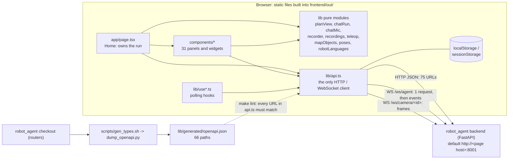

# robotapp documentation plan

Planned at: `4a810a3717ab0fe6bd16493025f070904193503a` (HEAD, commit message "20261119 -", 2026-11-19).

Uncommitted at plan time (3 files; none is quoted in this plan):

- `docs/CHANGELOG.md`
- `docs/features/vla-stack.md`
- `frontend/lib/skill_configs.json` (57 lines added, 121 removed vs HEAD)

The brief expected about 22 uncommitted files (generated `openapi.json`, `page.tsx`, several components). They are
committed in `4a810a3` itself (23 files changed in that commit, `git show 4a810a3 --stat`). Every line number in
this plan is from the committed text at `4a810a3` (`git show 4a810a3:<path>`). Writers: read the same way, and pin
code links to `4a810a3`:

```
https://github.com/mtbui2010/robotapp/blob/4a810a3/<path>#L<a>-L<b>
```

Not verified: that `4a810a3` is pushed to the public remote (no network here). Check before linking.

---

## 1. Audience and promise

**Who reads it**

| reader | comes for | stops reading at |
|---|---|---|
| Operator | what each panel does, how to start, stop and answer the robot | Home, Guides, Learn 1 |
| Robot integrator | point the dashboard at a `robot_agent` backend, what the backend must serve so a panel appears | Getting started, Learn 2-6, Reference |
| Frontend developer | where state lives, how a run flows, how to add a panel or an endpoint without breaking the rules | Key ideas, Modules, Reference, Tests |

**Promise (home page, one line):** robotapp is a browser dashboard for any `robot_agent` backend: you watch the
cameras and the map, give the robot a task in words or as a plan, see every step as it runs, and stop it at any time.

**What goes in and comes out (two sentences, verified):** The dashboard is a set of static files
(`frontend/next.config.js:4`, `output: 'export'`) that runs in the browser and talks to one backend URL per tab
(`frontend/lib/api.ts:118-126`). It sends HTTP requests and one WebSocket request per run, and turns the backend's
JSON answers, event stream and camera frames into panels; it holds no robot data of its own except two allowlisted
JSON files (`scripts/lint.mjs:23`).

**Scope.** This site documents this repo only. One overview page ("Where robotapp sits") links to the framework site
`https://mtbui2010.github.io/robot_agent/` (URL from the brief; not opened, no network) for `robot_agent`,
`kcare_robot`, `robot_template`. Backend behaviour is described only as far as the dashboard's code shows it (what it
sends, what it reads, what it does with an error); claims about what the backend does inside are left to that site.

**Size of the thing documented (counted at 4a810a3):** 65 TS/TSX files, 14,224 lines: `app/` 2 files 1,016 lines,
`components/` 31 files 9,503 lines, `lib/` 32 files 3,705 lines. Plus `scripts/` (lint 112, tests 780, gen_types 31,
dump_openapi 37 lines) and 8 recorded event fixtures.

---

## 2. System diagram (mermaid draft)



Numbers: 77 URL templates in `api.ts` (75 HTTP + 2 WebSocket), checked against 66 OpenAPI paths (`node scripts/lint.mjs`,
run, see section 10). Default URL: `api.ts:125`.

### One chat run, end to end (the "how it works" walkthrough)

1. The operator types in the chat card; `ChatPanel` calls `onSend` -> `sendChat` (`app/page.tsx:759-784`). Idle: it
   reads the log settings from `localStorage` (`page.tsx:775-780`) and calls `run(text, false, lang, planner, planOnly, ...)` (`page.tsx:782`).
2. `run` (`page.tsx:597-622`) asks for the microphone inside the click when the run may listen (`page.tsx:604-615`),
   stores the arguments in `argsRef`, sets the repeat counter, then calls `fire()`.
3. `fire` (`page.tsx:233-594`) opens `api.agentWs()` (`lib/api.ts:840-842`, `ws://<robot>/ws/agent`) and on open sends
   one JSON message `{prompt, lang, direct, planner, plan_only, log_data, log_mode, log_all}` (`page.tsx:331-335`).
4. Each message is parsed and stamped with `_rx` = receive time (`page.tsx:337-339`). `say` becomes a chat line and
   browser speech (`page.tsx:348-365`); `speak` / `listen` / `alarm` are queued in order (`page.tsx:385-482`);
   `step_start` / `step_done` / `step_log` update a `Step[]` list (`page.tsx:497-543`); `done` / `error` write the run
   summary and decide the next repeat (`page.tsx:544-573`). Then `emit(newEvents, newSteps)` (`page.tsx:575`, defined `125-130`).
5. `PlanPanel` gets `events` and `steps` as props (`page.tsx:877`). `PlanList` folds the events with
   `buildPlanView` (`components/PlanList.tsx:84`, `lib/planView.ts:201-203`) into the rows the operator sees.
6. A `listen` event is answered with `POST /agent/listen/<id>` (typed or browser speech, `api.ts:441-447`) or
   `POST /agent/listen/<id>/audio` (recorded audio, `api.ts:420-439`).
7. Stop: `stop` (`page.tsx:661-673`) sends `POST /agent/cancel` (`api.ts:452-454`); the run state goes to
   `stopping`; after 5 s without `done` it offers Force reset (`lib/chatRun.ts:13`, `page.tsx:674-678`), which drops the
   socket and everything queued (`page.tsx:636-657`).
8. The socket closes: `gone` (`page.tsx:580-593`) ends the run unless a repeat is about to start.

---

## 3. Key ideas (8, in reading order)

Each: one line, why it matters, evidence, background chapter, module page.

1. **The dashboard is static files; the robot is chosen in the browser, per tab.**
   Why: nothing to host but files, and one deployed copy serves any robot. Two tabs can drive two robots.
   Evidence: `frontend/next.config.js:4` (`output: 'export'`); `lib/api.ts:118-126` (active robot's URL, else
   `http://<page host>:8001`); `api.ts:55-67` (each tab keeps its choice in `sessionStorage`, the comment at
   `api.ts:13-16` records the 2026-10-27 bug where one tab sent another tab's calls).
   Learn: L1, L7. Module: `api-client`, `robots-connections`, `build-deploy`.

2. **One client module, checked against the backend's OpenAPI.**
   Why: the dashboard must work with every `robot_agent` backend; a call the backend does not serve fails `make lint`, not the operator.
   Evidence: `scripts/lint.mjs:39-62` (every `${getAgentUrl()}/...` in `api.ts` must match a path in
   `lib/generated/openapi.json`), `lint.mjs:64-74` (no `fetch` / `new WebSocket` outside `api.ts` unless the URL comes
   from an `api.` helper). Honest limit: TypeScript types are **not** generated yet: there is no `openapi.d.ts`
   (`ls frontend/lib/generated/` shows only `openapi.json`), `openapi-typescript` is not installed
   (`scripts/gen_types.sh:25-31`), and `api.ts:1` imports hand-written types from `lib/types.ts`.
   Learn: L2. Module: `api-client`, `generated-contract`, `lint`.

3. **The robot declares, the dashboard draws.**
   Why: a robot without a recorder, teleop, a map or a language list gets no empty panels, and no robot name is built in.
   Evidence: Data tab only when `GET /recorder` is not 404 (`api.ts:515-520`, `page.tsx:914`); teleop strip only
   when `GET /teleop` lists functions (`lib/useTeleop.ts:16-20`, `components/TeleopBar.tsx:28`); Map tab content only
   with a `MAP` config group (`components/MapPanel.tsx:173-182`); object actions only when declared
   (`lib/mapObjects.ts:19`); language picker from `GET /robot/languages` (`lib/robotLanguages.ts:1-11`). Exceptions
   are inventoried: two bundled JSON files (`lint.mjs:23`), hard-coded names (`docs/backend_coupling.md` section 5).
   Learn: L4. Modules: `map`, `teleop-poses`, `recorder`, `data-tab`, `chat`.

4. **A run is one WebSocket: one request out, a stream of events back.**
   Why: every panel that shows a run is a view over one array of events; nothing polls for progress.
   Evidence: `page.tsx:328-339`, `page.tsx:575`; event fields in `lib/types.ts:102-185` (`AgentEvent`, about 60 optional
   fields, no schema on the backend: `docs/backend_coupling.md`, "OpenAPI today").
   Learn: L3. Module: `page`, `plan-view`.

5. **The plan view is a pure replay of events, tested on recorded runs.**
   Why: the plan list survives replans, recoveries and two event shapes (SAGE `index/action/object`, legacy
   `step/task`) without React state bugs, and every change is checked against 8 real runs.
   Evidence: `lib/planView.ts:5-20` (model), `planView.ts:103-199` (`reducePlan`), `planView.ts:141-152` (match by
   order, legacy fallback); tests `scripts/test_lib.mjs:42-66` (invariants at every prefix of every fixture).
   Learn: L3. Module: `plan-view`, `tests`.

6. **Stop is explicit and always live.**
   Why: closing the socket does not stop the robot (the plan runs in a backend thread), so every Stop / Cancel button
   sends `POST /agent/cancel`, and the dashboard tracks "a run may still be alive" even after the socket drops.
   Evidence: `api.ts:449-454`; `lib/chatRun.ts:1-11, 30-55` (`idle / running / waiting / stopping`, `alive`, `stuck`);
   `page.tsx:661-678`; the tab-row Cancel is always enabled (`page.tsx:945-952`, `chatRun.ts:65-69`).
   Learn: L4. Module: `chat`, `page`.

7. **Reading never moves the robot; motion from one click asks first.**
   Why: every `POST /skill/<name>` starts a run on the backend, which clears a Stop in progress (CLAUDE.md rule 6); a
   pose poll that ran a skill would undo the operator's Stop.
   Evidence: `api.ts:813-819` (`agentGet`, `GET /agent/<name>/get`, "safe to poll"); `MapPanel.tsx:207-228` (pose poll);
   `lib/robotPose.ts:25-32`; `MapPanel.tsx:243-247` (`confirm_goal` asks before each motion; a running plan blocks map motion).
   Learn: L6. Module: `map`.

8. **The browser can be the robot's mouth and ears, one at a time.**
   Why: HRI skills with `source='dashboard'` speak and listen through the browser; the mic must never open while the
   robot is still talking, or it transcribes the robot.
   Evidence: one ordered queue `enqueueHri` (`page.tsx:221-229`) with an epoch that Reset bumps (`page.tsx:163-167`);
   echo guard and guard time (`lib/chatMic.ts:11-13, 40-48, 79-98`); voice activity detection before posting audio
   (`lib/hriVoice.ts:294-378`).
   Learn: L4. Module: `voice`, `chat`.

Suggested small diagram for the key-ideas page: 1 -> 2 -> 3 -> 4 -> 5, 4 -> 6, 4 -> 8, 3 -> 7.

---

## 4. Background chapters (`learn/`)

Seven chapters, from "what is it" to "run it for real". Each: what it must teach, one real value, a figure from
recorded data (or "diagram, not data"), and the "where in the code" box.

### L1. Where robotapp sits (UI mode of a robot_agent backend)

- Teach: the three ways to drive a robot built on `robot_agent` (UI = this repo; CLI and Python API live in each robot
  package, `docs/architecture.md`); the dashboard is not needed to operate the robot; one backend per robot; several
  robots in a registry; why two clients on one robot is unsafe (Cancel is process-wide, CLAUDE.md rule 7).
- Real value: default backend URL is `http://<page host>:8001` when no robot is registered (`api.ts:125`); the robot
  registry is `localStorage["robotapp_robots"] = [{name, url}]` (`api.ts:12, 21`).
- Figure: diagram, not data (the system diagram of section 2, simplified). Link to the framework site.
- Code box: `lib/api.ts:9-150`.

### L2. The contract: OpenAPI, the lint check, and hand-written types

- Teach: what an OpenAPI document is (one sentence, general knowledge); how this repo gets it without booting a
  robot (`scripts/dump_openapi.py:1-9, 17-33`: mounts the same routers on a bare FastAPI app); `make gen-types`
  (`Makefile:56-60`, `gen_types.sh:13-31`); what the lint checks with it (`lint.mjs:39-62`); why responses are still
  typed by hand (`lib/types.ts`, listed in `docs/backend_coupling.md` section 2); WebSocket routes are not in OpenAPI.
- Real values (counted from `lib/generated/openapi.json` at 4a810a3): 66 paths, 85 operations, 63 schemas, 47 of 85
  operations declare a typed 200 response; `api.ts` builds 77 URL templates. Paths in the OpenAPI that `api.ts` never
  calls: `/diagnostics`, `/diagnostics/boot`, and the 8 `/runs/...` operations.
- Figure (from data): bar chart, operations per router prefix, typed vs untyped. Data (computed at 4a810a3):

  | prefix | ops | typed | | prefix | ops | typed |
  |---|---|---|---|---|---|---|
  | /agent | 12 | 9 | | /recorder | 4 | 4 |
  | /buttons | 11 | 0 | | /recordings | 8 | 7 |
  | /config | 6 | 0 | | /robot | 2 | 2 |
  | /connects | 7 | 0 | | /ros | 1 | 0 |
  | /diagnostics | 2 | 0 | | /runs | 8 | 8 |
  | /map | 1 | 0 | | /skill | 1 | 0 |
  | /planner | 1 | 0 | | /skill-configs | 4 | 2 |
  | /poses | 7 | 7 | | /skills | 6 | 5 |
  | | | | | /teleop | 3 | 3 |
  | | | | | /tts | 1 | 0 |

  ("typed" = the 200 response schema is a `$ref` or an array of `$ref`; script in section 10.)
- Code box: `scripts/lint.mjs:39-62`, `scripts/dump_openapi.py:17-33`.

### L3. The agent event stream (`/ws/agent`)

- Teach: the request message (`page.tsx:331-335`); the event names the dashboard reacts to (`start`, `understand`,
  `clarify`, `plan`, `replan`, `recover`, `step_start`, `step_done`, `step_log`, `goal_check`, `world`, `done`,
  `error`, plus fields `say`, `speak`, `listen`, `alarm`, `choose`, `qa_state`, `dataset`, `log_image`); the two shapes
  of the same event (SAGE: `index`, `action`, `object`, `status`; legacy/direct: `step`, `total`, `task`,
  `result.isdone`, `success`; `planView.ts:72-74`, `page.tsx:505-514`); the client-only `_rx` and `stopped`.
- Real value: fixture `scripts/fixtures/events/mug_en_simple_success.json`, 16 events, first lines:
  `{"event": "start", "prompt": "Could you put the red mug on the dining table?"}`,
  `{"event": "step_start", "index": 0, "action": "MoveTo", "object": "counter@kitchen", "skill": "move", "say": "I will move to kitchen counter"}`.
- Figure (from data): event timeline per fixture (one row per event, coloured by event name) for
  `mug_en_simple_success` (16 events) and `apple_en_replan_fail`; plus the plan-view strip of the same run (run
  output in section 10).
- Code box: `lib/types.ts:102-185`, `lib/planView.ts:103-199`, `app/page.tsx:337-576`.

### L4. State and data flow in the page

- Teach: `Home` (`page.tsx:70`) owns the run: React state for what is drawn, refs for what callbacks read live
  (`page.tsx:90-96`, `voiceOutRef`, `eventsRef`, `stepsRef`); `emit` writes both (`page.tsx:125-130`); panels get props
  and callbacks; two parallel step models (the `Step[]` built in `page.tsx` for the Log, matched by `index`; the
  `planView` rows built from events for Plan progress, matched by order; tied by `seq`, `PlanPanel.tsx:599-610`);
  hooks poll the backend; window events tie distant parts (`robotapp:robot-changed` `api.ts:70`,
  `robotapp-planner` `lib/planner.ts:6`, `robotapp:record-audio-note` `lib/recordNote.ts:4`); `localStorage` vs
  `sessionStorage` (per-tab prefs, `lib/tabPref.ts:1-21`); the run state machine (`chatRun.ts`).
- Real values (polling periods, all from code): connection status every 10 s (`DevicePanel.tsx:481-486`), other
  machines every 30 s (`DevicePanel.tsx:263-269`), recorder every 1 s while present, 3 s after an error
  (`lib/useRecorder.ts:15-21`), teleop every 1.5 s while any function (`lib/useTeleop.ts:15-21`), map pose every
  `MAP.pose.period_s` (default 0.5 s, `MapPanel.tsx:226`), map objects every `MAP.objects.poll_s` (default 1 s, never
  below 0.2 s, `lib/mapObjects.ts:16`); Stop timeout 5,000 ms (`chatRun.ts:13`); "still working" nudge every 15 s
  (`page.tsx:354`).
- Figure: diagram, not data (who owns which state; props down, callbacks up, window events across). A table of the
  polling periods above, not a chart.
- Code box: `app/page.tsx:70-230`, `lib/chatRun.ts`, `lib/tabPref.ts`.

### L5. How camera and depth frames arrive

- Teach: one socket per viewed camera, `WS /ws/camera/<connection id>` (`api.ts:844-846`); the client sends
  `{depth_mode: 'colored' | 'raw'}` and optionally `{depth_range: [min, max]}` (`CameraFeed.tsx:309-318`); the server
  sends JSON with `rgb` and/or `depth` (base64 JPEG), or `depth_raw` + `depth_w` + `depth_h` (+ `depth_meta`), or
  `error` (`CameraFeed.tsx:319-366`, `CameraCell.tsx:50-81`); `depth_raw` is base64 of zlib-compressed little-endian
  uint16 millimetres (`lib/depthPng.ts:3-7`); the browser colours raw depth with a JET-like map
  (`CameraFeed.tsx:48-54, 391-423`) and shows the mm value under the cursor (`CameraFeed.tsx:161, 491`); a raw save is
  a real 16-bit grayscale PNG (`depthPng.ts:60-110`); grid cells reconnect after 1.5 s (`CameraCell.tsx:84-89`).
- Real value (run, section 10): 6 depth values `[0, 412, 815, 1203, 65535, 300]` mm -> `depth_raw` of 28 base64 chars
  `eJxjYJjDqM+8meX/fx1GABNSA7I=` -> `decodeRawDepth` gives the same 6 values -> `encode16BitGrayPng(…, 3, 2)` gives a
  79-byte PNG, IHDR width 3, height 2, bit depth 16, colour type 0.
- Figure (from data): the committed capture `test_data/20260806-095512_find_juice_bottle_cola_can_001_arm_depth.png`
  (848 x 480, 16-bit grayscale) coloured with the same `jet()` formula next to its `_rgb.png` (848 x 480, 8-bit RGB).
  The RGB image shows a drawer with a cola can and a juice bottle, no people (looked at it); owner to confirm it may be
  published (section 12).
- Correct the old site: `docs/src/content/docs/deep-dive/streaming.mdx` shows the frame as `{ mode, w, h, raw }` and
  the settings as `{ depth_mode, dmin, dmax }`; the dashboard code reads and sends the fields listed above. Write only
  what the code shows.
- Code box: `components/CameraFeed.tsx:295-423`, `components/CameraCell.tsx:33-100`, `lib/depthPng.ts`.

### L6. Map frames and robot poses

- Teach: the `MAP` config group read with `GET /skill-configs/MAP` (`MapPanel.tsx:173-182`, type `MapConfig`
  `lib/types.ts:241-267`); ROS `map.yaml` frame convention as used here: `origin` = world (x, y) of the image's
  bottom-left corner, `resolution` m/px, row 0 = top (`types.ts:194-196`, `MapPanel.tsx:55`); occupancy values
  free / inflated / occupied with defaults 128 / 255 (`MapPanel.tsx:75-76, 235-236`); height layer unit cm or mm
  (`MapPanel.tsx:238`); robot pose from a device agent's value by dot paths, yaw from a quaternion or a yaw field in
  deg or rad (`lib/robotPose.ts:8-23`); the user's origin frame (`MapPanel.tsx:30-38`); skill-call templates `{x}`
  `{y}` `{rz}` `{deg}` `{h}` (`MapPanel.tsx:42-52`).
- Real values (run, section 10): `poseFrom({pose:{position:{x:1.5,y:-0.25},orientation:{x:0,y:0,z:0.7071068,w:0.7071068}}}, {x:'pose.position.x', y:'pose.position.y', orientation:'pose.orientation'})`
  -> `{"x":1.5,"y":-0.25,"yaw":1.570796380007374}`; `poseFrom({x:2,y:3,th:90}, {x:'x',y:'y',yaw:'th',angle:'deg'})` -> yaw `1.5707963267948966`.
- Figure: diagram, not data (map image with origin, axes, pixel row/column; drawn from the convention, labelled as a diagram).
- Code box: `components/MapPanel.tsx:23-101`, `lib/robotPose.ts`.

### L7. Build, check and run it for real (static export, CI, secure context)

- Teach: `next build` with `output: 'export'`, `trailingSlash: true`, `images.unoptimized` (`next.config.js:1-11`)
  writes plain files to `frontend/out/`; any static host works; `make ci` = lint + typecheck + unit + smoke
  (`Makefile:54`) with no backend and no network; the backend URL is chosen at runtime, not at build time; browser
  features that need a secure context (https or localhost): the microphone (`lib/hriVoice.ts:310`,
  `page.tsx:609-611`), `navigator.clipboard` (with a fallback, `lib/clipboard.ts:1-28`); `getWsBase` derives `ws://` or
  `wss://` from the robot URL, not from the page (`api.ts:148-150`).
- Real values: an `out/` already present in the working tree (built 2026-11-19 04:55, not by this plan) has 19
  files, 1.2 MB, `out/index.html` 18,850 bytes, largest chunk `app/page-*.js` 418,216 bytes. Re-measure when writing.
- Figure: none needed; a table of `make` targets with what each needs (node_modules, robot_agent checkout, network, token).
- Code box: `Makefile:26-60`, `frontend/next.config.js`.
- Do not name the production domain, the account id or the deploy host (section 13).

---

## 5. Modules

Format of every entry: `sources:` (front matter of the page; repo-relative, single repo, so no prefix), purpose,
inputs, outputs and failure behaviour, backend endpoints (verified in `api.ts` and in the component's calls),
used by / uses, real example values, excerpt (verbatim, file and lines at 4a810a3), failure modes the project hit,
tests. "Read in full before writing" lists files this plan read only in part.

Endpoint column convention: method + path as built in `lib/api.ts` (the line is the URL's line).

### 5.1 `modules/page.md`: The page (run controller)

- sources: `frontend/app/page.tsx`, `frontend/app/layout.tsx`, `frontend/app/globals.css`, `frontend/lib/api.ts`,
  `frontend/lib/chatRun.ts`, `frontend/lib/chatMic.ts`, `frontend/lib/hriVoice.ts`, `frontend/lib/useVoiceOutput.ts`,
  `frontend/lib/datasetLog.ts`, `frontend/lib/useScreenRecorder.ts`, `frontend/lib/types.ts`
- Purpose: the only route (`app/page.tsx`, `'use client'`); lays out the three columns (sidebar: devices, skills,
  configs, planner prompt `page.tsx:818-840`; second column: Cancel, language, Chat, shortcut buttons, plan
  `page.tsx:842-886`; main: Agent panel, Cameras / Map / Data tabs `page.tsx:888-959`); owns the run: opens the agent
  socket, routes every event, runs the HRI queue, repeats, stop and reset.
- Inputs: none (root page). Reads `localStorage` keys `robotapp_data_tools`, `robotapp_log_data`,
  `robotapp_log_target`, `robotapp_log_all` and per-tab prefs `robotapp_planner`, `robotapp_plan_only`,
  `robotapp_lang` (`page.tsx:78, 711-723, 776-779`).
- Outputs: props to every panel; WebSocket request (table):

  | field | type | meaning | where set |
  |---|---|---|---|
  | `prompt` | string | the task text or the plan lines | `run()` arg 1 |
  | `lang` | string | language code or `auto` | picker |
  | `direct` | boolean | true = run the lines as given (Structured, buttons) | `page.tsx:873`, `AgentPanel.tsx:214` |
  | `planner` | `'grace' \| 'direct' \| 'sage'` | chat planner; default `sage` (`lib/planner.ts:7`) | chat header |
  | `plan_only` | boolean | plan, do not move; default on (`planner.ts:10-14`) | chat header |
  | `log_data`, `log_mode`, `log_all` | boolean, `'backend' \| 'frontend'`, boolean | vision capture logging | Agent panel |

  Files written by the browser for `log_mode: 'frontend'`: `<YYYYMMDD-HHMMSS>_<first task>/NNN_<tag>_<succeed|failed>_{rgb,detect,depth}.png`,
  `..._results.json`, `run_<outcome>.json` (`lib/datasetLog.ts:19-26, 58-87`, `page.tsx:286-326`).
- Endpoints: `WS /ws/agent` (`api.ts:841`), `POST /agent/cancel` (`api.ts:453`), `POST /agent/qa/end` (`api.ts:460`),
  `POST /agent/listen/{id}` (`api.ts:442`), `POST /agent/listen/{id}/audio` (`api.ts:424`),
  `GET /skill-configs/HRI_CONFIGS` for `speech_rate`, `speech_rate_en` (`page.tsx:115-118`).
- Used by: Next.js App Router. Uses: every component, `lib/*`.
- Real example: the run state after `start > stop > timeout` is
  `{"phase":"stopping","alive":true,"ws":true,"stuck":true}` and every stop button reads "Force reset" (run, section 10).
- Excerpt 1: `frontend/app/page.tsx:328-339` (open the socket, send the one request, stamp `_rx`).
  Excerpt 2: `frontend/app/page.tsx:661-673` (Stop: cancel, stopping, Force reset).
- Failure modes hit (from code comments): a milestone line after `ask` was dropped while the HRI queue talked, now
  queued (`page.tsx:356-365`); a muted window's `speechSynthesis.cancel()` silenced another window, 2026-10-27
  (`page.tsx:276-284`); a click while the robot was still asking was acted on late, 2026-10-27 (`page.tsx:200-203`);
  before 2026-11-12 an active repeat kept `running` true forever after a dropped socket (`page.tsx:583-585`); a log-all
  run with a failed step reported success (`page.tsx:484-494`). `isFailureEvent` mirrors a backend rule
  (`page.tsx:50-65`), not listed in `docs/backend_coupling.md` section 4. Workaround tag `hri-narrator-gate` at `page.tsx:347`.
- Tests: no unit test of `page.tsx` itself; its pure parts are tested (`chatRun`, `chatMic`, `planView`). `make smoke`
  checks the page builds (`Makefile:50-52`, not run here).
- Read in full before writing: `page.tsx` was read in full.

### 5.2 `modules/api-client.md`: The API client (`lib/api.ts`)

- sources: `frontend/lib/api.ts`, `frontend/lib/types.ts`, `frontend/lib/robotLanguages.ts`, `frontend/lib/buttonGroups.ts`,
  `frontend/lib/recorder.ts`, `frontend/lib/poses.ts`, `frontend/lib/recordings.ts`, `frontend/lib/teleop.ts`,
  `frontend/lib/generated/openapi.json`, `scripts/lint.mjs`
- Purpose: the only module that builds backend URLs and calls `fetch` / `new WebSocket`; also the robot registry
  (`api.ts:9-146`).
- Inputs: function arguments; the active robot's URL from storage. Storage keys: `robotapp_robots` (localStorage,
  JSON `[{name,url}]`), `robotapp_active_robot` (sessionStorage per tab, localStorage as the default for new tabs),
  legacy `agent_url` migrated on first read (`api.ts:21-44`).
- Outputs: typed promises. Error conventions (a table on the page, one row per pattern):

  | pattern | functions (examples) | on non-2xx | on network error |
  |---|---|---|---|
  | empty value | `listClients`, `listSkills`, `listButtons`, `getStatus`, `getApiKeys` | `[]` or `{}` | throws (fetch rejects), except where wrapped in `try` (`getServers`, `getSkillsStatus`, `getSkillConfig` -> `null`, `listLocations`) |
  | throw `detail` | `getWorld`, `setWorld`, `updateSkillConfig`, `addButton`, location calls, `jsonCall` (`api.ts:172-180`) | `Error(detail or "HTTP <status>")` | throws |
  | 404 = feature absent | `getRecorder`, `listRecordings` | `null` on 404, else throws | throws |
  | never throws | `answerListenAudio` (`api.ts:420-439`) | `{text:'', error}`; 404 -> `{gone:true}` | `{text:'', error:'cannot reach the robot (...)'}` |
  | fallback | `mergeSkillConfig` (`api.ts:332-349`) | 405 -> plain `PUT` of the whole group | throws |
  | error object | `addClient`, `updateClient` (`api.ts:222-262`) | `{id, error}` joining FastAPI validation `msg`s | throws |

- Endpoints: the full table goes to `reference/endpoints.md` (section 6). 77 URL templates, 75 HTTP and 2 WebSocket.
- Used by: `app/page.tsx`, 17 components, hooks `useRecorder`, `useTeleop`, `usePoses`, `useRobotLanguages`, `lib/robotPose.ts`, `lib/recordVoice.ts`.
- Real example (run in the unit tests): `answerListenAudio` with a 500 `{detail:'CUDA out of memory'}` returns an error
  matching `/HTTP 500: CUDA out of memory/`; 404 returns `gone: true`; 200 `{ok:true,text:'hello'}` returns
  `{text:'hello'}` (`scripts/test_lib.mjs:389-410`, passed).
- Excerpt 1: `frontend/lib/api.ts:116-126` (`getAgentUrl`). Excerpt 2: `frontend/lib/api.ts:332-349` (merge with 405 fallback).
- Failure modes hit: two tabs sent each other's calls (2026-10-27), fixed by per-tab `sessionStorage` (`api.ts:13-16`);
  a speech-server 500 was swallowed, now reported (`api.ts:415-419`, test above).
- Tests: `test_lib.mjs:389-410`; `make lint` (all URLs exist).
- Read in full before writing: read in full.

### 5.3 `modules/generated-contract.md`: OpenAPI dump and hand-written types

- sources: `frontend/lib/generated/openapi.json`, `frontend/lib/types.ts`, `scripts/gen_types.sh`, `scripts/dump_openapi.py`,
  `Makefile`, `docs/backend_coupling.md`
- Purpose: keep a copy of `robot_agent`'s OpenAPI in the repo, made offline; hold the backend types the OpenAPI does not give yet.
- Inputs: `ROBOT_AGENT_DIR` (default `../robot_agent`), `PYTHON` (default `python3`) (`gen_types.sh:12-16`); needs
  Python with `fastapi` and the `robot_agent` package importable.
- Outputs: `frontend/lib/generated/openapi.json` (sorted keys, indent 1, `dump_openapi.py:30-33`), printed
  `<out>: N paths, M schemas`; `openapi.d.ts` only when `openapi-typescript` is installed (it is not). Router list
  mounted: 16 routers (`dump_openapi.py:17-18`). Failure: exit 1 with "robot_agent not found at ..." (`gen_types.sh:20-22`);
  FastAPI warnings (for example duplicate operation ids) printed to stderr (`dump_openapi.py:25-29`).
- Real values: 66 paths, 63 schemas at 4a810a3 (counted from the committed JSON). `lib/types.ts` holds `ClientEntry`,
  `SkillDef`, `WorldState` (+ `provenance`), `AgentEvent`, `MapConfig`, `SimState`, `LocationsInfo` and more
  (`types.ts:1-292`).
- Excerpt: `scripts/dump_openapi.py:17-33`.
- Findings for the page: `docs/backend_coupling.md` "OpenAPI today" still says 38 paths, 21 schemas, no route declares
  a `response_model`; at 4a810a3 there are 66 paths, 63 schemas and 47 of 85 operations with a typed response
  (`/poses`, `/recorder`, `/recordings`, `/robot`, `/runs`, `/teleop`, most of `/agent` and `/skills`). The site should
  give today's numbers and say the types are still hand-written.
- Tests: none for the dump itself (not run: needs the backend checkout and Python deps). `make lint` uses its output.

### 5.4 `modules/chat.md`: Chat card, run state and language

- sources: `frontend/components/ChatPanel.tsx`, `frontend/components/LanguagePicker.tsx`, `frontend/components/PopoverButton.tsx`,
  `frontend/lib/chatRun.ts`, `frontend/lib/chatMic.ts`, `frontend/lib/robotLanguages.ts`, `frontend/lib/useRobotLanguages.ts`,
  `frontend/lib/planner.ts`, `frontend/lib/tabPref.ts`, `frontend/app/page.tsx`, `frontend/lib/api.ts`
- Purpose: the one chat card: idle -> a message starts a new unstructured run; waiting -> a message is the answer to
  the robot's question; running / stopping -> input disabled (`ChatPanel.tsx:6-12`). Planner select, plan-only,
  hands-free mic toggle, Stop, Reset, the language picker.
- Inputs (props, `ChatPanel.tsx:21-47`): `log: ChatLine[]` (`{who: 'robot'|'user'|'system', text, kind?: 'say'}`),
  `state`, `langPicker`, `planner`, `onPlanner`, `planOnly`, `onPlanOnly`, `handsFree`, `onHandsFree`,
  `micSupported`, `micListening`, `micNote`, `onSend`, `onStop`, `onReset`, `canStop`, `canType`, `lost`, `stuck`,
  `onClear`, `onClose`. LanguagePicker: `value, options, supported, on, detected, disabled, onPick, onToggle, buttonClass` (`LanguagePicker.tsx:7`).
- Outputs: callbacks only; the page sends. Language switch: `PUT /robot/languages {languages}` (`api.ts:622-626`).
- Endpoints: `GET /robot/languages` (`api.ts:494-498`), `PUT /robot/languages`; through the page: `WS /ws/agent`, `POST /agent/listen/{id}`, `POST /agent/cancel`.
- Real examples (run): run state table from section 10 (6 sequences); `resolveLanguage(null, ko-robot)` -> `'auto'`,
  `languageOptions(ko-robot,'en')` -> `['auto','ko','en']` (`test_lib.mjs:461-483`, passed).
- Excerpt: `frontend/lib/chatRun.ts:32-54` (the reducer).
- Failure modes hit: a Korean session turned English by itself because the language was shared across tabs
  (`tabPref.ts:3-6`); Stop that never got `done` left the card stuck, hence `stuck` + Force reset after
  `STOP_TIMEOUT_MS` = 5000 (`chatRun.ts:8-13`); a socket dropped mid-run keeps Stop available (`isLost`, `chatRun.ts:57-60`).
- Safety text present here: "One client per robot: a second client driving it is unsafe, and Cancel stops both" (`ChatPanel.tsx:16-19, 151`).
- Tests: `test_lib.mjs:260-338` (chatRun), `412-500` (tabPref, robotLanguages).
- Read in full before writing: `ChatPanel.tsx` (read 1-50 + grep), `LanguagePicker.tsx` (header only).

### 5.5 `modules/voice.md`: Robot voice and microphone in the browser

- sources: `frontend/lib/hriVoice.ts`, `frontend/lib/useVoiceOutput.ts`, `frontend/lib/useHandsFree.ts`, `frontend/lib/chatMic.ts`,
  `frontend/lib/speechGlobals.d.ts`, `frontend/lib/recordVoice.ts`, `frontend/app/page.tsx`, `frontend/lib/api.ts`
- Purpose: speak the robot's lines (milestone `say` through `useVoiceOutput`; skill `speak` through `speakAndWait`,
  which always plays to the end, `hriVoice.ts:4-11`); capture one answer (browser recogniser `recognizeOnce`, or
  record audio for the backend's Whisper `recordPhrase`); earcons and a siren (`hriVoice.ts:19-29, 65-68`); hands-free
  command capture only when idle and silent (`useHandsFree.ts:6-9`).
- Inputs: `listen` event fields `{id, lang, max_sec, prompt, mode: 'voice'|'text', capture: 'whisper'|'browser', silence_sec, earcon, rate}` (`types.ts:150-155`); defaults `max_sec` 8, `silence_sec` 1.5 (`page.tsx:446`, `hriVoice.ts:307`).
- Outputs: `POST /agent/listen/{id}` `{text, error, note}` (`api.ts:441-447`) or `POST /agent/listen/{id}/audio`
  with the recorded blob (`audio/webm;codecs=opus` first choice, `hriVoice.ts:323-324`); `null` blob when nobody
  spoke, so silence is never sent (`hriVoice.ts:297-301, 373-376`).
- Constants: `GUARD_MS` 1000, `ECHO_WINDOW_MS` 10,000, `ECHO_SIMILARITY` 0.6 (`chatMic.ts:11-13`); VAD noise floor
  over the first 0.3 s, threshold `max(0.015, 3 x floor)` (`hriVoice.ts:351-353`); robot speech assumed to last
  `400 + 90 x characters` ms (`page.tsx:181`).
- Real examples (run): echo guard after the robot said "I will move to kitchen counter": transcript "i will move to
  kitchen counter" -> echo `true`, "put the cup on the table" -> `false`; `similarity('Where is the apple?', 'where is
  the app')` = 0.923; `micVerdict` 400 ms after speech -> `{"listen":false,"reason":"guard","retryMs":600}`.
- Excerpt 1: `frontend/lib/chatMic.ts:79-98` (echo guard). Excerpt 2: `frontend/app/page.tsx:221-229` (`enqueueHri`).
  Optional: `frontend/lib/hriVoice.ts:342-364` (VAD loop).
- Failure modes hit: Whisper invents words for silence (`hriVoice.ts:300-301`); mic needs a user gesture, so it is
  primed inside the click (`hriVoice.ts:261-271`, `page.tsx:601-615`); plain http blocks the mic (`hriVoice.ts:310`);
  a speech-server 500 now keeps the question open for a typed answer (`page.tsx:460-466`).
- Tests: `test_lib.mjs:158-207, 250-258` (chatMic). `hriVoice.ts`, `useVoiceOutput.ts`, `useHandsFree.ts` have no unit tests (browser APIs).
- Read in full before writing: `hriVoice.ts` (read 294-378 + greps), `useVoiceOutput.ts`, `useHandsFree.ts` (greps only).

### 5.6 `modules/structured-runs.md`: Structured plans and shortcut buttons

- sources: `frontend/components/AgentPanel.tsx`, `frontend/components/ButtonPanel.tsx`, `frontend/components/ExpandEditor.tsx`,
  `frontend/components/RecordAudioToggles.tsx`, `frontend/components/PopoverButton.tsx`, `frontend/lib/buttonGroups.ts`,
  `frontend/lib/api.ts`, `frontend/app/page.tsx`
- Purpose: Agent panel = 4 plan cells (one `skill::params` per line), presets in `localStorage`, repeat once / N /
  forever, continue on error, log options, screen-record toggle, Run / Stop (`AgentPanel.tsx:150-214`). Shortcut
  buttons = server-side buttons in groups, drag to reorder, run as a direct plan with no data log, no voice, no screen
  recording (`page.tsx:872-874`).
- Inputs: AgentPanel props `toolbarExtra, running, lang, onRun, onStop, stopText, recordEnabled, onToggleRecord,
  manualRecording, onToggleManualRecord, backendLogDir, trial, onOpenGuide` (`AgentPanel.tsx:150-164`). ButtonPanel
  props `onRun(plan)`, `refreshKey` (`ButtonPanel.tsx:20-24`). Storage: `robotapp_cells`, `robotapp_presets_structured`,
  `robotapp_repeat_mode|_n|_continue_on_error`, `robotapp_log_data|_target|_all` (`AgentPanel.tsx:9-16`),
  `robotapp_button_group` and legacy `robotapp_buttons` / `robotapp_buttons_migrated` (`ButtonPanel.tsx:8-17`).
- Outputs: `onRun(cells[activeCell], true, lang, undefined, undefined, logData, logTarget, repeatTimes, repeatCOE, logAll)` (`AgentPanel.tsx:214`).
- Endpoints (ButtonPanel): `GET/POST /buttons`, `PUT/DELETE /buttons/{id}`, `POST /buttons/reorder`, `POST /buttons/bulk`,
  `GET/POST /buttons/groups`, `PUT/DELETE /buttons/groups/{id}`, `POST /buttons/groups/reorder` (`api.ts:641-732`).
- Real examples (run in tests): `groupTabs` of 2 groups and 5 buttons -> `[['head','Head',2],['arm','Arm',1],['','Other',2]]` (`test_lib.mjs:581-586`).
- Excerpt 1: `frontend/components/AgentPanel.tsx:206-214`. Excerpt 2: `frontend/components/ButtonPanel.tsx:61-84` (one-time migration of browser buttons to the server).
- Failure modes hit: React Strict Mode imported legacy buttons twice, hence a module-level in-flight flag
  (`ButtonPanel.tsx:13-17`); a preset loaded into a small cell hid six steps that then ran, hence the "N steps" badge
  (`AgentPanel.tsx:231-244`); ExpandEditor lost edits when the modal closed by itself (`ExpandEditor.tsx:22-24`).
- Tests: `test_lib.mjs:576-610` (buttonGroups). No test for the components.
- Read in full before writing: `AgentPanel.tsx` (read 1-260), `ButtonPanel.tsx` (read 1-110), `ExpandEditor.tsx`, `RecordAudioToggles.tsx` (headers).

### 5.7 `modules/plan-view.md`: Plan, log and robot state

- sources: `frontend/components/PlanPanel.tsx`, `frontend/components/PlanList.tsx`, `frontend/lib/planView.ts`, `frontend/lib/types.ts`,
  `frontend/lib/clipboard.ts`, `frontend/lib/api.ts`, `scripts/test_lib.mjs`, `scripts/fixtures/events/`
- Purpose: show the run: Robot State block (persistent world state, editable), planner trace (GRACE), Plan progress
  list (from `planView`), Log of one step (data, images), done badge.
- Inputs: PlanPanel props `events: AgentEvent[]`, `steps: Step[]`, `planMethod: string`, `running: boolean`
  (`page.tsx:877`; `Step` at `PlanPanel.tsx:14-23`). PlanList props `events, running, onPick?(seq)` (`PlanList.tsx:81`).
- Outputs: `PUT /agent/world` with only the changed fields (`PlanPanel.tsx:194-223`). `PlanView` =
  `{rows, goals, understood?, goalChecks, final}`; a row is a step (`pending|running|done|failed|skipped`, `spliced?`,
  `retry?`, `reason?`, `seq?`, `startedAt?`, `endedAt?`) or a note (`replan|recover|ask|plan`) (`planView.ts:23-61`).
- Endpoints: `GET /agent/world` (`api.ts:403-410`), `PUT /agent/world` (`api.ts:468-479`), `GET /agent/llm-config`
  (`api.ts:379-385`, refetched at each run start `PlanPanel.tsx:579-584`).
- Real example (run, section 10): `apple_en_replan_fail` -> `ask`, 2 settled steps, a `replan` note, then 6 recovery
  notes with spliced `MoveTo` rows and retried `Find apple` rows, 3 `skipped`, final
  `{"ok":false,"status":"failed","msg":"could not find the apple (looked at counter@kitchen, ...)"}`.
- Excerpt: `frontend/lib/planView.ts:141-152` (match by order; legacy text plans), with the runnable replay of a fixture
  and its real output (script in section 10).
- Failure modes hit: a GRACE plan never showed and "Generating…" stayed (two `plan` shapes,
  `PlanPanel.tsx:552-568`, tag `plan-event-shape`); two `done` shapes (`PlanPanel.tsx:612-618`, tag
  `done-event-shape`); the model / URL beside "Generating task plan" disappeared after a one-time fetch
  (`PlanPanel.tsx:574-584`); SAGE reuses a step index after a splice, so rows are matched by order (`planView.ts:7-9`, `PlanPanel.tsx:609`).
- Tests: `test_lib.mjs:42-156, 209-248` (planView on 8 fixtures and synthetic legacy events).
- Read in full before writing: `PlanPanel.tsx` (read 1-40, 151-224, 515-640 + greps), `PlanList.tsx` (read 81-127 + header).

### 5.8 `modules/cameras.md`: Cameras and depth

- sources: `frontend/components/CameraFeed.tsx`, `frontend/components/CameraCell.tsx`, `frontend/components/PopoverButton.tsx`,
  `frontend/lib/depthPng.ts`, `frontend/lib/captureName.ts`, `frontend/lib/api.ts`, `frontend/lib/types.ts`, `frontend/app/page.tsx`
- Purpose: show every connection with `is_camera: true` (`CameraFeed.tsx:60`) as tabs or a grid, plus a `log_image`
  tab (images a skill sent in `step_log`) and a local webcam "observe" tab; depth colouring and mm hover; capture,
  raw-depth save, "Save both" with one timestamp.
- Inputs: `clients: ClientEntry[]`, `logImage?: string | null` (base64 JPEG), `onClearLog?`, `toolbarSlot?: HTMLElement`
  (`CameraFeed.tsx:56-59`); CameraCell `client: ClientEntry` (`CameraCell.tsx:17`). Storage: `cameraTabOrder`,
  `robotapp_webcam_device` (`CameraFeed.tsx:17-18`).
- Outputs: browser downloads named `<camera>_<YYYYMMDD-HHMMSS>_<rgb|depth|depth_raw>.<ext>` (`captureName.ts:1-22`); real:
  `captureName('head_rgb','depth_raw','png','20261119-101530')` -> `head_20261119-101530_depth_raw.png` (run).
- Endpoints: `WS /ws/camera/{clientId}` (`api.ts:844-846`). Messages: section L5.
- Excerpt 1: `frontend/components/CameraCell.tsx:74-89`. Excerpt 2: `frontend/lib/depthPng.ts:10-19` with the runnable
  round trip and its real output (section 10).
- Failure modes hit: a grid cell froze on its last frame after a drop, hence the 1.5 s reconnect (`CameraCell.tsx:84-89`);
  a depth-only stream stayed blank in an RGB-default cell, hence the auto flip (`CameraCell.tsx:78-80`,
  `CameraFeed.tsx:331-335`). From `docs/features/camera-streaming.md` (a backend fix, describe only as context, link the
  framework site): two dashboards used to restart each other's camera streams. Observation to verify while writing:
  in tab mode the socket's `onclose` clears the picture with no reconnect (`CameraFeed.tsx:375-378`; only lines
  295-423 were read). `CameraFeed.decompressDepth` (`CameraFeed.tsx:40-46`) duplicates `depthPng.decodeRawDepth`.
- Tests: none for these components or `depthPng.ts` / `captureName.ts` in `test_lib.mjs`.
- Read in full before writing: `CameraFeed.tsx` (1,142 lines; read 1-60, 160-200, 295-430 + greps), `CameraCell.tsx` (read 1-120).

### 5.9 `modules/map.md`: Map tab, objects and simulation

- sources: `frontend/components/MapPanel.tsx`, `frontend/components/MapSettings.tsx`, `frontend/components/mapObjects.tsx`,
  `frontend/components/mapSim.tsx`, `frontend/components/ConfigFields.tsx`, `frontend/lib/mapObjects.ts`, `frontend/lib/robotPose.ts`,
  `frontend/lib/types.ts`, `frontend/lib/api.ts`
- Purpose: the active site's map with the robot on it; click a free spot to send the `goal` skill, arrow keys to
  `rotate`, click a place dot for `move::<name>`, auto lift to the nearest surface, save the pose as a new ENV place,
  edit the user origin, keep area, update the map from a SLAM connection (`MapPanel.tsx:10-21`); objects layer and the
  simulation bar when the config declares them.
- Inputs: props `clients: ClientEntry[]`, `running: boolean` (`MapPanel.tsx:139`). Config `MapConfig` keys (table on
  the page from `types.ts:241-267`): `image`, `source`, `layers.occupancy`, `layers.height`, `surfaces`, `places`,
  `pose`, `goal`, `rotate` (`step_deg`, default 15, `MapPanel.tsx:329`), `lift` (`clearance` default 0.1 m, `reach_m`
  default 0.8 m, `MapPanel.tsx:254, 259`), `confirm_goal`, `origin`, `sim`, `objects`.
- Outputs: skill calls through `POST /skill/{name}` with filled templates (`fill`, `MapPanel.tsx:42-52`); status line text.
- Endpoints: `GET /skill-configs/MAP`, `GET /skill-configs/ENV`, `PUT /skill-configs/ENV` (save place,
  `MapPanel.tsx:342-346`), `PATCH /skill-configs/MAP` (MapSettings via `mergeSkillConfig`), `GET /agent/{name}/get`
  (pose, objects), `POST /agent/{name}/send` (objects, sim), `POST /skill/{name}`, `POST /map/snapshot` (snapshot and
  preview, `api.ts:163-170, 824-834`), `GET /config/locations/_active/files/<path>` (layers, `api.ts:836-838`, fetched
  at `MapPanel.tsx:67`), `WS /ws/camera/{id}` (picture), `POST /agent/cancel`, `PUT /agent/world` (mapSim).
- Real examples (run): `fillCall({skill:'mv', params:{id:'{id}',x:'{x}',y:'{y}',where:'at {place}'}}, {id:'o1',x:1.23456,y:2,place:'desk'})`
  -> `{"id":"o1","x":1.235,"y":2,"where":"at desk"}`; `pollMs({poll_s:0.1})` -> 200; `parseObjects` drops an entry with no x/y; `poseFrom` values in L6.
- Excerpt 1: `frontend/components/MapPanel.tsx:265-287` (`goTo`, with the `map-arrive-check` workaround at 279).
  Excerpt 2: `frontend/lib/robotPose.ts:16-23`.
- Failure modes hit: kcare reports `moveb` done when navigation gave up, so the panel reads the pose back and reports
  "stopped N m short" beyond 0.3 m (`MapPanel.tsx:276-281`, tag `map-arrive-check`); a poll that ran a skill would undo
  Stop, hence `agentGet` (rule 6). "Save as place" writes the whole ENV group with PUT (`MapPanel.tsx:342-346`), while
  the config panel uses a merged PATCH: the read-modify-write can drop another machine's edit
  (`docs/backend_coupling.md`, "OpenAPI today"). Hard-coded skill name `move` for a place click (`MapPanel.tsx:293`).
- Safety: no "two clients" warning in `MapPanel.tsx` (grep at 4a810a3); `confirm_goal` is the guard.
- Tests: `test_lib.mjs:341-387` (mapObjects). No test for `MapPanel.tsx`, `mapSim.tsx`, `robotPose.ts`.
- Read in full before writing: `MapPanel.tsx` (699 lines; read 1-370), `mapSim.tsx` (370, header only), `mapObjects.tsx`, `MapSettings.tsx` (headers + greps).

### 5.10 `modules/teleop-poses.md`: Remote control strip and Go-to poses

- sources: `frontend/components/TeleopBar.tsx`, `frontend/components/PoseEditor.tsx`, `frontend/lib/teleop.ts`, `frontend/lib/useTeleop.ts`,
  `frontend/lib/poses.ts`, `frontend/lib/usePoses.ts`, `frontend/lib/api.ts`, `frontend/app/page.tsx`
- Purpose: one row per teleop function the robot offers (state, input device, gripper, mode chips, battery, speed,
  On / Off); the operator's "Go to" poses (label + plan, one speed for all). Shown only on the Cameras tab when "make
  data" is toggled on or something is recording / driving (`page.tsx:76-79, 693-694, 954`).
- Inputs: TeleopBar props `functions: TeleopFunction[]`, `runInFlight`, `onChanged`, `poses: PoseList | null`,
  `onPosesChanged` (`TeleopBar.tsx:15`); PoseEditor `list, onChanged, onClose` (`PoseEditor.tsx:11`). Types
  `TeleopState` / `TeleopFunction` (`teleop.ts:4-27`), `Pose`, `PoseList {speed, poses, defaults_missing}` (`poses.ts:3-4`).
- Outputs / endpoints: `GET /teleop`, `POST /teleop/{name}/enable {on, confirm}`, `POST /teleop/{name}/speed {scale}`
  (`api.ts:499-513`); `GET/POST /poses`, `PUT/DELETE /poses/{id}`, `PUT /poses/speed {speed}`, `POST /poses/defaults`,
  `POST /poses/{id}/run` (`api.ts:537-573`). On is sent with `confirm=true` (`TeleopBar.tsx:13-14`).
- Constants: speed levels 0.25 / 0.5 / 1 (`teleop.ts:35`); pose speeds 0.1 ... 1 (9 values, `poses.ts:7`); input
  device "ok" when it sent something in the last 2 s (`teleop.ts:55-60`); battery "low" at 20 % or less, not charging (`teleop.ts:85-94`).
- Real examples (tests, passed): `stateLabel` of an inactive ready function -> `{text:'off', tone:'off'}`;
  `driveLabel` -> `'▶ On'`; `planSteps('movej::fold\n\n# note\nlift::0.5&&movej::give  # two')` -> `["movej::fold","lift::0.5&&movej::give"]` (run).
- Excerpt: `frontend/components/TeleopBar.tsx:19-27` and `frontend/lib/teleop.ts:39-47`.
- Failure modes: a failed pose move leaves teleop off (`TeleopBar.tsx:23`); a stale state is never shown as "on" (`teleop.ts:49`).
- Tests: `test_lib.mjs:503-574` (teleop), `704-718` (poses).
- Read in full before writing: `TeleopBar.tsx` (read 1-50), `PoseEditor.tsx` (header).

### 5.11 `modules/recorder.md`: Record raw VLA episodes

- sources: `frontend/components/RecorderBar.tsx`, `frontend/lib/recorder.ts`, `frontend/lib/useRecorder.ts`, `frontend/lib/poses.ts`,
  `frontend/lib/api.ts`, `frontend/app/page.tsx`
- Purpose: two rows of prompt fields (for example open / close a drawer), a sentence generated from the robot's
  templates, Record = remote control + recording together, Stop as success / failure / discard; optional "Go to" pose
  before (default) or inside the recording (`RecorderBar.tsx:10-14, 33-53`).
- Inputs: props `status: RecorderStatus | null`, `runInFlight`, `onChanged`, `poses?` (`RecorderBar.tsx:13`); fields
  from `GET /recorder` `fields: string[]` (`recorder.ts:15-22`). Storage: `robotapp_rec_rows` (legacy `robotapp_rec_fields`).
- Outputs / endpoints: `GET /recorder` (404 = no recorder, `api.ts:515-520`), `POST /recorder/prompt {fields, avoid}`
  -> `{prompt}`, `POST /recorder/start {prompt, meta}`, `POST /recorder/stop {label}` (`api.ts:521-536`),
  `POST /poses/{id}/run`, `POST /teleop/{name}/enable`.
- Real examples (tests): `clock(83.4)` -> `'1:23'`; `countsText({state:400, action_ref:200, head:284, wrist:169})` ->
  `'head 284 · wrist 169'`; `lastText` -> `'saved ep_0003 (success, 0:24)'`; `recordBlock` reasons ("the recorder is
  not running on the robot (make run)", "a run is in flight: cancel it first", ...) (`recorder.ts:42-50`).
- Excerpt: `frontend/components/RecorderBar.tsx:33-53` (prompt first, then the move, then start).
- Failure modes: a wording error must not cost a move, so the prompt is made first (`RecorderBar.tsx:36`); a failed
  move before recording records nothing (`RecorderBar.tsx:40`); a failed move inside a recording says how to end it (`RecorderBar.tsx:50`).
- Tests: `test_lib.mjs:629-657, 732-737, 750-780`.
- Read in full before writing: `RecorderBar.tsx` (read 1-75).

### 5.12 `modules/data-tab.md`: Data tab: look at, clean and export episodes

- sources: `frontend/components/DataPanel.tsx`, `frontend/lib/recordings.ts`, `frontend/lib/api.ts`, `frontend/app/page.tsx`
- Purpose: list the recorded episodes with totals and warnings, filter by kind, edit per episode without touching the
  raw files (trim, label, exclude, note, robot mode, prompt), auto-clean, move to trash, export a manifest
  (`DataPanel.tsx:9-10`). Tab exists only when the robot has a recorder (`page.tsx:914, 958`).
- Inputs: none (props-less, `DataPanel.tsx:11`). Data types `RecList`, `RecRow`, `RecSummary`, `RecEdit`, `RecDetail`,
  `CropSpec`, `RecExport` (`recordings.ts:3-37`). Export defaults: fps 30, action `future_state`, horizon 0.3 s,
  successes only, no crop, auto-trim on (`DataPanel.tsx:17`).
- Outputs / endpoints: `GET /recordings` (404 -> `null`), `GET /recordings/{day}/{ep}`, `GET .../frame?cam=&t=` as an
  ``, `PUT/DELETE /recordings/{day}/{ep}/edit`, `DELETE /recordings/{day}/{ep}` (to trash),
  `POST /recordings/auto-clean {ids, overwrite}`, `POST /recordings/export {name, fps, action, horizon_s, labels, crop, auto_trim}` (`api.ts:574-620`).
- Real examples: `cropRect(1280, 720, {square:true, offset:120, anchor:{left:'left',...}}, 'left')` ->
  `{"x":120,"y":0,"side":720}`; `fmtSec(83.4)` -> `1:23.4`; `defaultExportName(2026-11-19)` -> `vla_20261119` (run);
  `cleanText(...)` -> `'trimmed 2 episodes (19.4 s cut), 1 left as they were'` (test).
- Excerpt: `frontend/lib/recordings.ts:100-109` (`cropRect`, same rule as the export) with the run output.
- Failure modes: a kind filter whose episodes were deleted shows all (`DataPanel.tsx:43`); delete asks first and moves to trash (`DataPanel.tsx:92`).
- Tests: `test_lib.mjs:660-701, 720-748, 761-768`.
- Read in full before writing: `DataPanel.tsx` (read 1-90).

### 5.13 `modules/robots-connections.md`: Robots, sites and connections

- sources: `frontend/components/DevicePanel.tsx`, `frontend/components/ServerListEditor.tsx`, `frontend/components/PanelSearch.tsx`,
  `frontend/lib/ros_templates.json`, `frontend/lib/targetBadge.ts`, `frontend/lib/api.ts`, `frontend/lib/types.ts`, `frontend/app/page.tsx`
- Purpose: the robot registry (add, edit, switch: commits only if the new robot answers, `DevicePanel.tsx:301-324`);
  site ("location") profiles on the backend (create, copy, rename, activate, delete) and which other machines use them;
  connections list (ROS service / topic / action, WebRTC, TCP, ZMQ, WebSocket, HTTP, VisionServe, SwitchBot, STT,
  and AI-server pools `vlms` / `visions` / `voices` with fallback servers); ROS scan and quick connect with
  encode / decode templates; API keys (write-only, the panel shows only whether one is saved); Warm up.
- Inputs: props `onClientsChange(ClientEntry[])`, `onAgentConnect()`, `onActiveChange(ActiveTarget)`
  (`DevicePanel.tsx:155-161, 186`); `ActiveTarget {robot, url, location, host}` drives the badge on the tab row
  (`page.tsx:929-942`, `lib/targetBadge.ts`).
- Endpoints: `GET /connects`, `GET /connects/status[?fresh=1]`, `GET /connects/servers`, `POST /connects`,
  `PUT/DELETE /connects/{id}`, `POST /connects/{id}/set_active`, `GET /ros/scan`, `GET /skills`, `POST /skill/warmup_servers`,
  `POST /agent/api-key`, `GET /agent/api-keys`, `GET/POST /config/locations`, `PUT/DELETE /config/locations/{name}`,
  `POST /config/locations/{name}/activate` (`api.ts:195-269, 387-400, 734-792`).
- Real examples (tests): `targetBadges(<robot>, <site with another name>)` flags a mismatch (`mismatch: true`); the page should use neutral
  names (`robot-a`, `site-b`) instead of the names in `test_lib.mjs:614-625` (section 13).
- Excerpt 1: `frontend/components/DevicePanel.tsx:305-324` (transactional switch). Excerpt 2:
  `frontend/components/DevicePanel.tsx:438-462` (`delete-active-location` workaround).
- Failure modes hit: the backend refuses to delete the active site, so the panel activates `default` first, two calls,
  not atomic (`DevicePanel.tsx:446-451`); `warmup_servers` is a kcare skill name hard-coded (`DevicePanel.tsx:492`).
- Tests: `test_lib.mjs:613-626` (targetBadge). None for the panel.
- Read in full before writing: `DevicePanel.tsx` (1,911 lines; read 1-330, 436-520 + outline grep), `ServerListEditor.tsx` (exports only).
  Do not excerpt `DevicePanel.tsx` lines that hold example LAN addresses (section 13).

### 5.14 `modules/skills.md`: Skills panel

- sources: `frontend/components/SkillPanel.tsx`, `frontend/components/PlanSkillEditor.tsx`, `frontend/components/SkillAliasesEditor.tsx`,
  `frontend/components/ConfigFields.tsx`, `frontend/components/EnvNamesEditor.tsx`, `frontend/components/PanelSearch.tsx`,
  `frontend/lib/skill_configs.json`, `frontend/lib/api.ts`, `frontend/lib/types.ts`
- Purpose: list skills grouped by module (plan skills, external URLs), status per skill, reload, add / edit / delete
  (with confirm), aliases as chips, plan skills checked while typing, and the config groups of a skill edited live.
- Inputs: prop `refreshKey` (`SkillPanel.tsx:32`); which config groups belong to which skill comes from the bundled
  `lib/skill_configs.json` (`SkillPanel.tsx:6, 12, 192`; 38 skills mapped to 10 groups at 4a810a3; on the lint allowlist, rule 2).
- Endpoints: `GET /skills`, `GET /skills/status`, `POST /skills`, `PUT /skills/{name}`, `DELETE /skills/{name}`
  (refused while a plan skill calls it, `api.ts:360-363`), `POST /skills/reload`, `GET/PUT /skill-configs/{name}`.
- Excerpt: `frontend/components/SkillPanel.tsx:159-176` (save the skill, then each config; a refusal keeps the form open).
- Failure modes hit: a skill was deleted by a misclick next to its name (`clear_pot`, 2026-10-15), hence a confirm
  (`SkillPanel.tsx:122`); saving while a config was still loading would drop it, hence the guard (`SkillPanel.tsx:149-150`).
  `checkPlan` and the alias checks mirror backend rules (`docs/backend_coupling.md` section 4).
- Tests: none in `test_lib.mjs`.
- Read in full before writing: `SkillPanel.tsx` (550 lines; read 1-32, 145-200 + comments), `PlanSkillEditor.tsx`, `SkillAliasesEditor.tsx` (headers).

### 5.15 `modules/configs.md`: Global configs, locations (ENV) and the planner prompt

- sources: `frontend/components/EnvPanel.tsx`, `frontend/components/EnvNamesEditor.tsx`, `frontend/components/EnvLocationsEditor.tsx`,
  `frontend/components/ConfigFields.tsx`, `frontend/components/PlannerPromptPanel.tsx`, `frontend/components/PanelSearch.tsx`,
  `frontend/lib/skill_configs.json`, `frontend/lib/robotPose.ts`, `frontend/lib/planner.ts`, `frontend/lib/hriVoice.ts`, `frontend/lib/api.ts`
- Purpose: edit the config groups no skill owns (`ENV` first; `MAP` has its own editor in the Map tab; groups used by
  skills stay in the Skills panel) as fields or JSON (`EnvPanel.tsx:10-20, 74-84`); ENV location aliases and
  add / delete locations (`EnvNamesEditor.tsx:4-8`, `EnvLocationsEditor.tsx:8-14`); a speech-rate slider with a sample
  (`ConfigFields.tsx:116-119`); read-only Direct planner prompt for a typed command (`PlannerPromptPanel.tsx:9-12`).
- Inputs: prop `refreshKey` on each panel.
- Endpoints: `GET /skill-configs` (names), `GET /skill-configs/{name}`, `PATCH /skill-configs/{name} {base, value}`
  (fallback `PUT` on 405), `GET /planner/prompt?command=&planner=`, `GET /skills`, `GET /buttons` (to warn where a
  deleted location is still named), `GET /agent/{name}/get` (add a location at the robot's pose).
- Excerpt 1: `frontend/components/EnvPanel.tsx:86-110` (save only what changed). Excerpt 2: `frontend/lib/api.ts:332-349`.
- Failure modes hit: another machine's location was lost on save, hence the merged PATCH
  (`EnvPanel.tsx:99`, `api.ts:329-331`). Comment at `EnvPanel.tsx:15` records groups deleted on 2026-10-26.
- Tests: none.
- Read in full before writing: all five components (headers and EnvPanel 1-125 read).

### 5.16 `modules/capture-logs.md`: Screen recording and run logs

- sources: `frontend/lib/useScreenRecorder.ts`, `frontend/lib/recordAudio.ts`, `frontend/lib/recordVoice.ts`, `frontend/lib/recordNote.ts`,
  `frontend/components/RecordAudioToggles.tsx`, `frontend/lib/datasetLog.ts`, `frontend/lib/depthPng.ts`, `frontend/lib/api.ts`, `frontend/app/page.tsx`
- Purpose: record the dashboard tab as `.webm` per run (one screen-share permission per enable), with sound from one
  of three sources (`system`, `direct` = the backend's TTS of the same lines through a WebAudio graph, `tab`)
  (`recordAudio.ts:2-14`, `recordVoice.ts:5-11`); save vision captures streamed in `AgentEvent.dataset` to the
  browser's downloads, named by step outcome (`datasetLog.ts:5-15`).
- Inputs: `getAudioPrefs()` from `robotapp_record_tab_audio` (default `'1'`), `robotapp_record_mic` (default `'0'`),
  source (`recordAudio.ts:31-45`); an IndexedDB folder handle only if granted earlier (`useScreenRecorder.ts:32-35`).
- Outputs: `.webm` file (`video/webm;codecs=vp9,opus` first choice, `useScreenRecorder.ts:97-102`); dataset files (5.1).
- Endpoints: `GET /tts?text=&lang=` (`api.ts:482-491`).
- Real example (run): `runFolder(2026-11-19 14:30:22, 'find::apple')` -> `20261119-143022_find_apple`.
  Committed sample of an older capture set: `test_data/20260806-095512_find_juice_bottle_cola_can_001_arm_{rgb,detect,depth}.png`
  (848 x 480; depth 16-bit grayscale), `..._results.json` (keys `juice bottle`, `cola can`), `..._run.json`
  (`task` `~find::juice bottle, cola can`, `planner` `direct`, `failed` true, `elapsed_ms` 2984, `captures` 1, 9
  events). These names have no `_succeed` / `_failed` part, so they predate the current naming (`datasetLog.ts:62`).
- Excerpt: `frontend/lib/datasetLog.ts:58-78`.
- Failure modes hit: a Korean line was silent in a tab-audio clip, hence the `direct` source (`recordVoice.ts:6-9`);
  a second microphone capture was silent and noisy, hence the tap of the listen stream (`recordVoice.ts:30-33`); the
  audio context must be made inside the click (`recordAudio.ts:68-70`).
- Tests: none (browser media APIs).
- Read in full before writing: `useScreenRecorder.ts` (read 76-140), `recordAudio.ts`, `recordVoice.ts`, `RecordAudioToggles.tsx` (greps only).

### 5.17 `modules/shared-widgets.md`: Shared widgets and the Guide

- sources: `frontend/components/PopoverButton.tsx`, `frontend/components/PanelSearch.tsx`, `frontend/components/ExpandEditor.tsx`,
  `frontend/components/GuidePanel.tsx`, `frontend/lib/clipboard.ts`
- Purpose: popover placed with `position: fixed` so no parent clips it (`PopoverButton.tsx:4-6`); search box that opens
  a folded panel on matches (`PanelSearch.tsx:3-4`); large modal editor with line numbers (`ExpandEditor.tsx:4-6`);
  the 7-step Guide dialog and example connection configs (`GuidePanel.tsx:13-86`); copy text with a fallback for http
  pages (`clipboard.ts:1-28`).
- Excerpt: `frontend/lib/clipboard.ts:5-28`.
- Finding: the README says the "two clients" safety note is in the Guide panel; `GuidePanel.tsx` at 4a810a3 has no
  such text (grep for "unsafe", "two clients", "same time"). It is in `ChatPanel.tsx:16-19, 151` and `TeleopBar.tsx:37`.
- Privacy: `GuidePanel.tsx` lines 47, 77 and 81 hold example LAN addresses and a private host name; do not excerpt them (section 13).
- Tests: none.
- Read in full before writing: all five (headers read; GuidePanel 1-90).

### 5.18 `modules/hooks.md`: Polling hooks (the shared pattern)

- sources: `frontend/lib/useRecorder.ts`, `frontend/lib/useTeleop.ts`, `frontend/lib/usePoses.ts`, `frontend/lib/useRobotLanguages.ts`,
  `frontend/lib/useHandsFree.ts`, `frontend/lib/useVoiceOutput.ts`, `frontend/lib/useScreenRecorder.ts`, `frontend/lib/api.ts`
- Purpose: one page that names the pattern the four data hooks share: read once on mount; poll only while the robot
  has the feature (`useRecorder` 1 s, `useTeleop` 1.5 s); keep the last answer on a failed read (recorder retries
  after 3 s; teleop resets to `[]`); read again on `ROBOT_CHANGED_EVENT`; `refresh()` after a click (tick state). Then
  one line each for the three browser hooks (hands-free, voice output, screen recorder) linking to 5.5 and 5.16.
- Table on the page:

  | hook | returns | endpoint | period | on error |
  |---|---|---|---|---|
  | `useRecorder` | `[RecorderStatus \| null, refresh]` | `GET /recorder` | 1 s while not null | keep last, retry in 3 s |
  | `useTeleop` | `[TeleopFunction[], refresh]` | `GET /teleop` | 1.5 s while non-empty | `[]` |
  | `usePoses` | `[PoseList \| null, refresh]` | `GET /poses` | on mount, refresh, robot change | `null` |
  | `useRobotLanguages` | `[RobotLanguages \| null, set]` | `GET/PUT /robot/languages` | on mount, robot change | keep last; `set` returns the error text |

- Excerpt: `frontend/lib/useRecorder.ts:8-28`.
- Tests: none for hooks.

### 5.19 `modules/lint.md`: Repo rules as a lint (`scripts/lint.mjs`)

- sources: `scripts/lint.mjs`, `frontend/lib/api.ts`, `frontend/lib/generated/openapi.json`, `docs/backend_coupling.md`, `CLAUDE.md`, `docs/rules.md`
- Purpose: enforce CLAUDE.md rules 1-3 with no dependencies: (1) every URL in `api.ts` exists in the OpenAPI (FastAPI
  `:path` params widened, `/ws/*` skipped, `lint.mjs:39-62`); (2) `fetch` / `new WebSocket` outside `api.ts` must take
  the URL from an `api.` helper (`lint.mjs:67-74`); (3) a JSON import under `frontend/` must be on the allowlist
  `lib/skill_configs.json`, `lib/ros_templates.json` (`lint.mjs:23, 75-81`); (4) each `BACKEND-WORKAROUND(<id>)` id
  must appear in `docs/backend_coupling.md` (`lint.mjs:84-96`); ESLint only when installed (it is not).
- Real output (run at 4a810a3, working tree clean in `frontend/` except `skill_configs.json`):

  ```
  lint: 77 endpoint URLs in lib/api.ts checked against 66 OpenAPI paths
  lint: 65 files, 5 BACKEND-WORKAROUND tags
  lint: eslint not installed in frontend/node_modules — skipped (npm i -D eslint eslint-config-next to enable)
  lint: ok
  ```

- The 5 tags at 4a810a3: `hri-narrator-gate` (`app/page.tsx:347`), `delete-active-location` (`DevicePanel.tsx:448`),
  `map-arrive-check` (`MapPanel.tsx:279`), `plan-event-shape` (`PlanPanel.tsx:555`), `done-event-shape` (`PlanPanel.tsx:615`).
  The line numbers in `docs/backend_coupling.md` section 3 are older (431, 522-537, 574, 245); use these.
- Excerpt: `scripts/lint.mjs:39-62`.
- Limit to state: the lint checks the path, not the HTTP method (`lint.mjs:51-59`).

### 5.20 `modules/tests.md`: Unit tests on recorded runs (`scripts/test_lib.mjs`)

- sources: `scripts/test_lib.mjs`, `scripts/fixtures/events/`, `frontend/lib/planView.ts`, `frontend/lib/chatMic.ts`, `frontend/lib/chatRun.ts`,
  `frontend/lib/robotLanguages.ts`, `frontend/lib/buttonGroups.ts`, `frontend/lib/targetBadge.ts`, `frontend/lib/teleop.ts`,
  `frontend/lib/recorder.ts`, `frontend/lib/recordings.ts`, `frontend/lib/poses.ts`, `frontend/lib/mapObjects.ts`,
  `frontend/lib/tabPref.ts`, `frontend/lib/api.ts`
- Purpose: bundle each pure `lib/*.ts` with the `esbuild` that ships with `next` into a temp dir and test it with
  `node:test` (`test_lib.mjs:1-31`); replay 8 recorded event files (recorded by a simulated home robot,
  `scripts/fixtures/events/README.txt`) at every prefix.
- Fixtures (8, 39,953 bytes): `apple_en_replan_fail`, `apple_ko_replan_success`, `mug_en_simple_success` (16 events),
  `mug_s2_retry_relook_fail`, `phone_s1_early_fail`, `structured_say_wait` (18 events), `towel_s0_searchleg_success`,
  `towel_s3_second_look_fail`.
- Real result (run): 78 tests, 78 pass, 0 fail, about 54 ms.
- What the planView invariant test proves (`test_lib.mjs:43-66`): settled rows before pending rows at every prefix,
  at most one running row, unique ids, nothing pending after `done`, done + failed rows = `step_start` count, failed
  rows = failing `step_done` count, one note per `replan` / `recover` / `clarify`, `final.ok` and `final.msg` match `done`.
- Excerpt: `scripts/test_lib.mjs:42-66`.
- Not covered: React components, browser media and speech APIs, `depthPng.ts`, `captureName.ts`, `datasetLog.ts`, `robotPose.ts`.

### 5.21 `modules/build-deploy.md`: Make targets, build and deploy

- sources: `Makefile`, `frontend/next.config.js`, `frontend/package.json`, `frontend/tsconfig.json`, `frontend/tailwind.config.ts`,
  `frontend/postcss.config.js`, `.gitignore`, `.github/workflows/deploy-docs.yml`
- Purpose: the commands, what each needs, and how the static export is produced and served.
- Targets (table; `Makefile:14-86`): `install` / `install-frontend` (npm install), `run-frontend` (dev server),
  `terminate` (frees port 3007), `build-frontend` (`next build`), `check-deps` (fails without `node_modules/.bin/tsc`),
  `lint`, `typecheck` (`tsc --noEmit -p .`), `unit`, `smoke` (`next build` and grep `<html` in `out/index.html`),
  `ci` (= lint typecheck unit smoke), `gen-types`, `deploy`, `deploy-status`. Write `deploy` generically: it builds and
  uploads `out/` to a static host with a token from the environment; do not copy the account id, project domain or
  the status URL from `Makefile:6-9, 74-86` (section 13).
- Stack facts (`package.json`): `next ^14.2.0`, `react ^18.3.0`, `typescript ^5`, `tailwindcss ^3`; TS `strict: true`
  (`tsconfig.json:7`). No `engines` field; node used here: v22.23.3.
- Dev port: `Makefile:15` runs `npm run dev -- -p 3007`, and `package.json:6` is `next dev --port 3001`. Which port
  wins was not run; the README and Makefile say 3007. Verify when writing Getting started.
- `.github/workflows/deploy-docs.yml` builds the current Astro site from `docs/` (paths filter `docs/**`) to GitHub
  Pages; the new site in `website/` needs its own workflow or a change to this one (section 12).
- Excerpt: `Makefile:37-54` and `frontend/next.config.js:1-11`.
- `make typecheck` writes `frontend/tsconfig.tsbuildinfo` (`tsconfig.json:15` `incremental: true`; gitignored).

---

## 6. Reference pages

| page | content | source of truth |
|---|---|---|
| `reference/endpoints.md` | every URL `api.ts` builds: method, path, `api.` function, line; which panel calls it; what the function returns on error | the extraction in section 10 (77 rows); regenerate at writing time with the same script |
| `reference/agent-events.md` | `AgentEvent` fields grouped (run, step, HRI, planner trace, world, dataset), who reads each (`page.tsx`, `planView.ts`, `PlanPanel.tsx`) | `lib/types.ts:102-185` |
| `reference/browser-storage.md` | every `localStorage` / `sessionStorage` / IndexedDB key, type, default, owner; the 3 window events | keys at `api.ts:21-23`, `AgentPanel.tsx:9-16`, `ButtonPanel.tsx:8-17`, `CameraFeed.tsx:17-18`, `RecorderBar.tsx` (`robotapp_rec_rows`, `robotapp_rec_fields`), `recordAudio.ts` (`robotapp_record_tab_audio`, `robotapp_record_mic`), `page.tsx:78` (`robotapp_data_tools`), `planner.ts:5,10`, `page.tsx:720` (`robotapp_lang`, legacy `robotapp_qa_lang`), `useScreenRecorder.ts` (IndexedDB `robotapp` / `fs` / `kcareDir`) |
| `reference/make-targets.md` | targets, what each needs, real output of `lint` and `unit` | `Makefile`, section 10 |
| `reference/map-config.md` | `MAP` keys, types, defaults | `lib/types.ts:193-281`, `MapPanel.tsx` defaults, `docs/features/map-tab.md` (check against code) |
| `reference/backend-coupling.md` | short summary of what the UI still knows that the backend should give (bundled JSON, hand-written types, 5 workarounds, mirrored checks, hard-coded names), with today's numbers | `docs/backend_coupling.md` corrected by sections 5.3 and 5.19 |
| `reference/glossary.md` | terms in section 14 | |

Generate `endpoints.md` and `browser-storage.md` from the code at writing time (scripts kept in `website/tools/`), not by hand.

---

## 7. Structure and nav

### Nav (page by page)

```
Home                                   index.md
Where robotapp sits                    overview.md            (links to the framework site)
Getting started                        getting-started.md
Guides
  Connect to a robot                   guides/connect.md
  Run a task from the chat             guides/chat-task.md
  Run a plan or a shortcut button      guides/structured.md
  Stop a run (and when Force reset)    guides/stop.md
  Move the robot from the map          guides/map-move.md
  Record and clean VLA episodes        guides/record-data.md
  Two robots in two tabs               guides/two-tabs.md
How it works
  Architecture and one run             how-it-works/index.md
  Key ideas                            how-it-works/key-ideas.md
  Code map                             how-it-works/code-map.md
  Proving it works                     how-it-works/correctness.md
Learn
  1 Where the dashboard sits           learn/01-ui-mode.md
  2 The contract (OpenAPI, lint)       learn/02-contract.md
  3 The agent event stream             learn/03-event-stream.md
  4 State and data flow in the page    learn/04-state.md
  5 Camera and depth frames            learn/05-camera-depth.md
  6 Map frames and robot poses         learn/06-map-pose.md
  7 Build, check and run it for real   learn/07-build-run.md
Modules
  Page (run controller)                modules/page.md
  API client                           modules/api-client.md
  OpenAPI dump and types               modules/generated-contract.md
  Chat card and run state              modules/chat.md
  Voice and microphone                 modules/voice.md
  Structured plans and buttons         modules/structured-runs.md
  Plan, log and robot state            modules/plan-view.md
  Cameras and depth                    modules/cameras.md
  Map tab                              modules/map.md
  Remote control and poses             modules/teleop-poses.md
  Recorder                             modules/recorder.md
  Data tab                             modules/data-tab.md
  Robots, sites, connections           modules/robots-connections.md
  Skills                               modules/skills.md
  Configs and planner prompt           modules/configs.md
  Screen recording and run logs        modules/capture-logs.md
  Shared widgets and Guide             modules/shared-widgets.md
  Polling hooks                        modules/hooks.md
  Lint                                 modules/lint.md
  Tests                                modules/tests.md
  Build and deploy                     modules/build-deploy.md
Reference
  Endpoints                            reference/endpoints.md
  Agent events                         reference/agent-events.md
  Browser storage                      reference/browser-storage.md
  Make targets                         reference/make-targets.md
  MAP config                           reference/map-config.md
  Backend coupling                     reference/backend-coupling.md
  Glossary                             reference/glossary.md
```

21 module pages: 12 for the 31 components (by responsibility), 5 for `lib/` (api client, generated contract, voice,
capture and logs, hooks; `recorder.ts` / `recordings.ts` / `teleop.ts` / `poses.ts` / `planView.ts` sit on their
panel's page), 1 for `app/`, 3 for scripts and build. Every component and lib file is a `sources:` entry of at least
one page (check with the code map).

### Code map coverage (components -> page)

| page | components |
|---|---|
| chat | ChatPanel, LanguagePicker |
| structured-runs | AgentPanel, ButtonPanel, RecordAudioToggles (toggle only), ExpandEditor (use) |
| plan-view | PlanPanel, PlanList |
| cameras | CameraFeed, CameraCell |
| map | MapPanel, MapSettings, mapObjects, mapSim |
| teleop-poses | TeleopBar, PoseEditor |
| recorder | RecorderBar |
| data-tab | DataPanel |
| robots-connections | DevicePanel, ServerListEditor |
| skills | SkillPanel, PlanSkillEditor, SkillAliasesEditor |
| configs | EnvPanel, EnvNamesEditor, EnvLocationsEditor, ConfigFields, PlannerPromptPanel |
| shared-widgets | PopoverButton, PanelSearch, ExpandEditor, GuidePanel |
| capture-logs | RecordAudioToggles |

### Writing order

1. `modules/lint.md`, `modules/tests.md`, `modules/build-deploy.md` (they force running the checks), then `getting-started.md`.
2. `how-it-works/index.md` (section 2 walkthrough) and `how-it-works/code-map.md`.
3. Module pages, core first: `api-client`, `generated-contract`, `page`, `plan-view`, `chat`, `voice`, then panels.
4. Reference pages (generated tables).
5. Guides (operator tasks; each says what was checked in code and what was not run against a robot).
6. Learn chapters, with their figures.
7. `how-it-works/key-ideas.md`, `how-it-works/correctness.md`, `overview.md`.
8. `index.md` last.

### Merge / split / leave out

- Merge: the old site's `stack/robotapp.mdx` and `deep-dive/streaming.mdx` (dashboard side only) into Learn 5 and the
  module pages; keep the idea "guided tour of the dashboard" (`index.mdx:82-126`) as the Home page's panel table.
- Leave out (belong to the framework site, link instead): `deep-dive/architecture.mdx`, `deep-dive/perception.mdx`,
  `stack/kcare-robot.mdx`, `stack/robot-agent.mdx`, `stack/robot-template.mdx`, and the backend parts of `streaming.mdx`.
- Leave out (not docs, or private): `about.mdx` (personal contact page), `WHISPER_SERVER.md`, `PROPOSAL-spoken-names.md`,
  the `test` note file at the repo root, `diagrams/*.drawio` (unless the owner wants them), `.claude/`.
- Keep `docs/features/*.md` and `docs/backend_coupling.md` as contributor source material: use them for the reason
  behind a design, and write only what the code at 4a810a3 confirms. Known stale spots: section 11.

### Portable Markdown profile (rule for every page)

Headings, paragraphs, tables, fenced code, ```` ```mermaid ```` blocks, and admonitions of four kinds only:
`note`, `warning`, `abstract` ("In this page"), `code` ("Where in the code"). Tabs rarely. No engine components (no
Starlight `Card`, `Aside`, `Tabs`), no raw HTML, no `measured` box: put numbers in a table with date and machine.
Front matter of module pages: `sources:` and `verified_at:` only.

---

## 8. Figures to draw from recorded data (`website/tools/figures.py` or a node script)

| id | page | data | what it shows |
|---|---|---|---|
| F1 | learn/03 | `scripts/fixtures/events/mug_en_simple_success.json`, `apple_en_replan_fail.json` | event timeline, one row per event, coloured by event name |
| F2 | modules/plan-view | `planView.buildPlanView(apple_en_replan_fail)` (real output, section 10) | the Plan progress rows as a strip: done / failed / spliced / retry / skipped |
| F3 | learn/02 | `frontend/lib/generated/openapi.json` | operations per router prefix, typed vs untyped (data in L2) |
| F4 | learn/05 | `test_data/..._arm_depth.png` + `_rgb.png` | 16-bit depth coloured with the dashboard's `jet()` beside the RGB frame (owner check, section 12) |
| D1 | learn/04, modules/chat | `chatRun.ts` | state diagram idle / running / waiting / stopping (mermaid, from code; label "diagram") |

No screenshots exist that were checked for private data; see section 12.

---

## 9. Guides: what each must show

Each guide: numbered steps, what the operator sees, the safety note, and an honest line "checked in code at 4a810a3,
not run against a robot" until the owner runs it.

- connect: add a robot (name + URL; the editor pre-fills `http://<page host>:8001`, `DevicePanel.tsx:326-331`), Connect
  (counts skills), pick a site; switching to an unreachable robot keeps the old one (`DevicePanel.tsx:301-324`).
- chat-task: open Chat, planner (default SAGE + assist), plan only (default on: the robot does not move), type a task,
  answer questions, read the Plan progress.
- structured: one `skill::params` per line, active cell, presets, repeat, shortcut buttons run silently with no data log.
- stop: every Cancel / Stop sends `POST /agent/cancel`; "Stopping…" until `done`; after 5 s "Force reset"; the tab-row
  Cancel works even when this tab shows no run; one client per robot.
- map-move: requires `MAP.pose` and `MAP.goal`; blocked cells refused; `confirm_goal` asks; a running plan blocks map
  motion; "stopped N m short" message.
- record-data: show the make-data tools, fill fields, Generate, Record, Success / Failure / Discard, then the Data tab.
- two-tabs: each tab keeps its robot and language (sessionStorage); the badge and the mismatch warning.

---

## 10. What was run and what was not

Run (read-only, offline, at 4a810a3; outputs kept in the scratchpad, not in the repo):

| command | result |
|---|---|
| `git rev-parse HEAD`, `git status --short`, `git show 4a810a3 --stat` | sha above; 3 modified files; the 23 files of the last commit |
| `node scripts/lint.mjs` | 77 URLs vs 66 paths, 65 files, 5 tags, ESLint not installed, `lint: ok`, exit 0 |
| `node --test-reporter=spec scripts/test_lib.mjs` with `TMPDIR` set to a scratch dir | 78 tests, 78 pass, 0 fail, 53.9 ms |
| `frontend/node_modules/.bin/tsc --noEmit -p . --incremental false` (in `frontend/`) | exit 0, about 3 s; `tsconfig.tsbuildinfo` unchanged (this differs from `make typecheck` only in not writing the build-info file) |
| a probe script that bundles `planView`, `chatRun`, `chatMic`, `mapObjects`, `recordings`, `robotPose`, `captureName`, `datasetLog`, `poses` with the repo's own `esbuild` into the scratchpad and prints outputs | outputs quoted in sections 4 and 5 |
| a depth round trip through `lib/depthPng.ts` with node's `zlib` | quoted in L5 |
| Python: PNG headers and JSON keys of `test_data/*`; OpenAPI counts per prefix; the endpoint extraction from `api.ts` | quoted in L2, 5.16, section 6 |

Probe output for `planView` (copy into the plan-view page):

```
## planView mug_en_simple_success (final view)
note  ask     Where is the red mug?
step  done    MoveTo counter@kitchen
step  done    Find red mug
step  done    Pick red mug
step  done    MoveTo dining_table@kitchen
step  done    Place dining_table@kitchen
goals [{"type":"on","object":"red mug","from":"","to":"dining_table@kitchen"}]
final {"ok":true,"status":"success","msg":""}

## prefix up to the 3rd step_start
step  done    MoveTo counter@kitchen
step  done    Find red mug
step  running Pick red mug
step  pending MoveTo dining_table@kitchen
step  pending Place dining_table@kitchen

## structured_say_wait (final view)
step  done    say::inputs='hello', lang='en'
step  done    wait::1
step  done    say::inputs='bye', lang='en'
step  done    wait::1
```

Run-state sequences (`chatRun.runReduce` from `INITIAL_RUN`):

```
start                            {"phase":"running","alive":true,"ws":true,"stuck":false}  canStop true  canType false label "Cancel"
start > listen                   {"phase":"waiting","alive":true,"ws":true,"stuck":false}  canStop true  canType true  label "Cancel"
start > stop                     {"phase":"stopping","alive":true,"ws":true,"stuck":false} canStop true  canType false label "Stopping…"
start > stop > timeout           {"phase":"stopping","alive":true,"ws":true,"stuck":true}  canStop true  canType false label "Force reset"
start > ws-close                 {"phase":"idle","alive":true,"ws":false,"stuck":false}    canStop true  canType true  label "Cancel"
start > listen > answered > done {"phase":"idle","alive":false,"ws":true,"stuck":false}    canStop false canType true  label "Cancel"
```

How the probe loads a module (writers reuse this; it needs only `frontend/node_modules`, no install):

```js
const { buildSync } = createRequire(join(FE, 'package.json'))('esbuild')
buildSync({ entryPoints: [join(FE, 'lib', name + '.ts')], outfile, bundle: true, format: 'esm', platform: 'node', logLevel: 'error' })
const mod = await import(pathToFileURL(outfile).href)
```

(the same approach as `scripts/test_lib.mjs:15-21`; write `outfile` outside the repo).

Not run:

- `make smoke` / `make build-frontend` / `next build`: they write `frontend/.next/` and `frontend/out/`. The `out/`
  numbers in L7 come from a build already in the working tree, made by someone else after the HEAD commit.
- `make run-frontend` (dev server), any browser: nothing visual was seen; no screenshot exists that was taken for this plan.
- Any `robot_agent` backend: no HTTP or WebSocket call was made; every backend reply in this plan is either from
  recorded fixtures, from unit-test fakes, or described from what the dashboard code reads.
- `make gen-types` / `scripts/dump_openapi.py` (needs a `robot_agent` checkout with FastAPI; not attempted).
- `make deploy`, `make deploy-status` (network, token). `npm install` (forbidden). ESLint (not installed).
- `.env` files were not read. The `robot_agent` repo was not read.

Read in part only (writers must read in full before writing their page): `CameraFeed.tsx`, `DevicePanel.tsx`,
`MapPanel.tsx` (from line 370), `mapSim.tsx`, `PlanPanel.tsx`, `SkillPanel.tsx`, `AgentPanel.tsx` (from 260),
`ButtonPanel.tsx` (from 110), `DataPanel.tsx` (from 90), `EnvPanel.tsx` (from 125), `GuidePanel.tsx` (from 90),
`ChatPanel.tsx` (from 50), `ConfigFields.tsx`, `EnvNamesEditor.tsx`, `EnvLocationsEditor.tsx`, `ExpandEditor.tsx`,
`PlanSkillEditor.tsx`, `SkillAliasesEditor.tsx`, `ServerListEditor.tsx`, `MapSettings.tsx`, `mapObjects.tsx`,
`PoseEditor.tsx`, `RecordAudioToggles.tsx`, `PopoverButton.tsx`, `PanelSearch.tsx`, `LanguagePicker.tsx`,
`hriVoice.ts`, `useVoiceOutput.ts`, `useHandsFree.ts`, `useScreenRecorder.ts`, `recordAudio.ts`, `recordVoice.ts`,
and `docs/features/*.md` (5 of 24 skimmed). Read in full: `app/page.tsx`, `lib/api.ts`, `lib/types.ts`, every other
`lib/*.ts`, `scripts/*`, `Makefile`, configs, the contributor docs `architecture.md`, `backend_coupling.md`,
`commands.md`, `rules.md`, `features/README.md`.

---

## 11. Findings (doc drift and observations, for the owner and the writers)

1. **Types are not generated.** CLAUDE.md rule 1 says "generate types (`make gen-types`)"; at 4a810a3 there is no
   `openapi.d.ts` and `api.ts` uses hand-written `lib/types.ts`. The OpenAPI is used only by the lint.
2. **`docs/backend_coupling.md` is stale on the OpenAPI**: it says 38 paths, 21 schemas, no `response_model`, "all 50
   exist"; at 4a810a3: 66 paths, 63 schemas, 47 of 85 operations typed, 77 URLs checked. Its line numbers for the
   workaround tags are old (section 5.19). `EnvPanel.tsx:14` `FIRST_NAMES = ['ENV', 'HOME_LOC']` there; the code now
   has `['ENV']` (`EnvPanel.tsx:16`). It counts 30 skills in `skill_configs.json`; HEAD maps 38 and has a second
   top-level key `pi0.5_act`.
3. **`docs/rules.md` section 4** says `make ci` = lint typecheck smoke; `Makefile:54` also runs `unit`.
4. **`docs/features/backend-contract.md`** lists `/devices` and `/camera/<id>`, which `api.ts` does not call.
5. **README**: the LOC table is old (for example DevicePanel 1070 there, 1,911 lines now); the "two clients" note is
   said to be in the Guide panel but is not (`GuidePanel.tsx`); it is in ChatPanel and TeleopBar only. Map clicks,
   shortcut buttons and the Agent panel can move the robot and show no such note (grep at 4a810a3). CLAUDE.md rule 7
   asks for it "in any operator-facing UI that can move the robot".
6. **Old streaming page** (`deep-dive/streaming.mdx`) gives a camera message shape that does not match the dashboard
   code (L5).
7. **Backend rule mirrored in the UI, not inventoried**: `isFailureEvent` (`page.tsx:50-65`) mirrors
   `unified_agent._is_failure_event` (its own comment); `docs/backend_coupling.md` section 4 does not list it.
8. **Two ways to save a config group**: `MapPanel.tsx:342-346` writes ENV with PUT (whole group); `EnvPanel.tsx:99-102`
   and `MapSettings` use the merged PATCH.
9. **Duplicate depth decoder**: `CameraFeed.tsx:40-46` and `lib/depthPng.ts:10-19`.
10. **Dev port**: `package.json:6` says 3001, `Makefile:15` passes `-p 3007` (which wins: not run).
11. **`make typecheck` writes `tsconfig.tsbuildinfo`** (incremental on); harmless, gitignored.
12. **HEAD commit message** "20261119 -" breaks CLAUDE.md rule 9 (no bare `YYYYMMDD -`); not a docs issue, noted only.

---

## 12. Open questions for the owner

1. **Engine and location**: the brief says the engine will be chosen later. The old Astro site lives in `docs/` and is
   deployed by `.github/workflows/deploy-docs.yml` (paths `docs/**`) to the `robotapp` GitHub Pages path. Should the new
   site replace it at the same URL, and may `docs/src/` (the Astro site) be removed once the new site is live, keeping
   `docs/*.md` as contributor docs?
2. **Screenshots**: may the existing images in `docs/src/assets/` (dashboard-full, dashboard-hero, feature-*) be reused?
   They were not checked for robot URLs, site names or LAN addresses. Or will you take new screenshots against a demo backend?
3. **`test_data/` capture** (drawer, cola can, juice bottle; no people): may it be used for figure F4?
4. **Robot and site names** in `lib/targetBadge.ts:1-3`, `components/MapSettings.tsx:14` and `scripts/test_lib.mjs:457, 614-625`:
   public or private? Plan default: replace with neutral names on the site.
5. **Guides against a real backend**: can you (or a session with a backend) run the seven guides once, so each gets a
   real outcome and a screenshot? Until then they say "checked in code, not run against a robot".
6. **Rule 7 coverage** (finding 5): document the current state only, or do you plan to add the warning to the Map tab and buttons first?
7. **Types**: should the site present "types generated from OpenAPI" as a goal (with the current state), or drop the
   claim until `openapi-typescript` is installed?
8. **Framework site URL** `https://mtbui2010.github.io/robot_agent/`: confirm it is live and the right link target (not checked, no network).
9. **Is 4a810a3 pushed?** Code links will be pinned to it.
10. **Deploy page**: how much of the production deploy may be described (generic "any static host", or name the provider)?

---

## 13. Privacy list (must not appear on the public site)

Values are not repeated here on purpose; each item says where it is.

| what | where (committed at 4a810a3) | rule for the site |
|---|---|---|
| Production domain of the dashboard | `Makefile:9`, `README.md`, `docs/commands.md`, `docs/src/content/docs/index.mdx`, `about.mdx`, `stack/robotapp.mdx`, `stack/robot-template.mdx` | never print; say "your static host" |
| Hosting account id | `Makefile:8` (also used in `Makefile:84`) | never print; do not excerpt `Makefile:6-9` or `79-86` |
| Hosting token variable usage | `Makefile:63-86` | name the variable only if needed, never a value |
| Private host names under the owner's domain (speech, LLM, labelling servers) | `WHISPER_SERVER.md`, `components/ServerListEditor.tsx`, `components/GuidePanel.tsx:81`, `docs/features/visual-qa.md` | never print; use `http://localhost:<port>` examples |
| LAN and private IP addresses | `components/DevicePanel.tsx`, `components/ServerListEditor.tsx`, `components/GuidePanel.tsx:47,77`, `components/SkillPanel.tsx`, `README.md`, `WHISPER_SERVER.md` (incl. a 10.x address), `docs/features/visual-qa.md`, `docs/src/content/docs/deep-dive/perception.mdx` | never print; do not excerpt those lines |
| Author e-mail | git history, `docs/src/content/docs/index.mdx`, `about.mdx` | never print |
| Personal contact page | `docs/src/content/docs/about.mdx` | leave out |
| Robot and site (customer / deployment) names other than `kcare` | `lib/targetBadge.ts:1-3`, `components/MapSettings.tsx:14`, `scripts/test_lib.mjs:457, 614-625` | replace with neutral names until the owner says otherwise |
| Organisation name in ROS interface templates | `lib/ros_templates.json` (an organisation's `rosinterfaces/...` interfaces), `docs/backend_coupling.md` | interface names are fine in code examples; do not describe the organisation |
| Machine paths of the owner's workstation | not in the repo files checked (`frontend/`, `scripts/`, `Makefile`); present in this environment | never print absolute local paths |
| Recorded camera images | `test_data/*.png`, `docs/src/assets/*.png`, `docs/public/og-image.png` | use only after the owner's check (questions 2, 3) |
| API keys | entered in DevicePanel, stored on the backend; the UI reads only "saved: yes / no" (`api.ts:396-400`) | describe the flow, never a key |

Repos without a public remote: not applicable (single repo; `origin` is `https://github.com/mtbui2010/robotapp`, public per the brief).

---

## 14. Glossary terms (for `reference/glossary.md`)

| term | plain meaning |
|---|---|
| robot_agent | the backend (FastAPI) that a robot package runs; the dashboard talks only to it |
| backend / robot URL | the base URL of one robot's `robot_agent`, for example `http://<host>:8001` |
| UI mode | driving the robot from this dashboard; the other modes are a CLI and a Python API in the robot package |
| run | one task or plan sent over `/ws/agent`, from `start` to `done` / `error` |
| event | one JSON message the backend sends during a run (`step_start`, `say`, `listen`, ...) |
| Structured run | plan lines `skill::params` run as given (`direct: true`) |
| chat run | free text planned by a planner (`direct: false`) |
| planner: SAGE, GRACE, Direct | the three planner choices the chat offers; SAGE + assist is the default |
| plan only | plan the task and stop; the robot does not move |
| skill | a named robot action the backend runs (`move`, `pick`, ...); `POST /skill/<name>` |
| plan skill | a skill defined as a list of other skills' steps |
| alias | another name a skill or a location answers to |
| config group / skill config | a named JSON group on the backend (`ENV`, `MAP`, `HRI_CONFIGS`, ...) |
| ENV | the config group of named places (locations) and their poses and heights |
| site / location profile | a set of connections and global configs on the backend; one is active |
| connection (client) | a device link the backend holds: ROS topic / service / action, camera, LLM, ... |
| AI-server pool (`vlms`, `visions`, `voices`) | one connection with several servers in fallback order |
| device agent | the backend object behind a connection; read with `GET /agent/<name>/get` |
| HRI | human-robot interaction skills that speak and listen (`ask`, `reply`, `qa`) |
| listen / speak / say | `listen`: the robot waits for an answer; `speak`: a skill's own line; `say`: a milestone narration |
| earcon | a short tone that marks "your turn" / "got it" |
| hands-free | the chat mic that listens for a new command while the robot is idle and silent |
| echo guard | drops a transcript that repeats what the robot just said |
| Stop / Cancel / Force reset | Stop and Cancel send `POST /agent/cancel`; Force reset drops the run on the browser side after 5 s without an answer |
| world state / Robot State | the backend's persistent beliefs: `arrived`, `found`, `holding`, `opened`, `on` |
| splice / recover / replan | recovery steps inserted into the plan; a new plan for the not-yet-run part |
| MAP config | the config group that tells the Map tab what to draw and which skills a click runs |
| occupancy layer | a map image: free / too close for the base / obstacle |
| teleop function | a part of the robot driven by an input device on the robot (for example a SpaceMouse) |
| Go-to pose | a named plan that moves the arm to a pose, run at one speed for all |
| episode | one recording of teleoperation for training a VLA model |
| VLA | vision-language-action model trained on recorded episodes |
| edit list | the non-destructive changes to an episode (trim, label, exclude, prompt, mode) |
| static export | `next build` output of plain files in `frontend/out/` |
| BACKEND-WORKAROUND | a tag on UI code that routes around a backend bug; each id is listed in `docs/backend_coupling.md` |
