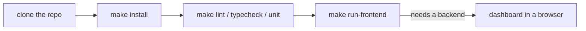

# Getting started

!!! abstract "In this page"
    From a fresh checkout to a first real result: what to install, the `make` targets, and the three checks that run offline (lint, type check, unit tests) with their real output. Starting the dashboard against a robot is described but not run here.

The dashboard is a Next.js 14 web app that talks to the `robot_agent` backend. The checks in this page need no backend, no robot and no browser.



## 1. Install

You need Node.js with npm. The repo sets no required version; the checks below ran on Node v22.23.3. From the repo root:

```bash
make install
```

This runs `npm install` in `frontend/` and fills `frontend/node_modules/`. Not run here: it needs the network. Every other check refuses to start without it. `make lint` stops with this message when `frontend/node_modules/.bin/tsc` is missing:

```
frontend/node_modules missing: run 'make install' (or symlink one)
```

## 2. The make targets

| Target | Use it to | Needs a backend |
|---|---|---|
| `make install` | install the npm packages | no |
| `make lint` | check the repo rules ([lint](modules/lint.md)) | no |
| `make typecheck` | type-check the TypeScript | no |
| `make unit` | run the unit tests ([tests](modules/tests.md)) | no |
| `make smoke` | build the static export and check `out/index.html` | no |
| `make ci` | `lint`, `typecheck`, `unit`, `smoke` in order | no |
| `make run-frontend` | start the dev server | to see data, yes |
| `make build-frontend` | build the static export | no |
| `make gen-types` | refresh the OpenAPI copy from a `robot_agent` checkout | needs the checkout, not a running robot |

The full table, with what each target writes, is on [the build page](modules/build-deploy.md).

## 3. Lint

```bash
node scripts/lint.mjs
```

(`make lint` runs the same command after the dependency check.) Run on 2026-11-19 at commit `4a810a3717ab`, Node v22.23.3, Linux. Exit code 0:

```
lint: 77 endpoint URLs in lib/api.ts checked against 66 OpenAPI paths
lint: 65 files, 5 BACKEND-WORKAROUND tags
lint: eslint not installed in frontend/node_modules — skipped (npm i -D eslint eslint-config-next to enable)
lint: ok
```

The ESLint line is expected: ESLint is not a dependency. Success is the last line, `lint: ok`.

## 4. Type check

```bash
cd frontend && node_modules/.bin/tsc --noEmit -p . --incremental false
```

The command prints nothing and exits 0 (about 3.6 s on this machine). `make typecheck` differs only in that it also writes `frontend/tsconfig.tsbuildinfo`, which git ignores.

## 5. Unit tests

```bash
node --test-reporter=spec scripts/test_lib.mjs
```

(`make unit` runs the same command.) Same day, commit and machine as above. Exit code 0; the summary:

```
ℹ tests 78
ℹ suites 0
ℹ pass 78
ℹ fail 0
ℹ cancelled 0
ℹ skipped 0
ℹ todo 0
ℹ duration_ms 56.080768
```

Each passing test is listed above the summary with a check mark. The tests write bundles to a temp folder; set `TMPDIR` if you do not want that in the system temp folder.

## 6. Start the dashboard (not run)

```bash
make run-frontend
```

Not run here: the dev server writes `frontend/.next/` and a browser is needed. The README says the dashboard opens on `http://localhost:3007`. The Makefile passes `-p 3007`, while `frontend/package.json` says `--port 3001`; read the address that `next dev` prints. If the port is busy, `make terminate` frees 3007.

The dashboard then needs a `robot_agent` backend. The README puts it on the robot host at port 8001. Pages that read the backend show errors until it answers. The steps to connect are in [Connect to a robot](guides/connect.md). The guides were checked in code at 4a810a3717ab and not run against a robot.

## If something fails

| You see | Cause | Fix |
|---|---|---|
| `frontend/node_modules missing: run 'make install'` | Packages not installed | `make install` |
| `lint: ... is not in robot_agent's OpenAPI` | A URL in `lib/api.ts` is not in the OpenAPI copy | See [lint](modules/lint.md) |
| `lint: no frontend/lib/generated/openapi.json ... endpoint check skipped` | The OpenAPI copy is missing | `make gen-types` against a `robot_agent` checkout |

## Next

- [How it works](how-it-works/index.md): one run from click to result.
- [Code map](how-it-works/code-map.md): where each part lives.
- [Make targets, build and deploy](modules/build-deploy.md): the build in detail.
