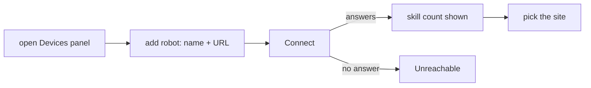

# Connect to a robot

!!! abstract "In this page"
    How to tell the dashboard which robot to talk to: add a robot (a name and a URL), press Connect, pick the site, and what you see when the robot does not answer. Checked in code at 4a810a3717ab, not run against a robot.

The dashboard keeps a list of named robots in this browser. One robot is active at a time, and every call goes to its URL. A robot is the [backend](../reference/glossary.md#backend) (`robot_agent`) of one robot package. A [site](../reference/glossary.md#site) is a config profile stored on that backend.

## Steps

1. Open the Devices panel. It is the first block of the left column (sidebar 1). That column is folded when the page loads: open it with the round button on its edge.
2. Press the `＋` button (tooltip "Add a robot"). The editor opens with the title `Add robot`.
3. Type a **name** (any text, unique in this browser) and a **URL**. For a new robot the URL box is already filled with `http://<page host>:8001`, where `<page host>` is the host the dashboard was loaded from. Replace it with the real address, for example `http://<robot_host>:<port>`.
4. Save. A duplicate name is refused and the editor shows the error. A new robot becomes active at once and the panel connects to it.
5. Press **Connect** (it shows `…` while it works). The panel asks the robot for its skill list (`GET /skills`). On success it shows `✓ <N> skills`, where N is the number of [skills](../reference/glossary.md#skill) the robot reported. On a network failure it shows `Unreachable`.
6. Pick the site (location) in the site list of the same panel. Switching a site makes the backend reload its devices; the other panels reload after it.
7. Look at the tab row: the badge `🤖 <robot name>` shows which robot this tab drives. Hover it to see the name, the URL and the host.

## What the operator sees

| moment | on screen |
|---|---|
| no robot saved yet | the robot list reads `(no robots — click Add)` |
| connecting | the Connect button shows `…` |
| connected | `✓ <N> skills`; the badge on the tab row |
| not reachable | `Unreachable` |
| switch to a robot that does not answer | `"<new>" unreachable — kept "<old>"`; the old robot stays active |
| active site not named like the robot | a `⚠` next to the badge; hover for both names |

!!! note "Switching keeps the old robot if the new one is down"
    Choosing another robot from the list writes the new name first, asks it for its skills, and writes the old name back if the request fails. Only a network failure counts as "unreachable": an HTTP error that still returns an answer counts as connected. Adding or editing a robot does **not** roll back: the new entry stays active and the status says `Unreachable`. Fix the URL with the edit button or remove the entry. Details: [robots and connections](../modules/robots-connections.md).

!!! warning "Check the site before you move anything"
    A tab that drives the wrong site is easy to miss. The badge shows only the robot name; a `⚠` appears when the site name differs from it. Read the tooltip before you give a task.

## Common problems

| symptom | cause | what to do |
|---|---|---|
| `Unreachable` after Connect | the URL is wrong, the backend is not running, or the network blocks it | check `<robot_host>:<port>` and that the backend runs |
| `"x" unreachable — kept "y"` | the robot you picked did not answer `GET /skills` | the old robot is still active; fix the URL or start the backend |
| a new robot is active but unreachable | add and edit do not roll back | edit the URL or remove the entry |
| `✓ 0 skills` | the robot answered with an empty list (an HTTP error also gives an empty list) | check the backend log; the dashboard cannot tell the cases apart |
| Warm up ends in `warm-up failed: HTTP <status>` | the button runs the skill `warmup_servers`, which only some robot packages have | ignore it on other robots |
| deleting the active site shows an error and the site is now `default` | the delete is two calls (activate `default`, then delete) | reload the site list and delete again |
| the robot list is empty on another computer | robots are stored in this browser | add them again |

Where to read more: [robots and connections](../modules/robots-connections.md) (list, sites, pools, API keys), [API client](../modules/api-client.md) (how the active robot is chosen), [browser storage](../reference/browser-storage.md).

Checked in code at 4a810a3717ab, not run against a robot.
