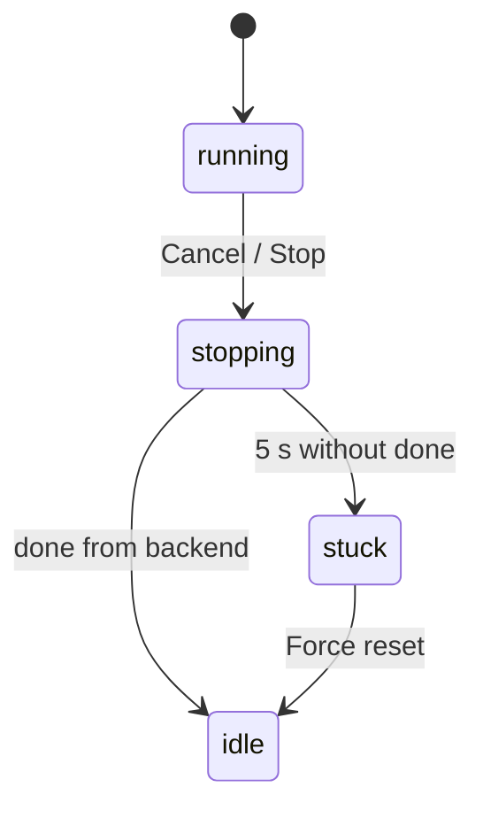

# Stop a run

!!! abstract "In this page"
    Which buttons stop the robot, what each state of the button means, what to do when the robot does not confirm, and why only one client should drive a robot. Checked in code at 4a810a3717ab, not run against a robot.

Every Cancel and Stop button in the dashboard calls one handler. It sends `POST /agent/cancel` to the active robot. The backend runs the plan in its own thread, so closing the browser connection does not stop the robot: the cancel call is what stops it. See [stop, cancel and force reset](../reference/glossary.md#stop-cancel-force-reset).

!!! warning "Stop is a request, not a proof"
    The dashboard cannot see the robot stop. It waits for the backend's `done` event. If none comes, it only drops the run on its own side ("Force reset"); the robot may still be moving. Use the robot's own emergency stop for a real emergency.

## The buttons

| button | where | note |
|---|---|---|
| `■ Cancel` | control bar, left column | tooltip: "Cancel every command in flight on the robot (arm, lift, head, base) and end the run" |
| `Cancel` | tab row (Cameras / Map / Data) | always live; stays reachable when the left column is folded |
| `■ Stop` | chat card | same handler |
| `Stop` | Agent panel, while it runs | same handler |
| `Stop` | Map tab | calls the cancel and shows `stop sent` |
| `reset` | chat card header | hard reset on this side, at any time |

## Steps

1. Press any Cancel or Stop button. The dashboard stops repeating, silences the speech and ends every capture in flight (typed answer, recording, recogniser), then calls `POST /agent/cancel`.
2. The button changes to `Stopping…` (chat: `■ Stopping…`). The input box is disabled.
3. When the backend sends `done`, the run ends and the buttons go back to normal.
4. If nothing arrives for 5 seconds, the status line says "no confirmation from the robot" and the button reads `Force reset`. Press it to drop the run on this side. This does not prove that the robot stopped.
5. Check the robot itself.

## The tab-row Cancel works without a run

The tab-row Cancel is always enabled, even when this tab shows no run. The reason is in the code: a skill started from the command line or from another client can be moving the robot while this tab shows nothing running. Pressing Cancel then stops that motion too.

## One client per robot

Cancel on the backend is process-wide: it stops what every client started. A second client (a command-line tool or another browser tab) driving the same robot is unsafe, and Cancel in one stops both. The warning is visible text in the chat card and a hover tooltip on the teleop strip. The Agent panel, the shortcut buttons, the Map tab and the Record bar show no such warning at this commit. See [Two tabs](two-tabs.md).

## Common problems

| symptom | cause | what to do |
|---|---|---|
| `Stopping…` for a long time | the backend is busy or the socket is dead | wait 5 s for `Force reset`, then check the robot |
| the card says `connection to the run lost; it may still be going: Stop / reset` | the socket closed during the run; Stop stays enabled | press Stop, then `reset` |
| Cancel does nothing visible but the robot moves | a run from another client | press the tab-row Cancel; stop the other client |
| the robot kept going after `Force reset` | the reset only clears this side | use the robot's own stop |

More: [chat module](../modules/chat.md) (state machine and its real output), [page](../modules/page.md) (the handler), [map](../modules/map.md).

Checked in code at 4a810a3717ab, not run against a robot.
