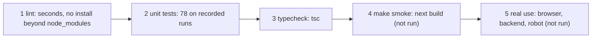

# Proving it works

This page lists the checks of the repo from cheap to expensive, says what each one catches and what it cannot, gives the real numbers recorded on the module pages, and says plainly what was not verified. The honest summary: three cheap checks ran and passed; the two expensive levels were not run.

!!! abstract "In this page"
    - Five levels: lint, unit tests on recorded runs, type check, `make smoke`, real use.
    - Real numbers for the three that were run, with date and machine.
    - Evidence that the checks have teeth: the doc drift they exposed.
    - What was not verified: no browser, no backend, no robot.

## The levels

| Level | Command | Catches | Cannot catch | Run for this site |
|---|---|---|---|---|
| 1. Lint | `node scripts/lint.mjs` (`make lint`) | A URL in `lib/api.ts` that is not an OpenAPI path; `fetch` or `new WebSocket` outside `api.ts`; a new bundled JSON file; a workaround tag with no entry | A wrong HTTP method; a URL built another way; a wrong reply shape | Yes, passed |
| 2. Unit tests | `node --test-reporter=spec scripts/test_lib.mjs` (`make unit`) | A broken rule in the pure `lib/` logic: plan view, run state, microphone rules, map helpers, recorder forms | Anything in React components, hooks, speech or storage APIs, or a real backend | Yes, 78 of 78 passed |
| 3. Type check | `tsc --noEmit -p .` (`make typecheck`) | A type error in the hand-written types and their uses | A wrong type: the reply types are written by hand, so the compiler trusts them | Yes, exit 0 |
| 4. Smoke | `make smoke` | The static export fails to build, or `out/index.html` has no `<html` | A page that builds and then misbehaves | No: it writes `.next/` and `out/` |
| 5. Real use | the dashboard in a browser, against a `robot_agent` backend and a robot | Everything else | Nothing is out of reach, but it costs a robot and a person | No |

`make ci` runs levels 1 to 4 in order: `lint`, `typecheck`, `unit`, `smoke` ([`Makefile:54`](https://github.com/mtbui2010/robotapp/blob/4a810a3717ab/Makefile#L54)).

## Level 1: lint

The lint turns the first rules of the repo's `CLAUDE.md` into checks. It reads source text with regular expressions; it does not parse TypeScript. Details: [Lint](../modules/lint.md).

| What | Value | Date | Machine |
|---|---|---|---|
| URL templates in `lib/api.ts` | 77 (75 HTTP, 2 WebSocket) | 2026-11-19 | offline Linux workstation, Node v22.23.3 |
| OpenAPI paths checked against | 66 | 2026-11-19 | same |
| Files scanned | 65 | 2026-11-19 | same |
| `BACKEND-WORKAROUND` tags | 5 | 2026-11-19 | same |
| Result | `lint: ok`, exit code 0 | 2026-11-19 | same |

The two WebSocket templates are counted but not checked, because OpenAPI does not list WebSocket routes. ESLint was skipped: it is not installed in `frontend/node_modules`.

## Level 2: 78 unit tests on recorded runs

Eight recorded event streams, cut down from runs of a simulated home robot, are replayed through the plan view. For every stream, at every prefix, the rows must stay in order, at most one may run, and ids must be unique. At the end, nothing is pending, and the counts of done, failed and note rows match the events. The other 70 tests cover run state, microphone rules, map helpers and the recorder. Details: [Tests](../modules/tests.md).

| What | Value | Date | Machine |
|---|---|---|---|
| Tests | 78 | 2026-11-19 | offline Linux workstation, Node v22.23.3 |
| Passed, failed, skipped | 78, 0, 0 | 2026-11-19 | same |
| Time | 56 ms in the run on the test page (53.9 ms in an earlier run) | 2026-11-19 | same |
| Recorded runs | 8 files, 39,953 bytes | - | - |

The streams are real recordings, so the tests check the reducer against the shapes the backend produced, not against shapes invented for the test. They run in about a twentieth of a second, so they can run after every edit.

## Level 3: type check

`tsc --noEmit -p . --incremental false` in `frontend/` exited with code 0 and printed nothing, in about 3.6 s on the same machine ([Getting started](../getting-started.md)). `make typecheck` does the same and also writes `tsconfig.tsbuildinfo`, which git ignores. The check is as strong as the types, and the types are hand-written, so it proves that the code agrees with `lib/types.ts`, not that `lib/types.ts` agrees with the backend. See [Generated contract](../modules/generated-contract.md).

## Level 4: `make smoke` (not run)

`make smoke` runs `next build` and checks that `frontend/out/index.html` holds `<html` ([`Makefile:49-51`](https://github.com/mtbui2010/robotapp/blob/4a810a3717ab/Makefile#L49-L51)). It was not run for this site: it writes `frontend/.next/` and `frontend/out/`, and the site was written read-only. So the claim "the static export builds" rests on the repo's own `make ci`, not on a run here. See [Build and deploy](../modules/build-deploy.md).

## Level 5: real use (not run)

No page of this site was checked in a browser, against a `robot_agent` backend, or on a robot. Every guide says "checked in code at 4a810a3717ab, not run against a robot". The numbers on the other pages that look like behaviour (timeouts, defaults, event order) were read in the code, or come from recorded runs and unit tests.

## The checks have teeth: documentation drift

The repo keeps its own notes in `docs/`. When this site compared them with the code at the pinned commit, many numbers had moved. The lint and the page-by-page reading are what exposed it: a note that no check reads goes stale.

| The note says | The code at this commit |
|---|---|
| The OpenAPI has 38 paths and 21 schemas | 66 paths and 63 schemas (85 operations) |
| No route declares a reply schema | 47 of 85 operations name a reply schema |
| `make lint` checks "all 50" URLs | 77 URLs |
| `skill_configs.json` has 30 skill names | 38, and a second top-level key |
| Five workaround tags at older line numbers | Same five tags, four at new lines (for example `PlanPanel.tsx:574` is now line 615) |
| `FIRST_NAMES = ['ENV', 'HOME_LOC']` | `['ENV']` |
| `make ci` is lint, typecheck, smoke | It also runs `unit` |
| The "two clients" warning is in the Guide | It is in the chat card and a teleop tooltip only |

The full list is in [Backend coupling](../reference/backend-coupling.md), section 7. One difference shows where the lint has limits: rule 4 only checks that a workaround id appears in `docs/backend_coupling.md`, not that its description or line number is still true. The five tags pass the lint although four line numbers there are old.

## What was not verified

| Not done | Why | What it leaves open |
|---|---|---|
| A browser | Nothing visual was opened; no screenshot exists | Layout, speech and storage behaviour, the look of every panel |
| A `robot_agent` backend | No HTTP or WebSocket call was made | That the backend answers as the OpenAPI snapshot and the code expect; that a reply has the hand-written type |
| A robot | None was available | Every motion, the effect of Cancel, the "stopped N m short" message |
| `make smoke`, `next build` | They write `.next/` and `out/` | A build error that `tsc` does not show |
| `make gen-types` | Needs a `robot_agent` checkout | Whether the snapshot is current |
| ESLint | Not installed | Lint rules beyond the repo's four |
| Deploy targets | Need network and a token | Nothing about them was checked beyond reading |

The backend's own behaviour is described on the [robot_agent site](https://mtbui2010.github.io/robot_agent/), not here.

## Where to go next

- The same numbers in context: [Getting started](../getting-started.md).
- What the dashboard still assumes about a backend: [Backend coupling](../reference/backend-coupling.md).
