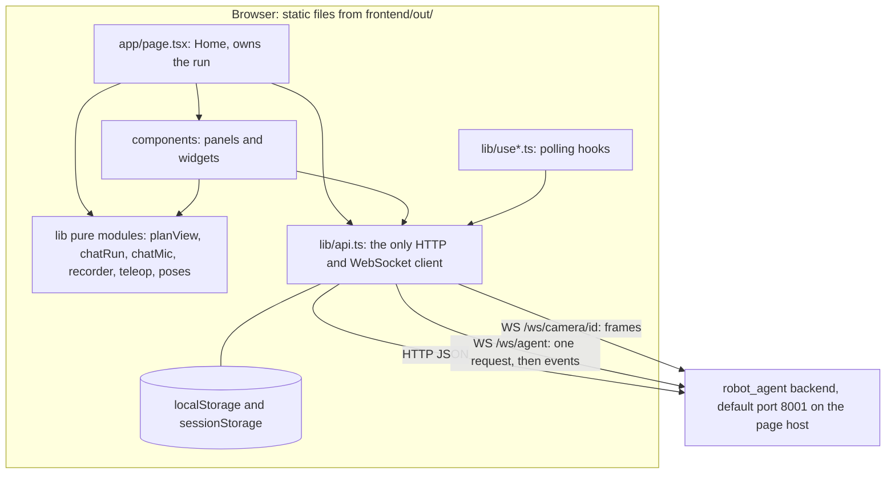

# How it works

The dashboard is static files in a browser. It sends one task to the robot backend (`robot_agent`) over a WebSocket, reads a stream of events back, and turns each event into text, speech and a plan list. This page shows the layers and follows one chat run from the click to the end. Each step names the real file and line at commit `4a810a3717ab`.

!!! abstract "In this page"
    - The layers: page, panels, hooks and pure logic, one API client, the backend.
    - One chat run in eight steps, with file and line for each.
    - What the robot does after it gets the task is not here: see the [robot_agent site](https://mtbui2010.github.io/robot_agent/).

## The layers



| Layer | Job | Page |
|---|---|---|
| `app/page.tsx` | Starts a run, receives every event, owns the run state, the repeat counter and the voice queue. | [Home page](../modules/page.md) |
| `components/` | Draw one panel each. They get data as props and call `api` for their own endpoints. | [Code map](code-map.md) |
| `lib/use*.ts` | Poll the backend and hold the answer for a panel. | [Hooks](../modules/hooks.md) |
| `lib/*.ts` pure modules | Logic with no React and no network, so it runs in a unit test. | [Tests](../modules/tests.md) |
| `lib/api.ts` | Builds every URL. No other file calls `fetch` or opens a WebSocket. It also keeps the list of robots. | [API client](../modules/api-client.md) |
| Backend | Plans, moves the robot, sends events. | [robot_agent](https://mtbui2010.github.io/robot_agent/) |

The base URL of the backend is the active robot of this tab, or `http://<page host>:8001` when none is set ([`api.ts:118-126`](https://github.com/mtbui2010/robotapp/blob/4a810a3717ab/frontend/lib/api.ts#L118-L126)). Terms: [robot_agent](../reference/glossary.md#robot-agent), [backend](../reference/glossary.md#backend), [static export](../reference/glossary.md#static-export).

## One chat run, end to end

A [chat run](../reference/glossary.md#chat-run) is free text that a planner turns into steps. All line numbers are in the committed files at `4a810a3717ab`.

1. **The operator sends text.** `ChatPanel` calls `onSend` (`components/ChatPanel.tsx:58`), which is `sendChat` ([`page.tsx:759-784`](https://github.com/mtbui2010/robotapp/blob/4a810a3717ab/frontend/app/page.tsx#L759-L784); the prop is set at [`page.tsx:991`](https://github.com/mtbui2010/robotapp/blob/4a810a3717ab/frontend/app/page.tsx#L991)). When a run is already waiting for an answer, the text goes to that question instead (step 6). When idle, `sendChat` reads the log settings from `localStorage` ([`page.tsx:775-780`](https://github.com/mtbui2010/robotapp/blob/4a810a3717ab/frontend/app/page.tsx#L775-L780)) and calls `run(...)` ([`page.tsx:782`](https://github.com/mtbui2010/robotapp/blob/4a810a3717ab/frontend/app/page.tsx#L782)). Module: [Chat](../modules/chat.md).
2. **`run` prepares the run.** It asks for the microphone inside the click when the run may listen ([`page.tsx:604-615`](https://github.com/mtbui2010/robotapp/blob/4a810a3717ab/frontend/app/page.tsx#L604-L615)), stores the arguments in `argsRef`, sets the repeat counter and calls `fire()` ([`page.tsx:597-622`](https://github.com/mtbui2010/robotapp/blob/4a810a3717ab/frontend/app/page.tsx#L597-L622)). Module: [Home page](../modules/page.md).
3. **`fire` opens the socket and sends one request.** It calls `api.agentWs()` ([`api.ts:840-842`](https://github.com/mtbui2010/robotapp/blob/4a810a3717ab/frontend/lib/api.ts#L840-L842)), a WebSocket to `/ws/agent`. On open it sends one JSON message ([`page.tsx:331-335`](https://github.com/mtbui2010/robotapp/blob/4a810a3717ab/frontend/app/page.tsx#L331-L335)); the whole of `fire` is [`page.tsx:233-594`](https://github.com/mtbui2010/robotapp/blob/4a810a3717ab/frontend/app/page.tsx#L233-L594). Module: [API client](../modules/api-client.md).
4. **Each event is stamped and handled.** The browser parses the message and adds `_rx`, the receive time ([`page.tsx:337-339`](https://github.com/mtbui2010/robotapp/blob/4a810a3717ab/frontend/app/page.tsx#L337-L339)). Then:
    - `say` becomes a chat line and browser speech ([`page.tsx:348-365`](https://github.com/mtbui2010/robotapp/blob/4a810a3717ab/frontend/app/page.tsx#L348-L365)).
    - `speak`, `listen` and `alarm` go into an ordered queue ([`page.tsx:385-482`](https://github.com/mtbui2010/robotapp/blob/4a810a3717ab/frontend/app/page.tsx#L385-L482)). Module: [Voice](../modules/voice.md).
    - `step_start`, `step_done` and `step_log` update the step list ([`page.tsx:497-543`](https://github.com/mtbui2010/robotapp/blob/4a810a3717ab/frontend/app/page.tsx#L497-L543)).
    - `done` and `error` write the run summary and decide the next repeat ([`page.tsx:544-573`](https://github.com/mtbui2010/robotapp/blob/4a810a3717ab/frontend/app/page.tsx#L544-L573)).
    - Last, `emit(newEvents, newSteps)` ([`page.tsx:575`](https://github.com/mtbui2010/robotapp/blob/4a810a3717ab/frontend/app/page.tsx#L575); defined at [`page.tsx:125-130`](https://github.com/mtbui2010/robotapp/blob/4a810a3717ab/frontend/app/page.tsx#L125-L130)) hands the arrays to the panels. Fields of each event: [Agent events](../reference/agent-events.md).
5. **The plan list folds the events.** `PlanPanel` gets `events` and `steps` as props ([`page.tsx:877`](https://github.com/mtbui2010/robotapp/blob/4a810a3717ab/frontend/app/page.tsx#L877)). `PlanList` calls `buildPlanView` ([`PlanList.tsx:84`](https://github.com/mtbui2010/robotapp/blob/4a810a3717ab/frontend/components/PlanList.tsx#L84)), which reduces the events to the rows on screen ([`planView.ts:201-203`](https://github.com/mtbui2010/robotapp/blob/4a810a3717ab/frontend/lib/planView.ts#L201-L203)). Module: [Plan view](../modules/plan-view.md).
6. **A `listen` event is answered.** Typed text or browser speech goes to `POST /agent/listen/<id>` ([`api.ts:441-447`](https://github.com/mtbui2010/robotapp/blob/4a810a3717ab/frontend/lib/api.ts#L441-L447)). Recorded audio goes to `POST /agent/listen/<id>/audio` ([`api.ts:420-439`](https://github.com/mtbui2010/robotapp/blob/4a810a3717ab/frontend/lib/api.ts#L420-L439)). Module: [Voice](../modules/voice.md).
7. **Stop.** `stop` ([`page.tsx:661-673`](https://github.com/mtbui2010/robotapp/blob/4a810a3717ab/frontend/app/page.tsx#L661-L673)) sends `POST /agent/cancel` ([`api.ts:452-454`](https://github.com/mtbui2010/robotapp/blob/4a810a3717ab/frontend/lib/api.ts#L452-L454)) and the run state becomes `stopping`. If no `done` comes in 5 seconds, the card offers Force reset ([`chatRun.ts:13`](https://github.com/mtbui2010/robotapp/blob/4a810a3717ab/frontend/lib/chatRun.ts#L13), [`page.tsx:674-678`](https://github.com/mtbui2010/robotapp/blob/4a810a3717ab/frontend/app/page.tsx#L674-L678)). Force reset closes the socket and drops everything queued ([`page.tsx:636-659`](https://github.com/mtbui2010/robotapp/blob/4a810a3717ab/frontend/app/page.tsx#L636-L659)). See [Stop, cancel and force reset](../reference/glossary.md#stop-cancel-force-reset).
8. **The socket closes.** `gone` ([`page.tsx:580-593`](https://github.com/mtbui2010/robotapp/blob/4a810a3717ab/frontend/app/page.tsx#L580-L593)) ends the run, unless a repeat is about to start. Then the next iteration calls `fire()` again.

Step 3 sends exactly these fields ([`page.tsx:331-335`](https://github.com/mtbui2010/robotapp/blob/4a810a3717ab/frontend/app/page.tsx#L331-L335)):

```ts
    ws.onopen = () => ws.send(JSON.stringify({
      prompt: a.finalPrompt, lang: a.lang, direct: a.direct, planner: a.planner,
      plan_only: a.planOnly, log_data: a.logData,
      log_mode: a.logTarget, log_all: a.logAll,
    }))
```

A [Structured run](../guides/structured.md) uses the same path from step 3. It sends `direct: true`, so no planner takes part.

## Where to go next

- Design choices and their reasons: [Key ideas](key-ideas.md).
- Which file does what: [Code map](code-map.md).
- How each claim here is checked: [Correctness](correctness.md).
