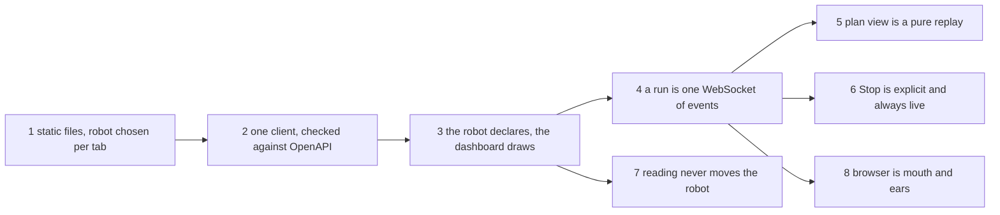

# Key ideas

Eight design ideas explain most of the code. They share one aim: the dashboard knows as little about any one robot as possible, and it never hides what the robot is doing. Each idea has a one-line statement, why it matters, the code that shows it (links are pinned to commit `4a810a3717ab`), and links to the background chapter and the module page.

!!! abstract "In this page"
    - The eight ideas, in the order a reader needs them.
    - For each: evidence in the code, a Learn chapter and a module page.
    - Where the code falls short of an idea, the page says so.

## 1. The dashboard is static files; the robot is chosen in the browser, per tab

**Why it matters.** There is nothing to host but files, and one deployed copy serves any robot. Two tabs can drive two robots, because each tab keeps its own choice.

**Evidence.**

- The build is a static export: [`next.config.js:1-8`](https://github.com/mtbui2010/robotapp/blob/4a810a3717ab/frontend/next.config.js#L1-L8) sets `output: 'export'`.
- The base URL is the active robot of this tab, or `http://<page host>:8001` when none is set: [`api.ts:116-126`](https://github.com/mtbui2010/robotapp/blob/4a810a3717ab/frontend/lib/api.ts#L116-L126).
- Each tab reads its choice from `sessionStorage` first: [`api.ts:55-67`](https://github.com/mtbui2010/robotapp/blob/4a810a3717ab/frontend/lib/api.ts#L55-L67). The comment at [`api.ts:10-17`](https://github.com/mtbui2010/robotapp/blob/4a810a3717ab/frontend/lib/api.ts#L10-L17) records the bug of 2026-10-27: with one shared key, the tab that picked a robot last sent the other tab's calls to its robot.

Background: [1. Where robotapp sits](../learn/01-ui-mode.md), [7. Build, check and run it](../learn/07-build-run.md). Code: [API client](../modules/api-client.md), [Robots and connections](../modules/robots-connections.md), [Build and deploy](../modules/build-deploy.md).

## 2. One client module, checked against the backend's OpenAPI

**Why it matters.** The dashboard must work with every `robot_agent` backend. A call that the backend does not serve fails `make lint`, so the operator does not find it first.

**Evidence.**

- Every `${getAgentUrl()}/...` template in `api.ts` must match a path of the OpenAPI snapshot: [`lint.mjs:39-62`](https://github.com/mtbui2010/robotapp/blob/4a810a3717ab/scripts/lint.mjs#L39-L62). The real run: 77 URLs against 66 paths.
- No file but `api.ts` may call `fetch(` or `new WebSocket(` unless the URL comes from an `api.` helper: [`lint.mjs:64-74`](https://github.com/mtbui2010/robotapp/blob/4a810a3717ab/scripts/lint.mjs#L64-L74).

!!! warning "The types are hand-written"
    The check covers paths, not types and not HTTP methods. There is no `openapi.d.ts` at this commit: `api.ts` imports hand-written types from `lib/types.ts` ([`api.ts:1`](https://github.com/mtbui2010/robotapp/blob/4a810a3717ab/frontend/lib/api.ts#L1)), and `make gen-types` only refreshes `openapi.json` because `openapi-typescript` is not installed ([`gen_types.sh:24-31`](https://github.com/mtbui2010/robotapp/blob/4a810a3717ab/scripts/gen_types.sh#L24-L31)). The backend names the reply of 47 of its 85 operations, so generated types are possible; they are not used today.

Background: [2. The contract](../learn/02-contract.md). Code: [API client](../modules/api-client.md), [Generated contract](../modules/generated-contract.md), [Lint](../modules/lint.md).

## 3. The robot declares, the dashboard draws

**Why it matters.** A robot without a recorder, teleop, a map or a language list gets no empty panels, and no robot name is built into the layout.

**Evidence.**

- The Data tab exists only when `GET /recorder` is not a 404 ([`api.ts:514-520`](https://github.com/mtbui2010/robotapp/blob/4a810a3717ab/frontend/lib/api.ts#L514-L520), [`page.tsx:914`](https://github.com/mtbui2010/robotapp/blob/4a810a3717ab/frontend/app/page.tsx#L914)).
- The teleop strip draws nothing when `GET /teleop` lists no function ([`useTeleop.ts:14-22`](https://github.com/mtbui2010/robotapp/blob/4a810a3717ab/frontend/lib/useTeleop.ts#L14-L22), [`TeleopBar.tsx:28`](https://github.com/mtbui2010/robotapp/blob/4a810a3717ab/frontend/components/TeleopBar.tsx#L28)).
- The Map tab needs a `MAP` config group; without one it says "This site has no MAP config." ([`MapPanel.tsx:172-183`](https://github.com/mtbui2010/robotapp/blob/4a810a3717ab/frontend/components/MapPanel.tsx#L172-L183)).
- Object actions exist only when declared ([`mapObjects.ts:18-19`](https://github.com/mtbui2010/robotapp/blob/4a810a3717ab/frontend/lib/mapObjects.ts#L18-L19)); the language picker comes from `GET /robot/languages` ([`robotLanguages.ts:1-11`](https://github.com/mtbui2010/robotapp/blob/4a810a3717ab/frontend/lib/robotLanguages.ts#L1-L11)).

!!! note "Exceptions"
    The idea is not fully met. Two JSON files are bundled, and some skill and config names are fixed in the code. [Backend coupling](../reference/backend-coupling.md) lists them with how to avoid trouble.

Background: [4. State and data flow](../learn/04-state.md). Code: [Map](../modules/map.md), [Teleop and poses](../modules/teleop-poses.md), [Recorder](../modules/recorder.md), [Data tab](../modules/data-tab.md), [Chat](../modules/chat.md).

## 4. A run is one WebSocket: one request out, a stream of events back

**Why it matters.** Every panel that shows a run is a view over one array of events. Nothing polls for progress.

**Evidence.** The page opens `/ws/agent`, sends one JSON message on open and stamps each event with its receive time ([`page.tsx:328-339`](https://github.com/mtbui2010/robotapp/blob/4a810a3717ab/frontend/app/page.tsx#L328-L339)). It hands the arrays to the panels with `emit` ([`page.tsx:575`](https://github.com/mtbui2010/robotapp/blob/4a810a3717ab/frontend/app/page.tsx#L575)). The event type has 55 optional fields and no backend schema, because OpenAPI does not describe WebSocket routes ([`types.ts:102-185`](https://github.com/mtbui2010/robotapp/blob/4a810a3717ab/frontend/lib/types.ts#L102-L185)).

Background: [3. The agent event stream](../learn/03-event-stream.md). Code: [Home page](../modules/page.md), [Plan view](../modules/plan-view.md).

## 5. The plan view is a pure replay of events, tested on recorded runs

**Why it matters.** The plan list must survive replans, recoveries and two event shapes (new `index/action/object`, older `step/task`). Because it is a function of the events and has no React state, the same function can be tested on 8 recorded runs.

**Evidence.** The model is described at [`planView.ts:1-22`](https://github.com/mtbui2010/robotapp/blob/4a810a3717ab/frontend/lib/planView.ts#L1-L22); the reducer is `reducePlan` ([`planView.ts:103-199`](https://github.com/mtbui2010/robotapp/blob/4a810a3717ab/frontend/lib/planView.ts#L103-L199)). The test checks the invariants after every event of every recorded run ([`test_lib.mjs:42-66`](https://github.com/mtbui2010/robotapp/blob/4a810a3717ab/scripts/test_lib.mjs#L42-L66)).

Background: [3. The agent event stream](../learn/03-event-stream.md). Code: [Plan view](../modules/plan-view.md), [Tests](../modules/tests.md).

## 6. Stop is explicit and always live

**Why it matters.** Closing the socket does not stop the robot: the plan runs in a backend thread. So Stop and Cancel send `POST /agent/cancel`, and the dashboard keeps "a run may still be alive" even after the socket drops.

**Evidence.**

- The comment and the call: [`api.ts:448-454`](https://github.com/mtbui2010/robotapp/blob/4a810a3717ab/frontend/lib/api.ts#L448-L454).
- Four phases (`idle`, `running`, `waiting`, `stopping`), the `alive` flag and the `stuck` state after 5000 ms: [`chatRun.ts:1-14`](https://github.com/mtbui2010/robotapp/blob/4a810a3717ab/frontend/lib/chatRun.ts#L1-L14).
- The Cancel button in the tab row is always enabled, because a run from another client may be moving the robot: [`page.tsx:943-952`](https://github.com/mtbui2010/robotapp/blob/4a810a3717ab/frontend/app/page.tsx#L943-L952).

!!! warning "Two clients"
    Cancel is process-wide: it stops a run started from another client too. The warning "one client per robot" is shown in the chat card and, as a hover tooltip, in the teleop strip. It is not in the Guide, the Map tab, the shortcut buttons or the Agent panel. See [Chat](../modules/chat.md) and [Use two tabs](../guides/two-tabs.md).

Background: [4. State and data flow](../learn/04-state.md). Code: [Chat](../modules/chat.md), [Home page](../modules/page.md). Guide: [Stop a run](../guides/stop.md).

## 7. Reading never moves the robot; motion from one click asks first

**Why it matters.** A call to `POST /skill/<name>` starts a run on the backend, and that clears a Stop in progress. A pose poll that ran a skill would undo the operator's Stop.

**Evidence.**

- `agentGet` reads with `GET /agent/<name>/get` and the comment says it is safe to poll: [`api.ts:813-819`](https://github.com/mtbui2010/robotapp/blob/4a810a3717ab/frontend/lib/api.ts#L813-L819). The Map tab polls the pose with it: [`MapPanel.tsx:207-228`](https://github.com/mtbui2010/robotapp/blob/4a810a3717ab/frontend/components/MapPanel.tsx#L207-L228).
- A motion is refused while a plan runs, and asks first when the site sets `confirm_goal`: [`MapPanel.tsx:243-247`](https://github.com/mtbui2010/robotapp/blob/4a810a3717ab/frontend/components/MapPanel.tsx#L243-L247). The confirmation is a site setting, so it is off unless the site turns it on.

Background: [6. Map frames and robot poses](../learn/06-map-pose.md). Code: [Map](../modules/map.md). Guide: [Move the robot from the Map tab](../guides/map-move.md).

## 8. The browser can be the robot's mouth and ears, one at a time

**Why it matters.** Human-robot skills with `source='dashboard'` speak and listen through the browser. The microphone must not open while the robot is still talking, or it would transcribe the robot.

**Evidence.**

- One ordered queue, `enqueueHri`, with an epoch that a Reset or a new run bumps: [`page.tsx:163-167`](https://github.com/mtbui2010/robotapp/blob/4a810a3717ab/frontend/app/page.tsx#L163-L167), [`page.tsx:221-229`](https://github.com/mtbui2010/robotapp/blob/4a810a3717ab/frontend/app/page.tsx#L221-L229).
- A guard time of 1000 ms, and an echo guard that drops a transcript at least 0.6 similar to something the robot said in the last 10 s: [`chatMic.ts:9-14`](https://github.com/mtbui2010/robotapp/blob/4a810a3717ab/frontend/lib/chatMic.ts#L9-L14), [`chatMic.ts:75-80`](https://github.com/mtbui2010/robotapp/blob/4a810a3717ab/frontend/lib/chatMic.ts#L75-L80).

The speech part runs in the browser and was only read, not run. Terms: [echo guard](../reference/glossary.md#echo-guard), [hands-free](../reference/glossary.md#hands-free).

Background: [4. State and data flow](../learn/04-state.md). Code: [Voice](../modules/voice.md), [Chat](../modules/chat.md).

## Where to go next

- The layers and one run, step by step: [How it works](index.md).
- How each claim is checked, and what was not: [Proving it works](correctness.md).
