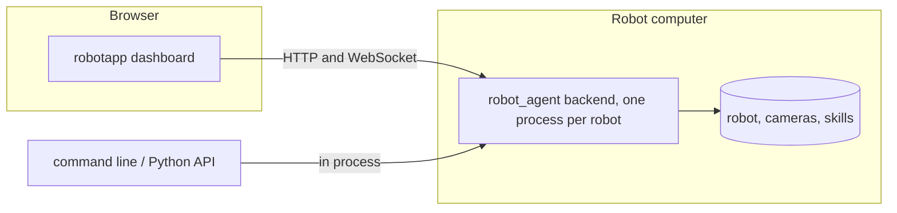

---
sources:
  - frontend/lib/api.ts
  - docs/architecture.md
  - CLAUDE.md
  - frontend/components/ChatPanel.tsx
  - frontend/components/TeleopBar.tsx
  - frontend/lib/generated/openapi.json
verified_at: 4a810a3717ab
---

# 1. Where robotapp sits: the UI mode of a robot backend

You will learn what this dashboard is in the robot stack, what it is not, and how it finds the robot it talks to.

!!! abstract "In this chapter"
    - robotapp is one of three ways to drive a robot built on `robot_agent`. It is the browser way. The robot does not need it.
    - One backend serves one robot. The dashboard keeps a list of robots and talks to one at a time, chosen per browser tab.
    - Two clients on one robot is unsafe: Cancel is process-wide and stops both. The dashboard tells you this in some places, not in all.

## The question: what do I need this dashboard for?

Often the answer is "nothing". A robot built on the `robot_agent` framework (the backend) runs its own skills and planners. The robot package has a command line and a Python API that start the robot inside one process. `docs/architecture.md` calls the dashboard the UI mode of that stack and says it is not required to operate the robot. The framework is described on [the robot_agent site](https://mtbui2010.github.io/robot_agent/). This site covers only the browser side.

| way to drive the robot | where it lives | needs the dashboard |
|---|---|---|
| UI mode | this repo, a static web page | it is the dashboard |
| command line | each robot package | no |
| Python API | each robot package | no |



The dashboard is a static export: plain files, with no server of its own. It holds no robot data. Everything it shows comes from the backend (rule 2 in the repo's rules, checked by [the lint](../modules/lint.md)).

## One robot, one backend, several robots in a list

The page can know many robots. Each is a name and a base URL. This is the real storage, from `lib/api.ts`:

| key | store | content |
|---|---|---|
| `robotapp_robots` | `localStorage` | `[{ "name": "...", "url": "..." }, ...]` |
| `robotapp_active_robot` | `sessionStorage` for this tab, `localStorage` as the default for new tabs | the name of the active robot |

If no robot is in the list, the dashboard uses `http://<page host>:8001`, which is the host the page was loaded from, on port 8001. The rule is in `getAgentUrl()`:

[`frontend/lib/api.ts:116-126`](https://github.com/mtbui2010/robotapp/blob/4a810a3717ab/frontend/lib/api.ts#L116-L126)

```ts
// Returns the URL of the active robot. Falls back to same-host :8001 when no
// robot is configured yet (preserves the legacy default).
function getAgentUrl(): string {
  if (typeof window === 'undefined') return 'http://localhost:8001'
  const active = getActiveRobotName()
  if (active) {
    const r = readRobots().find(x => x.name === active)
    if (r) return r.url
  }
  return `http://${window.location.hostname}:8001`
}
```

Every call to the robot builds its URL from this function. The WebSocket base is the same URL with `ws://` or `wss://`. When you pick another robot, the page fires the window event `robotapp:robot-changed` so panels drop what they read from the old robot (chapter 4).

A real bug shaped this design. The active robot used to live in one shared `localStorage` key, so the tab that picked a robot last sent the other tab's calls to its robot. The comment in `api.ts:13-16` dates the fix to 2026-10-27. Now each tab keeps its own choice. See [two tabs, two robots](../guides/two-tabs.md).

## Why two clients on one robot is unsafe

The backend runs a plan in its own thread, and Cancel is process-wide. The description of `POST /agent/cancel` in the OpenAPI snapshot says it cancels every ROS command in flight and "also stops a skill started from the CLI or a second client". So a second client, whether a command line or another browser, can stop your run, and you can stop theirs. Repo rule 7 asks the UI to warn about this.

Current state at the pinned commit, found by searching the code:

| place | has the warning |
|---|---|
| chat card help text (`ChatPanel.tsx:16-19`) | yes |
| tooltip of the remote-control buttons (`TeleopBar.tsx:37`) | yes |
| Agent panel, shortcut buttons, Map tab | no, although they can move the robot |

The tab-row Cancel button is always live for this reason: a run from another client may be moving the robot while this tab shows no run (`page.tsx:946`, `chatRun.ts:67`).

!!! code "Where in the code"
    - Robot registry and the default URL: [`frontend/lib/api.ts:9-150`](https://github.com/mtbui2010/robotapp/blob/4a810a3717ab/frontend/lib/api.ts#L9-L150)
    - Layout and the three ways to drive: [`docs/architecture.md`](https://github.com/mtbui2010/robotapp/blob/4a810a3717ab/docs/architecture.md)
    - Module page: [the API client](../modules/api-client.md); the connection panel: [robots and connections](../modules/robots-connections.md)

## What this means when you use it

- Do not wait for the dashboard to run the robot. If the page is closed, the robot and its other clients are unaffected.
- Give each robot its own entry in the list, and give each browser tab its own robot. Do not point two tabs at one robot to run tasks.
- Before you start a run, check that no command line or other browser is driving the same robot. Cancel stops all of them.
- If the page cannot reach a robot, check the active robot's URL first. With an empty list the page assumes port 8001 on its own host.
- Words used here: [UI mode](../reference/glossary.md#ui-mode), [robot_agent](../reference/glossary.md#robot-agent), [backend](../reference/glossary.md#backend).

**Next:** [2. The contract: OpenAPI, the lint check, and hand-written types →](02-contract.md)
