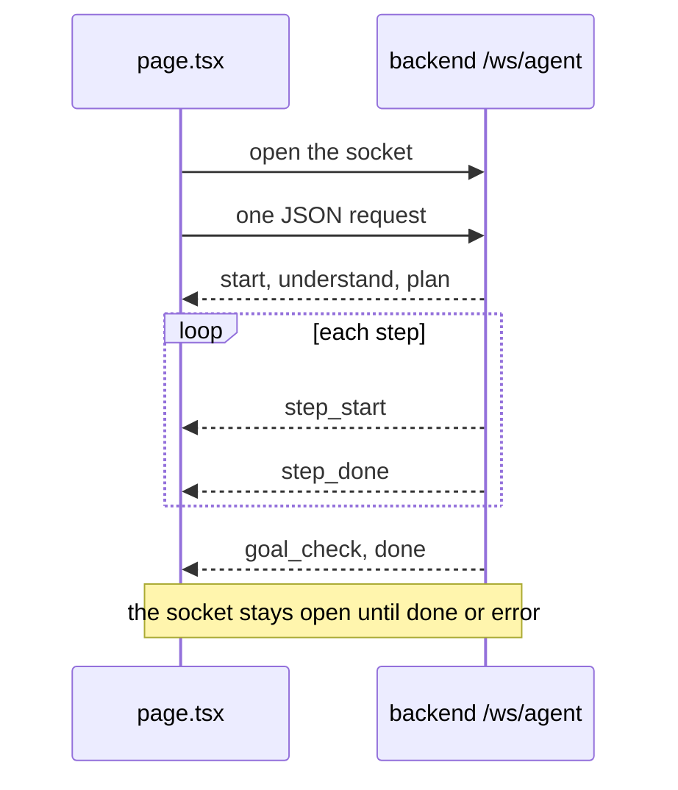

---
sources:
  - frontend/app/page.tsx
  - frontend/lib/types.ts
  - frontend/lib/planView.ts
  - frontend/lib/api.ts
  - scripts/fixtures/events/mug_en_simple_success.json
  - scripts/fixtures/events/apple_en_replan_fail.json
verified_at: 4a810a3717ab
---

# 3. The agent event stream

You will learn how one request goes out and a stream of events comes back, what the events look like, and how the page turns them into a plan list.

!!! abstract "In this chapter"
    - A run is one WebSocket on `/ws/agent`. The page sends one JSON request when the socket opens. The backend then sends events until `done` or `error`.
    - Events are plain JSON with an `event` name. The page also reads other fields (`say`, `speak`, `listen`, ...) from any event, so one message can cause several actions.
    - The same step event has two shapes, one per planner family. The page accepts both.

## The question: what does the robot tell the page while it works?

A task can take minutes. A plain HTTP call would return only at the end. So the dashboard opens a WebSocket for each run. `api.agentWs()` returns `new WebSocket(<ws base>/ws/agent)`. This route is not in OpenAPI (chapter 2), so no tool checks its messages; the TypeScript type `AgentEvent` is the only written contract.



## The request

The request is one JSON object, sent in `ws.onopen`.

[`frontend/app/page.tsx:331-335`](https://github.com/mtbui2010/robotapp/blob/4a810a3717ab/frontend/app/page.tsx#L331-L335)

```tsx
    ws.onopen = () => ws.send(JSON.stringify({
      prompt: a.finalPrompt, lang: a.lang, direct: a.direct, planner: a.planner,
      plan_only: a.planOnly, log_data: a.logData,
      log_mode: a.logTarget, log_all: a.logAll,
    }))
```

`prompt` is the task text (or the plan lines for a Structured run), `direct` is `true` to run lines as written, and `planner` is `grace`, `direct` or `sage`. Every field is explained on [the page module](../modules/page.md).

## A real event sequence

The repo keeps recordings of real runs in `scripts/fixtures/events/`. Their README says they were recorded from a simulated home robot and stripped to the planning events. The unit tests use them. Below is `mug_en_simple_success.json` (16 events), with long fields trimmed by me and nothing else changed. Names such as `counter@kitchen` are the planner's place labels in that simulation.

| # | event | main fields | what the page does |
|---|---|---|---|
| 0 | `start` | `prompt`: "Could you put the red mug on the dining table?" | resets the plan view |
| 1 | `understand` | `status`: `clear`; `goals`: one `on` goal for `red mug` to `dining_table@kitchen` | stores the goals |
| 2 | `clarify` | `question`: "Where is the red mug?", `round`: 1, `kind`: `where_source` | adds a robot line to the chat and a note row to the plan |
| 3 | `plan` | `steps`: 5 steps (`MoveTo`, `Find`, `Pick`, `MoveTo`, `Place`), `certified`: true | shows 5 pending rows |
| 4 | `step_start` | `index`: 0, `action`: `MoveTo`, `object`: `counter@kitchen`, `skill`: `move`, `say`: "I will move to kitchen counter" | row 0 becomes running; the `say` line goes to the chat and may be spoken |
| 5 | `step_done` | `index`: 0, `status`: `success`, `result`: `{at, isdone: true, msg: "ok"}`, `say`: "Done: move to kitchen counter" | row 0 becomes done |
| 6-13 | `step_start` and `step_done` for `Find`, `Pick`, `MoveTo`, `Place` | same shape; `Find` returns `ins` with a `pose_3d` | same |
| 14 | `goal_check` | `ok`: true, `evidence`: "the red mug is seen on the dining_table in the kitchen" | adds a goal check |
| 15 | `done` | `status`: `success`, `say`: "Task completed" | closes the run |

Event counts, computed from the files (2026-11-19, offline Linux workstation):

| fixture | events | by name |
|---|---|---|
| `mug_en_simple_success` | 16 | start 1, understand 1, clarify 1, plan 1, step_start 5, step_done 5, goal_check 1, done 1 |
| `apple_en_replan_fail` | 47 | start 1, understand 1, clarify 1, plan 1, step_start 17, step_done 17, search 1, replan 1, recover 6, done 1 |

The apple run is the failure case. `Find apple` fails with `code: absent` at the counter. The backend sends `search`, then `replan` with a reason, then walks to other places. Each `recover` event (kind `search_leg`, then `second_look`) comes before the next `step_start`. The run ends with `done`, `status: failed` and a `msg` that lists the places it looked in.

## Two shapes of one event

Two planner families send the same event with different fields. The page reads either, and the code says where:

| what | SAGE shape | older (legacy, direct) shape |
|---|---|---|
| step number | `index` | `step`, with `total` |
| step label | `action` plus `object` | `task` |
| success of a step | `status` (`success` or `planned`) | `success`, or `result.isdone` |

`isOk` in `planView.ts:72-74` tests `status` first and falls back to the other two. In `page.tsx:505-514` the step number is `ev.step ?? ev.index`, and the label is `ev.task` or `action` plus `object`. The fixture above is the SAGE shape. A SAGE recovery can reuse an `index`, so `step_done` closes the row that is still running, not the first row with that number.

## Two fields the backend never sends

The page adds `_rx`, the time in milliseconds when it received the event, to every event it parses (`page.tsx:339`). The plan list uses it for step durations. The fixtures have no `_rx` because they were recorded on the backend side. The plan list (`PlanList.tsx:84`) also adds a `stopped` event itself when a run ended without a `done` (Stop or a closed socket); the plan view treats it like `done`. Both are marked as made by the dashboard in [the agent events reference](../reference/agent-events.md).

## From events to the plan list

`lib/planView.ts` turns the event list into rows with one reducer, `reducePlan`. I bundled it with the repo's own esbuild and ran it over the mug fixture. These are the real rows (the first row of each column is a note, the others are steps) after the first 5 events, after 9, and at the end:

| after 5 events | after 9 events | after all 16 events |
|---|---|---|
| ask: Where is the red mug? | ask: Where is the red mug? | ask: Where is the red mug? |
| running: MoveTo counter@kitchen | done: MoveTo counter@kitchen | done: MoveTo counter@kitchen |
| pending: Find red mug | done: Find red mug | done: Find red mug |
| pending: Pick red mug | running: Pick red mug | done: Pick red mug |
| pending: MoveTo dining_table@kitchen | pending: MoveTo dining_table@kitchen | done: MoveTo dining_table@kitchen |
| pending: Place dining_table@kitchen | pending: Place dining_table@kitchen | done: Place dining_table@kitchen |
| final: none | final: none | final: `{"ok":true,"status":"success","msg":""}` |

A `plan` event creates pending rows. A `step_start` finds the pending row with the same label and moves it to running. A `step_done` closes the latest running row. On `replan` the pending rows are replaced. On `done` or `error`, rows still running become done or failed, and pending rows become `skipped`. Details are on [the plan view page](../modules/plan-view.md).

!!! code "Where in the code"
    - Event type: [`frontend/lib/types.ts:102-185`](https://github.com/mtbui2010/robotapp/blob/4a810a3717ab/frontend/lib/types.ts#L102-L185)
    - Plan reducer: [`frontend/lib/planView.ts:103-199`](https://github.com/mtbui2010/robotapp/blob/4a810a3717ab/frontend/lib/planView.ts#L103-L199)
    - Handler for every event: [`frontend/app/page.tsx:337-576`](https://github.com/mtbui2010/robotapp/blob/4a810a3717ab/frontend/app/page.tsx#L337-L576)
    - Recorded runs: [`scripts/fixtures/events/`](https://github.com/mtbui2010/robotapp/tree/4a810a3717ab/scripts/fixtures/events)
    - Modules: [the page](../modules/page.md), [plan view](../modules/plan-view.md), [chat](../modules/chat.md); reference: [agent events](../reference/agent-events.md)

## What this means when you use it

- Do not wait for `done` to know what happened. Read `step_done` and the `say` lines as they come.
- A failed step is not the end. `replan` and `recover` events mean the backend is trying again. The end is `done` or `error`.
- If you write a new backend or a test, send `event` plus either shape of the step fields, and keep `step_done` in the same shape as its `step_start`.
- The page does not guard `JSON.parse` in `onmessage`, so a non-JSON message throws in the handler. Send JSON only.
- No schema checks events. When the backend renames a field, nothing fails until the page reads it.
- The framework side of the stream is on [the robot_agent site](https://mtbui2010.github.io/robot_agent/).

**Next:** [4. State and data flow in the page →](04-state.md)
