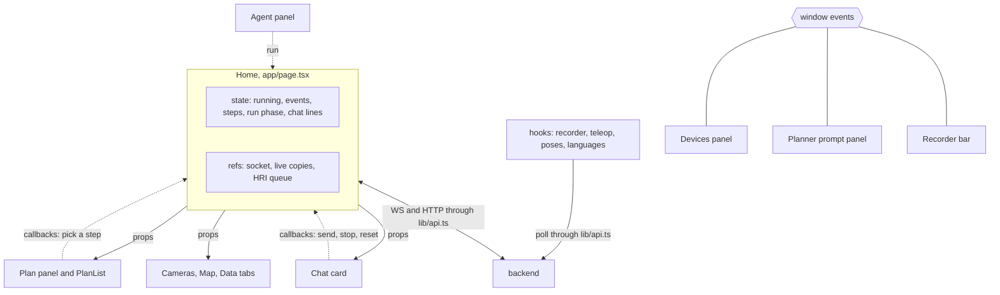
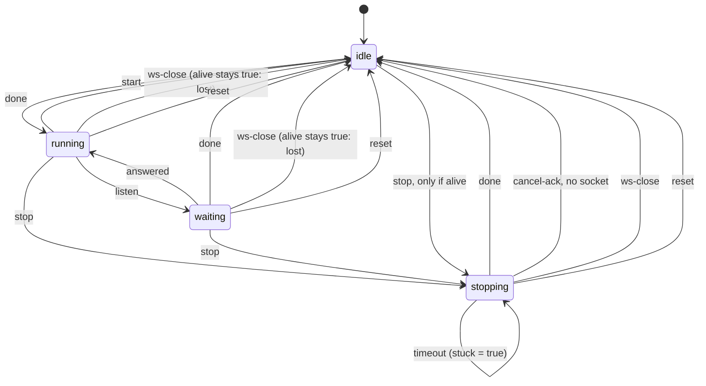

---
sources:
  - frontend/app/page.tsx
  - frontend/lib/chatRun.ts
  - frontend/lib/tabPref.ts
  - frontend/lib/api.ts
  - frontend/lib/planner.ts
  - frontend/lib/recordNote.ts
  - frontend/lib/useRecorder.ts
  - frontend/lib/useTeleop.ts
  - frontend/lib/mapObjects.ts
  - frontend/components/PlanPanel.tsx
  - frontend/components/DevicePanel.tsx
  - frontend/components/MapPanel.tsx
verified_at: 4a810a3717ab
---

# 4. State and data flow in the page

You will learn who owns what in the page, how data moves between panels, how often the page asks the robot for news, and what the run's state machine allows.

!!! abstract "In this chapter"
    - One component, `Home` in `app/page.tsx`, owns the run. It keeps what is drawn in React state and what callbacks must read live in refs.
    - Panels get props down and call callbacks up. Distant parts talk through three window events. Preferences that belong to one tab use `sessionStorage`.
    - Several things are polled on fixed periods. The run itself is a four-phase state machine in `lib/chatRun.ts`.

## The question: why does Stop still work while the screen is busy?

The page has one route and many panels (devices, plan, chat, cameras, map). When an event arrives, a callback must see the newest state, not the state from the render in which the callback was made. React state does not give that inside a long-lived socket handler. So `Home` keeps two copies of the data that matter.

| kind | holds | used by |
|---|---|---|
| state (`useState`) | what is drawn: `running`, `agentEvents`, `agentSteps`, `rs` (the run phase), `qaLog` | rendering |
| refs (`useRef`) | the same data, live: `eventsRef`, `stepsRef`, `rsRef`, `wsRef`, `voiceOutRef`, `stopReqRef` | socket and timer callbacks |

`emit` writes both at once:

[`frontend/app/page.tsx:125-130`](https://github.com/mtbui2010/robotapp/blob/4a810a3717ab/frontend/app/page.tsx#L125-L130)

```tsx
  const emit = useCallback((events: AgentEvent[], steps: Step[]) => {
    eventsRef.current = events
    stepsRef.current  = steps
    setAgentEvents(events)
    setAgentSteps(steps)
  }, [])
```

The voice checkbox is a small example. `voiceOutRef.current = voiceOut` runs on every render (`page.tsx:90-91`). A socket handler that is already running reads the ref, so unticking the box in the middle of a run silences the rest of it.

## Who owns what



Panels hold only their own small state, for example which row is picked. The run state is passed down as plain props, and every action goes up as a callback (`onSend`, `onStop`, `onReset`). Three callers start a run through the same `run()`: the Agent panel, the chat and the shortcut buttons (see [the page module](../modules/page.md)).

## Two step models that are tied by order

The same run is kept twice, on purpose.

| model | built where | from what | used by | matched by |
|---|---|---|---|---|
| `Step[]` (`agentSteps`) | `page.tsx`, in `onmessage` | `step_start`, `step_done`, `step_log` | the Log in the Plan panel | `index` of the step (the running row with that index) |
| plan view rows | `lib/planView.ts`, rebuilt from the whole event list | every plan event | the Plan progress list | label, then order |

They are tied by `seq`. A plan view row stores `seq`, the number of steps started before it, which is also its position in `steps`. When you click a progress row, `PlanPanel.tsx:599-610` shows `steps[seq]` in the Log. The comment there says it plainly: "Rows and Log steps are matched by start order (row.seq = index in `steps`)." Chapter 3 showed how the plan rows are built.

## Window events across distant parts

A window event is a browser `Event` fired on `window`. It lets two components talk without a common parent or props.

| event name | fired in | when | who listens |
|---|---|---|---|
| `robotapp:robot-changed` | defined `lib/api.ts:70`, fired `:76` | this tab's active robot changes | the hooks `usePoses`, `useRecorder`, `useTeleop`, `useRobotLanguages`, which reload or restart their poll |
| `robotapp-planner` | defined `lib/planner.ts:6`, fired `page.tsx:743` | the planner is changed in the chat header | the Planner prompt panel |
| `robotapp:record-audio-note` | defined `lib/recordNote.ts:4`, fired by `noteRecordingAudio` | the recorder has a one-line note about sound | `RecordAudioToggles` |

The robot-changed event is the one to remember: when you pick another robot, everything cached from the old one is stale, and the event tells the panels to reload.

## localStorage and sessionStorage

The browser shares `localStorage` between all tabs of a site. If two tabs share one key, one tab changes the other. The repo met this twice: the active robot (2026-10-27, chapter 1) and the language (a Korean session turned English by itself). The fix is one helper in `lib/tabPref.ts`.

[`frontend/lib/tabPref.ts:10-21`](https://github.com/mtbui2010/robotapp/blob/4a810a3717ab/frontend/lib/tabPref.ts#L10-L21)

```ts
export const readTabPref = (key: string, legacyKey?: string): string | null =>
  get(() => sessionStorage, key) ?? get(() => localStorage, key) ?? (legacyKey ? get(() => localStorage, legacyKey) : null)

// A tab that has not chosen yet keeps what it started with: without this a reload would read the last choice of ANOTHER tab.
export const pinTabPref = (key: string, effective: string): void => {
  if (get(() => sessionStorage, key) === null) put(() => sessionStorage, key, effective)
}

export const writeTabPref = (key: string, v: string): void => {
  put(() => sessionStorage, key, v)      // this tab
  put(() => localStorage, key, v)        // the default of the next new tab
}
```

A write goes to both stores. A read takes this tab's value first, then the last choice of any tab. The language, the planner and "plan only" use it (`robotapp_lang`, `robotapp_planner`, `robotapp_plan_only`). The robot registry list `robotapp_robots` is shared on purpose; only the active choice is per tab. All keys are in [the browser storage reference](../reference/browser-storage.md).

## What is polled, and how often

The page cannot be told about every change, so some parts ask on a timer. All values are from the code.

| what | period | stops or slows when | where |
|---|---|---|---|
| connection status of devices | every 10 s | the Devices panel is unmounted | `DevicePanel.tsx:481-486` |
| other machines on a site | every 30 s | the Devices panel is unmounted | `DevicePanel.tsx:263-269` |
| recorder status | 1 s while the backend has a recorder | 3 s after an error; the poll stops if the backend has no recorder | `lib/useRecorder.ts:15-21` |
| teleop functions | 1.5 s while any function exists | stops when the list is empty or the call fails | `lib/useTeleop.ts:15-21` |
| map pose | `MAP.pose.period_s`, default 0.5 s | the Map panel is unmounted | `MapPanel.tsx:226` |
| map objects | `MAP.objects.poll_s`, default 1 s, never below 0.2 s | the Map panel is unmounted | `lib/mapObjects.ts:16` |
| "still working" phrase | every 15 s of silence in a voiced run | any new milestone restarts it; `done` or `error` stops it | `page.tsx:354` |
| Stop timeout | 5,000 ms, once | the phase leaves `stopping` | `lib/chatRun.ts:13` |

The last two are timers, not polls. The run itself is not polled: it is pushed by the WebSocket (chapter 3).

## The run state machine

`lib/chatRun.ts` has no React. It is one function, `runReduce(state, event)`, and four phases. The state has four fields: `phase`, `alive` (a run may still be going on the backend), `ws` (the run's socket is open) and `stuck` (stopping took longer than 5,000 ms). Drawn from the reducer:



I ran `runReduce` from the initial state, bundled with the repo's own esbuild (2026-11-19, offline Linux workstation). The label is `stopLabel(state, 'Cancel')`.

| events | phase | alive | ws | stuck | can stop | can type | label |
|---|---|---|---|---|---|---|---|
| `start` | running | true | true | false | true | false | Cancel |
| `start`, `listen` | waiting | true | true | false | true | true | Cancel |
| `start`, `listen`, `answered` | running | true | true | false | true | false | Cancel |
| `start`, `stop` | stopping | true | true | false | true | false | Stopping… |
| `start`, `stop`, `timeout` | stopping | true | true | true | true | false | Force reset |
| `start`, `stop`, `cancel-ack` | stopping | true | true | false | true | false | Stopping… |
| `start`, `ws-close` | idle | true | false | false | true | true | Cancel |
| `start`, `listen`, `answered`, `done` | idle | false | true | false | false | true | Cancel |

Three rows are worth reading. With a live socket, `cancel-ack` does not end the stop: the page waits for the backend's `done`. If `done` does not come in 5 s, the label becomes "Force reset" and a second press calls `reset`, which always works on the browser side. A socket that closes mid-run leaves `alive` true (a "lost" run), so Stop stays on. In the last row `ws` is still true after `done`: it becomes false only when the socket closes.

!!! code "Where in the code"
    - The owner of the state: [`frontend/app/page.tsx:70-230`](https://github.com/mtbui2010/robotapp/blob/4a810a3717ab/frontend/app/page.tsx#L70-L230)
    - The run state machine: [`frontend/lib/chatRun.ts`](https://github.com/mtbui2010/robotapp/blob/4a810a3717ab/frontend/lib/chatRun.ts#L1-L76)
    - Per-tab preferences: [`frontend/lib/tabPref.ts`](https://github.com/mtbui2010/robotapp/blob/4a810a3717ab/frontend/lib/tabPref.ts#L1-L21)
    - Modules: [the page](../modules/page.md), [chat](../modules/chat.md), [hooks](../modules/hooks.md), [plan view](../modules/plan-view.md)

## What this means when you use it

- Do not trust a displayed state alone. A callback reads the ref, the screen shows the state. If you add a callback to the page, read refs inside it.
- Stop is always offered when a run might be alive, including after a lost socket. If the label says "Force reset", the robot may not have confirmed. The cancel was still sent, but nothing proves the robot stopped.
- Two browser tabs can hold two languages and two robots. They share only the saved list of robots and the last choice for new tabs.
- Polling costs requests. The Map tab asks every 0.5 s for the pose and every 1 s for objects. Many open tabs on a slow link multiply this.
- If a panel shows data from the previous robot after you switch, it is not listening to `robotapp:robot-changed`.

**Next:** [5. How camera and depth frames arrive →](05-camera-depth.md)
