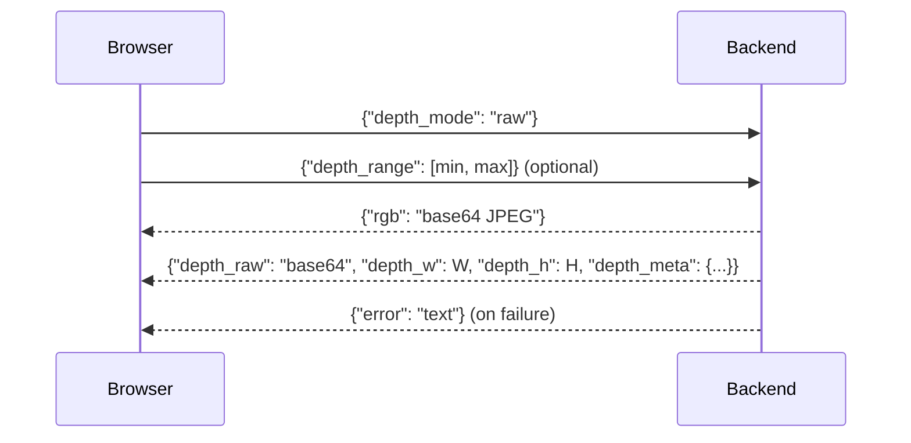

---
sources:
  - frontend/components/CameraFeed.tsx
  - frontend/components/CameraCell.tsx
  - frontend/lib/depthPng.ts
  - frontend/lib/api.ts
verified_at: 4a810a3717ab
---

# 5. How camera and depth frames arrive

!!! abstract "In this chapter"
    - Each viewed camera has its own WebSocket, and every message on it is a small JSON text.
    - Colour arrives as a base64 JPEG. Depth arrives either as a coloured JPEG or as raw `uint16` millimetres, compressed with zlib and written in base64.
    - Raw depth keeps the real distances: the browser can show the value under the cursor and save a true 16-bit PNG.

## The question

"The picture on the screen is coloured. Where did the real distances go, and how do I get them back?"

## The idea

A depth camera gives one distance per pixel. This dashboard counts it in millimetres in an unsigned 16-bit integer (0 to 65535). The value 0 means "no reading". A raw frame of that is a lot of numbers, so the [backend](../reference/glossary.md#backend) compresses it before it sends it. For each camera the dashboard opens `WS /ws/camera/<connection id>`. The browser first says what it wants, then the server streams frames.

A frame holds `rgb`, `depth` (a depth image already coloured by the server, as a JPEG), or `depth_raw`. In the `depth_raw` form the text is base64 of zlib-compressed bytes. After inflate, the bytes are little-endian `uint16` values, `depth_w` times `depth_h` of them, row by row. The full message table, the controls and the failure modes are in [cameras and depth](../modules/cameras.md).

One example, run offline on synthetic data (no camera, no image). I took six depth values in millimetres and made a payload the way a backend would. I decoded it with the repo's own `decodeRawDepth` and wrote it as a PNG with `encode16BitGrayPng(..., 3, 2)` (a 3 by 2 image). The run used Node v22.23.3 on a local machine on 2026-11-19, with the repo's `lib/depthPng.ts` bundled by its own `esbuild`.

| step | result |
|---|---|
| six values in mm | `[0, 412, 815, 1203, 65535, 300]` |
| `depth_raw` text | 28 characters: `eJxjYJjDqM+8meX/fx1GABNSA7I=` |
| `decodeRawDepth` | `[0,412,815,1203,65535,300]`, the same six values |
| `encode16BitGrayPng` | a PNG of 79 bytes, width 3, height 2, bit depth 16, colour type 0 |

Colour type 0 with bit depth 16 is a real 16-bit grayscale PNG. Nothing was rounded to 8 bits, so a depth map saved this way keeps every millimetre. A coloured JPEG or a canvas snapshot cannot do that.

To draw raw depth, the browser maps each value to a colour with a small JET-like formula, scaled between `depth_meta.dmin` and `depth_meta.dmax`; the value 0 is drawn black. Hovering shows `(x,y) N mm`, or `invalid` for 0. The page says the same in [the module page](../modules/cameras.md#frames-on-the-wire).

!!! code "Where in the code"
    - `frontend/components/CameraFeed.tsx` lines 295-423: the tab view, the settings sent on open, the frame handling and the colouring. [View](https://github.com/mtbui2010/robotapp/blob/4a810a3717ab/frontend/components/CameraFeed.tsx#L295-L423)
    - `frontend/components/CameraCell.tsx` lines 33-100: one grid cell with its own socket, and the reconnect after 1.5 s. [View](https://github.com/mtbui2010/robotapp/blob/4a810a3717ab/frontend/components/CameraCell.tsx#L33-L100)
    - `frontend/lib/depthPng.ts`: `decodeRawDepth` (lines 10-19) and `encode16BitGrayPng` (lines 61-110). [View](https://github.com/mtbui2010/robotapp/blob/4a810a3717ab/frontend/lib/depthPng.ts#L10-L110)
    - `frontend/lib/api.ts` lines 844-846: the socket URL.

## What this means when you use it

- Choose `Raw` in the tab layout when you need numbers (the mm hover, a 16-bit save). Choose `Color` when you only want to look; it is lighter on the browser.
- A depth value of 0 is "no reading", not "touching the lens". A hole in the picture is normal.
- Save depth with `save_raw` to get a lossless 16-bit PNG. Save both the RGB and the depth with `Save both`: the two files get one timestamp.
- If you write a backend, send exactly the fields above: `depth_raw`, `depth_w`, `depth_h`, and `depth_meta` with `dmin`, `dmax`. The dashboard reads those names; an older description of the frame in the previous documentation site uses other names and does not match the code.
- A grid cell reconnects by itself; in the tab layout a dropped socket leaves the view empty until you switch view or press Stop then Live. This is current behaviour, listed in the module page.
- The hub side (how a camera becomes a connection and how the backend shares one stream between viewers) is on the [framework site](https://mtbui2010.github.io/robot_agent/). Nothing here was run against a camera or in a browser.

**Next:** [6. Map frames and robot poses](06-map-pose.md)
