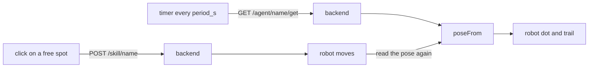

---
sources:
  - frontend/components/MapPanel.tsx
  - frontend/lib/robotPose.ts
  - frontend/lib/types.ts
  - frontend/lib/api.ts
verified_at: 4a810a3717ab
---

# 6. Map frames and robot poses

!!! abstract "In this chapter"
    - A map is an image plus three numbers, and the numbers (`origin`, `resolution`, and "row 0 is the top") tell you which world point each pixel is.
    - The robot's pose is read from the value of a device agent by dot paths; yaw comes from a quaternion or from a number in degrees or radians.
    - Reading the pose is read-only and safe to repeat. Sending the robot somewhere is a skill call with checks, and the two must not be mixed up.

## The question

"I clicked a pixel on the map. Where in the world is that, and how does the dashboard know where the robot is?"

## The idea

### A frame in three numbers

The Map tab follows the ROS `map.yaml` convention. The `MAP` [config group](../reference/glossary.md#config-group) of the active [site](../reference/glossary.md#site) names the picture and its frame:

| field | meaning |
|---|---|
| `origin` | the world `(x, y)` in metres of the image's bottom-left corner |
| `resolution` | metres per pixel |
| row 0 | the top row of the image (image rows grow downward, world `y` grows upward) |

The code converts world to pixel with `col = (x - origin_x) / resolution` and `row = height - (y - origin_y) / resolution`. Worked by hand as an example (arithmetic only, not run): with `origin = [-5, -5]`, `resolution = 0.05` and a 200 pixel tall image, the world point `(0, 0)` is column 100, row 200 - 100 = 100. The `y` flip is the part that people forget. The full list of `MAP` keys is in [map config](../reference/map-config.md) and the tab itself in [the map module](../modules/map.md).

There are two frames of numbers. The robot and the saved places (`ENV`) use the robot's own map frame. The numbers a person reads on screen use the user's origin `MAP.origin`, `[x, y, yaw in degrees]`, so a person can pick a corner of the room as zero. The tab converts between them in two small functions.

### The pose from an agent's value

The tab does not know any robot. `MAP.pose` names a [device agent](../reference/glossary.md#device-agent) and the dot paths inside its value: `x`, `y`, and either `orientation` (a quaternion) or `yaw` with `angle` `deg` or `rad`. `poseFrom` returns `{x, y, yaw}` in the map frame, or `null` if `x` or `y` is not a finite number. Real outputs, run offline on synthetic values with the repo's own `lib/robotPose.ts` (Node v22.23.3, 2026-11-19):

```text
poseFrom({pose:{position:{x:1.5,y:-0.25},orientation:{x:0,y:0,z:0.7071068,w:0.7071068}}}, {x:'pose.position.x', y:'pose.position.y', orientation:'pose.orientation'})
  -> {"x":1.5,"y":-0.25,"yaw":1.570796380007374}
poseFrom({x:2,y:3,th:90}, {x:'x',y:'y',yaw:'th',angle:'deg'})
  -> {"x":2,"y":3,"yaw":1.5707963267948966}
poseFrom({x:'n/a',y:3}, {x:'x',y:'y'})
  -> null
```

The first value is a quaternion for a quarter turn; the second reaches the same 1.5708 rad (90 degrees) from a field in degrees. The third shows that a bad value gives no pose rather than a wrong one.

### Reading is not moving



The tab polls the pose every `MAP.pose.period_s` seconds (default 0.5) with `api.agentGet`. Its comment in `api.ts` says why: it is read-only, and unlike `runSkill` it never clears a pending cancel. A poll that ran a [skill](../reference/glossary.md#skill) would undo the operator's Stop on the next tick. See [Stop, cancel, force reset](../reference/glossary.md#stop-cancel-force-reset). If a poll fails, the tab ignores it ("robot not up yet") and tries again on the next tick.

Motion is a different path. A click calls `goTo`: it fills the `goal` skill's params from the templates `{x}`, `{y}`, `{rz}`, refuses a blocked cell (occupancy at or above the inflated value, default 128), refuses while a plan runs, asks first when `confirm_goal` is set, then sends `POST /skill/<name>`. After the skill says done, the tab reads the pose again and, if the robot is more than 0.3 m from the goal, shows `stopped N m short of the goal (no path?)`. That check exists because one robot package reports done when its navigation gave up (a [backend workaround](../reference/glossary.md#backend-workaround), `map-arrive-check`).

!!! code "Where in the code"
    - `frontend/components/MapPanel.tsx` lines 23-101: frame conversions, the template `fill`, the pixel formula. [View](https://github.com/mtbui2010/robotapp/blob/4a810a3717ab/frontend/components/MapPanel.tsx#L23-L101)
    - `frontend/components/MapPanel.tsx` lines 265-287: `goTo`, with the arrival check. [View](https://github.com/mtbui2010/robotapp/blob/4a810a3717ab/frontend/components/MapPanel.tsx#L265-L287)
    - `frontend/lib/robotPose.ts`: `getPath`, `quatYaw`, `poseFrom`. [View](https://github.com/mtbui2010/robotapp/blob/4a810a3717ab/frontend/lib/robotPose.ts)
    - `frontend/lib/types.ts` lines 241-267: type `MapConfig`.

## What this means when you use it

- To add a new robot you write config, not code: name the pose agent, its three dot paths, the goal skill and its params. Check the paths with a real `GET /agent/<name>/get` value first.
- Picking the wrong `angle` (`deg` for a value in radians) turns the arrow by a factor of 57. A quaternion needs no `angle`.
- A map click is a real robot move. Today the Map tab shows no "two clients on one robot" warning (the chat card does): do not drive a robot from two clients, and use `confirm_goal` if you want a dialog before each move. Details in [the map module](../modules/map.md).
- If the dot does not move, the poll is failing quietly; check the pose agent and the dot paths before you look at the map image.
- This chapter is checked in code at 4a810a3717ab and by the offline runs above. It was not run against a robot.

**Next:** [7. Build, check and run it](07-build-run.md)
