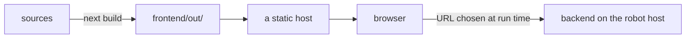

---
sources:
  - Makefile
  - frontend/next.config.js
  - frontend/lib/api.ts
  - frontend/lib/clipboard.ts
  - frontend/lib/hriVoice.ts
  - frontend/app/page.tsx
  - scripts/lint.mjs
  - scripts/test_lib.mjs
verified_at: 4a810a3717ab
---

# 7. Build, check and run it

!!! abstract "In this chapter"
    - The dashboard builds to plain files (a static export). It has no server, and the backend address is chosen in the browser, not at build time.
    - Three checks need no robot and no network: the repo lint, 78 unit tests and the type check. All three were run for this site and passed.
    - The microphone needs a secure context (https or localhost). The clipboard works on plain http through a fallback.

## The question

"Where does this run, what proves it still works, and why does the microphone say no on my robot's address?"

## The idea

### A static export

`frontend/next.config.js` sets three options, and together they make `next build` write ordinary files to `frontend/out/`:

| option | value | effect |
|---|---|---|
| `output` | `'export'` | write a static site, no Node server |
| `trailingSlash` | `true` | each page is a folder with an `index.html` |
| `images.unoptimized` | `true` | the image optimiser needs a server, so it is off |

Any host that serves files can serve `out/`; see [static export](../reference/glossary.md#static-export). The page then talks to the [backend](../reference/glossary.md#backend) from the browser. The robot URL is a setting you pick at run time and `getWsBase` makes the WebSocket address from it, not from the page address: `http://` becomes `ws://` and `https://` becomes `wss://`. The same files therefore work for any robot. Targets, versions and deploy notes are in [make targets, build and deploy](../modules/build-deploy.md).



### The checks

`make ci` runs `lint`, `typecheck`, `unit` and `smoke` in that order (`Makefile` line 54 at the pin). It needs `frontend/node_modules` but no backend and no network. The `smoke` part runs `next build`, which writes `.next/` and `out/`, so it was not run for this site. The other three were:

| check | what it proves | result (2026-11-19, Node v22.23.3, Linux) | page |
|---|---|---|---|
| `node scripts/lint.mjs` | every URL in `lib/api.ts` exists in the OpenAPI file, only `lib/api.ts` does HTTP, no new bundled robot data, every workaround tag is listed | 77 URLs against 66 paths, 65 files, 5 workaround tags; `lint: ok`; ESLint is not installed, so that step was skipped | [lint](../modules/lint.md) |
| `node --test-reporter=spec scripts/test_lib.mjs` | the pure `lib/` modules, including plan views replayed on recorded event files | 78 tests, 78 pass, 0 fail, about 56 ms | [tests](../modules/tests.md) |
| `tsc --noEmit -p . --incremental false` in `frontend/` | the code type-checks in strict mode | exit code 0, about 3 s | [build and deploy](../modules/build-deploy.md) |

The type check differs from `make typecheck` only in not writing `tsconfig.tsbuildinfo`. These checks do not cover the components, the camera code or the map tab: no test loads them. What they cannot see, a person has to try against a robot, and the guides in this site were checked in code but not run against a robot.

Be exact about one thing: the dashboard's types are written by hand in `lib/types.ts`. `make gen-types` only dumps the OpenAPI of a `robot_agent` checkout; the lint uses that file to check URLs. The hub side of this contract is on the [framework site](https://mtbui2010.github.io/robot_agent/).

### Secure context: the microphone and the clipboard

A browser gives some features only to a secure context: a page served over https, or from `localhost`. A dashboard opened as `http://<host>:<port>` on a robot's address is not one.

| feature | what the code does on plain http |
|---|---|
| microphone | `recordPhrase` in `lib/hriVoice.ts` returns the error `not-allowed` with the note `insecure-context (http)`, and `primeMic` returns `insecure-context`. The page then tells the user: "this page is on http — open it over https (or localhost) to use the mic", and the robot asks for typed input instead |
| clipboard | `copyText` uses `navigator.clipboard` only in a secure context and otherwise falls back to a hidden text box and `execCommand('copy')`, which still works |

The clipboard guard, [clipboard.ts lines 5-11](https://github.com/mtbui2010/robotapp/blob/4a810a3717ab/frontend/lib/clipboard.ts#L5-L11):

```ts
export async function copyText(text: string): Promise<boolean> {
  if (typeof navigator !== 'undefined' && navigator.clipboard && window.isSecureContext) {
    try {
      await navigator.clipboard.writeText(text)
      return true
    } catch { /* permission denied, not focused, … — try the fallback */ }
  }
```

!!! code "Where in the code"
    - `frontend/next.config.js` lines 1-11: the export options. [View](https://github.com/mtbui2010/robotapp/blob/4a810a3717ab/frontend/next.config.js)
    - `Makefile` lines 35-54: `lint`, `typecheck`, `unit`, `smoke`, `ci`. [View](https://github.com/mtbui2010/robotapp/blob/4a810a3717ab/Makefile#L35-L54)
    - `frontend/lib/api.ts` lines 148-150: `getWsBase`. [View](https://github.com/mtbui2010/robotapp/blob/4a810a3717ab/frontend/lib/api.ts#L148-L150)
    - `frontend/lib/hriVoice.ts` line 310 and `frontend/app/page.tsx` lines 605-611: the secure-context check and its message.
    - `frontend/lib/clipboard.ts`: the fallback.

## What this means when you use it

- Run `make lint`, `make typecheck` and `make unit` before a change; they take seconds and need no robot. Run `make ci` when you can build, since `smoke` writes `.next/` and `out/`.
- Serve `out/` from any static host and set the robot URL in the dashboard. You do not rebuild for a new robot.
- For the microphone, open the dashboard over https or at `localhost`. On plain http voice input is off and the robot falls back to typing; nothing else breaks.
- If you open the dashboard over https, the robot URL must also be https, or the browser will block the calls as mixed content (general browser rule, not tested here).
- A green check does not mean a panel works. Only pure modules are tested; try a real run on the robot.

**Back to the course:** [1. The UI mode](01-ui-mode.md)
