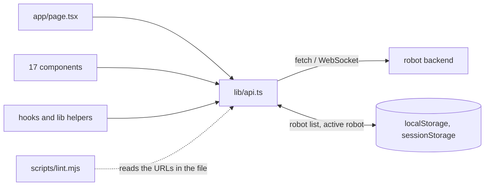

---
sources:
  - frontend/lib/api.ts
  - frontend/lib/types.ts
  - frontend/lib/robotLanguages.ts
  - frontend/lib/buttonGroups.ts
  - frontend/lib/recorder.ts
  - frontend/lib/poses.ts
  - frontend/lib/recordings.ts
  - frontend/lib/teleop.ts
  - frontend/lib/generated/openapi.json
  - scripts/lint.mjs
  - scripts/test_lib.mjs
verified_at: 4a810a3717ab
---

# The API client (`lib/api.ts`)

One file builds every URL the dashboard sends to the robot backend, and it is the only file that calls `fetch` or `new WebSocket`. It also keeps the list of robots and says which one this browser tab talks to.

!!! abstract "In this page"
    - `api` is one object with 86 members: 8 registry helpers and 78 backend methods. Each backend method is one call and returns a typed promise.
    - The robot registry lives in the same file: a list of `{name, url}` in `localStorage`, and one active robot per tab in `sessionStorage`.
    - Errors do not follow one rule. There are six patterns. The table below says which method uses which, so you know what a failure looks like before you call it.
    - There are 77 URL templates: 75 HTTP and 2 WebSocket. `make lint` checks that each HTTP path exists in the OpenAPI snapshot.
    - Two real bugs shaped the file: two tabs sent each other's calls, and a speech-server error was swallowed. Both are fixed and described below.

!!! code "Where in the code"
    - Robot registry: [`api.ts:9-146`](https://github.com/mtbui2010/robotapp/blob/4a810a3717ab/frontend/lib/api.ts#L9-L146)
    - Shared helpers `skillResponse`, `mapPost`, `jsonCall`: [`api.ts:152-180`](https://github.com/mtbui2010/robotapp/blob/4a810a3717ab/frontend/lib/api.ts#L152-L180)
    - The `api` object: [`api.ts:182-847`](https://github.com/mtbui2010/robotapp/blob/4a810a3717ab/frontend/lib/api.ts#L182-L847)
    - WebSocket openers: [`api.ts:840-846`](https://github.com/mtbui2010/robotapp/blob/4a810a3717ab/frontend/lib/api.ts#L840-L846)

## Where it sits



Used by: `app/page.tsx`, 17 components (`ButtonPanel`, `CameraCell`, `CameraFeed`, `DataPanel`, `DevicePanel`, `EnvLocationsEditor`, `EnvPanel`, `MapPanel`, `MapSettings`, `PlanPanel`, `PlannerPromptPanel`, `PoseEditor`, `RecorderBar`, `SkillPanel`, `TeleopBar`, `mapObjects`, `mapSim`), the hooks `useRecorder`, `useTeleop`, `usePoses`, `useRobotLanguages`, and the helpers `lib/robotPose.ts` and `lib/recordVoice.ts`. It uses only the types from `lib/types.ts` and a few small type files (`robotLanguages`, `buttonGroups`, `recorder`, `poses`, `recordings`, `teleop`).

## The robot registry

The dashboard can know several robots and talks to one at a time. The data is plain browser storage.

| key | store | content |
|---|---|---|
| `robotapp_robots` | `localStorage` | JSON list `[{"name": "...", "url": "..."}]`. Entries without a name or a URL are dropped on read. |
| `robotapp_active_robot` | `sessionStorage` (this tab) and `localStorage` (default for new tabs) | the name of the active robot |
| `agent_url` | `localStorage` (old key) | one URL. Read once: if there is no valid `robotapp_robots`, a robot named `default` is built from it and saved. |

Registry functions are exported on `api` too: `listRobots`, `addRobot`, `updateRobot`, `removeRobot`, `getActiveRobotName`, `setActiveRobot`, `getAgentUrl`, `setAgentUrl`.

| function | behaviour |
|---|---|
| `addRobot(name, url)` | trims both, removes trailing `/` from the URL, refuses an empty name, an empty URL or a name already used. Returns `{ok, error?}`. The first robot added becomes active. |
| `updateRobot(name, newName, newUrl)` | same checks; if the renamed robot was active, the active name follows it. |
| `removeRobot(name)` | removes it; if it was active, the first remaining robot (or `''`) becomes active. |
| `setActiveRobot(name)` | writes both stores and fires the window event `robotapp:robot-changed` (exported as `ROBOT_CHANGED_EVENT`). Code that cached something from the old robot, such as the language list, listens to it. |
| `getAgentUrl()` | URL of the active robot. With no robot configured it falls back to `http://<page host>:8001`. During server-side rendering (no `window`) it is `http://localhost:8001`. |
| `setAgentUrl(url)` | changes the URL of the active robot, or creates a robot named `default` when there is none. |

WebSocket URLs use the same base: `https://` becomes `wss://` and `http://` becomes `ws://` (`getWsBase`). `agentWs()` opens `/ws/agent`; `cameraWs(clientId)` opens `/ws/camera/<clientId>`. The camera id is put in the URL as it is, without encoding.

### Why the active robot is per tab

Before 2026-10-27 every call read the one `localStorage` key. The tab that chose a robot last then sent the other tab's calls (skills, configs, location) to its own robot. Now each tab copies the choice into `sessionStorage` on its first read and keeps it, even if another tab picks another robot. `localStorage` only seeds new tabs.

## Inputs and outputs

Inputs are the arguments of each method. The base URL comes from `getAgentUrl()` at the time of the call, so a switch of robot takes effect at the next call.

Outputs are typed promises. Return types come from `lib/types.ts` (hand-written; see [the generated contract](generated-contract.md)) and from small type files next to it. A few methods return a URL string instead of calling the backend, because the browser loads it itself: `recordingFrameUrl(id, cam, t)` and `siteFileUrl(path)`.

## Error conventions

There is no single rule. Pick the row for the method you call.

| pattern | methods (examples) | on a non-2xx reply | on a network error |
|---|---|---|---|
| empty value | `listClients`, `listSkills`, `listButtons`, `listButtonGroups`, `getStatus`, `getApiKeys` | returns `[]` or `{}` | throws (fetch rejects), except where wrapped in `try`: `getServers`, `getSkillsStatus`, `listSkillConfigNames`, `getLlmConfig` return an empty value, `getSkillConfig` returns `null`, `listLocations` returns `{locations: [], active: ''}` |
| throw `detail` | `getWorld`, `setWorld`, `updateSkillConfig`, `addButton`, `updateButton`, the location calls, `plannerPrompt`, `jsonCall` and the button-group calls (`api.ts:172-180`) | throws `Error(detail)`, or `Error("HTTP <status>")` when the reply has no `detail` | throws |
| throw status only | `runSkill`, `agentSend`, `agentGet`, `getRobotLanguages`, `getTeleop`, `listPoses`, `restorePoseDefaults` | throws `Error("HTTP <status>")` | throws |
| 404 means "feature absent" | `getRecorder`, `listRecordings` | returns `null` on 404; any other error status throws | throws |
| never throws | `answerListenAudio` (`api.ts:420-439`) | returns `{text: '', error}`; a 404 returns `{text: '', gone: true}` | returns `{text: '', error: 'cannot reach the robot (...)'}` |
| fallback | `mergeSkillConfig` (`api.ts:332-349`) | on 405 it sends a plain `PUT` of the whole group instead; other errors throw `detail` | throws |
| error object | `addClient`, `updateClient` (`api.ts:222-262`) | returns `{id, error}`; when `detail` is a list of validation errors, the `msg` of each is joined with `; ` | throws |
| not checked | `scanRos`, `setActiveLlm`, `reloadSkills`, `setLlmConfig`, `setApiKey` | the reply body is parsed and returned whatever the status; no error is raised for the status | throws |
| result ignored | `deleteClient`, `answerListen`, `cancelRun` | the status is not read | throws |

Two things follow for a caller. First, a method in the "throw" rows must be wrapped in `try` or `.catch`, or the error reaches the console as an unhandled rejection. Second, a method in the "not checked" or "result ignored" rows can look successful when the backend refused it. The page `app/page.tsx` handles this for `cancelRun` and `answerListen` by adding `.catch(() => {})` and by not relying on the reply.

A short real run (offline; `fetch` is replaced by a fake that answers a fixed status; the host `x` is a placeholder):

```text
listSkills 500 -> []  getWorld 500 -> throws: HTTP 500
update 400 -> throws: alias already used
addClient 422 -> {"id":"","error":"field required; bad type"}
merge 405 -> {"a":2} ["PATCH http://x:8001/skill-configs/ENV","PUT http://x:8001/skill-configs/ENV"]
```

## Excerpt 1: which robot to call

[`frontend/lib/api.ts:116-126`](https://github.com/mtbui2010/robotapp/blob/4a810a3717ab/frontend/lib/api.ts#L116-L126)

```ts
// Returns the URL of the active robot. Falls back to same-host :8001 when no
// robot is configured yet (preserves the legacy default).
function getAgentUrl(): string {
  if (typeof window === 'undefined') return 'http://localhost:8001'
  const active = getActiveRobotName()
  if (active) {
    const r = readRobots().find(x => x.name === active)
    if (r) return r.url
  }
  return `http://${window.location.hostname}:8001`
}
```

If the active name is not in the list (for example it was removed in another tab), the function silently falls back to the page host on port 8001. It does not warn.

## Excerpt 2: save a config group, with a fallback

[`frontend/lib/api.ts:332-349`](https://github.com/mtbui2010/robotapp/blob/4a810a3717ab/frontend/lib/api.ts#L332-L349)

```ts
  async mergeSkillConfig(name: string, base: Record<string, unknown>, value: Record<string, unknown>):
      Promise<Record<string, unknown>> {
    const r = await fetch(`${getAgentUrl()}/skill-configs/${encodeURIComponent(name)}`, {
      method: 'PATCH',
      headers: { 'Content-Type': 'application/json' },
      body: JSON.stringify({ base, value }),
    })
    if (r.status === 405) {          // a backend from before 2026-10-26: plain PUT of the whole group
      await api.updateSkillConfig(name, value)
      return value
    }
    const body = await r.json().catch(() => ({}))
    if (!r.ok) {
      const detail = (body as { detail?: unknown }).detail
      throw new Error(typeof detail === 'string' ? detail : `HTTP ${r.status}`)
    }
    return (body as { value: Record<string, unknown> }).value
  },
```

`base` is the group as it was loaded and `value` is the group as edited. The backend merges per top-level entry (per location for `ENV`), so another machine's newer entries are kept. An older backend answers 405 and the client overwrites the whole group. In that case `mergeSkillConfig` returns the `value` it sent, not what the backend now holds.

## Endpoints

The full table (method, path, function, line) is in [the endpoint reference](../reference/endpoints.md). By area, the client calls these path families:

| area | path family | example methods |
|---|---|---|
| devices | `/ros/scan`, `/connects`, `/connects/status`, `/connects/servers`, `/connects/{id}`, `/connects/{id}/set_active` | `scanRos`, `listClients`, `addClient`, `getServers` |
| skills and configs | `/skills`, `/skills/status`, `/skills/reload`, `/skills/{name}`, `/skill/{name}`, `/skill-configs`, `/skill-configs/{name}` | `listSkills`, `runSkill`, `mergeSkillConfig` |
| agent | `/agent/llm-config`, `/agent/api-key`, `/agent/api-keys`, `/agent/world`, `/agent/cancel`, `/agent/qa/end`, `/agent/listen/{id}`, `/agent/listen/{id}/audio`, `/agent/{name}/send`, `/agent/{name}/get` | `cancelRun`, `answerListen`, `agentGet`, `getWorld` |
| language and voice | `/robot/languages`, `/tts` | `getRobotLanguages`, `ttsAudio` |
| planner | `/planner/prompt` | `plannerPrompt` |
| shortcut buttons | `/buttons`, `/buttons/{id}`, `/buttons/reorder`, `/buttons/bulk`, `/buttons/groups`, `/buttons/groups/{id}`, `/buttons/groups/reorder` | `listButtons`, `addButtonGroup` |
| sites | `/config/locations`, `/config/locations/{name}`, `/config/locations/{name}/activate`, `/config/locations/_active/files/<path>` | `listLocations`, `siteFileUrl` |
| map | `/map/snapshot` | `mapSnapshot`, `mapPreview` |
| data | `/teleop...`, `/recorder...`, `/poses...`, `/recordings...` | `getTeleop`, `startRecording`, `runPose`, `exportRecordings` |
| sockets | `/ws/agent`, `/ws/camera/{id}` | `agentWs`, `cameraWs` |

The OpenAPI snapshot has 66 paths. The client does not call 10 of them: the eight `/runs` paths and the two `/diagnostics` paths.

## Failure modes and how to avoid them

| symptom | cause | what to do |
|---|---|---|
| Two tabs drive each other's robot | (fixed 2026-10-27) one shared storage key | keep one robot per tab; the choice is stored in `sessionStorage` |
| A speech-server failure looked like "nothing heard" | `answerListenAudio` once swallowed a 500 | fixed: it now returns `error` with the backend `detail` (cut to 120 characters). The test below covers it. |
| Calls go to `http://<page host>:8001` after you removed a robot in another tab | `getAgentUrl()` falls back when the active name is not found | choose a robot again in the device panel |
| A save looks done but the backend refused it | the method is in the "not checked" or "result ignored" row | check the method in the table before relying on its result |
| Saving a config group on an old backend replaces the whole group | 405 fallback in `mergeSkillConfig` | update the backend; the merged save needs it |

## How it is verified

- Unit test `scripts/test_lib.mjs:389-410` bundles `api.ts` with esbuild and replaces `fetch`. A 500 with `{detail: 'CUDA out of memory'}` gives an error matching `/HTTP 500: CUDA out of memory/`. A network error gives `cannot reach the robot`. A 404 gives `gone: true`. A 200 with `{ok: true, text: 'hello'}` gives `{text: 'hello'}`. It passes in the 78-test run (see the table at the end).
- `make lint` runs `scripts/lint.mjs`. It reads every `${getAgentUrl()}/...` and `${getWsBase()}/...` template in `api.ts` with a regular expression and checks that the path exists in `frontend/lib/generated/openapi.json`. It also fails if `fetch(` or `new WebSocket(` appears in any other file under `app/`, `components/` or `lib/` unless the argument starts with `api.`.
- The lint compares paths only. It does not compare the HTTP method, the request body or the reply shape.

Real output of the checks above, run offline:

| date | machine | command | result |
|---|---|---|---|
| 2026-11-19 | offline Linux workstation | `node scripts/lint.mjs` | `lint: 77 endpoint URLs in lib/api.ts checked against 66 OpenAPI paths`, `lint: ok` |
| 2026-11-19 | offline Linux workstation | the `answerListenAudio` probe (same fake replies as the unit test) | `{"text":"","error":"HTTP 500: CUDA out of memory"}`, `{"text":"","error":"cannot reach the robot (connection refused)"}`, `{"text":"","gone":true}`, `{"text":"hello"}` |
| 2026-11-19 | offline Linux workstation | `node --test-reporter=spec scripts/test_lib.mjs` | 78 tests, 78 pass, 0 fail (run for the whole site, not only for this page) |

Not run for this page: any call to a real backend. The behaviour on a live robot is read from the code.
