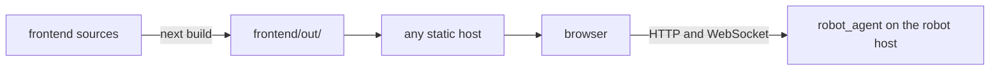

---
sources:
  - Makefile
  - frontend/next.config.js
  - frontend/package.json
  - frontend/tsconfig.json
  - frontend/tailwind.config.ts
  - frontend/postcss.config.js
  - .gitignore
  - .github/workflows/deploy-docs.yml
verified_at: 4a810a3717ab
---

# Make targets, build and deploy

!!! abstract "In this page"
    Every `make` target of the repo, what each one needs, how the static export is produced, and the stack versions. Only the checks were run for this page; builds and the dev server were not (see the table at the end).

The dashboard is a Next.js 14 app in `frontend/`. It is built as a static export: a folder of plain files in `frontend/out/` that any static host can serve. It has no server of its own. In the browser it talks to the `robot_agent` backend.



## Stack

| Item | Value | Where |
|---|---|---|
| Framework | `next ^14.2.0` | `frontend/package.json` |
| UI | `react ^18.3.0`, `react-dom ^18.3.0` | `frontend/package.json` |
| Language | `typescript ^5`, with `strict: true` | `package.json`, `tsconfig.json:7` |
| Styles | `tailwindcss ^3`, `postcss ^8`, `autoprefixer ^10` | `package.json`, `tailwind.config.ts`, `postcss.config.js` |
| Node version | No `engines` field. The checks on this page ran on Node v22.23.3 | - |

## Static export

`frontend/next.config.js` sets three options:

| Option | Value | Effect |
|---|---|---|
| `output` | `'export'` | `next build` writes a static site to `out/` |
| `trailingSlash` | `true` | Each page is a folder with an `index.html` |
| `images.unoptimized` | `true` | The image optimiser needs a server, so it is off |

`.gitignore` leaves out `node_modules/`, `.next/`, `out/`, `*.tsbuildinfo`, `next-env.d.ts` and the `.env` files.

## The targets

```make
# Repo rules (scripts/lint.mjs: endpoints in OpenAPI, HTTP only in lib/api.ts,
# no new bundled robot data, workaround tags inventoried) + ESLint when installed.
lint: check-deps
	node $(ROOT)/scripts/lint.mjs

typecheck: check-deps
	cd $(ROOT)/frontend && $(FE_BIN)/tsc --noEmit -p .

# Unit tests of the pure lib modules (planView replayed on recorded event files, chatMic): scripts/test_lib.mjs
unit: check-deps
	node --test-reporter=spec $(ROOT)/scripts/test_lib.mjs

# Static export must build and produce the page (runs without a robot).
smoke: check-deps
	cd $(ROOT)/frontend && NEXT_TELEMETRY_DISABLED=1 $(FE_BIN)/next build
	@grep -q '<html' $(ROOT)/frontend/out/index.html && echo "smoke: out/index.html ok"

ci: lint typecheck unit smoke
```

Source: [`Makefile:37-54`](https://github.com/mtbui2010/robotapp/blob/4a810a3717ab/Makefile#L37-L54).

| Target | What it does | Needs | Writes |
|---|---|---|---|
| `install`, `install-frontend` | `npm install` in `frontend/` | Node, npm, network | `frontend/node_modules/` |
| `run-frontend` | `npm run dev -- -p 3007`: the dev server | `node_modules` | `frontend/.next/` |
| `terminate` | `fuser -k 3007/tcp`: frees port 3007 | `fuser` | nothing |
| `build-frontend` | `npm run build` (`next build`) | `node_modules` | `.next/`, `out/` |
| `check-deps` | Fails with a message unless `node_modules/.bin/tsc` exists | - | nothing |
| `lint` | `node scripts/lint.mjs` ([lint](lint.md)) | `check-deps` | nothing |
| `typecheck` | `tsc --noEmit -p .` in `frontend/` | `check-deps` | `tsconfig.tsbuildinfo` |
| `unit` | `node --test-reporter=spec scripts/test_lib.mjs` ([tests](tests.md)) | `check-deps` | a temp folder |
| `smoke` | `next build`, then checks that `out/index.html` holds `<html` | `check-deps` | `.next/`, `out/` |
| `ci` | `lint`, `typecheck`, `unit`, `smoke`, in that order | `check-deps` | as its parts |
| `gen-types` | Runs `scripts/gen_types.sh`: dumps the OpenAPI of a `robot_agent` checkout to `frontend/lib/generated/openapi.json` | A `robot_agent` checkout with FastAPI; pass `ROBOT_AGENT_DIR` and `PYTHON` | the OpenAPI file |
| `deploy` | Builds, then uploads `out/` to a static host. The host login comes from an environment variable | Network and a token | `.next/`, `out/` |
| `deploy-status` | Asks the host about the published site | Network and a token | nothing |

`make ci` (`Makefile:54`) runs `unit` as well. `docs/rules.md` section 4 lists `ci` without it.

`make typecheck` uses `incremental: true` (`tsconfig.json:15`), so it writes `frontend/tsconfig.tsbuildinfo`. That file is ignored by git and does no harm.

`gen-types` does not make types. At this commit there is no `openapi.d.ts`: the dashboard types are written by hand in `frontend/lib/types.ts`, and the OpenAPI file is used only by [the lint](lint.md). The script writes `openapi.d.ts` only if `openapi-typescript` is installed, and it is not.

## Deploy

`make deploy` builds the static export and uploads `frontend/out/` to a static host. The login is a token in the environment; the target stops with an error if it is not set, and no token is stored in the repo. The repo also has a `pages:deploy` script in `frontend/package.json` that does the same with a vendor command-line tool. Host names and accounts are not part of this documentation. Any host that serves static files can serve `out/`: put `out/` behind it and point the dashboard at the backend of your robot.

## The dev server port

Two places set the port of `next dev`:

| Where | Command | Port |
|---|---|---|
| `Makefile:15` | `npm run dev -- -p 3007` | 3007 |
| `frontend/package.json:6` | `"dev": "next dev --port 3001"` | 3001 |

`make run-frontend` runs the npm script with `-p 3007` added after it, so `next dev` receives `--port 3001 -p 3007`. Which of the two it uses was not run here. The README and `make terminate` both say 3007; when you start the server, read the address it prints.

## The docs workflow

`.github/workflows/deploy-docs.yml` builds the older Astro site that lives in `docs/` (it starts on pushes that change `docs/**`) and publishes it to GitHub Pages. It does not build this site, which lives in `website/`.

## What was run for this page

| Command | Run? |
|---|---|
| `node scripts/lint.mjs`, the unit tests, `tsc --noEmit -p . --incremental false` | Yes, all exit 0; see [lint](lint.md), [tests](tests.md) and [Getting started](../getting-started.md) |
| `make smoke`, `make build-frontend`, `next build` | No: they write `.next/` and `out/` |
| `make run-frontend` | No |
| `make gen-types` | No: needs a `robot_agent` checkout |
| `make deploy`, `make deploy-status` | No: network and token |

!!! code "Where in the code"
    - `Makefile:14-60`: the targets (the deploy targets are after line 60).
    - `frontend/next.config.js`: the export options.
    - `frontend/package.json:5-9`: the npm scripts.
    - `frontend/tsconfig.json`: strict mode and incremental build info.
    - `.github/workflows/deploy-docs.yml`: the docs workflow.
