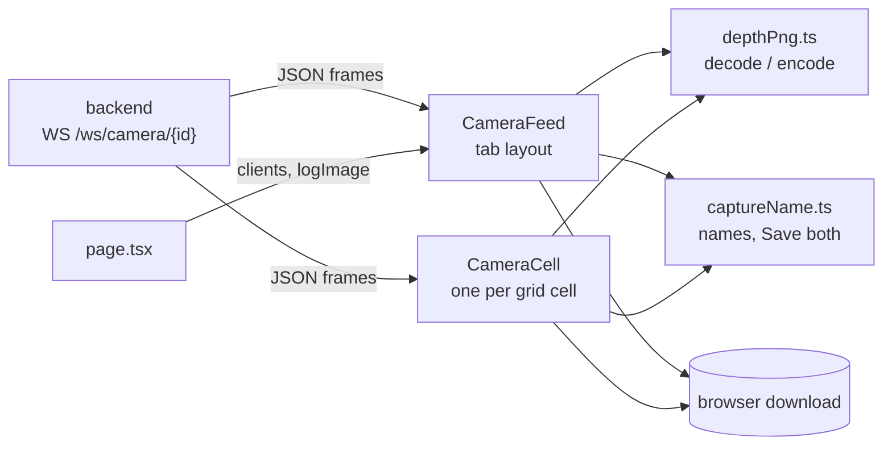

---
sources:
  - frontend/components/CameraFeed.tsx
  - frontend/components/CameraCell.tsx
  - frontend/components/PopoverButton.tsx
  - frontend/lib/depthPng.ts
  - frontend/lib/captureName.ts
  - frontend/lib/api.ts
  - frontend/lib/types.ts
  - frontend/app/page.tsx
verified_at: 4a810a3717ab
---

# Cameras and depth

!!! abstract "In this page"
    The Cameras tab shows every robot connection that is marked as a camera, as one view at a time (tab layout) or as a grid. It also has a tab for the images a skill logs and a tab for the operator's own webcam. Depth can be coloured by the server or sent as raw millimetres, which the browser colours itself, reads under the cursor, and saves as a real 16-bit PNG. This page explains the frame format, the 16-bit decode and encode (with a run on synthetic data), the two depth decoders that exist in the code, and what each control does.

## What the reader gets

After this page you can read the camera WebSocket messages, decode `depth_raw` by hand, find the code behind each save button, and tell why a camera view goes blank or freezes.

| | |
|---|---|
| **Components** | `CameraFeed` (the tab: layout, view list, tab view, log and observe views), `CameraCell` (one self-contained grid cell with its own socket) |
| **Pure logic** | `lib/depthPng.ts` (decode, PNG encode, download), `lib/captureName.ts` (file names, "Save both") |
| **Input** | props `clients`, `logImage`, `onClearLog`, `toolbarSlot`; one WebSocket per viewed camera |
| **Output** | pixels on screen; browser downloads (JPEG or 16-bit PNG) |
| **Endpoint** | `WS /ws/camera/{clientId}` (`api.ts` lines 844-846) |
| **Tests** | none for these files in `scripts/test_lib.mjs` |

## Background

A depth camera gives, for each pixel, the distance to the surface. In this dashboard depth is a number of millimetres in an unsigned 16-bit integer (a `uint16`, 0 to 65535). The value 0 means "no reading" (the hover text says `invalid`). Raw depth is a lot of numbers, so the backend compresses it. The backend can also colour the depth itself and send a JPEG. See [camera and depth in the learn chapter](../learn/05-camera-depth.md) for a slower walk through.

A connection is a device the backend knows (a camera, a robot arm, a language model). A connection is shown in the Cameras tab when its entry has `is_camera: true` (`CameraFeed.tsx` line 60). Connections are listed in [robots and connections](../modules/robots-connections.md).

## Where it sits



`page.tsx` mounts the component at line 957 as `<CameraFeed clients={clients} logImage={logImage} onClearLog={() => setLogImage(null)} toolbarSlot={cameraSlot} />`. The map tab ([map](../modules/map.md)) opens its own socket to a camera with the same protocol, for its picture.

## Props

| prop | type | meaning |
|---|---|---|
| `clients` | `ClientEntry[]` | every connection; the component keeps those with `is_camera` |
| `logImage` | `string \| null`, optional | a base64 JPEG that a skill sent in a `step_log` event; shown in the `log_image` view |
| `onClearLog` | function, optional | called by the Clear button of that view |
| `toolbarSlot` | `HTMLElement \| null`, optional | when given, the toolbar is drawn there (the page's Cameras / Map row) through a portal; otherwise under the tabs |

`CameraCell` has one prop, `client: ClientEntry` (`CameraCell.tsx` line 17). A `ClientEntry` has `id`, `name`, `type`, `connected`, `is_camera` and more (`lib/types.ts` lines 26-37). `type` `webrtc` or `ros_topic` makes the camera "live capable": it gets a Stop / Live button. For other types the tab view shows `Press Capture` until a frame is on screen.

Browser storage: `cameraTabOrder` (the order of camera rows, a JSON array of ids) and `robotapp_webcam_device` (the id of the webcam chosen for `observe`), both in `CameraFeed.tsx` lines 17-18. See [browser storage](../reference/browser-storage.md).

## The views

| view | what it is |
|---|---|
| one per camera | the camera's frames |
| `log_image` | the last image a skill sent with `log_data({ log_image: ... })`; Save, Clear and a hint text when empty |
| `observe` | the operator's own webcam through `getUserMedia`, live only; present after the `webcam` checkbox is ticked; the device choice is saved |

The layout switch has two values, `Tab` and `Grid`; the default is `Grid`. In grid layout a `👁` list with checkboxes picks which views are shown, and the cells can be dragged to reorder. `log_image` is always last. A camera whose name or id contains "depth" starts unticked, so `head_rgb` shows and `head_depth` waits for a tick. In tab layout the same list has radio buttons. If there is no camera, the tab selects `log_image` and shows "No camera connected" with a hint to add a client with `is_camera: true`.

## Frames on the wire

The client opens `WS /ws/camera/{clientId}` and, on open, sends its depth settings. All messages are JSON text.

| direction | message | meaning |
|---|---|---|
| browser to server | `{"depth_mode": "colored"}` or `{"depth_mode": "raw"}` | what to send for depth |
| browser to server | `{"depth_range": [min, max]}` or `{"depth_range": null}` | colour range in mm; `null` is auto |
| browser to server | `{"capture": true}` | ask for one frame to download (tab layout, Capture) |
| server to browser | `{"rgb": "<base64 JPEG>"}` | an RGB frame |
| server to browser | `{"depth": "<base64 JPEG>"}` | a depth frame coloured by the server |
| server to browser | `{"depth_raw": "<base64>", "depth_w": W, "depth_h": H, "depth_meta": {dmin, dmax, mode}}` | raw depth (below) |
| server to browser | `{"error": "text"}` | a failure; shown in red; a pending Capture is cancelled |

A frame can hold `rgb`, `depth`, or both. When a frame has depth and no `rgb`, the view flips from RGB to depth so it does not stay blank (`CameraCell.tsx` lines 78-80, `CameraFeed.tsx` lines 331-335).

`depth_raw` is the base64 text of a zlib-compressed byte string of little-endian `uint16` millimetre values (`depthPng.ts` lines 3-7), `depth_w` x `depth_h` of them, row by row. The browser draws it with a JET-like colour map: value 0 is black, other values are scaled between `depth_meta.dmin` and `depth_meta.dmax` (`CameraFeed.tsx` lines 391-423). Hovering the canvas shows `(x,y) N mm` or `invalid`.

### The 16-bit decode and encode, run

`decodeRawDepth` and `encode16BitGrayPng` are in `lib/depthPng.ts`. The excerpt below is `decodeRawDepth` ([depthPng.ts lines 10-19](https://github.com/mtbui2010/robotapp/blob/4a810a3717ab/frontend/lib/depthPng.ts#L10-L19)):

```ts
export async function decodeRawDepth(b64: string): Promise<Uint16Array> {
  const compressed = Uint8Array.from(atob(b64), c => c.charCodeAt(0))
  const stream = new Blob([compressed as BlobPart]).stream()
    .pipeThrough(new DecompressionStream('deflate'))
  const buf = await new Response(stream).arrayBuffer()
  const bytes = new Uint8Array(buf)
  // Bytes are already little-endian — on LE platforms (every browser target)
  // Uint16Array reads them directly. Slice the buffer to be byteOffset-safe.
  return new Uint16Array(bytes.buffer, bytes.byteOffset, Math.floor(bytes.byteLength / 2))
}
```

The round trip below used synthetic data only (no camera, no image from the repository). I bundled `depthPng.ts` with the repo's own `esbuild` into a scratch folder, built a payload with Node's `zlib` from six chosen values (as a backend would), decoded it with `decodeRawDepth`, encoded it with `encode16BitGrayPng(…, 3, 2)`, and read the PNG back with `zlib` (Node, local machine, 2026-11-19):

```text
depth_raw 28 chars eJxjYJjDqM+8meX/fx1GABNSA7I=
decoded [0,412,815,1203,65535,300] same: true
png bytes 79 type image/png sig 137,80,78,71,13,10,26,10
IHDR w 3 h 2 bit 16 colour 0
png pixels [0,412,815,1203,65535,300] filter bytes 0 0
```

The input was `[0, 412, 815, 1203, 65535, 300]` mm. The PNG is a real 16-bit grayscale file (colour type 0, bit depth 16). Its pixels are written most significant byte first, as PNG requires, with filter byte 0 at the start of each row. So depth is kept without loss on disk, unlike the coloured JPEG or a canvas snapshot.

| step | file and lines | what happens |
|---|---|---|
| decode | `depthPng.ts` 10-19 | base64, then inflate, then view the bytes as `Uint16Array` |
| encode | `depthPng.ts` 61-110 | `IHDR` (width, height, depth 16, colour 0), rows with filter 0 and big-endian samples, deflate, `IDAT`, `IEND`, CRC32 on each chunk |
| download | `depthPng.ts` 113-123 | a temporary link, then the object URL is revoked after 1 s |

### Two depth decoders

The code has two decoders of the same payload. `decodeRawDepth` in `depthPng.ts` returns a `Uint16Array`. `decompressDepth` in `CameraFeed.tsx` (lines 40-46) returns the raw `Uint8Array`, and the caller then builds the `Uint16Array` itself (`CameraFeed.tsx` lines 361-366). The tab view uses both: `decompressDepth` for the picture and the hover, `decodeRawDepth` for the one-shot raw save; `CameraCell` uses only `decodeRawDepth`. I ran a verbatim copy of `decompressDepth` on the same payload and it gives the same six values (`decompressDepth [0,412,815,1203,65535,300] equal: true`). So today they agree. The cost is a second copy to keep in step: if the payload format changes, change both, or make `CameraFeed` import `decodeRawDepth`.

## What each control does

| control | where | effect |
|---|---|---|
| `Tab` / `Grid` | toolbar | layout; in grid every cell owns a socket, in tab one socket serves the selected view |
| `RGB` / `Depth` | cell or tab | which channel is shown |
| `Color` / `Raw` | tab only | `depth_mode` sent to the server; `Raw` draws on a canvas and enables the mm hover |
| min, max, `Apply`, `Auto` | tab only | send `depth_range`; `Auto` sends `null`; Apply needs `max > min` |
| `Capture` | tab | sends `{capture: true}`, downloads the frame that comes back |
| `Save` | grid cell | downloads the frame on screen |
| `save_raw` | depth view | saves raw depth as a 16-bit PNG; if the stream is coloured, it switches the wire to raw for one frame and then restores the old mode |
| `Save both` | tab and cell | saves the RGB frame and the raw depth with one timestamp |
| `Draw` / `Clear` | tab | draws a rectangle on the image; its pixel box is shown at top left |
| `Stop` / `Live` | live-capable cameras | closes and reopens the socket |

The grid cell has no depth range, no raw canvas and no rectangle; those stay in the tab layout (comment at `CameraCell.tsx` lines 10-16).

### File names

`lib/captureName.ts` gives every saved file one name, `<camera>_<YYYYMMDD-HHMMSS>_<kind>.<ext>`, where `kind` is `rgb`, `depth` or `depth_raw`. `<camera>` is the connection name without a trailing `rgb`, `depth`, `color`, `colour` or `image` part, so `head_rgb` and `head_depth` save under the same base. "Save both" works across cells: each mounted `CameraCell` registers a saver under its base name, and `saveGroup` calls every saver with one stamp, so the RGB cell and the depth cell write a matching pair. Output of the repo functions (same run as above):

```text
captureName('head_rgb', 'depth_raw', 'png', '20261119-101530') -> head_20261119-101530_depth_raw.png
captureName('head_depth', 'rgb', 'jpg', '20261119-101530')     -> head_20261119-101530_rgb.jpg
cameraBase('arm color') -> arm    cameraBase('') -> camera    cameraBase('head-Depth') -> head
```

## The grid cell and its reconnect

`CameraCell` opens its own socket and, if the socket drops while the cell is live, opens it again after 1.5 s ([CameraCell.tsx lines 74-89](https://github.com/mtbui2010/robotapp/blob/4a810a3717ab/frontend/components/CameraCell.tsx#L74-L89)):

```tsx
          setSrcs(prev => ({
            rgb:   data.rgb   ? `data:image/jpeg;base64,${data.rgb}`   : prev.rgb,
            depth: data.depth ? `data:image/jpeg;base64,${data.depth}` : prev.depth,
          }))
          // Depth-only stream → flip this cell to depth so it actually renders
          // (matches the tab single view; otherwise an rgb-default cell stays blank).
          if (data.depth && !data.rgb) setChannel(prev => (prev === 'rgb' ? 'depth' : prev))
        } catch { /* ignore malformed frame */ }
      }
      ws.onerror = () => { setError('connection error') }
      // Unexpected drop while still live → auto-reconnect with a small backoff
      // (otherwise the cell freezes on its last frame and stops streaming).
      ws.onclose = () => {
        if (cancelled) return
        reconnectTimer = setTimeout(connect, 1500)
      }
```

## Edge cases and failure modes

| symptom | cause | what the code does |
|---|---|---|
| A grid cell froze on its last frame after a drop | the socket closed and nothing opened it again | `CameraCell` reconnects after 1.5 s |
| A depth-only stream stayed blank in an RGB cell | the default channel was RGB | the view flips to depth when a frame has depth and no `rgb` |
| In tab layout the picture disappears and stays empty after a drop | in `CameraFeed`, `ws.onerror = ws.onclose` clears the frames and the raw depth (`CameraFeed.tsx` lines 375-378) and does not reconnect; the socket opens again only when the view, the layout or the Stop / Live state changes | switch to another view and back, or press Stop then Live (live-capable cameras), or use the grid layout, which reconnects |
| `Camera not connected` or `not connected` | Capture or save_raw pressed with no open socket | message shown; press again after the socket is back |
| Capture shows nothing | the server sent `error`, or no frame has arrived | the pending capture is cancelled; the red error text is shown |
| `invalid` under the cursor | the depth value is 0 | the camera has no reading for that pixel |
| A raw save did not happen | the one-shot raw frame was lost or decoding failed | the error is logged to the browser console (`save_raw`), then the old depth mode is restored |
| Two dashboards on one robot were slow | an old backend started one stream per socket, so a second browser tore down the first and the cell's reconnect tore it back | a backend fix: one worker per camera shared by all viewers (see the [framework site](https://mtbui2010.github.io/robot_agent/)); the dashboard code did not change for it |

In tab layout an incoming message is parsed with `JSON.parse` without a `try`, while `CameraCell` ignores a malformed frame. The old site's streaming page describes the frame as `{ mode, w, h, raw }` and the settings as `{ depth_mode, dmin, dmax }`; the dashboard code reads and sends the fields listed in the table above, and this page follows the code.

## How it is verified

Nothing in `scripts/test_lib.mjs` covers `depthPng.ts`, `captureName.ts` or the components. The values on this page come from a one-off run of the repo's own code on synthetic data, not from a test. Nothing here was run against a camera or in a browser. To make a test, copy the probe: bundle the file with `esbuild` as `scripts/test_lib.mjs` does for the other `lib/` files, then build a payload with `zlib.deflateSync`. See [tests](../modules/tests.md).
