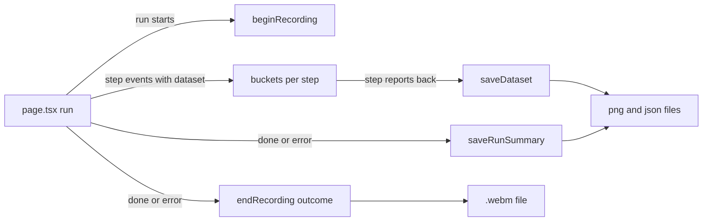

---
sources:
  - frontend/lib/useScreenRecorder.ts
  - frontend/lib/recordAudio.ts
  - frontend/lib/recordVoice.ts
  - frontend/lib/recordNote.ts
  - frontend/components/RecordAudioToggles.tsx
  - frontend/lib/datasetLog.ts
  - frontend/lib/depthPng.ts
  - frontend/lib/api.ts
  - frontend/app/page.tsx
verified_at: 4a810a3717ab
---

# Screen recording and run logs

!!! abstract "In this page"
    The dashboard can leave two kinds of files on your computer for each run: a `.webm` video of the dashboard tab, and the vision captures (images and JSON) that the backend streams during the run. This page explains how the files are made, how they are named, where the sound of the video comes from, and what goes wrong. Everything here was read in the code at commit `4a810a3717ab`. Nothing was run against a browser or a robot.

## What you get

| File | Made by | Name |
|---|---|---|
| Video of one run | `useScreenRecorder` | `<run folder>_succeed.webm` or `<run folder>_failed.webm` |
| Video started by hand | `useScreenRecorder` | `manual_<time>.webm` |
| Capture images, depth, results | `datasetLog.saveDataset` | `<run folder>/<nnn>[_<tag>]_<succeed or failed>_rgb.png` (and `_detect.png`, `_depth.png`, `_results.json`) |
| Run summary | `datasetLog.saveRunSummary` | `<run folder>/run_<succeed or failed>.json` |
| Log image of a step | `page.tsx` | `<run folder>/step_<nnn>_<succeed or failed>.jpg` |

The run folder is `<date>-<time>_<first task>`. One run has one folder name, so the video and the capture folder sort next to each other in your Downloads.



## The run folder name

`runFolder(startedAt, firstTask)` builds the name. The time is the local time at which the run started. In the first task, every group of characters that are not letters or digits becomes one `_`; leading and trailing `_` are removed; the result is cut to 40 characters. An empty task gives the time only. These three calls were run offline (the module bundled with the repo's own esbuild, `Date` values set in the probe):

| Call | Result |
|---|---|
| `runFolder(2026-11-19 14:30:22, 'find::apple')` | `20261119-143022_find_apple` |
| `runFolder(2026-11-19 14:30:22, '')` | `20261119-143022` |
| `runFolder(2026-11-19 14:30:22, '~find::juice bottle, cola can')` | `20261119-143022_find_juice_bottle_cola_can` |

The name is resolved on the first write, because the first task is known only when the first step starts (`page.tsx:262`, `page.tsx:503`).

## Screen recording

### Two ways to record

| Way | Start | Stop | Name |
|---|---|---|---|
| Per run | tick the record checkbox once (`toggleRecord(true)`); every run then records a segment | the run ends (`endRecording`), or you untick the box | the run folder name, plus `_succeed` or `_failed` |
| Manual | `toggleManualRecord()` | the same call again, or stop sharing in the browser | `manual_<ISO time with : and . replaced by ->` |

The two recorders are separate objects, so a manual clip never clashes with a run segment (`useScreenRecorder.ts:89-95`). A manual clip has no run outcome and no run name.

- The browser asks for the screen share once for each time you enable recording. The stream is reused for every run until you untick the box or stop the share (`useScreenRecorder.ts:112-123`).
- `beginRecording()` is called when a run starts, only if recording is enabled. A run started by a shortcut button never starts one (`page.tsx:247`).
- `endRecording('succeed' | 'failed')` is called at the `done` or `error` event. A run is `failed` if a step failed or the event is `error`. When the run ends in another way (the socket dropped, you cancelled), `endRecording()` is called with no outcome and the file has no suffix (`page.tsx:546`, `page.tsx:590`).
- A recording of size 0 is not saved (`useScreenRecorder.ts:70`).

### Where the file goes

`saveRecording` writes to a folder only if the browser still holds permission for a folder handle that is stored in IndexedDB (database `robotapp`, store `fs`). Otherwise it downloads the file. If writing to the folder fails, it downloads too.

!!! note
    The comment at the top of `useScreenRecorder.ts` says the user grants a folder once. The code no longer asks: `loadDirSilent()` never opens a picker and never asks for permission. A handle exists only if an earlier build of the dashboard stored one. A new browser saves every file to its download folder.

### Format

`pickMime()` takes the first type the browser supports from this list: `video/webm;codecs=vp9,opus`, `video/webm;codecs=vp8,opus`, `video/webm;codecs=vp9`, `video/webm;codecs=vp8`, `video/webm`. If none is supported, the browser chooses.

## Sound in the video

The browser's own speech (the `speechSynthesis` voice) cannot always be captured. A Korean line was silent in a tab-audio clip, so there are three sources (`recordAudio.ts:2-14`).

| Source | What is recorded | Needs | Default on |
|---|---|---|---|
| `system` | everything the computer plays, so the robot's voice is the browser voice you hear | share "Entire screen" and tick the system audio box (Windows, ChromeOS) | Windows and ChromeOS |
| `direct` | the app builds the sound itself: the backend's voice for the same lines (`GET /tts?text=&lang=`) and the beeps, in a WebAudio graph. No audio is shared | the backend route `/tts` and, for gTTS, the internet | every other system |
| `tab` | the sound of the shared tab | tick "Also share tab audio"; Chrome often leaves the browser voice out | none |

With `direct` you still hear the browser voice. The file holds the backend voice of the same lines, so it is a different voice.

The three choices are kept in the browser (see [browser storage](../reference/browser-storage.md)).

| Key | Values | Default |
|---|---|---|
| `robotapp_record_tab_audio` | `'1'` or `'0'` ("record sound") | on (anything but `'0'`) |
| `robotapp_record_mic` | `'1'` or `'0'` ("your answers") | off |
| `robotapp_record_audio_source_v2` | `system`, `direct`, `tab` | by `userAgent`, see the table above |

### The answers of the user

With "your answers" on, the stream that the dashboard listens with (the one the speech recogniser hears) is tapped into the recording during each listen (`recordVoice.tapMic`). A second, always-open microphone capture was silent on a real machine and would add room noise and the robot's own voice, so it is not used (`recordVoice.ts:30-33`).

With a tapped microphone, all sounds are mixed into one audio track. Without it, in the `system` and `tab` sources, the shared stream is recorded as it is, so a suspended mixer cannot silence it.

### The note beside the button

`noteRecordingAudio(msg)` sends a window event `robotapp:record-audio-note`. `RecordAudioToggles` shows the last message: what the recording carries, or why it has no sound. This avoids passing props through the page. The "audio test" button runs `testRecordingAudio()`: about five seconds, it measures what reaches the recording and prints peak levels in dB; a level above -50 dB counts as "recorded" (`recordAudio.ts:192`, `recordAudio.ts:256`). Changes apply from the next recording.

## Dataset captures

During a run, the backend streams `AgentEvent.dataset` events. Each holds some of: `rgb`, `annotated` (the picture with boxes or masks), a raw `depth` with `depth_w` and `depth_h`, and `results`. The dashboard writes them as browser downloads when the log target is `frontend`: `a.logData && a.logTarget === 'frontend'` (`page.tsx:251`). With the `backend` target the backend writes to its own disk and the dashboard writes nothing.

How it works:

1. Each capture is put in a bucket for the step that made it. A capture made outside a step (planning, teardown) goes to a run bucket (`page.tsx:286-302`).
2. The outcome that names the file is not known until the step reports back, so the bucket is held until then. `writeBucket(step, outcome)` saves its items with `++dsSeq` as the sequence number (`page.tsx:303-311`).
3. `saveDataset` writes up to four files: `_rgb.png`, `_detect.png`, `_depth.png` and `_results.json`. The depth is decoded from the raw bytes and written again as a 16-bit grayscale PNG (`depthPng.ts`).
4. In "failed only" mode the captures stay in their buckets until the run turns out to fail. At `done` or `error`, if "log all" is on or the run failed, the buckets still held are written (steps that never reported get the run verdict) and `saveRunSummary` writes `run_<outcome>.json` with the keys `task`, `planner`, `failed`, `elapsed_ms`, `captures`, `failure_events` and `events` (`page.tsx:550-560`). The images and datasets are removed from `events` first.

A run can succeed and still contain a failed step, so the step name and the run name carry separate verdicts. `*_failed_rgb.png` is the whole failed set.

```ts
export async function saveDataset(ds: Dataset, runDir: string, seq: number,
                                  outcome?: Outcome): Promise<void> {
  const n = String(seq).padStart(3, '0')
  const tag = (ds.tag || '').replace(/[^a-zA-Z0-9]+/g, '_').replace(/^_+|_+$/g, '')
  const base = `${runDir}/${n}${tag ? `_${tag}` : ''}${outcome ? `_${outcome}` : ''}`
  try {
    if (ds.rgb) saveBlob(b64ToBlob(ds.rgb, 'image/png'), `${base}_rgb.png`)
    if (ds.annotated) saveBlob(b64ToBlob(ds.annotated, 'image/png'), `${base}_detect.png`)
    if (ds.depth && ds.depth_w && ds.depth_h) {
      const u16 = await decodeRawDepth(ds.depth)
      const png = await encode16BitGrayPng(u16, ds.depth_w, ds.depth_h)
      saveBlob(png, `${base}_depth.png`)
    }
    if (ds.results !== undefined) {
      saveBlob(new Blob([JSON.stringify(ds.results, null, 2)], { type: 'application/json' }),
               `${base}_results.json`)
    }
  } catch (err) {
    console.error('[datasetLog] save failed:', err)
  }
}
```

!!! code "Where in the code"
    [`frontend/lib/datasetLog.ts` lines 58-78](https://github.com/mtbui2010/robotapp/blob/4a810a3717ab/frontend/lib/datasetLog.ts#L58-L78). The folder name is made by `runFolder` in the same file (lines 20-26). The recorder is [`frontend/lib/useScreenRecorder.ts`](https://github.com/mtbui2010/robotapp/blob/4a810a3717ab/frontend/lib/useScreenRecorder.ts); the sound is in [`recordAudio.ts`](https://github.com/mtbui2010/robotapp/blob/4a810a3717ab/frontend/lib/recordAudio.ts) and [`recordVoice.ts`](https://github.com/mtbui2010/robotapp/blob/4a810a3717ab/frontend/lib/recordVoice.ts).

The repo has a small older sample set in `test_data/` (for example `..._001_arm_rgb.png`, `..._results.json` and a `..._run.json`). Its names have no `_succeed` or `_failed` part, so it comes from before the current naming. It is not shown here.

## Endpoint

| Call | Used for | Source |
|---|---|---|
| `GET /tts?text=<text>&lang=<two letters>` | the backend voice in the `direct` source and in the audio test; the reply is audio (`audio/mpeg` is how the dashboard wraps it) | `api.ts:482-491` |

On an error reply, `api.ttsAudio` throws with the `detail` text of the body, or `GET /tts: HTTP <status>`. The language is cut to two letters and lower-cased (`recordVoice.ts:56`). The speed of each line is clamped to 0.5-2 and played by a media element that keeps the pitch (`recordVoice.ts:59-68`).

## Failure modes

| Symptom | Cause | What to do |
|---|---|---|
| The video has no sound | the share had no audio track, or sound is off | read the note beside the button; for `system` choose "Entire screen" and tick the system audio box; for `tab` tick the tab audio box |
| A Korean or other line is missing in the video | the browser voice is not captured in a tab-audio clip | use `direct` (any system) or `system` (Windows) |
| "Robot voice NOT recorded" | the backend has no `/tts`, or gTTS has no internet | restart the backend with the route; check the network. You still hear the browser voice |
| The file is empty (about 110 bytes in the test) | an audio track that delivers no samples | the app keeps a silent constant source in the graph so samples always flow (`recordAudio.ts:95-100`); do not remove it |
| No sound with `direct` or a microphone | the audio context was made after an `await`, so the browser left it suspended | the context is made inside the click, before anything is awaited (`recordAudio.ts:68-70`, `useScreenRecorder.ts:106`) |
| No folder dialog, the file is in Downloads | no stored folder handle (see the note above) | move the file by hand |
| No capture files | the log target is `backend`, logging is off, or the run succeeded and "log all" is off | choose target `frontend` and "log all" in the log options of the Agent panel |
| No file for a step that succeeded | with "failed only" the captures are held and written only when the run turns out to fail | choose "log all" |
| A file named with the run verdict, not the step verdict | its step never reported back; at the end of the run the leftovers are named with the run verdict (`writeRest`, `page.tsx:320-324`) | none; this is by design |
| One of the files did not download | `saveDataset` catches an error and only writes it to the console | open the browser console and look for `[datasetLog] save failed` |

## Tests

None. The code uses browser media APIs (`getDisplayMedia`, `MediaRecorder`, WebAudio, downloads). The offline tests cover `lib/` modules that do not need a browser; see [tests](tests.md).
