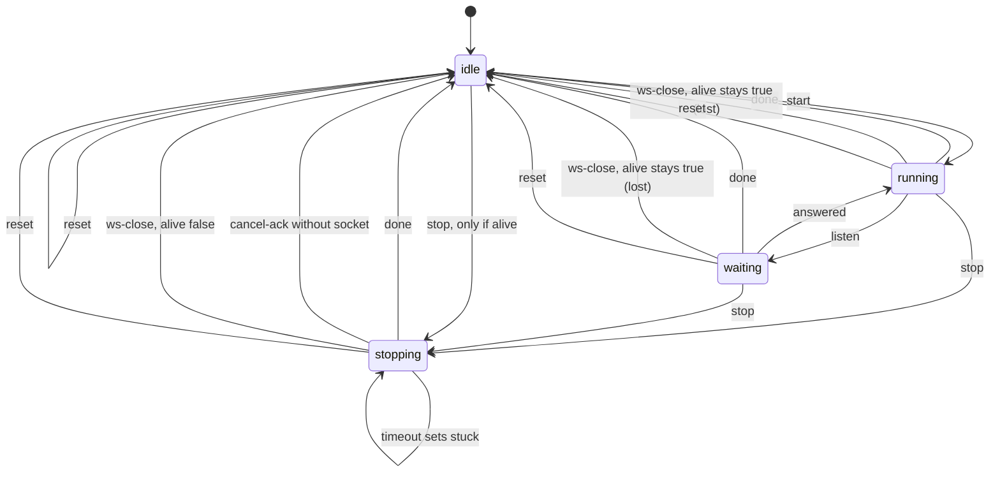

---
sources:
  - frontend/components/ChatPanel.tsx
  - frontend/components/LanguagePicker.tsx
  - frontend/components/PopoverButton.tsx
  - frontend/lib/chatRun.ts
  - frontend/lib/chatMic.ts
  - frontend/lib/robotLanguages.ts
  - frontend/lib/useRobotLanguages.ts
  - frontend/lib/planner.ts
  - frontend/lib/tabPref.ts
  - frontend/app/page.tsx
  - frontend/lib/api.ts
verified_at: 4a810a3717ab
---

# Chat: the card, the run state and the language

!!! abstract "In this page"
    The chat card is the one place where an operator types a task, answers a question from the robot, and stops a run. This page explains the four states of a run (`idle`, `running`, `waiting`, `stopping`), the state machine in `lib/chatRun.ts` that drives them, the language picker, and the safety text on the card. The microphone side is in [voice](../modules/voice.md).

## What the reader gets

You learn what each button of the card does in each state, why Stop can show "Force reset", and why one browser tab keeps its own language. The state machine is pure code, so its output below is real: it was run offline.

| | |
|---|---|
| **Component** | `ChatPanel` (the card), `LanguagePicker` (a popover inside it) |
| **State machine** | `runReduce` in `frontend/lib/chatRun.ts`, no React |
| **Owner of the state** | `app/page.tsx`: it holds the run state and passes plain props to the card |
| **Output of the card** | callbacks only (`onSend`, `onStop`, `onReset`, ...); the page does the work |
| **Tests** | `scripts/test_lib.mjs` lines 262-344 (run state), 415-505 (tab preference, languages) |

## The four states

| state | meaning | typed input | what a message does |
|---|---|---|---|
| `idle` | no run is known to be going | enabled | starts a new run of that text, as an unstructured command, with the chosen planner |
| `running` | the robot executes, nothing is asked | disabled | nothing |
| `waiting` | the robot asked a question (a `listen` is pending) | enabled | is the answer: `POST /agent/listen/{id}` |
| `stopping` | Stop was pressed, cancel was sent, the backend has not confirmed | disabled | nothing |

This is written at the top of `ChatPanel.tsx` (lines 6-12) and implemented in `sendChat` in `page.tsx` (lines 759-784). The typed box is present in every state and also works when the microphone is on.

The state of the run has four fields (`chatRun.ts` line 16):

| field | meaning |
|---|---|
| `phase` | one of the four states above |
| `alive` | "a run may still be going on the backend". Set when a run starts. Cleared only by a `done` or `error` event, a confirmed stop, or a reset |
| `ws` | the run's WebSocket is open |
| `stuck` | `stopping` for longer than `STOP_TIMEOUT_MS`, which is 5000 ms |

The field `alive` matters when the socket drops. The phase goes back to `idle`, but `alive` stays true: the run is "lost". The card then says "connection to the run lost; it may still be going: Stop / reset", and Stop stays enabled (`isLost`, `chatRun.ts` line 59).

## State diagram

Drawn from the reducer (`chatRun.ts` lines 30-55). Event names are the `t` values of `RunEvent`.



Rules that the diagram does not show:

- `start` is ignored unless the phase is `idle`.
- `stop` while already `stopping` changes nothing. `stop` when `idle` and not `alive` changes nothing.
- `cancel-ack` (the answer of `POST /agent/cancel`) ends the stop only when there is no socket. With an open socket the card waits for the backend's `done`.
- `reset` always returns to the initial state, whatever the backend does.

## Real output of the state machine

Run offline on 2026-11-19 with the repo's esbuild, as in `scripts/test_lib.mjs` lines 15-21. Each line is a sequence of events from the initial state. The label is `stopLabel(state, 'Cancel')`.

```text
start                            {"phase":"running","alive":true,"ws":true,"stuck":false} canStop true canType false lost false label "Cancel"
start > listen                   {"phase":"waiting","alive":true,"ws":true,"stuck":false} canStop true canType true lost false label "Cancel"
start > stop                     {"phase":"stopping","alive":true,"ws":true,"stuck":false} canStop true canType false lost false label "Stopping…"
start > stop > timeout           {"phase":"stopping","alive":true,"ws":true,"stuck":true} canStop true canType false lost false label "Force reset"
start > ws-close                 {"phase":"idle","alive":true,"ws":false,"stuck":false} canStop true canType true lost true label "Cancel"
start > listen > answered > done {"phase":"idle","alive":false,"ws":true,"stuck":false} canStop false canType true lost false label "Cancel"
```

## Code

The reducer, cases `start` to `reset` (`chatRun.ts` lines 32-54):

```ts
    case 'start':
      return s.phase === 'idle' ? { phase: 'running', alive: true, ws: true, stuck: false } : s
    case 'listen':
      return s.phase === 'running' ? { ...s, phase: 'waiting' } : s
    case 'answered':
      return s.phase === 'waiting' ? { ...s, phase: 'running' } : s
    case 'stop':
      if (s.phase === 'stopping') return s
      return s.phase === 'idle' && !s.alive ? s : { ...s, phase: 'stopping', stuck: false }
    case 'cancel-ack':
      // without a socket no `done` can arrive: the acknowledged cancel is the end
      return s.phase === 'stopping' && !s.ws ? { ...s, phase: 'idle', alive: false, stuck: false } : s
    case 'done':
      return { ...s, phase: 'idle', alive: false, stuck: false }
    case 'ws-close':
      if (s.phase === 'idle') return { ...s, ws: false }
      // a closed socket cancels the run on the backend; during a stop that is the answer, otherwise the run is "lost"
      return { phase: 'idle', alive: s.phase !== 'stopping', ws: false, stuck: false }
    case 'timeout':
      return s.phase === 'stopping' ? { ...s, stuck: true } : s
    case 'reset':
      return INITIAL_RUN
```

!!! code "Where in the code"
    [`frontend/lib/chatRun.ts` lines 32-54](https://github.com/mtbui2010/robotapp/blob/4a810a3717ab/frontend/lib/chatRun.ts#L32-L54). The helpers `canStop`, `canType`, `isLost`, `needsForce`, `stopAction` and `stopLabel` follow in lines 57-71.

## Stop and Reset

All Stop buttons use one flow: the chat Stop, the Agent panel Stop, the control bar Cancel and the tab-row Cancel call the same handler (`stop` in `page.tsx`, lines 659-673). It asks `stopAction(state)`:

| state | action |
|---|---|
| not stuck | `stop`: abort the captures in flight, send `stop` to the state machine, call `POST /agent/cancel` and send `cancel-ack` when it answers |
| `stopping` and stuck | `force-reset`: drop the run on this side |

A timer sends `timeout` after `STOP_TIMEOUT_MS` (5000 ms) while the phase is `stopping` (`page.tsx` lines 674-678). Then the status line says "no confirmation from the robot" and a "Force reset" button appears. The small "reset" link in the header does the same hard reset at any time: it drops the run, every pending question, the speech and the microphone capture, and works even if the robot does not answer.

Closing the WebSocket does not stop the robot. The backend runs the plan in its own thread, so the dashboard calls `POST /agent/cancel` explicitly (`api.ts` lines 452-454 and the comment above it).

## The card

Inputs (props of `ChatPanel`, `ChatPanel.tsx` lines 21-47):

| prop | type | meaning |
|---|---|---|
| `log` | `ChatLine[]` | `{who: 'robot' or 'user' or 'system', text, kind?: 'say'}`. A robot line with `kind: 'say'` is a short narration, drawn small and in italics |
| `state` | `'idle'`, `'running'`, `'waiting'`, `'stopping'` | the phase |
| `langPicker` | React node | the language picker, built by the page |
| `planner`, `onPlanner` | `PlannerMethod` | the planner for the next command |
| `planOnly`, `onPlanOnly` | `boolean` | plan only, or execute |
| `handsFree`, `onHandsFree` | `boolean` | the microphone toggle |
| `micSupported`, `micListening`, `micNote` | `boolean`, `boolean`, `string` | whether the browser can listen, whether it listens now, why it is off |
| `onSend`, `onStop`, `onReset`, `onClear`, `onClose` | callbacks | the card only reports; the page acts |
| `canStop`, `canType`, `lost`, `stuck` | `boolean` | from `canStop`, `canType`, `isLost`, `needsForce` of `chatRun.ts` |

Controls in the header and below it:

| control | behaviour |
|---|---|
| Stop | enabled when `canStop`; reads "Stopping..." while stopping |
| reset | the hard reset |
| clear | clears the log only |
| `x` | closes the card; while a run is going the title says "Hide (the run keeps going)" |
| planner select | `SAGE + assist`, `SAGE plain loop`, `Direct`; disabled unless `idle` |
| plan only | a checkbox, disabled unless `idle`. In `page.tsx` the state starts as ON (`useState(true)`, line 703). When it is OFF the label says "will move" in red |
| mic toggle | hands-free; see [voice](../modules/voice.md) |
| input and Send | Enter sends; Enter during text composition (for example Korean input) does not |

The planner and plan-only choices are saved per tab with `writeTabPref` (`page.tsx` lines 740-748), as described below.

!!! warning "One client per robot"
    The card says it twice: in the help text and under the input, "One client per robot: a second client driving it is unsafe, and Cancel stops both" (`ChatPanel.tsx` lines 16-19 and 151). A second client is a command-line tool or another browser tab. Do not drive one robot from two clients. In this version of the dashboard a text search finds this warning only in the chat card and, as a hover tooltip, in the teleop strip (`TeleopBar.tsx:37`, see [Remote control and poses](teleop-poses.md)); the map, the shortcut buttons and the Agent panel can also move the robot and do not show it.

## Language

The language of the robot's speech and of what it hears is one value for the whole dashboard (chat and Structured runs). It is picked in the chat header or in the control bar.

| item | detail |
|---|---|
| source of options | `GET /robot/languages` (`api.ts` lines 494-498), read by `useRobotLanguages` and refetched when another robot is picked |
| shape | `{robot, language, languages, supported?, declared?}`: `supported` is what the robot's manifest lists, `languages` is what this site has switched on, `language` is the default |
| picker options | `Detect` (value `auto`) always, then the languages that are on, plus the one in use if it is not among them |
| switching a language on or off | `PUT /robot/languages {languages}` (`api.ts` lines 622-626). Saved on the robot: every dashboard sees it. At least one language must stay on |
| Detect | the robot follows the language you speak, among the languages that are on |

`resolveLanguage(stored, info)` picks the value to use: the tab's own choice if it is on offer, else `auto`. Before the robot has answered, the stored choice or `en`. Real values, from a manifest with `language: 'ko'`, `languages: ['ko','en']`, `supported: ['ko','en','ja']`:

```text
resolveLanguage(null, manifest)      -> auto
languageOptions(manifest, 'en')      -> ["auto","ko","en"]
toggleLanguage(manifest, 'ja')       -> ["ko","en","ja"]
toggleLanguage(one-language, 'ko')   -> null   (the last language cannot be switched off)
```

### Why a tab keeps its own language

`localStorage` is shared by all tabs of a browser. When the language lived only there, picking English in one tab changed another tab at its next reload, and a Korean session turned English by itself. `lib/tabPref.ts` keeps each tab's choice in `sessionStorage`, and writes `localStorage` only as the default for a tab that has none yet (`tabPref.ts` lines 1-6, 10-21):

| function | effect |
|---|---|
| `readTabPref(key, legacyKey?)` | this tab's value, else the last choice of any tab, else a legacy key |
| `pinTabPref(key, effective)` | a tab that has not chosen keeps what it started with, so a reload does not take another tab's choice |
| `writeTabPref(key, v)` | writes this tab and the default for new tabs |

The same functions store the planner and plan-only choices. The storage keys are listed in [browser storage](../reference/browser-storage.md).

## Endpoints

| call | by | when |
|---|---|---|
| `GET /robot/languages` | `useRobotLanguages` | on mount, and when the robot changes |
| `PUT /robot/languages` | `useRobotLanguages` | a language is switched on or off |
| `WS /ws/agent` | `page.tsx` | a run starts |
| `POST /agent/listen/{id}` | `page.tsx` | a message while `waiting` |
| `POST /agent/cancel` | `page.tsx` | Stop |

The card itself calls none of them. See [endpoints](../reference/endpoints.md).

## Failure modes met in the code

| symptom | cause | what the code does |
|---|---|---|
| a Korean session turned English | the language was shared across tabs | per-tab `sessionStorage` (`tabPref.ts`) |
| the card stuck in "stopping" | the backend never sent `done` | after 5 s `stuck` is set and "Force reset" is offered |
| a run seems lost | the socket dropped mid-run | phase `idle`, `alive` true: Stop and reset stay enabled, status says the run may still be going |
| a spoken answer is not used | the robot had stopped listening when the recording was posted (HTTP 404) | the chat shows a note: the robot had already stopped listening, say it again when asked (`noteForListenReply`, `chatRun.ts` lines 73-76) |
| a language cannot be switched off | it is the last one on | the checkbox is disabled; `toggleLanguage` returns `null` |

## Tests

`scripts/test_lib.mjs` lines 262-344 test `chatRun` (a normal run, Stop with `done` or socket close, Stop twice, stuck and Force reset, a lost socket, `cancel-ack` with an open socket, the labels, the 404 note). Lines 415-459 test `tabPref`, lines 461-505 the language helpers. There is no test of `ChatPanel` itself. At the pinned commit all 78 tests passed in an offline run on 2026-11-19.

## Related

- [Voice](../modules/voice.md): the microphone and the robot's voice.
- [Plan, log and robot state](../modules/plan-view.md): what the run looks like on the right.
- [Page](../modules/page.md): the component that owns the state.
