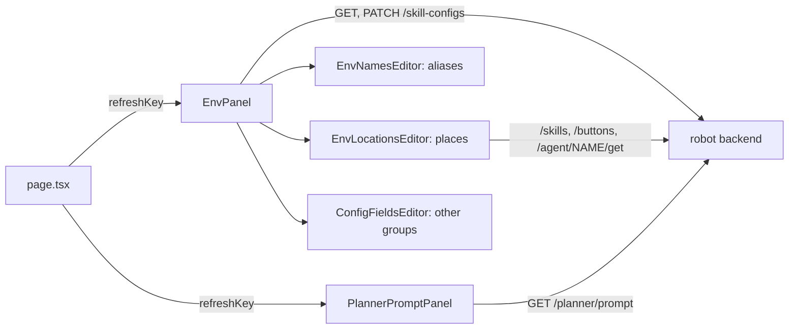

---
sources:
  - frontend/components/EnvPanel.tsx
  - frontend/components/EnvNamesEditor.tsx
  - frontend/components/EnvLocationsEditor.tsx
  - frontend/components/ConfigFields.tsx
  - frontend/components/PlannerPromptPanel.tsx
  - frontend/components/PanelSearch.tsx
  - frontend/lib/skill_configs.json
  - frontend/lib/robotPose.ts
  - frontend/lib/planner.ts
  - frontend/lib/hriVoice.ts
  - frontend/lib/api.ts
verified_at: 4a810a3717ab
---

# Global configs, locations (ENV) and the planner prompt

!!! abstract "In this page"
    Two panels. The Global Configs panel (`EnvPanel`) edits the config groups that no skill owns; today that is
    the `ENV` group, shown as "Locations (ENV)": the named places the robot can go to. The Planner prompt panel
    (`PlannerPromptPanel`) shows, read-only, the prompt the Direct planner would send for a command. You get: which
    groups appear, how the field editors work, why a save sends only what changed, and what each location action calls.
    Checked in code at `4a810a3717ab`, not run against a robot.

## Words used here

| word | meaning |
|---|---|
| config group | a named JSON object kept by the backend, read and written through `/skill-configs/{name}`. |
| ENV | the config group that holds the places: one entry per location, with `loc` (x, y, rz), `height`, `default_mode`, `aliases` and more. |
| location (in ENV) | a named place in the robot's map, for example `move::<location>` goes there. Not the same as a site (config profile) in [robots and connections](robots-connections.md). |
| alias | another name that reaches the same location. |
| Fields view / JSON view | two ways to edit the same text: a form with one row per leaf value, or a raw text box. |
| Direct planner | the planner that sends one prompt to a language model and gets a plan back. |

## Where it sits



## Which groups appear

The panel asks `GET /skill-configs` for the names of all groups and keeps the ones that no other editor owns
(`EnvPanel.tsx:74-84`):

| rule | in code |
|---|---|
| `ENV` is always first | `FIRST_NAMES = ['ENV']` |
| a group that a skill edits is left to the Skills panel | the names in `lib/skill_configs.json` (`SKILL_GROUPS`) |
| `MAP` has its own editor in the Map tab (Settings) | `OWN_EDITOR = new Set(['MAP'])` |
| all others, sorted by name, come after `ENV` | `extra` |

So at `4a810a3717ab`, on the robot package the comment names, the list is only `ENV`, and the panel title is
"Locations (ENV)". With more groups it is "Global Configs". A comment at `EnvPanel.tsx:15` records that five groups
(`HOME_LOC`, `CALIB_PARAMS`, `KR2EN`, `EN2KR`, `LLM_SERVERS`) were deleted on 2026-10-26.

The prop `refreshKey` (number, default 0) is bumped by the page when the robot connects or the site changes. It makes both
panels fetch again; the planner panel also clears the shown prompt.

Everything starts folded; the search box (`PanelSearch`) stays visible and a match opens the groups that hold it.

## Editing one group

Each group has a header with the name, a reload arrow, a Fields or JSON switch, a status, and Save. The text is loaded with
`GET /skill-configs/{name}`. If the group does not exist the panel says `Not found on agent`.

| state | shown |
|---|---|
| text differs from the loaded group | `unsaved` (amber) |
| save succeeded | `saved` (green) |
| text is not valid JSON | `Invalid JSON`, nothing sent |
| the backend refuses | its `detail` text, for example an alias that already names another location |

### Fields view

`ConfigFieldsEditor` (`ConfigFields.tsx`) turns the object into one row per leaf value, keyed by a dot path such as
`loc.x`. Arrays are leaves. The input follows the value type: a checkbox for a boolean, a number box for a number,
a text box for a string. It is shared by the Skills panel and this one. Every edit is written back as JSON text, so
the Fields and JSON views always show the same data.

One special case: a number whose path ends in `speech_rate` or `speech_rate_en` gets a slider from 0.5 to 2.0 (the range
the backend clamps to), the value, and a play button that speaks a sample sentence at that rate through the browser's speech
synthesis (`speakAndWait` in `lib/hriVoice.ts`). The sample is Korean for `speech_rate` and English for `speech_rate_en`.
The play button does not save; Save does (`ConfigFields.tsx:115-144`).

### Locations in ENV

For `ENV`, the Fields view is two editors, not the generic one (`EnvPanel.tsx:205-217`):

- **Location aliases** (`EnvNamesEditor`): per location its aliases as chips. A name is compared after
  `normalizeName`: Unicode NFC, lower case, trimmed, white space collapsed, each part around `@` on its own. Run with the committed function:

  ```js
  console.log(JSON.stringify([normalizeName('  Living   Room '), normalizeName('Counter2@Kitchen  Area'), normalizeName('')]))
  ```

  ```text
  ["living room","counter2@kitchen area",""]
  ```

  An alias is refused when it is empty, is `home` or `base` (reserved), or already names another location or alias. The
  backend resolver (`robot_agent/env_names.py`) checks the same on save.
- **Locations** (`EnvLocationsEditor`): one foldable row per location, with a summary line such as `front · h 0.75 · (0, 0, 0°)`.
  Inside, each value can be edited and a parameter added or removed.

Adding a location (`+ Add location`) has three starts:

| start | how |
|---|---|
| empty | the defaults: `default_mode: 'front'`, `height: 0.75`, `loc` zero, `dforward`, `dshift`, `placepose` zero |
| at the robot's position now | reads `MAP.pose` (the Map settings name an agent and the paths of x, y and yaw), calls `GET /agent/{name}/get`, and sets `loc` to x, y (3 decimals) and rz in degrees (1 decimal) |
| a copy of another location | copies the numbers but drops `aliases`, `label`, `qa` and `source`, because an alias must not name two places |

If the site has no `MAP.pose`, the add fails with `robot position: this site has no MAP.pose (Map tab Settings)`
and nothing is added. The new name goes through the same checks as an alias (reserved, already exists, already an alias).

Deleting a location (the bin icon) first looks for its name and aliases in the plan skills (`GET /skills`) and in the
shortcut buttons (`GET /buttons`) and lists the hits in the confirm. This is only a warning: it is a text search, and it
cannot know all places a name is used. The delete is held until you press Save, and an undo arrow brings back the last
deleted location.

## Saving only what changed

!!! code "Where in the code"
    [`EnvPanel.tsx:86-110`](https://github.com/mtbui2010/robotapp/blob/4a810a3717ab/frontend/components/EnvPanel.tsx#L86-L110)

```ts
  const save = async (name: ProxyName) => {
    const text = texts[name]
    if (text === undefined) return
    let parsed: unknown
    try {
      parsed = JSON.parse(text)
    } catch {
      setSaveErrors(p => ({ ...p, [name]: 'Invalid JSON' }))
      return
    }
    setSaveErrors(p => { const n = { ...p }; delete n[name]; return n })
    const value = parsed as Record<string, unknown>
    try {
      // only what changed since it was loaded: a location another machine added meanwhile is kept
      const saved = base[name] && typeof parsed === 'object' && parsed && !Array.isArray(parsed)
        ? await api.mergeSkillConfig(name, base[name], value)
        : (await api.updateSkillConfig(name, value), value)
      setTexts(prev => ({ ...prev, [name]: JSON.stringify(saved, null, 2) }))
      setBase(prev => ({ ...prev, [name]: saved }))
      setSavedAt(p => ({ ...p, [name]: Date.now() }))
    } catch (err) {
      const msg = err instanceof Error ? err.message : 'Save failed'
      setSaveErrors(p => ({ ...p, [name]: msg }))
    }
  }
```

The panel keeps `base`, each group as last loaded or saved. A save sends `{ base, value }` to the backend, which merges per top-level entry
(per location for ENV). So a location that another machine added after you loaded is not erased by your save. The answer is
the group as saved, and it becomes the new `base` and the new text. This was added after a location from another machine
was lost on save (comment at `api.ts:329-331`; the backend change is dated 2026-10-26 in the next excerpt).

!!! code "Where in the code"
    [`api.ts:332-349`](https://github.com/mtbui2010/robotapp/blob/4a810a3717ab/frontend/lib/api.ts#L332-L349)

```ts
  async mergeSkillConfig(name: string, base: Record<string, unknown>, value: Record<string, unknown>):
      Promise<Record<string, unknown>> {
    const r = await fetch(`${getAgentUrl()}/skill-configs/${encodeURIComponent(name)}`, {
      method: 'PATCH',
      headers: { 'Content-Type': 'application/json' },
      body: JSON.stringify({ base, value }),
    })
    if (r.status === 405) {          // a backend from before 2026-10-26: plain PUT of the whole group
      await api.updateSkillConfig(name, value)
      return value
    }
    const body = await r.json().catch(() => ({}))
    if (!r.ok) {
      const detail = (body as { detail?: unknown }).detail
      throw new Error(typeof detail === 'string' ? detail : `HTTP ${r.status}`)
    }
    return (body as { value: Record<string, unknown> }).value
  },
```

Status 405 means an older backend without `PATCH`; the client then falls back to `PUT` of the whole group, with the old risk of overwriting.

!!! warning "Two ways to save the same group"
    The Map tab saves `ENV` with `PUT` of the whole group (`MapPanel.tsx:342-346`), not the merged `PATCH`. It reads `ENV` just
    before it writes, so the risk is only a change made by another machine between that read and the write. The Skills panel
    also saves its groups with `PUT`. The Global Configs panel is the one that merges.

## Planner prompt

`PlannerPromptPanel` is a read-only view. You type a command and press Show (or Enter);
the panel calls `GET /planner/prompt?command=...&planner=...`. The planner is the one chosen in the Agent panel
(`storedPlanner()`, kept per tab, default `sage`); a change of choice is followed live through the `robotapp-planner` window event.

| result field | meaning |
|---|---|
| `prompt` | the text the Direct planner would send: robot manifest, places, notes, similar example plans |
| `examples` | the example plans used, `task` first |
| `planner` | the planner the backend answered for |
| `uses_prompt` | `false` when that planner builds its own prompts; the panel then says so (labels: `sage` is "SAGE + assist", `grace` is "SAGE (plain loop)", `direct` is "Direct") |

The panel stores nothing. The prompt is built by the backend each time from the robot's manifest, the ENV places and memory.
To change it, change the manifest (`planner.notes`, skill descriptions) or the seed pool, not this panel. An error shows the
backend's `detail` or `Failed to load the prompt`.

## Edge cases and failure modes

| symptom | cause | what to do |
|---|---|---|
| Save disabled | the group is loading, or its load failed | use the reload arrow |
| `Not found on agent` | `GET /skill-configs/{name}` answered not found | check that the robot serves that group |
| a save is refused with an alias message | the alias already names another location or skill | rename the alias |
| `robot position: ...` when adding | the site has no `MAP.pose`, or the agent gives no pose | set `MAP.pose` in the Map settings |
| a deleted location is still used by a plan | the warning is a text search and only a warning | edit the plans and buttons it names |
| another machine's change is missing after a save from the Map tab | that tab saves ENV with `PUT` (whole group) | save again from the Global Configs panel; see the warning above |
| the planner panel says the prompt is not used | the chosen planner is SAGE | choose Direct in the Agent panel |

## How it is verified

There is no test for these panels in `scripts/test_lib.mjs`. The type check and lint cover the calls
(see [tests](tests.md)). The normalisation example above was run offline on the committed function.
