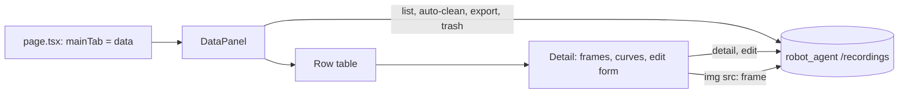

---
sources:
  - frontend/components/DataPanel.tsx
  - frontend/lib/recordings.ts
  - frontend/lib/api.ts
  - frontend/app/page.tsx
  - scripts/test_lib.mjs
verified_at: 4a810a3717ab
---

# Data tab: look at, clean and export episodes

!!! abstract "In this page"
    You get what the Data tab lists, how an episode is looked at and cleaned without changing the raw files, what Auto-clean and Export send, and what the filter does and does not cover. Checked in code at `4a810a3717ab`; nothing here was run against a robot.

## What it is

The Data tab shows the raw episodes that the robot recorded (see [Record raw VLA episodes](recorder.md)). It has three jobs:

1. **Look.** A table of episodes with totals, warnings and a kind filter. Click a row to see camera frames and the joint curves.
2. **Clean.** Trim the idle start and end, change the label, exclude, add a note, set the robot mode, edit the prompt. All of this is an **edit list** saved beside the raw files. The raw files are never changed, and **Reset** removes the edit.
3. **Export.** Ask the backend to write a manifest of the episodes to export. The answer includes a command that turns the manifest into a LeRobot dataset on the training server. The dashboard does not run that command.

The tab exists only when the robot has a recorder (`page.tsx:914`, `958`): the tab list is `cameras`, `map`, `data` when `GET /recorder` gave a status, and only `cameras`, `map` otherwise.

## Where it sits



`DataPanel` has no props. It reads the list once on mount. The `↻` button reads it again. It does not poll.

## Inputs

None as props. The data types are in `recordings.ts:3-37`:

| type | what it holds |
|---|---|
| `RecList` | `dir`, `modes?`, `crop?` (per camera), `episodes: RecRow[]`, `totals` (`episodes`, `hours`, `success`, `failure`, `excluded`) |
| `RecRow` | `id` (`<day>/<episode>`), `prompt` (the edit's wording, else the recorded one), `recorded_prompt?`, `kind_fields?`, `label?`, `robot_mode?`, `recorded_mode?`, `summary`, `edit?`, `error?` |
| `RecSummary` | `duration_s`, `rates_hz?`, `moving_fraction?`, `idle_head_s?`, `idle_tail_s?`, `trim_suggest?` (`[start, end]`), `init_moves?`, `notes?`, `gripper_changes?`, `max_speed_rad_s?`, `warnings` |
| `RecEdit` | `trim_start_s?`, `trim_end_s?`, `label?`, `exclude?`, `note?`, `robot_mode?`, `prompt?` |
| `RecDetail` | a `RecRow` plus `series` (time, joints, gripper) and `cameras` |
| `CropSpec` | `square?`, `offset?`, `size?`, `anchor?` (per mode) |
| `RecExport` | `manifest`, `episodes`, `hours`, `command` |

## What the panel shows

**Top bar.** The totals line (`N episodes · H h · S success · F failure`, and `· E excluded` when any); `↻`; `🧹 Auto-clean all` with a `redo saved trims` box; the export controls.

**Kind filter.** Shown when at least one episode has a kind. The kind is the `action` and `target_object` fields filled when recording, lowercase (`kindOf`), for example `stack cups`. The buttons show the counts, the biggest first, with `all` first. Episodes with no kind (older ones, errors) are not counted in any kind but appear under `all`.

**Table.** About five rows high, then it scrolls. Columns: episode, prompt, label, mode, length, idle start / end, moving, kept, warnings, clean, delete. An excluded episode is struck through. A row with an `error` shows the error and only the delete cell.

| cell | behaviour |
|---|---|
| prompt | double-click or `✎` edits in place; Enter or leaving the box saves; Esc cancels. An empty text, or the recorded wording, removes the override (`withPrompt`). A `✎` mark shows when it was changed. |
| label | the edit's label, else the recorded one, else `?` (`effectiveLabel`) |
| mode | a menu, saved at once. Choosing the recorded mode again removes your setting. `rec` = as recorded, `✎` = set by you. Amber when there is no mode. |
| kept | `all`, or `<start>–<end> ✎` when a trim is saved |
| warnings | the count; the tooltip lists them |
| clean | `🧹 cut` saves the suggested trim for this episode (overwrites); `✓ cut` when it is already saved; disabled when the backend suggests nothing |
| delete | `🗑`, then `to trash?` Yes / No in place. The episode is **moved** to the trash folder of the data, the raw files are kept there. |

**Detail** (click a row). Camera frames at the cursor time (the frame is an `` whose `src` is the backend URL, so the browser fetches it), the prompt, length, maximum speed, gripper changes and rates, the warnings and notes. A play button and a slider move the time cursor in steps of 0.2 s. A chart of the 7 arm joints and the gripper command: grey bands are trimmed away, blue bands are a Go to pose (the init part, which is kept). Clicking the chart moves the cursor.

The **clean form** has: keep start and end in seconds, `⇤ here` and `here ⇥` (use the cursor), `suggest` (the backend's trim, with a 0.5 s margin), `all`, a label menu, a mode menu, `exclude`, a note, **Save** (enabled only when the form differs from what is saved, `editChanged`) and **Reset** (enabled only when an edit exists).

When the list has a `crop` for a camera and the image size is known, a dashed amber frame on the image shows the square the export keeps for the episode's mode.

## Output: what it sends

| action | request | body |
|---|---|---|
| list | `GET /recordings` (404 gives `null`) | |
| detail | `GET /recordings/{day}/{episode}` | |
| frame | `GET /recordings/{day}/{episode}/frame?cam=<cam>&t=<seconds>` | used as an image `src` |
| save edit | `PUT /recordings/{day}/{episode}/edit` | a `RecEdit` |
| reset edit | `DELETE /recordings/{day}/{episode}/edit` | |
| trash | `DELETE /recordings/{day}/{episode}` | answer `{ok, trash}` |
| auto-clean | `POST /recordings/auto-clean` | `{ids, overwrite}`; answer `{cleaned, skipped, rows}` |
| export | `POST /recordings/export` | `{name, fps, action, horizon_s, labels, crop, auto_trim}` |

The calls are at `api.ts:574-620`. The episode id is split at `/` into day and episode. Errors carry the backend's `detail` text or `HTTP <status>`.

**Auto-clean all** sends no `ids`, so it covers every episode. Without `redo saved trims` it saves the suggested trim only for episodes that have none. The answer is shown as one line by `cleanText`.

**Export** defaults (`DataPanel.tsx:17`):

| setting | default | choices |
|---|---|---|
| name | `vla_<YYYYMMDD>` of today | free text; Export is disabled when empty |
| rate | 30 Hz | 10, 15, 20, 30, 50 |
| action | `future_state` | `future_state`, `servo`, `ref` |
| horizon | 0.3 s | 0 to 3, only for `future_state` |
| labels | successes only | `+ failures` adds `failure` |
| crop | off | the `square crop` box shows only when the list has a `crop` |
| cut idle ends | on | an episode with no saved trim is exported without its idle ends; a saved trim is always used |

The result box shows `N episodes, H h → <manifest>` and the command, which can be selected and copied.

## The filter covers the list only

The kind filter changes only what the table lists. **Auto-clean all and Export still use every episode.** The tooltip of the filter says so. To export one kind, exclude the others first.

## Code

```ts
/** The square crop of a w x h image for a robot mode (the same rule as robot_teleop.export.crop_square_box, which the export and the policy client use):
 *  its side is the shorter dimension; anchor 'left' = `offset` px from the left edge, 'right' = `offset` px from the right edge, else centred. */
export function cropRect(w: number, h: number, spec: CropSpec, mode?: string | null): { x: number; y: number; side: number } {
  const side = Math.min(w, h), offset = spec.offset ?? 0, anchor = (spec.anchor ?? {})[mode ?? ''] ?? 'centre'
  if (w >= h) {
    const x0 = anchor === 'left' ? offset : anchor === 'right' ? w - side - offset : Math.floor((w - side) / 2)
    return { x: Math.max(0, Math.min(w - side, x0)), y: 0, side }
  }
  return { x: 0, y: Math.floor((h - side) / 2), side }
}
```

[`frontend/lib/recordings.ts` lines 100-109](https://github.com/mtbui2010/robotapp/blob/4a810a3717ab/frontend/lib/recordings.ts#L100-L109)

The dashed frame uses the same rule as the export, so what you see is what is kept. Output for a 1280 by 720 image and the spec `{square: true, offset: 120, anchor: {left: 'left', right: 'right'}}` (run offline):

| mode | result |
|---|---|
| `left` | `{"x":120,"y":0,"side":720}` |
| `right` | `{"x":440,"y":0,"side":720}` |
| none (centred) | `{"x":280,"y":0,"side":720}` |

## Edge cases and failure modes

| symptom | cause | what to do |
|---|---|---|
| The panel says `Reading the recordings…` and stays | `GET /recordings` answered 404, so the list is `null` and there is no error text to show (`DataPanel.tsx:15, 40`). Or the first read is still going. | check that the robot has a recorder; press `↻` after it is fixed |
| A red line under the top bar | a call failed; the text is the backend's `detail` | read it; the table is unchanged |
| The filter shows all episodes after a delete | a kind filter whose episodes were all deleted falls back to all (`DataPanel.tsx:43`) | none needed |
| An episode row is red | the backend could not summarise it (`error`) | delete it to the trash, or look at the files |
| Save is grey | the form equals the saved edit (a trim equal to the whole episode counts as no trim) | change something |
| An episode is exported without its idle ends | `cut idle ends` is on and no trim is saved | switch the box off to export whole episodes |
| The delete does not ask twice | `to trash?` Yes / No is the only question; the move is not a permanent delete | find the episode in the trash folder of the data |

A frame request that fails shows a broken image in the browser; the panel has no handler for it.

## How it is verified

`scripts/test_lib.mjs:660-701`, `720-748` and `761-768` test `effectiveLabel`, `keptRange`, `polyline`, `jointRange`, `editChanged`, `suggestApplied`, `cleanText`, `defaultExportName`, `cropRect`, `kindOf`, `kindCounts` and `withPrompt`. There is no test for `DataPanel.tsx`.

Real output of the pure helpers, run offline through the repo's own `esbuild`:

| call | result |
|---|---|
| `fmtSec(83.4)` | `1:23.4` |
| `defaultExportName(new Date(2026, 10, 19))` | `vla_20261119` |
| `cleanText({cleaned: 2, skipped: 1, rows: [{kept_s: 10, was_s: 20}, {kept_s: 5, was_s: 14.4}]})` | `trimmed 2 episodes (19.4 s cut), 1 left as they were` |
| `withPrompt({trim_start_s: 1}, 'open drawer', 'open the drawer')` | `{"trim_start_s":1,"prompt":"open the drawer"}` |
| `withPrompt({prompt: 'x'}, 'open drawer', 'open drawer')` | `null` (nothing is left to save: the edit is deleted) |
| `kindCounts` of four episodes: `Stack` + `cups` and `stack` + `cups`, `open drawer`, none | `[{"kind":"stack cups","n":2},{"kind":"open drawer","n":1}]` |

!!! code "Where in the code"
    - [`frontend/components/DataPanel.tsx`](https://github.com/mtbui2010/robotapp/blob/4a810a3717ab/frontend/components/DataPanel.tsx): `DataPanel`, `Row`, `PromptCell`, `DeleteCell`, `Detail`.
    - [`frontend/lib/recordings.ts`](https://github.com/mtbui2010/robotapp/blob/4a810a3717ab/frontend/lib/recordings.ts): types and pure helpers.
    - [`frontend/lib/api.ts` lines 574-620](https://github.com/mtbui2010/robotapp/blob/4a810a3717ab/frontend/lib/api.ts#L574-L620): the recordings calls.
    - [`frontend/app/page.tsx` lines 914, 958](https://github.com/mtbui2010/robotapp/blob/4a810a3717ab/frontend/app/page.tsx#L914): when the tab exists.
