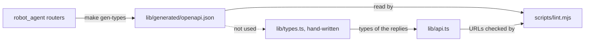

---
sources:
  - frontend/lib/generated/openapi.json
  - frontend/lib/types.ts
  - scripts/gen_types.sh
  - scripts/dump_openapi.py
  - scripts/lint.mjs
  - Makefile
  - docs/backend_coupling.md
verified_at: 4a810a3717ab
---

# The contract with the backend: an OpenAPI snapshot and hand-written types

The dashboard keeps a copy of the backend's API description in the repo and checks its own URLs against it. The TypeScript types of the backend data are written by hand. They are not generated from that copy.

!!! abstract "In this page"
    - `frontend/lib/generated/openapi.json` is a snapshot of the `robot_agent` backend's OpenAPI, made offline by `make gen-types`.
    - At the pinned commit it has 66 paths and 63 schemas. There is no `openapi.d.ts`: `make gen-types` writes it only when `openapi-typescript` is installed, and it is not.
    - Only `scripts/lint.mjs` reads the snapshot. It checks that each of the 75 HTTP URL templates in `lib/api.ts` matches one of the 66 paths. The 77 counted by the lint include the 2 WebSocket templates, which it skips.
    - The types the code uses are in `frontend/lib/types.ts` (292 lines) and a few small type files. They can drift from the backend. Nothing checks them.
    - Some project text is out of date on all of this. The section "What the docs say and what the code does" lists it.

!!! code "Where in the code"
    - Snapshot writer: [`scripts/dump_openapi.py`](https://github.com/mtbui2010/robotapp/blob/4a810a3717ab/scripts/dump_openapi.py#L17-L33)
    - Wrapper and the optional `.d.ts` step: [`scripts/gen_types.sh`](https://github.com/mtbui2010/robotapp/blob/4a810a3717ab/scripts/gen_types.sh#L12-L31)
    - Make target: [`Makefile:56-60`](https://github.com/mtbui2010/robotapp/blob/4a810a3717ab/Makefile#L56-L60)
    - Check that reads the snapshot: [`scripts/lint.mjs:39-62`](https://github.com/mtbui2010/robotapp/blob/4a810a3717ab/scripts/lint.mjs#L39-L62)
    - Hand-written types: [`frontend/lib/types.ts`](https://github.com/mtbui2010/robotapp/blob/4a810a3717ab/frontend/lib/types.ts#L1-L292)

## Where it sits



The dotted arrow is the point of this page: no step turns the snapshot into types.

## The snapshot: how `make gen-types` makes it

The target runs `scripts/gen_types.sh` with two variables.

| input | default | meaning |
|---|---|---|
| `ROBOT_AGENT_DIR` | `../robot_agent` next to this repo | a checkout of the backend |
| `PYTHON` | `python3` | a Python that can import `fastapi` and the `robot_agent` package |

Steps, from the scripts:

1. `gen_types.sh` stops with exit 1 and `robot_agent not found at <dir> (set ROBOT_AGENT_DIR)` when `<dir>/robot_agent/api` does not exist.
2. It runs `scripts/dump_openapi.py` with the checkout on `PYTHONPATH`. That script makes a bare FastAPI app, includes 16 routers in a fixed order (`devices`, `skills`, `configs`, `buttons`, `agent`, `camera`, `diagnostics`, `locations`, `planner`, `robot`, `tts`, `map`, `teleop`, `recorder`, `recordings`, `poses`), and asks the app for its OpenAPI. It does not start a robot, so it needs no devices and no ROS.
3. Warnings that FastAPI raises while building the schema, for example a duplicated route, are printed to stderr as `warning: ...`.
4. The file is written with `indent=1` and sorted keys, so a new dump gives a small, readable diff. The script prints `<out>: N paths, M schemas`.
5. If `frontend/node_modules/.bin/openapi-typescript` exists, `gen_types.sh` runs it to write `frontend/lib/generated/openapi.d.ts`. Otherwise it prints `openapi-typescript not installed in frontend/node_modules: skipped openapi.d.ts` and ends. No download is tried.

WebSocket routes (`/ws/agent`, `/ws/camera/<id>`) are not part of OpenAPI, so they are not in the snapshot.

[`scripts/dump_openapi.py:17-33`](https://github.com/mtbui2010/robotapp/blob/4a810a3717ab/scripts/dump_openapi.py#L17-L33)

```python
ROUTERS = ['devices', 'skills', 'configs', 'buttons', 'agent', 'camera',
           'diagnostics', 'locations', 'planner', 'robot', 'tts', 'map', 'teleop', 'recorder', 'recordings', 'poses']


def main(out: str) -> None:
    app = FastAPI(title='robot_agent')
    for name in ROUTERS:
        app.include_router(importlib.import_module(f'robot_agent.api.{name}').router)
    with warnings.catch_warnings(record=True) as caught:
        warnings.simplefilter('always')
        spec = app.openapi()
    for w in caught:                       # e.g. duplicate POST /skills (agent.py + skills.py)
        print(f'warning: {w.message}', file=sys.stderr)
    with open(out, 'w') as f:
        json.dump(spec, f, indent=1, sort_keys=True, ensure_ascii=False)
        f.write('\n')
    print(f'{out}: {len(spec["paths"])} paths, {len(spec.get("components", {}).get("schemas", {}))} schemas')
```

If the list in `ROUTERS` falls behind the backend's own router list, the snapshot misses paths and the lint cannot see them.

## What is in the snapshot today

Counted from the committed `openapi.json` (OpenAPI 3.1.0, title `robot_agent`, version `0.1.0`).

| number | value | date | machine |
|---|---|---|---|
| paths | 66 | 2026-11-19 | offline Linux workstation |
| operations (method + path) | 85 | 2026-11-19 | offline Linux workstation |
| schemas | 63 | 2026-11-19 | offline Linux workstation |
| operations whose 200 or 201 reply is a named schema (`$ref`) or an array of named schemas | 47 | 2026-11-19 | offline Linux workstation |

"Names a schema" is the only test used here: the 200 or 201 reply is a `$ref`, or an array whose items are a `$ref`. Other tests give other counts (46 for a direct `$ref` in any 2xx reply, 48 when a `$ref` may sit anywhere inside the schema, 51 for any non-empty schema); this page and the site use 47. It says the backend declared the reply shape. It does not say the shape is complete.

Operations by first path segment: total, and how many name a reply schema.

| prefix | operations | with a reply schema |
|---|---|---|
| `/agent` | 12 | 9 |
| `/buttons` | 11 | 0 |
| `/config` | 6 | 0 |
| `/connects` | 7 | 0 |
| `/diagnostics` | 2 | 0 |
| `/map` | 1 | 0 |
| `/planner` | 1 | 0 |
| `/poses` | 7 | 7 |
| `/recorder` | 4 | 4 |
| `/recordings` | 8 | 7 |
| `/robot` | 2 | 2 |
| `/ros` | 1 | 0 |
| `/runs` | 8 | 8 |
| `/skill` | 1 | 0 |
| `/skill-configs` | 4 | 2 |
| `/skills` | 6 | 5 |
| `/teleop` | 3 | 3 |
| `/tts` | 1 | 0 |
| total | 85 | 47 |

The families the dashboard uses most for setup (`/connects`, `/buttons`, `/config`) have no reply schema. Their reply types exist only in `lib/types.ts` or in the file that calls them.

## The 77 URLs against the 66 paths

`node scripts/lint.mjs` printed, on 2026-11-19 on the offline workstation:

```text
lint: 77 endpoint URLs in lib/api.ts checked against 66 OpenAPI paths
lint: 65 files, 5 BACKEND-WORKAROUND tags
lint: eslint not installed in frontend/node_modules — skipped (npm i -D eslint eslint-config-next to enable)
lint: ok
```

How to read the first line:

- The 77 is the number of `${getAgentUrl()}/...` and `${getWsBase()}/...` templates in `lib/api.ts`. Of these, 75 are HTTP and 2 are WebSocket. The lint counts all 77 but skips the two `/ws/` ones, so 75 are matched.
- The 66 is the number of paths in the snapshot. A path can have several methods, so 75 URLs are not 75 paths. Several `api` methods share one URL template and differ in method.
- A URL is accepted when its path matches some snapshot path. `{id}`-style parts match one segment. FastAPI drops `:path` in OpenAPI, so those parts match several segments.
- The lint does not compare the HTTP method, the body or the reply. A wrong method on a real path passes.
- The match is loose in one place. The `getStatus` call is written as `/connects/status` followed by a template string with a query part with a query string built inside the template, and the regular expression stops at the `?` inside it. The partial path then matches `/connects/{connect_id}`, not `/connects/status`. The URL is right, but the lint did not check it against its own path.
- In the other direction, 10 snapshot paths are never called by `api.ts`: the eight `/runs` paths and the two `/diagnostics` paths. Replaying the lint's own matching also shows `/connects/status` as not hit, for the reason above. It is called.

The lint prints `lint: no frontend/lib/generated/openapi.json ... endpoint check skipped` and goes on when the snapshot is missing. In that case the URL check is off and `lint: ok` can still print.

## The hand-written types

[`frontend/lib/types.ts`](https://github.com/mtbui2010/robotapp/blob/4a810a3717ab/frontend/lib/types.ts#L1-L292) has 292 lines. The main ones:

| type | what it describes |
|---|---|
| `ClientEntry`, `ClientType`, `PoolStatus` | a device or AI-server connection, with its connection state |
| `SkillDef` | a skill: `name`, `type` (`internal`, `external`, `plan`), `description`, optional `plan` and `aliases` |
| `WorldState` and `WorldProvenance` | the robot's belief about the world (`arrived`, `found`, `holding`, `opened`, `on`) and where each value came from |
| `AgentEvent` | one message of the agent WebSocket; every field except `event` is optional |
| `PlannerPrompt`, `LlmInfo` | planner prompt and LLM settings |
| `MapConfig` and the `Map*` types, `SimState` | the `MAP` config group and the simulator state |
| `LocationsInfo` | the list of sites and the active one |

`AgentEvent` has one field the backend never sends: `_rx`, the time in ms at which the dashboard received the event. The page sets it itself. See [the page](page.md).

Other types sit next to the code that uses them: `RobotLanguages`, `BtnDef`, `RecorderStatus`, `Pose`, `RecDetail`, `TeleopFunction`.

What this means for you:

- A type can say a field exists while the backend renamed it. `tsc` cannot see that, and neither can the lint.
- The backend has typed replies for 47 of 85 operations (see the table), so for those a generated type could replace some hand-written ones. This is not done.
- `fetch` replies are cast to these types in `lib/api.ts` (`r.json()` returns `any`). A wrong shape fails at the place that reads the field, not in the client.

## What the docs say and what the code does

These are current facts. Use them to avoid being misled.

| where | what it says | what the code shows at 4a810a3717ab |
|---|---|---|
| the repo rules file (rule 1) | "generate types (`make gen-types`)" | `make gen-types` writes only the JSON snapshot. There is no `openapi.d.ts`. `lib/api.ts` imports its types from the hand-written `lib/types.ts`. |
| `docs/backend_coupling.md`, "OpenAPI today" | 38 paths, 21 schemas, no route declares a `response_model`, "all 50 exist" | 66 paths, 63 schemas, 47 of 85 operations with a named reply schema, 77 URLs checked. The page is out of date on these numbers. |
| comment at the end of `scripts/gen_types.sh` | "most responses are untyped anyway: robot_agent routes declare no response_model" | The message is printed when `.d.ts` is skipped. It no longer matches the snapshot: `/poses`, `/recorder`, `/recordings`, `/robot`, `/runs`, `/teleop`, `/skills` and most of `/agent` have reply schemas. |

How to refresh the snapshot, not run here (it needs a `robot_agent` checkout with FastAPI, and this site was written offline):

```text
make gen-types ROBOT_AGENT_DIR=../robot_agent PYTHON=python3
```

To get a `.d.ts`, install `openapi-typescript` in `frontend/` on a machine with network and run the same command. Nothing in `lib/` would import the file until someone changes `api.ts` to use it.

## Failure modes

| symptom | cause | what to do |
|---|---|---|
| `robot_agent not found at ...` and exit 1 | `ROBOT_AGENT_DIR` does not point to a checkout with `robot_agent/api` | set `ROBOT_AGENT_DIR` |
| Python `ModuleNotFoundError: fastapi` or `robot_agent` | the `PYTHON` you gave lacks the packages | use a Python that has them |
| `warning: ...` lines on stderr | FastAPI found duplicate operation ids or routes | read them; the dump still writes the file |
| the lint passes but a call fails on the robot | the lint checks paths only | test the call against the backend |
| the lint prints `endpoint check skipped` | `openapi.json` is missing | run `make gen-types` |
| the snapshot is older than the backend | nobody ran `make gen-types` after a backend change | run it and commit the diff |

## How it is verified

- No test covers the dump itself. It needs the backend checkout and Python packages, so it was not run for this page.
- `make lint` uses the committed snapshot. Its output is above. It was run offline and exits 0.
- The counts in "What is in the snapshot today" were taken from the committed JSON with a short script of this site's build, not by the dump.
