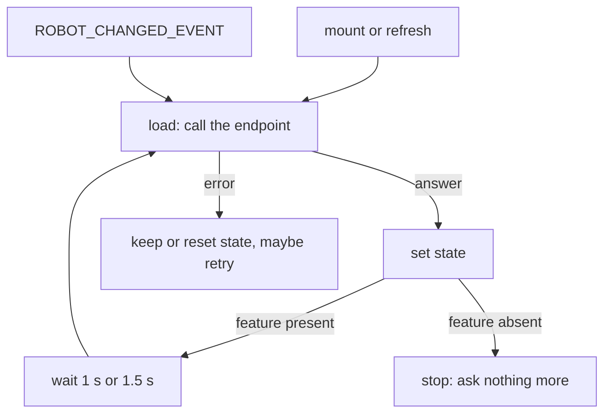

---
sources:
  - frontend/lib/useRecorder.ts
  - frontend/lib/useTeleop.ts
  - frontend/lib/usePoses.ts
  - frontend/lib/useRobotLanguages.ts
  - frontend/lib/useHandsFree.ts
  - frontend/lib/useVoiceOutput.ts
  - frontend/lib/useScreenRecorder.ts
  - frontend/lib/api.ts
verified_at: 4a810a3717ab
---

# Polling hooks and the shared pattern

!!! abstract "In this page"
    Four hooks read the robot's state from the backend and give it to the page: the recorder, the teleop functions, the "Go to" poses and the robot's languages. They share one pattern: read once on mount, poll only while the robot has the feature, keep what you have when a read fails, read again when the robot changes, and re-read when a click asks for it. This page gives that pattern, a table of the four hooks, and the points where the code and its own comments differ. Three more hooks (hands-free, voice output, screen recorder) work in the browser; each gets one line. Read in code at commit `4a810a3717ab`; the hooks have no tests and were not run.

## The pattern



1. **Read once on mount.** `load()` runs as soon as the effect starts.
2. **Poll only while the robot has the feature.** `useRecorder` sets the next timer only when the answer is not `null`; `useTeleop` only when the list is not empty. A robot without a recorder or teleop is asked once.
3. **A failed read.** `useRecorder` keeps the last answer and asks again after 3 seconds. `useTeleop` sets `[]` and stops (see the next section).
4. **Read again when the robot changes.** The hooks listen to `ROBOT_CHANGED_EVENT` (`'robotapp:robot-changed'`) on `window`. `setActiveRobot` in `api.ts` sends it when the tab's robot changes (`api.ts:70-77`), because what was read from the old robot is stale.
5. **`refresh()` after a click.** The hook keeps a counter (`tick`). `refresh` adds 1; the effect lists `tick` as a dependency, so it is cleaned up and started again, and the read happens at once.
6. **Clean up.** A flag `alive` is set false on cleanup, so a late answer after unmount sets no state; the timer and the listener are removed.

## The four hooks

| Hook | Returns | Endpoint | Period | On error |
|---|---|---|---|---|
| `useRecorder` | `[RecorderStatus \| null, refresh]` | `GET /recorder` | 1 s while the answer is not `null` | keep the last answer, retry in 3 s |
| `useTeleop` | `[TeleopFunction[], refresh]` | `GET /teleop` | 1.5 s while the list is not empty | set `[]`, no retry |
| `usePoses` | `[PoseList \| null, refresh]` | `GET /poses` | none: on mount, `refresh`, robot change | set `null` |
| `useRobotLanguages` | `[RobotLanguages \| null, set]` | `GET /robot/languages`, and `PUT /robot/languages` in `set` | none: on mount, robot change | keep the last answer; `set` returns the error text |

Details that the table cannot hold:

- `GET /recorder` returns `null` for HTTP 404 (`api.ts:515-519`). That means "this robot has no recorder": the state is `null`, no timer is set, and nothing is drawn. Any other non-OK status throws, which takes the retry path.
- `GET /teleop` returns `functions` from the body, or `[]` (`api.ts:500-504`).
- `useRobotLanguages` has no `refresh`. Its second value `set(langs)` calls `PUT /robot/languages` with `{ languages }`, puts the reply into the state, and returns `''`. On an error it returns the message (the `detail` of the body, or `HTTP <status>`) and the state does not change.
- All four are used once, in `app/page.tsx:689-692`: the page keeps the values and gives them to the panels.

## Where code and comment differ

!!! note
    The comment of `useTeleop` says "A failed read keeps the last answer". The code does the opposite: the `catch` sets `[]` and sets no timer (`useTeleop.ts:20`). Result: after one failed read the teleop bar is empty and the hook does not ask again until `refresh()` is called (after a click) or the robot changes. If the backend is restarted while the bar is shown, the bar disappears and stays away. Reload the page, switch robot, or use a control that calls `refresh`.

`useRecorder` is the opposite: a failed read keeps the last answer and retries every 3 seconds without end. If the very first read fails, the state stays `null` and the retry continues.

## Code

```ts
export function useRecorder(): [RecorderStatus | null, () => void] {
  const [st, setSt] = useState<RecorderStatus | null>(null)
  const [tick, setTick] = useState(0)
  const refresh = useCallback(() => setTick(t => t + 1), [])
  useEffect(() => {
    let alive = true
    let timer: ReturnType<typeof setTimeout> | undefined
    const load = () => {
      api.getRecorder().then(s => {
        if (!alive) return
        setSt(s)
        if (s) timer = setTimeout(load, 1000)
      }).catch(() => { /* keep the last answer, ask again */ if (alive) timer = setTimeout(load, 3000) })
    }
    load()
    const again = () => { if (timer) clearTimeout(timer); load() }
    window.addEventListener(ROBOT_CHANGED_EVENT, again)
    return () => { alive = false; if (timer) clearTimeout(timer); window.removeEventListener(ROBOT_CHANGED_EVENT, again) }
  }, [tick])
  return [st, refresh]
}
```

!!! code "Where in the code"
    [`frontend/lib/useRecorder.ts` lines 8-28](https://github.com/mtbui2010/robotapp/blob/4a810a3717ab/frontend/lib/useRecorder.ts#L8-L28). The same shape is in [`useTeleop.ts`](https://github.com/mtbui2010/robotapp/blob/4a810a3717ab/frontend/lib/useTeleop.ts); [`usePoses.ts`](https://github.com/mtbui2010/robotapp/blob/4a810a3717ab/frontend/lib/usePoses.ts) and [`useRobotLanguages.ts`](https://github.com/mtbui2010/robotapp/blob/4a810a3717ab/frontend/lib/useRobotLanguages.ts) have no timer.

`again` clears the pending timer before it loads, so a robot change does not leave two timers running. A request that is still in flight when the robot changes is not cancelled; its answer can arrive after the new one.

## The three browser hooks

These do not call a polling endpoint. They are listed so that the name is easy to find.

| Hook | What it does | More |
|---|---|---|
| `useHandsFree` | the chat's hands-free microphone: a loop of one-shot recognitions, never a continuous recogniser; it listens only when `chatMic.micVerdict` allows it and aborts when that stops being true; what it hears goes to `onHeard` unless `acceptTranscript` drops it | [chat](chat.md), [voice](voice.md) |
| `useVoiceOutput` | `speak(text, lang?, rate?)` through `speechSynthesis`; returns `{ speak, supported, missingVoice }`; when a recording with the `direct` sound source is on, it also sends the line to `speakViaSink` | [voice](voice.md), [capture logs](capture-logs.md) |
| `useScreenRecorder` | per-run and manual screen recording; returns `recordEnabled`, `toggleRecord`, `beginRecording`, `endRecording`, `manualRecording`, `toggleManualRecord`, `setRecordingPrefix` | [capture logs](capture-logs.md) |

## Dev port

Where the page is served while you work on a hook is not the same in the two files that set it. `frontend/package.json` has `"dev": "next dev --port 3001"`. The `run-frontend` target in the `Makefile` runs `npm run dev -- -p 3007`. A comment in `lib/clipboard.ts` also names port 3007. Which port wins when the `make` target is used was not run here; check the line the dev server prints when it starts.

## Edge cases and failure modes

| Symptom | Cause | Fix |
|---|---|---|
| The recorder or teleop control does not appear | the robot has none (`/recorder` answers 404, or `/teleop` gives no functions), so nothing is drawn | none needed; a robot with the feature shows it |
| The recorder card shows old values | a read failed; the hook keeps the last answer | fix the backend; it retries every 3 s |
| The teleop bar vanished after a backend restart | `useTeleop` resets to `[]` on error and stops polling | switch robot, reload, or trigger `refresh` |
| Poses or languages are not shown after the backend came up | no polling in these hooks | switch robot, reload, or edit a pose (which calls `refresh`) |
| After switching robot, values of the old robot flash | the old request was in flight and was not cancelled | wait for the next answer; `refresh` for the poses |

## Tests

None for the hooks. The offline tests cover pure `lib/` modules (see [tests](tests.md)); the endpoints that the hooks call are listed in [endpoints](../reference/endpoints.md).
