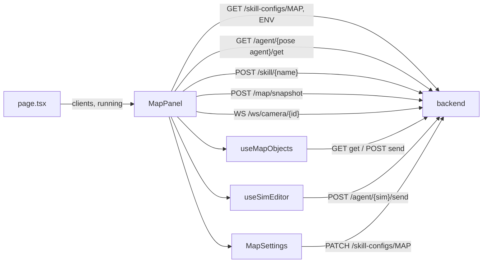

---
sources:
  - frontend/components/MapPanel.tsx
  - frontend/components/MapSettings.tsx
  - frontend/components/mapObjects.tsx
  - frontend/components/mapSim.tsx
  - frontend/components/ConfigFields.tsx
  - frontend/lib/mapObjects.ts
  - frontend/lib/robotPose.ts
  - frontend/lib/types.ts
  - frontend/lib/api.ts
  - scripts/test_lib.mjs
verified_at: 4a810a3717ab
---

# Map tab, objects and simulation

!!! abstract "In this page"
    The Map tab shows the active site's map with the robot on it. A click on a free spot sends the robot there, the arrow keys turn it, a click on a saved place sends it to that place, and "Save as place" stores the current pose as a new place. When the site's `MAP` config declares them, the tab also draws an objects layer and a simulation bar. This page lists the `MAP` config keys, the endpoints, how a click becomes a skill call, real outputs of the pure helpers, and the failure modes, including one that writes a whole config group.

## What the reader gets

After this page you can read a `MAP` config and say what the tab will do with it, add a pose source, a goal skill and an objects layer for a new robot, and find the code that is behind each button.

| | |
|---|---|
| **Component** | `MapPanel` (`frontend/components/MapPanel.tsx`, 699 lines); hooks `useMapObjects` (`mapObjects.tsx`) and `useSimEditor` (`mapSim.tsx`); `MapSettings` (the settings box); `MapUpdater` (inside `MapPanel.tsx`) |
| **Pure logic** | `lib/mapObjects.ts` (objects: parse, fill, poll), `lib/robotPose.ts` (pose from an agent's value) |
| **Props** | `clients: ClientEntry[]`, `running: boolean` (`MapPanel.tsx` line 139) |
| **Output** | skill calls and device-agent calls; writes to the `ENV` and `MAP` config groups; a status line |
| **Tests** | `scripts/test_lib.mjs` lines 341-387 (objects only) |

## Background

The map is a picture of the site (a floor plan, or a top-down camera view) plus layers that are also pictures: an occupancy layer (where the robot cannot go) and a height layer (how high the floor or the surface is). The backend stores them as files of the active site and describes them in a config group named `MAP`. A config group is a named JSON object served by `GET /skill-configs/<name>` (see [configs](../modules/configs.md)). The group `ENV` holds the saved places: each has a location `loc: {x, y, rz}` in metres and degrees, a `height`, and more.

Coordinates follow the ROS `map.yaml` convention (`types.ts` lines 193-196): `origin` is the world `(x, y)` in metres of the image's bottom-left corner, `resolution` is metres per pixel, and image row 0 is the top. The user's origin (`MAP.origin`) is a second frame, `[x, y, yaw in degrees]`, for the numbers shown on screen: hover, robot position, angles. The robot and `ENV` keep the robot's own map frame. A device agent is a connection that can be read with `GET /agent/{name}/get` ([robots and connections](../modules/robots-connections.md)). See [map and pose in the learn chapter](../learn/06-map-pose.md) for the frames.

## Where it sits



## The `MAP` config

Type `MapConfig` (`lib/types.ts` lines 241-267). Everything the tab does comes from it; a robot without a `MAP` group gets "This site has no MAP config." with the "Update map" box (the tab needs `image` or `layers.occupancy`).

| key | meaning | default |
|---|---|---|
| `image` | the picture under everything: `{connection}` (a camera, drawn live), `{url}`, or `{file}` (a site file such as `map/map.png`), with its `frame` | none |
| `source` | where the saved map came from: the occupancy connection, `saved_at`, `inflate_m`, `occupied`, the `keep` polygon, `speck_cells` | none |
| `layers.occupancy` | grey PNG: values at or above `values.inflated` (128) are blocked, at or above `values.occupied` (255) are obstacles | 128 and 255 |
| `layers.height` | grey PNG of heights; unit `cm` or `mm` | `cm` |
| `surfaces` | list of `{name, centre, size, yaw_deg, height}`: tables and shelves, drawn and used for auto lift | none |
| `places` | `'ENV'` draws the `ENV` entries as green dots; a click runs `move` for that name | no dots |
| `pose` | `{agent, x, y, orientation or yaw, angle, period_s}`: the agent to read and the dot paths of its value | none; without `pose` and `goal` the map is view only |
| `goal` | `{skill, params}` with `{x}`, `{y}`, `{rz}` | none |
| `rotate` | `{skill, params, step_deg}` with `{deg}` | step 15 degrees |
| `lift` | `{skill, params, clearance, reach_m}` with `{h}` | clearance 0.1 m, reach 0.8 m |
| `confirm_goal` | ask before every motion | off |
| `origin` | the user's frame `{x, y, yaw_deg}` | `0, 0, 0` |
| `sim` | `{agent}`: turns on the simulation bar | none |
| `objects` | the objects layer (below) | none |

The full key reference is in [map config](../reference/map-config.md).

## How a click becomes a robot move

1. **Fill the template.** `fill` (`MapPanel.tsx` lines 43-52) replaces `{x}`, `{y}`, `{rz}`, `{deg}`, `{h}` in each param. A param that is only a placeholder keeps its type and becomes a number rounded to 3 decimals; a param with other text becomes a string.
2. **Check the click.** `goTo` refuses a click on a blocked spot (occupancy at or above the inflated value), refuses if the config has no `goal` or `pose`, refuses while a plan is running (`A plan is running — stop it first.`), and asks for confirmation when `confirm_goal` is set.
3. **Send.** `POST /skill/{name}` with the filled params through `api.runSkill`. The current heading is kept: `rz` is the robot's yaw in degrees.
4. **Read back.** After the skill reports done, the panel reads the pose again with `agentGet` and compares it with the goal.
5. **Lift.** If the config has `lift`, the panel picks the nearest surface within `reach_m` (or the typed height in the `height` box), adds `clearance`, and runs the lift skill. `auto lift` can be switched off.

A click on a green place dot runs the skill `move` with `{inputs: <name>}`. The skill name `move` is fixed in the code (`MapPanel.tsx` line 293); it is not read from the config. The arrow keys run the `rotate` skill: left turns counter-clockwise by `step_deg`; presses made while a turn is running add up and go as one turn. Keys are read while the map has focus.

### The arrival check

`goTo`, [MapPanel.tsx lines 265-287](https://github.com/mtbui2010/robotapp/blob/4a810a3717ab/frontend/components/MapPanel.tsx#L265-L287):

```tsx
  const goTo = useCallback(async (x: number, y: number) => {
    if (!cfg || busy) return
    if (!cfg.goal || !cfg.pose) { setStatus('View only: add "pose" and "goal" to the MAP config to move the robot from the map.'); return }
    const pr = probe(x, y)
    if (pr.blocked) { setStatus(`(${x.toFixed(2)}, ${y.toFixed(2)}) is blocked for the base — pick a free (green) spot.`); return }
    if (!motionAllowed(`Move the robot to (${x.toFixed(2)}, ${y.toFixed(2)})`)) return
    setGoal([x, y]); setBusy(true); setStatus(`moving to (${x.toFixed(2)}, ${y.toFixed(2)})…`)
    try {
      const rz = (pose?.yaw ?? 0) / DEG
      const r = await api.runSkill(cfg.goal.skill, fill(cfg.goal, { x, y, rz }))
      if (r.isdone === false) { setStatus(`move failed: ${String(r.msg ?? '')}`); return }
      const pc = cfg.pose
      const v = await api.agentGet(pc.agent).catch(() => null)
      const px = v ? Number(getPath(v, pc.x)) : x, py = v ? Number(getPath(v, pc.y)) : y
      if (Math.hypot(px - x, py - y) > 0.3) {          // kcare reports done even when navigation gave up — BACKEND-WORKAROUND(map-arrive-check)
        setStatus(`stopped ${Math.hypot(px - x, py - y).toFixed(2)} m short of the goal (no path?)`); return
      }
      setStatus('arrived')
      await liftFor({ x: px, y: py, yaw: pose?.yaw ?? 0 })
    } catch (e) { setStatus(`error: ${(e as Error).message}`) }
    finally { setBusy(false); setGoal(null) }
    // eslint-disable-next-line react-hooks/exhaustive-deps
  }, [cfg, busy, probe, pose, liftFor, running])
```

The line tagged `map-arrive-check` is a workaround for the `kcare` robot package, which reports its base move as done even when the navigation gave up. The panel therefore reads the pose back and, if the robot is more than 0.3 m from the goal, shows `stopped N m short of the goal (no path?)` and does not lift. This is a backend quirk handled in the dashboard; see [backend coupling](../reference/backend-coupling.md).

## Reading the pose

`lib/robotPose.ts` reads the pose from the value of the agent named in `MAP.pose`. The panel polls `GET /agent/{agent}/get` every `period_s` seconds (default 0.5). It uses `agentGet`, a read-only call, on purpose: a poll that ran a skill would clear a pending cancel and so undo the operator's Stop. `poseFrom` takes dot paths for `x` and `y` and either a quaternion (`orientation`) or a yaw (`yaw`, with `angle` `deg` or `rad`). It returns `null` unless `x` and `y` are finite numbers ([robotPose.ts lines 16-23](https://github.com/mtbui2010/robotapp/blob/4a810a3717ab/frontend/lib/robotPose.ts#L16-L23)):

```ts
/** {x, y, yaw [rad]} in the robot's map frame, from the value of MAP.pose's agent. */
export function poseFrom(v: unknown, p: NonNullable<MapConfig['pose']>): { x: number; y: number; yaw: number } | null {
  const x = Number(getPath(v, p.x)), y = Number(getPath(v, p.y))
  let yaw = 0
  if (p.orientation) yaw = quatYaw(getPath(v, p.orientation) as { x: number; y: number; z: number; w: number })
  else if (p.yaw) yaw = Number(getPath(v, p.yaw)) * (p.angle === 'deg' ? Math.PI / 180 : 1)
  return Number.isFinite(x) && Number.isFinite(y) ? { x, y, yaw } : null
}
```

Real outputs, from a run of the repo's own `robotPose.ts`, `mapObjects.ts` and `buttonGroups.ts` bundled with its `esbuild` and run offline on synthetic values (Node, local machine, 2026-11-19):

```text
poseFrom({pose:{position:{x:1.5,y:-0.25},orientation:{x:0,y:0,z:0.7071068,w:0.7071068}}}, {x:'pose.position.x', y:'pose.position.y', orientation:'pose.orientation'})
  -> {"x":1.5,"y":-0.25,"yaw":1.570796380007374}
poseFrom({x:2,y:3,th:90}, {x:'x',y:'y',yaw:'th',angle:'deg'})
  -> {"x":2,"y":3,"yaw":1.5707963267948966}
poseFrom({x:'n/a',y:3}, {x:'x',y:'y'})
  -> null
```

The first is a quaternion for a quarter turn (yaw 1.5708 rad, 90 degrees); the second gives the same angle from a field in degrees.

## Saved places, origin and keep area

| button or gesture | what it does | writes |
|---|---|---|
| `Save as place` | asks a name and a surface height (guessed from the nearest surface within reach, or the typed height, else 0.7 m), re-reads `ENV`, asks before it overwrites a name, adds the entry with `loc` rounded to 3 decimals (rz to 1) and `source: 'map'` | `PUT /skill-configs/ENV` (whole group) |
| `✥ Edit origin` | drag the origin dot to move it, the arrow tip to rotate it, or type x, y, yaw; arrow keys rotate it by 5 degrees (1 with Shift); `Apply…` asks whether the places follow the origin | `PUT /skill-configs/MAP` and, if places follow, `PUT /skill-configs/ENV` |
| `↶ Undo origin change` | restores the old origin and, if the places moved, the old `ENV` | `PUT` of both groups |
| `⟳ Update map` | confirms, then saves the chosen occupancy-grid connection as this site's map files (the old map is kept in `map/history/`) | `POST /map/snapshot` |
| `✂ Keep area` | loads the robot's whole map (`preview`), you click the corners of the area to keep (Backspace removes the last); `Apply` saves the map cropped to it; `whole map` removes the area | `POST /map/snapshot` with `keep` |
| `⚙ Settings` | opens `MapSettings`, which uses the shared fields-or-JSON editor `ConfigFieldsEditor` from `ConfigFields.tsx`, and edits the hand-set keys (`confirm_goal`, `places`, `pose`, `goal`, `rotate`, `lift`) as fields or as JSON for all of `MAP` | `PATCH /skill-configs/MAP` |
| `Stop` | cancels the run on the robot | `POST /agent/cancel` |

`MapUpdater` lists the connections whose `data_interface` contains `OccupancyGrid`; with none, it shows how to add one. The picture can also come live from a camera connection named in `MAP.image.connection`: the panel opens `WS /ws/camera/{id}` with the same protocol as the camera cell ([cameras](../modules/cameras.md)) and reconnects after 1.5 s.

### Save as place writes the whole group

`Save as place` reads the whole `ENV` group, changes one entry, and writes the whole group back with `PUT` (`MapPanel.tsx` lines 342-346):

```tsx
    const cur = ((await api.getSkillConfig('ENV')) ?? {}) as Record<string, EnvEntry>
    if (cur[name] && !window.confirm(`"${name}" exists — overwrite it?`)) return
    cur[name] = { default_mode: 'front', height: Number(hs), placepose: { dx: 0, dy: 0 }, source: 'map',
                  loc: { x: Number(pose.x.toFixed(3)), y: Number(pose.y.toFixed(3)), rz: Number((pose.yaw / DEG).toFixed(1)) } }
    await api.updateSkillConfig('ENV', cur)
```

Other parts of the dashboard save a config group differently. `MapSettings` and the Global Configs panel use `api.mergeSkillConfig`, which sends `PATCH {base, value}` so that the backend merges per top-level entry and keeps what another machine saved meanwhile. `PUT` replaces the group. So if a second machine changes `ENV` between the `GET` and the `PUT` of `Save as place`, its change is lost. The window is short here because `ENV` is re-read just before the write. The same `PUT` of a whole group is used in three more places found in the code at this commit:

| code | group written with `PUT` |
|---|---|
| `applyOrigin` (`MapPanel.tsx` lines 385-409) | `ENV` when places follow, and `MAP` from the config held in state since the last reload |
| `undoOrigin` (lines 411-420) | `ENV` and `MAP` |
| `afterRebuild` in `mapSim.tsx` (lines 150-155) | `ENV` and `MAP` as regenerated by the simulator |

For `MAP` the written object is an object spread of `cfg` plus `origin` where `cfg` was loaded when the tab last reloaded, so a map saved from another machine after that is overwritten too. How to avoid it: use one dashboard at a time when you edit places, the origin or the simulated house, and press `reload` (which reads `MAP` again, and `ENV` when `places` is `'ENV'`) before you edit. This is the current behaviour, not a plan.

## The objects layer

When `MAP.objects` exists, `useMapObjects` draws labelled markers and polls them. Nothing about objects is known in the dashboard: the backend declares where to read them, which fields mean what, and which actions exist (`MapObjectsConfig`, `types.ts` lines 227-239).

| key | meaning |
|---|---|
| `agent` | the device agent to read |
| `read` | `{method: 'get'}` (default; `GET /agent/{agent}/get`) or `{method: 'send', body}` (`POST /agent/{agent}/send`) |
| `path` | where the dict `id -> entry` (or a list) sits in the reply; empty means the reply itself |
| `poll_s` | seconds between reads: default 1, never below 0.2 |
| `fields` | names of `x`, `y`, `label`, `kind`, `place`, `held`, `id` in an entry; defaults `x`, `y`, `name`, `cls`, `at`, `held`, `id` |
| `actions` | `spawn`, `move`, `remove`; each a skill call `{skill, params}` or a device command `{agent, send}` with `{id}`, `{x}`, `{y}`, `{place}`, `{cls}` |

An entry with no finite `x` and `y` is dropped, except a held object, which is drawn on the robot. The marker colour is a hash of the kind, so one kind always has one colour. A click selects a marker. The buttons `Move` (then click the map, or pick `to a place…`), `Remove` and `Add` (a kind and a place) appear only for the actions the backend declared, and an action is refused while a plan is running. A template that uses a placeholder the caller did not give leaves that entry out; it never sends the text `{place}`.

Real outputs of `fillCall`, `pollMs` and `parseObjects` (same run as above):

```text
fillCall({skill:'mv', params:{id:'{id}',x:'{x}',y:'{y}',where:'at {place}'}}, {id:'o1',x:1.23456,y:2,place:'desk'})
  -> {"id":"o1","x":1.235,"y":2,"where":"at desk"}
fillCall({skill:'mv', params:{id:'{id}',where:'at {place}'}}, {id:'o1'})
  -> {"id":"o1"}
pollMs({poll_s:0.1}) -> 200     pollMs({}) -> 1000     pollMs({poll_s:3}) -> 3000
parseObjects({a:{x:1,y:2,name:'cup',cls:'mug'}, b:{name:'no position'}}, {agent:'x'})
  -> [{"id":"a","x":1,"y":2,"label":"cup","kind":"mug","place":"","held":false}]
```

The second line shows an entry left out because `{place}` was not given. The fourth shows `b` dropped for having no position.

## The simulation bar

When `MAP.sim` has an `agent`, `useSimEditor` adds a bar that talks to the simulator's control service through `POST /agent/{sim agent}/send` with a `cmd`. The bar reads the state with `{cmd: 'state'}` every 3 s (every second while an edit mode is on).

| control | effect |
|---|---|
| `↺ objects`, `↺ + drawers`, `↺ everything` | `reset` with `what` = `objects`, `scene` or `all`; `all` asks first, puts the robot at its start pose and also clears the robot state with `PUT /agent/world` (`holding`, `found`, `opened`); refused while a plan runs |
| scene list, `Load`, `Save as…`, `Delete` | `load`, `save`, `delete` of named scenes; `Save as…` asks before it overwrites |
| `objects` and `furniture` modes | drag to move, `Del` removes, pick from a catalogue and click to add; furniture turns 15 degrees with the arrow keys |
| `Apply changes`, `Discard` | structural changes are collected as a draft and sent as one `apply` that rebuilds the house in a few seconds; the regenerated `ENV` and `MAP` are then saved (see the table above) and the map reloads |

Only one edit at a time: origin edit, keep-area edit and the simulation editor block each other (`finish the other edit first`).

## Edge cases and failure modes

| symptom | cause | what the code does |
|---|---|---|
| `View only: add "pose" and "goal"...` | the config has no `pose` or no `goal` | no motion; add them in `⚙ Settings` |
| `stopped N m short of the goal (no path?)` | the robot package reports done when navigation gave up | pose read-back, threshold 0.3 m (`map-arrive-check`) |
| Stop seemed to be undone | a poll that ran a skill clears a pending cancel | the poll uses `agentGet`, a read-only call |
| a click on a place does the wrong thing | the place click runs the skill `move` with `inputs`, fixed in code | name your move skill `move`, or change the code |
| `A plan is running — stop it first.` | a run is active | no motion until it ends |
| robot dot missing | `pose` unset, the agent not up, or no finite x and y | the poll ignores errors and keeps trying |
| objects do not show | `MAP.objects` missing, or `read` fails (backend not up) | the read error is ignored and the next poll tries again |
| a change from another machine vanished | whole-group `PUT` (above) | none; avoid concurrent edits |

### No "two clients" warning here

The rule that an operator screen able to move the robot should warn that two clients must not drive one robot is not met in `MapPanel.tsx`: a search of the file at the pin finds no such note, and a map click, a place click, the arrow keys and the objects and simulation actions can all move the robot or the scene. The guard that exists is `confirm_goal` (an `OK` dialog before each motion), which you should set on a real robot, and the refusal while a plan runs. How to avoid the problem: one dashboard per robot, and use `Stop` in the dashboard that started the motion.

## How it is verified

`scripts/test_lib.mjs` lines 341-387 test `lib/mapObjects.ts`: parsing a dict or a list under `path`, dropping entries without `x` and `y`, held objects following the robot, which actions are declared, template filling with types kept, the device-agent template form, read and poll rules, colour by kind and the nearest marker. There is no test for `MapPanel.tsx`, `MapSettings.tsx`, `mapSim.tsx`, `robotPose.ts` or the arrival check; the `robotPose.ts` outputs above are from a one-off run, not a test. Nothing here was run against a robot, a simulator or a browser. See [tests](../modules/tests.md), and [the map and move guide](../guides/map-move.md) for the operator steps.
