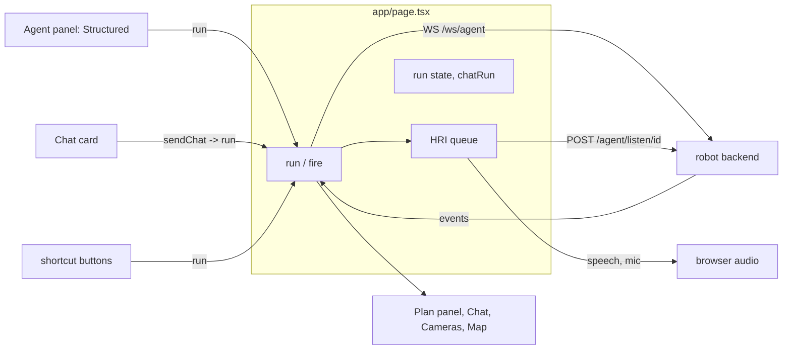
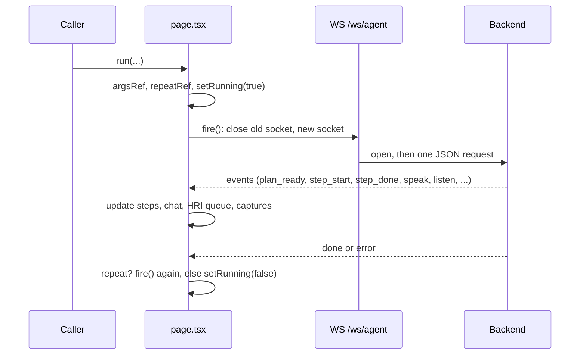

---
sources:
  - frontend/app/page.tsx
  - frontend/app/layout.tsx
  - frontend/app/globals.css
  - frontend/lib/api.ts
  - frontend/lib/chatRun.ts
  - frontend/lib/chatMic.ts
  - frontend/lib/hriVoice.ts
  - frontend/lib/useVoiceOutput.ts
  - frontend/lib/datasetLog.ts
  - frontend/lib/useScreenRecorder.ts
  - frontend/lib/planner.ts
  - frontend/lib/tabPref.ts
  - frontend/lib/types.ts
verified_at: 4a810a3717ab
---

# The page: layout and run controller (`app/page.tsx`)

The dashboard has one route. This file draws the three columns and owns the run: it opens the agent WebSocket, sends one request, handles every event that comes back, speaks and listens for the robot, repeats a plan, stops it, and resets.

!!! abstract "In this page"
    - `app/page.tsx` is a client component (`'use client'`) of 1,001 lines. It takes no props. It holds the state and passes it to the panels.
    - A run is one WebSocket on `/ws/agent`. The page sends one JSON request when the socket opens and then reads events until `done` or `error`.
    - Three callers start a run through the same `run()` function: the Structured plan in the Agent panel, the chat, and the shortcut buttons. They differ in the arguments.
    - Speech and listening go through a queue (`enqueueHri`) so the microphone never opens while the browser is talking.
    - Stop sends a cancel to the backend and waits for `done`. If nothing arrives in 5 seconds the button reads "Force reset", and a second press drops the run on the browser side.
    - Several comments in the file record bugs that were fixed. They are listed in the failure table.

!!! code "Where in the code"
    - Layout: [`page.tsx:812-1001`](https://github.com/mtbui2010/robotapp/blob/4a810a3717ab/frontend/app/page.tsx#L812-L1001)
    - Run (`fire`, `run`): [`page.tsx:233-622`](https://github.com/mtbui2010/robotapp/blob/4a810a3717ab/frontend/app/page.tsx#L233-L622)
    - Event handler: [`page.tsx:337-576`](https://github.com/mtbui2010/robotapp/blob/4a810a3717ab/frontend/app/page.tsx#L337-L576)
    - Stop and reset: [`page.tsx:624-678`](https://github.com/mtbui2010/robotapp/blob/4a810a3717ab/frontend/app/page.tsx#L624-L678)
    - Chat send: [`page.tsx:755-785`](https://github.com/mtbui2010/robotapp/blob/4a810a3717ab/frontend/app/page.tsx#L755-L785)
    - Run state machine: [`lib/chatRun.ts`](https://github.com/mtbui2010/robotapp/blob/4a810a3717ab/frontend/lib/chatRun.ts#L1-L76)

## Where it sits



## The layout

The root is a `flex` row of two sidebars and a main area, with two overlays.

| part | lines | content | open by default |
|---|---|---|---|
| sidebar 1 | 818-840 | `DevicePanel`, `SkillPanel`, `EnvPanel`, `PlannerPromptPanel`, and a round button that folds the column | no (collapsed since 2026-10-27) |
| sidebar 2 | 842-886 | the control bar (Cancel, language picker, Chat), `ButtonPanel` (shortcut buttons), `PlanPanel` | yes |
| main, top | 891-908 | `AgentPanel` (with a voice checkbox), and the hidden `GuidePanel` dialog | always |
| main, tabs | 910-959 | tab switch, data-tools button, robot badge, camera chips slot, second Cancel button, then `CameraFeed`, `MapPanel` or `DataPanel` | Cameras |
| overlay 1 | 963-980 | the "robot did not understand" choice dialog (shown while `choice` is set) | when needed |
| overlay 2 | 981-998 | `ChatPanel` (shown while `chatOpen`) | closed |

Details:

- The tab switch has Cameras and Map. A third tab, Data, appears only when the robot has a recorder (`recorder` from `useRecorder` is not empty).
- The data tools (`TeleopBar`, `RecorderBar`) show on the Cameras tab only when the operator pressed the red dot button (key `robotapp_data_tools`). They are never hidden while a recording or a teleop function is active (`dataBusy`).
- Two Cancel buttons call the same `stop`: one in the control bar of sidebar 2, one on the tab row. The tab-row one is kept when sidebar 2 is folded. Its comment says it is always live, because a skill started from the command line or another client may be moving the robot while this tab shows no run.
- The robot badge on the tab row shows which robot and site this tab drives (from `DevicePanel` through `onActiveChange`).
- `layout.tsx` is the root layout: title `RobotApp v2`, `<html lang="en">`, and the global CSS.

## Inputs

None. It is the root page of the App Router. It reads these browser keys:

| key | store | read where | meaning |
|---|---|---|---|
| `robotapp_data_tools` | `localStorage` | line 78 | `1` = show remote control and record |
| `robotapp_log_data` | `localStorage` | line 777 | log vision captures; a missing key means on (`!== '0'`) |
| `robotapp_log_target` | `localStorage` | line 778 | `backend` or `frontend`; default `frontend` |
| `robotapp_log_all` | `localStorage` | line 779 | `1` = save captures of all runs, not only failed ones; default off |
| `robotapp_planner` | per tab (`sessionStorage`), last choice in `localStorage` | lines 711, 719-723 | `grace`, `direct` or `sage` |
| `robotapp_plan_only` | per tab, last choice in `localStorage` | `lib/planner.ts` | plan without moving; default on |
| `robotapp_lang` | per tab, last choice in `localStorage` (old key `robotapp_qa_lang` as a fallback) | line 720 | language code, or `auto` |

The per-tab helpers are `readTabPref`, `writeTabPref` and `pinTabPref` in `lib/tabPref.ts`. They exist for the same reason as the per-tab robot choice in [the API client](api-client.md): a shared key let one tab change another.

The page also reads `GET /skill-configs/HRI_CONFIGS` for `speech_rate` and `speech_rate_en` (the speaking speed of the browser voice). It does this on load and at every run (`loadSpeechRate`). A number of zero or less is ignored.

## State

The page keeps most run data in refs, because the event handler is a closure that must see live values.

| name | kind | meaning |
|---|---|---|
| `running` | state | a run (or a chain of repeats) is in progress |
| `agentEvents`, `agentSteps` | state, mirrored in `eventsRef`, `stepsRef` | all events of this run; the step rows for the Plan panel (written by `emit`) |
| `rs` (`rsRef`) | state | the run life cycle `{phase, alive, ws, stuck}` from `lib/chatRun.ts` |
| `qaLog` | state | the chat lines (`robot`, `user`, `system`) |
| `listenId` (`listenIdRef`) | state | id of the pending `listen` the robot is waiting on |
| `choice` | state | the on-screen options of a "did not understand" question |
| `trial` | state | iteration number while repeating |
| `runMethod` | state | planner used by the active run (`direct` for any structured run) |
| `logImage` | state | latest debug image of a step, shown in the Cameras tab |
| `wsRef` | ref | the run's socket |
| `argsRef` | ref | the arguments of the current run, reused by every repeat |
| `repeatRef` | ref | `{remaining, continueOnError, active}`; `remaining` may be `Infinity` |
| `stopReqRef` | ref | Stop was pressed for the run in flight |
| `hriEpochRef`, `hriChainRef`, `hriBusyRef` | refs | the HRI queue: current epoch, the promise chain, the number of queued jobs |
| `voiceOutRef` | ref | live copy of the voice checkbox, so unticking it mid-run silences the rest |

## The request

`ws.onopen` sends one JSON message (lines 331-335):

| field | type | meaning | where it comes from |
|---|---|---|---|
| `prompt` | string | the task text, or the plan lines | first argument of `run()` |
| `lang` | string | language code or `auto` | the language picker |
| `direct` | boolean | `true` = run the lines as written (no planner) | `true` for Structured and for buttons, `false` for chat |
| `planner` | `'grace'`, `'direct'` or `'sage'` | planner for a chat task; default `grace` in `run()`, `sage` in the chat | chat header |
| `plan_only` | boolean | plan, do not move; default on in the chat, `false` in `run()` | chat header |
| `log_data` | boolean | ask for vision capture logging | Agent panel, or `robotapp_log_data` for chat |
| `log_mode` | `'backend'` or `'frontend'` | who saves captures (field name is `log_mode`; the page calls it `logTarget`) | Agent panel |
| `log_all` | boolean | save all captures, not only failed runs | Agent panel |

### Who calls `run()`

`run(finalPrompt, direct, lang, planner, planOnly, logData, logTarget, repeatTimes, continueOnError, logAll, voice, screenRec)` returns at once if the prompt is blank or a run is going.

| caller | arguments that differ from the defaults |
|---|---|
| Structured plan, `AgentPanel.tsx:214` | `direct` true; planner and plan-only left at defaults (`grace`, `false`); log settings, repeat count and continue-on-error from the panel |
| Chat, `sendChat` (page line 782) | `direct` false; chat planner and plan-only; log settings from storage; one run; `nextRunChatRef` set so the chat card may open |
| Shortcut button, line 873 | `direct` true, language `en`, no data log, `logAll` true, no voice, no screen recording |

A button run does not speak and does not log. The comment at line 871 says so.

## The life of a run



`fire()` (lines 233-594) does, in order: count the trial, close any old socket, clear events and steps, reset the heard language, set the voice language, record the start time, choose `runMethod`, start the screen recording if enabled, open a new HRI epoch, clear the stop flag, send `start` to the run state, open the socket. The event handler, `ws.onclose` and `ws.onerror` follow.

[`frontend/app/page.tsx:328-339`](https://github.com/mtbui2010/robotapp/blob/4a810a3717ab/frontend/app/page.tsx#L328-L339)

```tsx
    const ws = api.agentWs()
    wsRef.current = ws

    ws.onopen = () => ws.send(JSON.stringify({
      prompt: a.finalPrompt, lang: a.lang, direct: a.direct, planner: a.planner,
      plan_only: a.planOnly, log_data: a.logData,
      log_mode: a.logTarget, log_all: a.logAll,
    }))

    ws.onmessage = e => {
      const ev: AgentEvent = JSON.parse(e.data)
      ev._rx = Date.now()                  // receive time: the plan list shows step durations from it
      const newEvents = [...eventsRef.current, ev]
      let newSteps = stepsRef.current
```

`_rx` is added by the browser only. The event list is rebuilt as a new array for every message, and the whole list is saved in state through `emit`. The parse is not wrapped in `try`, so a message that is not JSON throws inside the handler.

## What the handler does with each event

The handler checks fields, not only `event`, so one message can trigger several actions. The list of event names and fields is in [the agent events reference](../reference/agent-events.md).

| field or event | action |
|---|---|
| `say` (not on `done` or `error`) | adds a robot line of kind `say` to the chat |
| `say` and the voice option on and no HRI job queued | speaks it in the browser and restarts the "still working" nudge (every 15 s a short phrase while no new milestone comes) |
| `say` while HRI jobs are queued | queues it after them (it is never spoken while the mic is open) |
| `qa_state` | shows or hides the "End Q&A" button (`qaSkill`) |
| `choose`, `choose_close` | opens or closes the on-screen choice dialog |
| `clarify` with `question` | adds the question as a robot line |
| `speak`, `speak_lang`, `speak_rate`, `speak_id` | adds a robot line and queues speech; with `speak_id` it then posts an empty answer to `/agent/listen/<speak_id>` so the skill knows the line was spoken |
| `alarm` | queues the siren (`volume` default 0.6, `cycles` default 3) |
| `listen` | queues a listen job (next section) |
| `dataset` | with frontend logging, holds the capture in a bucket until its step reports |
| `step_start` | adds a running row. SAGE events carry `index`, `action`, `object` instead of `step`, `total`, `task`; the page takes either |
| `step_done` | closes the running row with the result: `done` if `result.isdone` is true, else `failed` |
| `step_log` | adds the log entry to the row; shows `log_image`; reads `data.lang_detected.lang` as the heard language in Detect mode |
| `done`, `error` | writes a system line (`✓ done`, `✓ planned (plan only: the robot did not move)`, `✗ failed`, `✗ error: ...`), closes the dialog, stops the nudge, sends `done` to the run state, releases a typed-answer wait, then decides whether to repeat |

A step row is matched on `index`. In SAGE a recovery can reuse an `index`, so `step_done` closes the row that is still `running`.

## The HRI queue

HRI means human-robot interaction: a skill that talks to the person through this browser. Jobs for `speak`, `listen` and `alarm` run strictly one after another through `enqueueHri`. Each job belongs to an epoch. A new run or a reset starts a new epoch, and a job from an older epoch that has not started is dropped. This keeps an old run's question from holding the queue.

A `listen` job, in order:

1. Skip if the answer already came (a click, a chat message, Stop or Reset).
2. Speak the prompt if the voice is on.
3. Choose how to answer (`answerBy` in `lib/chatMic.ts`): typing when the backend asked for text, or when this is a chat run with the chat mic off.
4. Otherwise play the "your turn" tone, and record. With `capture` equal to `whisper` the page records audio and posts it to `/agent/listen/<id>/audio`, and the robot transcribes it. Otherwise the browser's recogniser (`recognizeOnce`) listens, and the text is posted to `/agent/listen/<id>`.
5. In the browser-recogniser path, a transcript that matches what the robot just said is dropped as an echo.
6. On a speech-recognition error the page writes a note and keeps the question open for typing.

Typing never times out in the page. The backend decides when to give up.

A message sent in the chat while the robot waits is the answer. `sendChat` posts it to `/agent/listen/<id>`, ends any recording, and clears the wait.

## The run state

`lib/chatRun.ts` is a small reducer with no React. `phase` is `idle`, `running`, `waiting` (the robot asked) or `stopping`. `alive` means a run may still be going on the backend. `ws` means the run's socket is open. `stuck` means stopping took longer than `STOP_TIMEOUT_MS` (5,000 ms).

Real output of the reducer from the initial state (run on 2026-11-19, offline Linux workstation, bundled from the pinned file; the label column is `stopLabel(state, 'Cancel')`):

| events | phase | alive | ws | stuck | can stop | can type | button label |
|---|---|---|---|---|---|---|---|
| `start` | running | true | true | false | true | false | Cancel |
| `start`, `listen` | waiting | true | true | false | true | true | Cancel |
| `start`, `stop` | stopping | true | true | false | true | false | Stopping… |
| `start`, `stop`, `timeout` | stopping | true | true | true | true | false | Force reset |
| `start`, `ws-close` | idle | true | false | false | true | true | Cancel |
| `start`, `listen`, `answered`, `done` | idle | false | true | false | false | true | Cancel |
| `start`, `stop`, `cancel-ack` | stopping | true | true | false | true | false | Stopping… |

The fourth row is the "stuck" case: every Stop or Cancel button reads "Force reset". The fifth row is a "lost" run: the socket closed in the middle, so no `done` will come, yet the state says a run may be alive and keeps Stop available.

`cancel-ack` ends the stop only when there is no socket (`ws` false). With a socket the page waits for the backend's `done`.

## Stop and reset

[`frontend/app/page.tsx:659-673`](https://github.com/mtbui2010/robotapp/blob/4a810a3717ab/frontend/app/page.tsx#L659-L673)

```tsx
  // Stop: tell the backend to cancel and wait for its `done` (the card shows "stopping…"; after STOP_TIMEOUT_MS it offers
  // Force reset). Pressed again while stuck, it is a Force reset. The socket stays open so the end of the run is seen.
  const stop = useCallback(() => {
    const cur = rsRef.current
    if (stopAction(cur) === 'force-reset') { reset('force reset'); return }
    repeatRef.current.active = false   // cancel any pending repeat
    stopNudge()
    stopReqRef.current = true
    abortCaptures()
    sendRun({ t: 'stop' })
    // The backend runs the plan in its own thread, so the robot must be told to cancel explicitly (closing the socket alone
    // does not reach it).
    api.cancelRun().then(() => sendRun({ t: 'cancel-ack' })).catch(() => {})
    if (!cur.ws) { setRunning(false); endRecording() }
  }, [endRecording, stopNudge, abortCaptures, sendRun, reset])
```

Stop does five things: turn off repeating, silence the nudge, set the stop flag so late `speak` and `listen` events are ignored, end every capture in flight (typed wait, recording, recogniser, speech, dialog), and call `POST /agent/cancel`. A `useEffect` starts a 5-second timer while the phase is `stopping`; when it fires, the state becomes `stuck`.

`reset(why)` always works, whatever the backend does. It turns repeating off, calls `cancelRun` (errors ignored), detaches and closes the run's socket, aborts captures, starts a new HRI epoch, clears the pending listen, the events, the steps and the log image, sets `running` false, ends the screen recording, sends `reset` to the run state, and adds a system line `■ <why>: the run was dropped on this side (cancel sent); you can type a new task`. The hands-free mic setting is kept. The cancel is sent on a best-effort basis: if it does not reach the backend, the robot may still move.

`gone()` handles `onclose` and `onerror`. It ignores a socket that is no longer the run's (replaced by a new run, or detached by reset). Otherwise it sends `ws-close`. It keeps `running` true only when the run state is idle and a repeat is active, which means the socket closed between two iterations.

## Repeat

Repeat applies to Structured runs. `repeatRef` holds `remaining` (can be `Infinity`), `continueOnError` and `active`. At `done` or `error` the page subtracts one. If `active` is still true, `remaining` is above zero, and the run succeeded (status `success` or `planned`, or `success` true on older events) or `continueOnError` is set, it calls `fire()` again after `setTimeout(..., 0)`. Otherwise it sets `active` false and `running` false. `trial` counts the iterations. Stop and reset set `active` false.

## Data capture on the browser side

With `log_data` on and `log_mode` set to `frontend`, the page saves captures as browser downloads. The backend does not write them. With `backend`, the backend writes and the page only shows the `log_dir` it receives.

- Captures arrive with `dataset` events. The page holds them in buckets keyed by step number, because the file name carries the step's outcome (`succeed` or `failed`), which is known only when the step reports. Captures outside a step go to a run bucket labelled with the run's verdict.
- With `log_all` off, nothing is written until the run is known to have failed. Then everything held so far is written and later captures are saved as they arrive. With `log_all` on, each capture is written when its step ends.
- `isFailureEvent` (lines 50-65) decides what a failure is. It copies the backend's `_is_failure_event`, as its comment says: an `error` event; a `step_done` with status `failed` or `result.isdone` equal to `false`; a `done` that is not `success` or `planned`; a `plan_step` that failed verification or has violations; any `replan`.
- Names (from `lib/datasetLog.ts:19-26, 58-87`): the folder is `<YYYYMMDD-HHMMSS>_<first task>` (the task is cut to 40 characters, non-alphanumerics become `_`); files are `NNN_<tag>_<succeed|failed>_rgb.png`, `_detect.png`, `_depth.png` (16-bit) and `_results.json`; step debug images are `step_NNN_<outcome>.jpg`; the summary is `run_<outcome>.json` with the task, planner, failure flag, elapsed time, capture count, the failure events and all events without images. These are download names; where the files land is up to the browser.

## Endpoints

| method and path | `api` method | where in the page |
|---|---|---|
| `WS /ws/agent` | `agentWs` | `fire`, line 328 |
| `POST /agent/cancel` | `cancelRun` | `stop`, `reset` |
| `POST /agent/qa/end` | `endQa` | the "End Q&A" button; an error is shown in an `alert` |
| `POST /agent/listen/{id}` | `answerListen` | choice click, chat answer, typed answer, speech result, the empty answer after a `speak_id` line |
| `POST /agent/listen/{id}/audio` | `answerListenAudio` | recorded answer (`capture` is `whisper`) |
| `GET /skill-configs/HRI_CONFIGS` | `getSkillConfig` | `loadSpeechRate` |

Reads made by the hooks the page uses (`useRobotLanguages`, `usePoses`, `useRecorder`, `useTeleop`) go through `getRobotLanguages`, `listPoses`, `getRecorder` and `getTeleop`. See [the endpoint reference](../reference/endpoints.md).

## Failure modes and current behaviour

| symptom | cause and state |
|---|---|
| A milestone line after `ask` was never said | The narrator was blocked while the HRI queue talked. Now the line is queued behind it (lines 356-365). |
| A muted window silenced another window | `speechSynthesis.cancel()` ran in a window with the voice off (2026-10-27). Now `silenceNarration` skips it when the voice is off (lines 276-284). |
| A click while the robot was still asking was acted on late | A queued listen still ran its prompt and mic (2026-10-27). Now a click or chat message sets `choiceAtRef`, and a listen queued before it is skipped (lines 200-203). |
| `running` stayed true after a dropped socket | Before 2026-11-12, an active repeat kept it so; Stop was the only way out. Now `gone()` ends it (lines 583-585). |
| A "log all" run with a failed step wrote a success summary | The failure flag was set only under the failed-only filter. Now it is tracked in both modes (lines 484-494). |
| Stop does nothing for a long time | The backend is busy or the socket is dead. The button reads "Stopping…", then "Force reset" after 5 s; press it again to drop the run on this side. The cancel is still sent, but nothing confirms the robot stopped. |
| The failure rule differs from the backend | `isFailureEvent` is a copy of backend logic. `docs/backend_coupling.md` does not list it in its inventory of mirrored rules. If the backend changes its rule, the page does not know. |
| A non-JSON message on the socket | `JSON.parse` in `onmessage` has no `try`, so it throws in the handler. |
| No "two clients on one robot" note here | The warning text exists in `ChatPanel` and in the `TeleopBar` tooltip. The Agent panel, the shortcut buttons and the Map tab can move the robot and show no such note at this commit. The Cancel button is the safe action for any client. |

One workaround is tagged in the file: `BACKEND-WORKAROUND(hri-narrator-gate)` at line 347. It is the rule that no milestone is spoken while an HRI job is queued. The tag is listed in `docs/backend_coupling.md`, and `make lint` fails if a tag is missing there.

## How it is verified

- No unit test loads `page.tsx`. Its pure parts are tested in `scripts/test_lib.mjs`: the run reducer in `lib/chatRun.ts`, the mic helpers in `lib/chatMic.ts`, and the plan view.
- `make smoke` builds the static export and checks that `out/index.html` has an `<html` tag. It was not run for this page, because it writes `.next/` and `out/`.
- `make typecheck` and `make lint` cover the file. The lint passed with `lint: ok` on 2026-11-19 (see [the API client page](api-client.md)).
- Nothing here was run against a robot or in a browser. The behaviour above is read from the code at the pinned commit.
