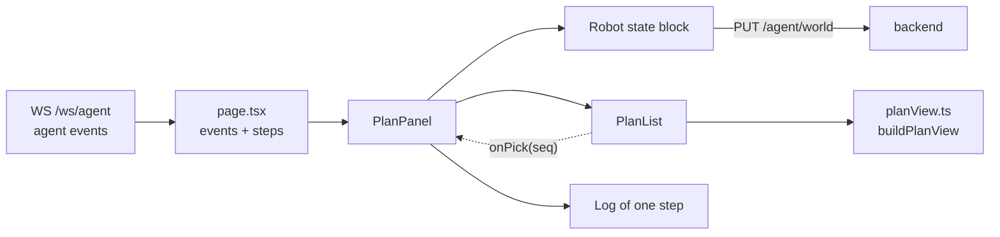

---
sources:
  - frontend/components/PlanPanel.tsx
  - frontend/components/PlanList.tsx
  - frontend/lib/planView.ts
  - frontend/lib/types.ts
  - frontend/lib/clipboard.ts
  - frontend/lib/api.ts
  - scripts/test_lib.mjs
  - scripts/fixtures/events/
verified_at: 4a810a3717ab
---

# Plan, log and robot state

!!! abstract "In this page"
    The right-hand panel of the dashboard shows one run: the robot's world state, the plan as a list of steps with ticks, the log of one step, and a final badge. The plan list is a pure function over the stream of agent events. This page shows how the function turns events into rows, with real output from recorded runs.

## What the reader gets

After this page you can read the Plan progress list and know why each row has its mark. You can also change `lib/planView.ts` and test it without a browser or a robot.

| | |
|---|---|
| **Component** | `PlanPanel` (the whole panel), `PlanList` (the plan list inside it) |
| **Pure logic** | `buildPlanView(events)` and `reducePlan(view, event)` in `frontend/lib/planView.ts` |
| **Input** | the array of agent events of the current run, the steps that `page.tsx` builds from them, the planner name, a `running` flag |
| **Output** | pixels, plus one write: `PUT /agent/world` when the operator edits the robot state |
| **Tests** | `scripts/test_lib.mjs` lines 42-156 and 209-248, on 8 recorded runs in `scripts/fixtures/events/` |

## Where it sits



`page.tsx` stamps every incoming event with `_rx`, the time the browser received it, and keeps the array of events of the current run. `PlanPanel` is mounted as `<PlanPanel events={agentEvents} steps={agentSteps} planMethod={runMethod} running={running} />` (`page.tsx` line 877). The agent event shapes are listed in [agent events](../reference/agent-events.md).

## Inputs

PlanPanel props (`PlanPanel.tsx` lines 350-355):

| prop | type | meaning |
|---|---|---|
| `events` | `AgentEvent[]` | every event of the current run, in arrival order |
| `steps` | `Step[]` | one entry per started step: `index`, `total`, `task`, `status` (`running`, `done`, `failed`), optional `result`, `logs`, `startedAt`, `endedAt` (`PlanPanel.tsx` lines 14-23) |
| `planMethod` | `string` (optional) | the planner of the active run, shown as a small tag |
| `running` | `boolean` | a run is active; false with no verdict makes the list close as "stopped" |

PlanList props (`PlanList.tsx` line 81): `events`, `running`, and an optional `onPick(seq)` called when the operator clicks a row.

## What the panel shows

From top to bottom (`PlanPanel.tsx` lines 630-741):

| block | what it shows | source of data |
|---|---|---|
| header | "Task Plan & Execution", the planner tag, the model and server of the language model | props; `GET /agent/llm-config` |
| Robot state | the persistent world state: where the robot is (`arrived`), what it found, what it holds, what is opened, what is on what. Editable | latest `world` field on an event, else `GET /agent/world` |
| status line | for example the "Generating task plan" message, with the model | `status` event |
| planner progress | `decompose`, `expand`, `refine` lines of the GRACE planner while the plan is not ready | `plan_step` events |
| Plan progress | the list this page is about | `buildPlanView(events)` |
| planner steps and trace | sub-goal counts, LLM calls, latency; a trace per sub-goal | `plan_meta`, `plan_step` |
| Log | the detail of one step: its log lines, images, result JSON, a copy button | `steps` |
| badge and error | "Task completed" or "Task failed" with seconds; the error message and trace | `done`, `error` events |

The Log shows one step: the step being run, or the step the operator clicked in Plan progress. When the next step starts, it goes back to the current step (`PlanPanel.tsx` lines 599-610). Log steps and plan rows are matched by start order: the k-th started step is the k-th Log step (`row.seq`).

## The plan list is a function over events

`planView.ts` has no React and no clock. It is a reducer: `reducePlan(view, event)` returns the next view, and `buildPlanView(events)` folds a whole array of events.

A view has `rows`, `goals`, `understood`, `goalChecks` and `final`, plus a few fields that only the reducer reads (`planView.ts` lines 49-61).

| part | shape | meaning |
|---|---|---|
| `rows` | list of step rows and note rows | what the list draws |
| step row | `status`: `pending`, `running`, `done`, `failed`, `skipped`; optional `spliced`, `retry`, `reason`, `say`, `seq`, `startedAt`, `endedAt` | one step of the plan |
| note row | `note`: `replan`, `recover`, `ask`, `plan`; `text`, optional `detail` | a line between steps that says why the plan changed |
| `goals` | `{type, object, from, to}` list | what the assist layer understood |
| `goalChecks` | `{goal, ok, evidence}` list | the result of each goal check |
| `final` | `{ok, status, msg}` or `null` | the verdict of the run |

How each event changes the view:

| event | effect |
|---|---|
| `start` | empty view |
| `understand` | sets `goals` and `understood` |
| `clarify` | inserts an `ask` note before the first pending row |
| `plan` | replaces the pending rows with the new plan lines |
| `replan` | keeps settled rows, inserts a `replan` note, replaces the pending rows |
| `recover` | starts a splice: the next started steps that are not in the list are marked `spliced`, until the failed step starts again (marked `retry`) |
| `step_start` | the matching pending row becomes `running` |
| `step_done` | the running row becomes `done` or `failed`, with a reason |
| `goal_check` | appends to `goalChecks` |
| `done`, `error`, `stopped` | running rows end, pending rows become `skipped`, `final` is set |

`stopped` is not a backend event. `PlanList` adds it itself when the run is over without a `done` or `error` (Stop pressed, socket lost): see `PlanList.tsx` lines 82-84.

Rows are kept in one order: settled rows first (done, failed, running, notes), then pending rows. A new running row is inserted at that boundary.

!!! note "Why rows are matched by order, not by index"
    The planner called SAGE reuses a step `index` after a splice, so an index does not name one step. The reducer matches a started step to the first pending row with the same label. A step that is not in the list during a recovery is marked `spliced` and does not use up a pending row (`planView.ts` lines 5-15).

## Code

The match inside `step_start`, including the rule for old text plans (`planView.ts` lines 141-152):

```ts
      if (splice) {
        if (label === v.failedLabel) { retry = true; splice = false } else spliced = true
      } else {
        let k = rows.findIndex(r => r.kind === 'step' && r.status === 'pending' && r.label === label)
        // Structured (legacy) runs: the plan is text lines ("say::inputs='hi'") while step_start carries a Python list
        // ("[['say', \"inputs='hi'\"]]"): the labels never match, so the step takes the next pending line, by order.
        if (k < 0 && !ev.action) {
          k = rows.findIndex(r => r.kind === 'step' && r.status === 'pending')
          if (k >= 0) label = (rows[k] as StepRow).label
        }
        if (k >= 0) rows = [...rows.slice(0, k), ...rows.slice(k + 1)]
      }
```

!!! code "Where in the code"
    [`frontend/lib/planView.ts` lines 141-152](https://github.com/mtbui2010/robotapp/blob/4a810a3717ab/frontend/lib/planView.ts#L141-L152). The whole reducer is lines 103-199.

## Real output

The script below was run offline on 2026-11-19. It bundles `lib/planView.ts` with the esbuild that is already in `frontend/node_modules`, in the same way as `scripts/test_lib.mjs` lines 15-21, and replays recorded runs from `scripts/fixtures/events/`. The output is trimmed to a few runs and is not edited.

```js
const { buildSync } = createRequire(join(FE, 'package.json'))('esbuild')
buildSync({ entryPoints: [join(FE, 'lib', 'planView.ts')], outfile, bundle: true,
            format: 'esm', platform: 'node', logLevel: 'error' })
const PV = await import(pathToFileURL(outfile).href)
const events = JSON.parse(readFileSync(join(FIX, 'mug_en_simple_success.json'), 'utf8'))
const view = PV.buildPlanView(events)          // a prefix: events.slice(0, k + 1)
```

A simple run (`mug_en_simple_success`). The assist layer asks one question, then five steps run:

```text
note  ask     Where is the red mug?
step  done    MoveTo counter@kitchen
step  done    Find red mug
step  done    Pick red mug
step  done    MoveTo dining_table@kitchen
step  done    Place dining_table@kitchen
goals [{"type":"on","object":"red mug","from":"","to":"dining_table@kitchen"}]
final {"ok":true,"status":"success","msg":""}
```

The same run cut after the third `step_start`. This is what the operator sees in the middle of the run: one step running, two pending:

```text
note  ask     Where is the red mug?
step  done    MoveTo counter@kitchen
step  done    Find red mug
step  running Pick red mug
step  pending MoveTo dining_table@kitchen
step  pending Place dining_table@kitchen
```

A run that fails (`apple_en_replan_fail`): two settled steps, a `replan` note, then six `recover` notes with spliced `MoveTo` rows and retried `Find apple` rows. The three steps that never started become `skipped`:

```text
note  ask     Where is the apple?
step  done    MoveTo counter@kitchen
step  failed  Find apple
note  replan  E: Find apple failed. R: red apple not found; it is not at counter@kitchen. Look next at side_table@living. S: robot at counter@kitchen, holding noth…
step  done    MoveTo side_table@living
step  failed  Find apple
note  recover looking for the apple at sofa@living
step  done    MoveTo sofa@living  [spliced]
step  failed  Find apple  [retry]
note  recover looking for the apple at tv_stand@living
step  done    MoveTo tv_stand@living  [spliced]
step  failed  Find apple  [retry]
...
note  recover looking again for the apple
step  done    MoveTo sofa@living  [spliced]
step  failed  Find apple  [retry]
step  skipped Pick apple
step  skipped MoveTo counter@kitchen
step  skipped Place counter@kitchen
final {"ok":false,"status":"failed","msg":"could not find the apple (looked at counter@kitchen, tv_stand@living, chest@bedroom, bed@bedroom, side_table@living, sofa@living)"}
```

The `...` line replaces three recovery legs (chest, bed, a second look at the side table) that are in the real output. A text plan of the older Structured mode (`structured_say_wait`) also works, because of the order rule in the excerpt:

```text
step  done    say::inputs='hello', lang='en'
step  done    wait::1
step  done    say::inputs='bye', lang='en'
step  done    wait::1
```

## Robot state block

`WorldStateBlock` (`PlanPanel.tsx` lines 151-224) shows the world state the robot believes in. It reads the newest `world` field of any event; if there is none, it calls `GET /agent/world` once on mount (`api.ts` lines 403-410). The event always wins over the fetch.

The operator can edit the fields. While there are unsaved edits (`dirty`), new events do not overwrite the inputs. On Save, only the fields that differ from the current world are sent in `PUT /agent/world` (`api.ts` lines 468-479). If nothing changed, nothing is sent. A failed save only resets the button; it shows no error text.

The block is hidden until a world is known: a backend that has no `/agent/world` simply shows no block.

## Endpoints

| call | where | when |
|---|---|---|
| `GET /agent/world` | `api.ts` lines 403-410 | on mount |
| `PUT /agent/world` | `api.ts` lines 468-479 | Save in the robot state block, changed fields only |
| `GET /agent/llm-config` | `api.ts` lines 379-385 | on mount and at each run start; a failure returns an empty object |

The list of endpoints is in [endpoints](../reference/endpoints.md).

## Failure modes met in the code

Each of these is current behaviour. They are handled in the code at the pinned commit.

| symptom | cause | how the code handles it |
|---|---|---|
| a GRACE plan never shows and "Generating..." stays | the `plan` event has two shapes: a text (`plan`, `plan_text`) or an array (`steps`) | `PlanPanel.tsx` lines 552-568 accepts both; marked `BACKEND-WORKAROUND(plan-event-shape)` |
| the badge could read a good run wrongly | the `done` event has two shapes: `status` (`success`, `failed`, `planned`, `aborted`) or a boolean `success` | `PlanPanel.tsx` lines 612-618 prefers `status`; marked `BACKEND-WORKAROUND(done-event-shape)` |
| the model and server beside "Generating task plan" vanish | the language model is often chosen after the panel mounts | refetched at each run start (`PlanPanel.tsx` lines 574-584) |
| the Log shows the wrong step after a splice | a step index is reused | rows and Log steps are matched by start order (`PlanPanel.tsx` line 609) |
| no durations in a replay | recorded files have no `_rx` | a row has `startedAt` and `endedAt` only when both events had `_rx` |

The robot state block has one quiet failure: a failed `PUT /agent/world` shows nothing. If the fields snap back after Save, check the backend.

## Tests

`scripts/test_lib.mjs` replays the 8 recorded runs at every prefix and checks the invariants (settled rows before pending rows, at most one running row, unique row ids, no pending row left after `done`). It also has named cases: the apple run with a replan, a retried `Pick`, an early failure, a client-side `stopped`, legacy events, and durations from `_rx` (lines 42-156 and 209-248). In the same file, `node --test` ran 78 tests and all passed on 2026-11-19 (see [tests](../modules/tests.md)).

There is no test for `PlanPanel` or `PlanList` themselves: the pure logic is tested, the React code is not.

## Related

- [Chat](../modules/chat.md) starts the runs this panel shows.
- [Event stream](../learn/03-event-stream.md) explains the events.
