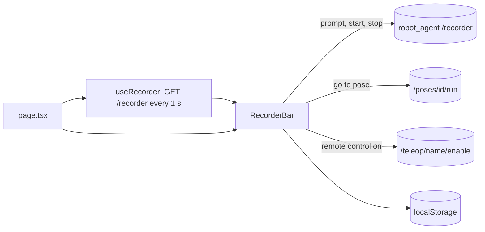
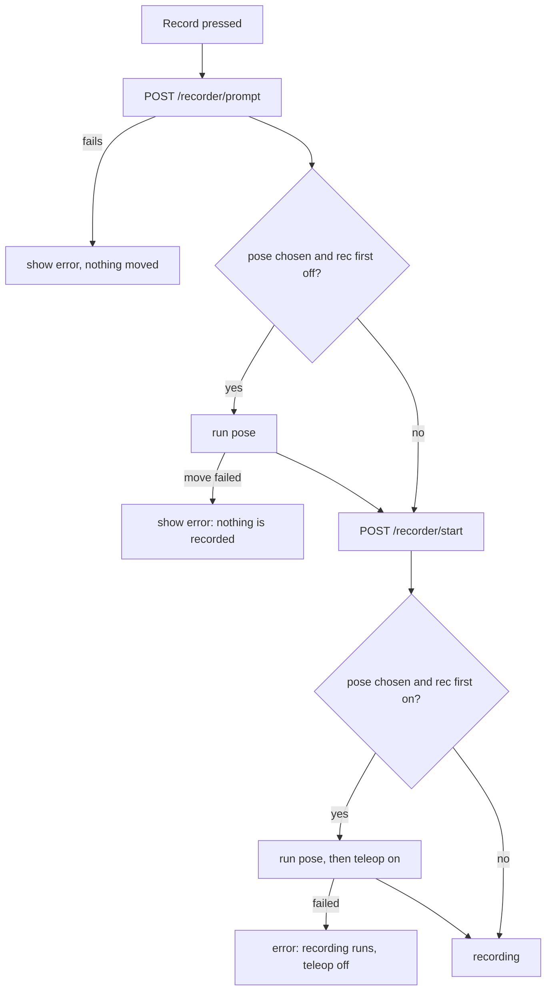

---
sources:
  - frontend/components/RecorderBar.tsx
  - frontend/lib/recorder.ts
  - frontend/lib/useRecorder.ts
  - frontend/lib/poses.ts
  - frontend/lib/api.ts
  - frontend/app/page.tsx
  - scripts/test_lib.mjs
verified_at: 4a810a3717ab
---

# Record raw VLA episodes

!!! abstract "In this page"
    You get what the Record bar does, the order in which it prompts, moves and records, what it sends to the robot, what it stores in the browser, and what happens when a step fails. Checked in code at `4a810a3717ab`; nothing here was run against a robot.

## What it is

A VLA (vision-language-action) model learns from episodes. An episode is one demonstration: camera images, joint states and actions, plus one sentence that says what was done ("open the drawer"). The Record bar records such **raw** episodes while the operator drives the robot by hand (see [Remote control strip and Go-to poses](teleop-poses.md)).

The operator fills a few **fields** (for example `action` and `target object`). The robot's own templates turn the fields into a sentence, with a new wording each time. **Record** starts remote control and the recording together. **Stop** ends it as a success, a failure, or throws it away. The saved episodes are looked at and cleaned in the [Data tab](data-tab.md).

Nothing is drawn when the robot has no recorder: `GET /recorder` answers 404, `useRecorder` gives `null`, and `RecorderBar` returns nothing.

## Where it sits



Like the teleop strip, the bar is drawn only on the Cameras tab, when the "make data" toggle is on or something is recording or driving (`page.tsx:955`; the rule is described in [Remote control strip and Go-to poses](teleop-poses.md)).

## Inputs

Props (`RecorderBar.tsx:13`):

| prop | type | meaning |
|---|---|---|
| `status` | `RecorderStatus \| null` | the answer of `GET /recorder`; `null` hides the bar |
| `runInFlight` | `boolean` | an agent run is going on; Record is blocked |
| `onChanged` | `() => void` | after every action; the page re-reads both the recorder and the teleop state (`page.tsx:955`) |
| `poses` | `PoseList \| null` (optional) | the Go-to poses; without them there is no pose menu |

`RecorderStatus` (`recorder.ts:15-22`):

| field | meaning |
|---|---|
| `available` | the robot's recorder is running |
| `state` | `idle`, `recording` or `saving`, with `episode`, `prompt`, `elapsed_s`, `counts`, `last`, `error`, `ready`, `saving` |
| `fields` | the prompt fields, in order, for example `action`, `target_object` |
| `teleop` | the teleop function that is switched on with the recording |
| `dir`, `age_s` | the data folder and the age of the state |

`state.ready` is false when the shared folder cannot be written. `state.saving` counts episodes being copied to the shared folder in the background: the next recording can start meanwhile. The value `saving` for `state.state` comes only from an older node.

## What the bar shows

**Idle.** Two rows of fields. Each row has:

| control | meaning |
|---|---|
| checkbox | the row Record uses; one row is always checked |
| `Go to…` menu | the pose the arm goes to when Record is pressed with this row (only when `poses` is given). Empty means record from where the arm is. |
| `rec first` | appears when a pose is chosen: record the move too (see below) |
| one text box per field | the placeholder is the field name with `_` replaced by a space (`fieldLabel`) |
| sparkle button | shows a sample sentence under the row; press again for another wording. Disabled while `action` is empty. Record makes its own sentence. |

One **Record** button serves both rows. During the move it reads `going to <pose>…`.

**Recording or saving.** The sentence, a clock (`● 1:23`, or `saving…`), the frame counts of the camera streams, and three buttons: `✔ Success`, `✘ Failure` (kept, labelled) and `🗑 Discard`. The buttons show only while the phase is `recording`.

**Under the bar.** A red line with the error (the bar's own error, or `state.error` from the robot); `saving N…` while episodes copy in the background; after a save, the line `saved ep_0003 (success, 0:24)` followed by `→ <folder>`.

Two rows exist so that two related tasks (open and close a drawer) need no retyping.

## Output: what it sends

| step | request | body |
|---|---|---|
| read status | `GET /recorder` (404 means no recorder) | |
| make a sentence | `POST /recorder/prompt` | `{fields, avoid}`; answer `{prompt}`. `avoid` is the sentence shown now, so the answer is another one when there is one. |
| start | `POST /recorder/start` | `{prompt, meta}` where `meta` is `{fields}` |
| stop | `POST /recorder/stop` | `{label}` with `success`, `failure` or `discard` |
| go to a pose | `POST /poses/{id}/run` | |
| remote control back on | `POST /teleop/{name}/enable` | `{on: true, confirm: true}` |

The calls are at `api.ts:515-536`. Errors carry the backend's `detail` text, or `HTTP <status>`.

## How Record works

`record` (`RecorderBar.tsx:33-53`) runs in a fixed order:



1. Make the sentence first. A wording error must not cost a move.
2. Default (`rec first` off): if the row has a pose, the arm goes there first. The recording starts after it arrived, so the move is not in the episode. A failed move stops here and records nothing.
3. Start the recording with `POST /recorder/start`. The sentence is new for every episode, and the sample sentences are cleared.
4. `rec first` on: after the start the arm goes to the pose. The backend marks that part of the episode as its init part. When the arm has arrived, remote control is switched on again (when `status.teleop` is set).

```tsx
  const record = async () => {
    setBusy(true)
    try {
      const prompt = await api.makeRecordPrompt(fields)                    // first: a wording problem must not cost a move
      if (initPose && !before[active]) {                                   // default: the arm goes to the start pose; only then do the recording and remote control begin
        setGoing(initPose.label)
        const r = await api.runPose(initPose.id)
        if (!r.isdone) throw new Error(`could not go to "${initPose.label}": ${r.msg || 'the move failed'} (nothing is recorded)`)
      }
      await api.startRecording(prompt, { fields })                         // a new wording for every episode
      setDemo([]); setErr('')
      if (initPose && before[active]) {                                    // recording first: the move is part of the episode (the backend marks it as the init part)
        setGoing(initPose.label)
        try {
          const r = await api.runPose(initPose.id)
          if (!r.isdone) throw new Error(r.msg || 'the move failed')
          if (status.teleop) await api.enableTeleop(status.teleop, true, true)   // arrived: remote control starts again, as after a Go to
        } catch (e) { fail(new Error(`could not go to "${initPose.label}": ${e instanceof Error ? e.message : String(e)}. The recording is running and remote control is off: stop it (✘ Failure) or discard it.`)) }
      }
    } catch (e) { fail(e) } finally { setGoing(''); setBusy(false); onChanged() }
  }
```

[`frontend/components/RecorderBar.tsx` lines 33-53](https://github.com/mtbui2010/robotapp/blob/4a810a3717ab/frontend/components/RecorderBar.tsx#L33-L53)

Stop (`RecorderBar.tsx:54`) calls `POST /recorder/stop` with the label, then clears the error and calls `onChanged`. The bar stays busy until the call ends.

## When Record is blocked

`recordBlock` (`recorder.ts:43-50`) returns the first reason that applies, and the button shows it as its tooltip. The bar always passes `hasPrompt` as false, so the action field must be filled.

| order | reason text | cause |
|---|---|---|
| 1 | `the recorder is not running on the robot (make run)` | `available` is false or there is no state |
| 2 | `the shared folder cannot be written` | `state.ready` is false |
| 3 | `the recorder is recording` (or `saving`) | the phase is not idle |
| 4 | `a run is in flight: cancel it first` | `runInFlight` |
| 5 | `fill the action (and the other fields) of the checked row` | the `action` field of the checked row is empty |

## Browser storage

The two rows are kept in `localStorage` under `robotapp_rec_rows`: the field values, the pose of each row, the `rec first` flag of each row and the checked row. An older version saved one set of fields under `robotapp_rec_fields`. When the new key is missing, that set becomes row 1. Anything unreadable gives empty rows, no pose, and row 1 checked. Writes that fail are ignored: it is a convenience per browser. See [Browser storage](../reference/browser-storage.md).

A saved pose that is no longer in the list counts as no pose.

## Two clients on one robot

Record starts remote control. The Record bar shows **no** "two clients" warning, in text or in a tooltip (no such text in `RecorderBar.tsx` at the pin). The only warning near it is the tooltip on the `🕹` icon of the teleop rows. See the table in [Remote control strip and Go-to poses](teleop-poses.md). Use one client per robot while recording.

## Edge cases and failure modes

| symptom | cause | what to do |
|---|---|---|
| Error `could not go to "<pose>": <msg> (nothing is recorded)` | the move before the recording failed | fix the cause, press Record again |
| Error `... The recording is running and remote control is off: stop it (✘ Failure) or discard it.` | `rec first` was on and the move failed after the start | press `✘ Failure` or `🗑 Discard`, or switch teleop on in the strip |
| Record does nothing, a sentence error shows | `POST /recorder/prompt` failed (for example the templates cannot use the fields) | change the fields; no move was made |
| The bar vanished | `GET /recorder` answered 404 for this robot | the robot has no recorder |
| Status looks old | a failed read keeps the last answer and asks again after 3 s (`useRecorder.ts:20`) | check the connection |

`useRecorder` reads `GET /recorder` every second while the robot has a recorder; a 404 is asked once, and again when another robot is picked.

## How it is verified

`scripts/test_lib.mjs:629-657`, `732-737` and `750-780` test the phase, `fieldLabel`, `clock`, `countsText`, `recordBlock`, `lastText`, `savingText` and `parseRecRows` (two rows, legacy fallback, odd values, `rec first` default). There is no test for `RecorderBar.tsx` or `useRecorder.ts`.

Real output of the pure helpers, run offline through the repo's own `esbuild`:

| call | result |
|---|---|
| `clock(83.4)` | `1:23` |
| `countsText({state:400, action_ref:200, head:284, wrist:169})` | `head 284 · wrist 169` (state and action streams are left out) |
| `lastText` of a saved episode `ep_0003`, label `success`, 24 s | `saved ep_0003 (success, 0:24)` |
| `fieldLabel('target_object')` | `target object` |
| `recordBlock` with no recorder | `the recorder is not running on the robot (make run)` |
| `recordBlock`, idle, run in flight | `a run is in flight: cancel it first` |
| `recordBlock`, idle, `action` empty | `fill the action (and the other fields) of the checked row` |
| `recordBlock`, idle, `action` filled | empty text (Record allowed) |
| `parseRecRows(null, '{"action":"open"}')` | `{"rows":[{"action":"open"},{}],"inits":["",""],"before":[false,false],"active":0}` |

!!! code "Where in the code"
    - [`frontend/components/RecorderBar.tsx`](https://github.com/mtbui2010/robotapp/blob/4a810a3717ab/frontend/components/RecorderBar.tsx): the bar and `record`.
    - [`frontend/lib/recorder.ts`](https://github.com/mtbui2010/robotapp/blob/4a810a3717ab/frontend/lib/recorder.ts): types and pure helpers.
    - [`frontend/lib/useRecorder.ts`](https://github.com/mtbui2010/robotapp/blob/4a810a3717ab/frontend/lib/useRecorder.ts): the polling hook.
    - [`frontend/lib/api.ts` lines 514-536](https://github.com/mtbui2010/robotapp/blob/4a810a3717ab/frontend/lib/api.ts#L514-L536): the four recorder calls.
