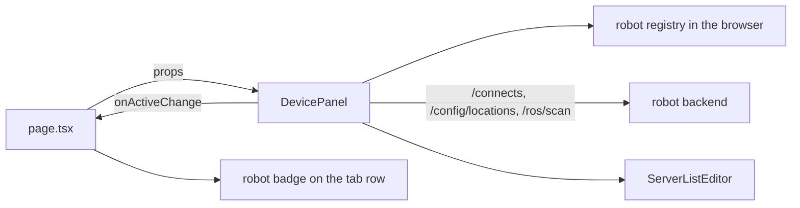
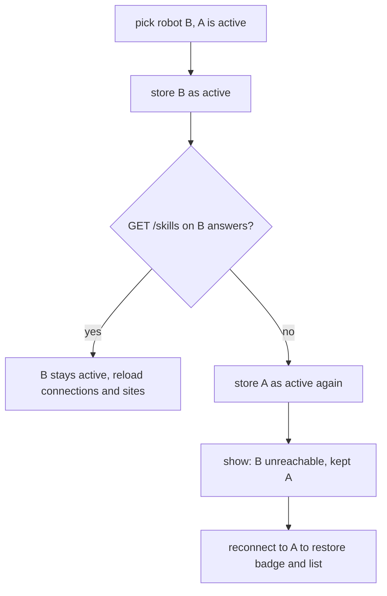

---
sources:
  - frontend/components/DevicePanel.tsx
  - frontend/components/ServerListEditor.tsx
  - frontend/components/PanelSearch.tsx
  - frontend/lib/ros_templates.json
  - frontend/lib/targetBadge.ts
  - frontend/lib/api.ts
  - frontend/lib/types.ts
  - frontend/app/page.tsx
verified_at: 4a810a3717ab
---

# Robots, sites and connections

!!! abstract "In this page"
    The Devices panel (`DevicePanel`) is where you tell the dashboard which robot to talk to, which
    site profile that robot runs, and which devices and AI servers it is connected to. You get: how
    the robot list is stored, why a switch to an unreachable robot changes nothing, how site profiles
    work, what each connection type is, how API keys are handled, and the code that does it.
    Everything here was checked in code at `4a810a3717ab`, not run against a robot.

## Words used here

| word | meaning |
|---|---|
| robot (registry entry) | a name and the URL of one robot backend. The list lives in the browser, not on the backend. |
| site (location) | a config profile stored on the backend: its own connections and its own global configs. One site is active at a time. |
| connection | one device or service the backend talks to (a ROS topic, a camera stream, an AI server). |
| pool | an AI connection (`vlms`, `visions`, `voices`) that holds several servers in fallback order. |
| host | an id the backend reports for the machine it runs on. Other machines that share the same configs folder are listed with their host and site. |

## Where it sits



`DevicePanel.tsx` is 1,911 lines. It holds three jobs: the robot list at the top, the site profiles
in the middle, and the connection list with its add and edit forms below. `ServerListEditor.tsx` is the
small editor for the servers of one pool.

## Props

| prop | type | what it does |
|---|---|---|
| `onClientsChange` | `(ClientEntry[]) => void` | called with the connection list after every load and every status poll; the page uses it to know which devices exist (cameras, for example) |
| `onAgentConnect` | `() => void`, optional | called when the dashboard has (re)connected to a robot or a site switch reloaded the devices; the page bumps a key so the other panels reload |
| `onActiveChange` | `(ActiveTarget) => void`, optional | called whenever the active robot, its URL, the active site or the host changes |

`ActiveTarget` is `{ robot, url, location, host }` (`DevicePanel.tsx:66`). The page turns it into the badge at the right
of the tab row (`page.tsx:929-942`).

## The robot list

Robots are kept in the browser by `lib/api.ts`, not on the backend:

| key | storage | content |
|---|---|---|
| `robotapp_robots` | localStorage | JSON list `[{ name, url }, ...]` |
| `robotapp_active_robot` | localStorage and sessionStorage | the name of the active robot. The localStorage copy is only the default for a new tab; each tab keeps its own choice in sessionStorage, so two tabs can drive two robots (`api.ts:10-17, 55-77`). |

An old single `agent_url` key is migrated to a robot called `default` on first read.

The editor opens with a name box and a URL box. For a new robot the URL box is pre-filled with
`http://<page_host>:8001`, where `<page_host>` is the host name of the page the dashboard was loaded
from (`localhost` when there is no window) (`DevicePanel.tsx:326-331`). So a dashboard opened from
`<host>` suggests a robot backend on the same machine, port 8001.

Saving an entry (`saveRobotEditor`, `DevicePanel.tsx:347-360`) calls `api.addRobot` or `api.updateRobot`.
These refuse a duplicate name and return `{ ok: false, error }`, which the editor shows. A new robot is made
active at once and the panel connects to it. Removing the active robot asks for a confirm, then the
first robot left becomes active.

### Switching robots: the old one stays if the new one does not answer

Choosing another robot from the list runs `switchActiveRobot`. It writes the new name first, because every
call reads the active robot from storage, then asks the new robot for its skill list
(`connectActiveRobot` calls `GET /skills`). If that fails, it writes the old name back.



!!! code "Where in the code"
    [`DevicePanel.tsx:305-324`](https://github.com/mtbui2010/robotapp/blob/4a810a3717ab/frontend/components/DevicePanel.tsx#L305-L324)

```ts
  const switchActiveRobot = async (name: string) => {
    const previous = api.getActiveRobotName() ?? ''
    if (name === previous) return
    api.setActiveRobot(name)
    setActiveRobotState(name)
    setAgentStatus(null)
    const ok = await connectActiveRobot()
    if (!ok) {
      api.setActiveRobot(previous)
      setActiveRobotState(previous)
      setAgentStatus({
        ok: false,
        skills: 0,
        error: previous
          ? `"${name}" unreachable — kept "${previous}"`
          : `"${name}" unreachable`,
      })
      if (previous) void connectActiveRobot()  // restore badge + clients
    }
  }
```

What the reader should know about this:

- The message on screen is `"<name>" unreachable — kept "<previous>"`. With no earlier robot it is only `"<name>" unreachable`.
- "Answers" means `GET /skills` returned a list. `api.listSkills` returns an empty list on an HTTP error, which
  still counts as an answer. Only a network failure (the request throws) counts as unreachable.
- The rollback applies to switching. Adding or editing a robot (`saveRobotEditor`) does not roll back: the new
  or edited robot stays active and the status line says `Unreachable`.
- Switching also fires the `robotapp:robot-changed` window event (`api.ts:70`), so parts of the page that
  cached something from the old robot (the robot's languages, for example) know it is stale.

## The robot badge

The badge on the tab row shows the robot name. When the active site has a different name from the
robot, a warning sign appears instead of writing the site name; both names are in its tooltip. The reason:
a tab that drives the wrong site is easy to miss. The logic is in `lib/targetBadge.ts` and is pure, so it
can be run offline. Run with the module of this commit (Node 22, `--experimental-strip-types`), with neutral names:

```js
import * as TB from './tb.ts'
console.log(TB.targetBadges('robot-a', 'site-b'))
console.log(TB.targetBadges('robot-a', ' ROBOT-A '))
console.log(TB.targetBadges('robot-a', ''))
console.log(JSON.stringify(TB.targetTitle('robot-a', 'site-b', 'http://<robot_host>:8001', 'host-1')))
```

Output, as printed:

```text
{ robot: 'robot-a', location: 'site-b', mismatch: true }
{ robot: 'robot-a', location: 'ROBOT-A', mismatch: false }
{ robot: 'robot-a', location: null, mismatch: false }
"robot-a @ site-b\nhttp://<robot_host>:8001 · host host-1"
```

The comparison ignores case and surrounding spaces. A site that the backend did not report gives
`location: null` and no warning.

## Site (location) profiles

A site is a folder of config on the backend: its own `connections` and its own global configs. The panel
shows the list, the active one, and which other machines use which site.

| action | call | what the panel does after |
|---|---|---|
| list | `GET /config/locations` | fills the list, the active name, `host` and `others` |
| switch | `POST /config/locations/{name}/activate` | the backend hot-reloads its devices; the panel calls `onAgentConnect` and reloads the connections |
| create | `POST /config/locations` with `{ name, copy_from }` | the new site is activated at once; the "copy from" box starts on the active site |
| rename | `PUT /config/locations/{name}` with `{ new_name }` | updates list, active name and others |
| delete | `DELETE /config/locations/{name}` | see below |

The list of other machines refreshes every 30 s (`DevicePanel.tsx:264-269`). An entry has `host`, `location`,
`age_sec` and an optional `clash`: another machine that runs with the same host id as this backend. Two machines on one site
share its connections and global configs (`types.ts:285-292`).

### Deleting the active site takes two calls

The backend refuses to delete the active site. So the panel first activates `default`, then deletes the
target. `default` itself cannot be deleted (checked in the panel, `Cannot delete the default location`). A confirm
says that the site's connections and global configs go with it.

!!! code "Where in the code"
    [`DevicePanel.tsx:445-451`](https://github.com/mtbui2010/robotapp/blob/4a810a3717ab/frontend/components/DevicePanel.tsx#L445-L451), tagged
    `BACKEND-WORKAROUND(delete-active-location)`

```ts
    try {
      // The backend refuses to delete the active site, so fall back to
      // 'default' first (also hot-reloads devices), then delete.
      // BACKEND-WORKAROUND(delete-active-location)
      await api.activateLocation('default')
      setActiveLocation('default')
      const res = await api.deleteLocation(target)
```

The two calls are not atomic. If the delete fails after the first call, the backend is left on `default`; the
panel shows the error text and reloads the list from the backend, so what you see is what the backend has.

## Connections

`GET /connects` returns the connections. Each has an id, a name, a type, a config, and a `connected` flag.
The panel then polls `GET /connects/status` every 10 s and `GET /connects/servers` after it
(`DevicePanel.tsx:470-486`). The Ping button (tooltip: Ping all connections now) asks for `GET /connects/status?fresh=1`, which makes the backend
probe now instead of using its answer cached for 5 s.

| type id | label in the panel | what it is |
|---|---|---|
| `ros_service`, `ros_topic`, `ros_action` | ROS Service, ROS Topic, ROS Action | a ROS interface, with encode and decode functions |
| `webrtc` | WebRTC | camera or media stream |
| `tcp`, `zmq`, `websocket`, `http` | TCP/IP, ZeroMQ, WebSocket, HTTP / REST | plain network connections |
| `switchbot` | SwitchBot (BLE) | a light switch; one can be made the default light |
| `llm` | LLM | an older single language-model server |
| `visionserve`, `stt` | VisionServe (old), Speech-to-text (old) | older single-server types; still editable, not added any more |
| `vlms`, `visions`, `voices` | VLMs, Visions, Voices | pools: several AI servers in fallback order |

(Labels from `DevicePanel.tsx:54-70`.)

### AI-server pools

A pool is one role (look at images, detect objects, understand speech) with a list of servers. The first usable
server serves each call; the next takes over when it fails or runs on the CPU (comment at
`ServerListEditor.tsx:2-3`). `ServerListEditor` is the list editor: add, remove, move up or down, enable or
disable a server. A row has these fields:

| field | meaning |
|---|---|
| `provider` | `vlms` only: Ollama, ChatGPT (OpenAI), Gemini, Claude (Anthropic) |
| `url` | required unless the provider is a cloud one |
| `model` | required for a cloud provider |
| `numCtx` | Ollama context window |
| `slowSec` | slower than this means "on the CPU". Blank uses the kind default: 20 s for `vlms`, 8 s for `visions`, 5 s for `voices` |
| `enabled` | a disabled server is skipped |
| `apiKey`, `needsKey` | see the next section |

`rowsError` checks the rows before the save: at least one server, a URL for each non-cloud server, a model
for each cloud one (the backend checks the same). A coloured dot per server shows its state:
`ok`, `slow`, `down`, `unknown` or `off` (`STATUS_DOT`).

In the current code, a new pool starts from example rows (`defaultRows`) that point at a private network
address of the author's lab. Replace the URL with your own server before saving; this page does not repeat it.

### ROS scan and quick connect

The Scan button (tooltip: Scan ROS) calls `GET /ros/scan` and lists the topics, services and actions it found, grouped by the first
word of the name. Quick connect on one of them opens a small form (connection name, agent name, is
camera, is client, encode, decode and, for an action, cancel code) and then calls `POST /connects` with the type, name and a config
holding `conn_name`, `data_interface` and the functions.

`lib/ros_templates.json` holds 14 templates (encode and decode code for known interface types, for example
`string_topic_sub`, `compressed_image_sub`, `navigate_to_pose`). `recommendTemplates` ranks the ones that match the
connection type: 10 points when the interface is listed in the template, 1 for each keyword found in the interface name. A new ROS
action starts with a sample `cancel_func` (`DEFAULT_CANCEL_FUNC`) that cancels the goals of this process and then
calls `cancel_all_goals`, so a new action begins with a working stop.

### API keys

A key typed for a cloud VLM server, for a voices server that needs one, or for an old LLM connection is sent with
`POST /agent/api-key { provider, key }`. The backend stores it in the site's `.env`, never in the connection
config. The panel cannot read a key back. `GET /agent/api-keys` returns only `{ provider: true | false }`; the key
box then shows the hint `saved - leave blank to keep`, and a blank box keeps the key. Key values do not appear on this
site and must not be pasted into the dashboard of someone else.

### Warm up

The Warm up button runs the skill `warmup_servers` (`POST /skill/warmup_servers`, `DevicePanel.tsx:488-503`) to load
the models on the AI servers. The result may carry a `level` (`ok`, `warn`, `error`), a message and a `kinds` map. The panel shows one
colour and "n of m servers ready" per kind. If the call throws, it shows `warm-up failed: <reason>`.

!!! warning "The skill name is fixed in the code"
    `warmup_servers` is the name of a skill of the kcare robot package (the comment points to its `skills/warmup.py`). The
    panel does not check that the robot has it. On a robot without that skill the button ends in `warm-up failed: HTTP <status>`.

## Edge cases and failure modes

| symptom | cause | what to do |
|---|---|---|
| `"x" unreachable - kept "y"` after a switch | the new robot did not answer `GET /skills` | check the URL and that the backend runs; the old robot is still active |
| an added robot is active but the status says Unreachable | add and edit do not roll back | fix the URL with the edit button, or remove the entry |
| delete of the active site shows an error and the site is now `default` | the delete is two calls | reload the site list; delete again |
| a warning sign next to the robot name | the active site is not named like the robot | check that the tab drives the site you mean |
| a clash is flagged in the other-machines list | another machine runs with the same host id as this backend (`clash: true`) | find that machine; the panel only reports it |
| two tabs show two robots | the choice is per tab (sessionStorage) | intended |

## How it is verified

`scripts/test_lib.mjs` tests `lib/targetBadge.ts` (`targetBadges` and `targetTitle`; the badge section starts near line 613). There is
no automated test for the panel itself; the type check and lint cover its calls to the API client.
See [tests](tests.md), [API client](api-client.md) and [browser storage](../reference/browser-storage.md).
