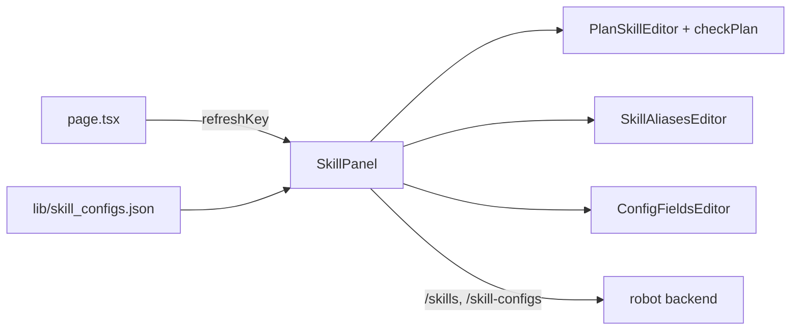

---
sources:
  - frontend/components/SkillPanel.tsx
  - frontend/components/PlanSkillEditor.tsx
  - frontend/components/SkillAliasesEditor.tsx
  - frontend/components/ConfigFields.tsx
  - frontend/components/EnvNamesEditor.tsx
  - frontend/components/PanelSearch.tsx
  - frontend/lib/skill_configs.json
  - frontend/lib/api.ts
  - frontend/lib/types.ts
verified_at: 4a810a3717ab
---

# Skills panel

!!! abstract "In this page"
    The Skills panel (`SkillPanel`) lists the skills the robot backend knows, shows whether each one loads,
    lets you add, edit and delete them, and edits the config groups that belong to a skill. You get: the three
    skill types, how a plan skill is checked while you type, how aliases are checked, which calls each action makes,
    and the two guards that came from real mistakes. Checked in code at `4a810a3717ab`, not run against a robot.

## Words used here

| word | meaning |
|---|---|
| skill | one action the robot can do, called by name, for example `move` or `pick_top`. The backend owns the list. |
| internal skill | a Python function, found by `module_path` and `func_name`. |
| external skill | a REST endpoint, found by `url`. |
| plan skill | a sequence of other skills, one `skill::args` per line. |
| alias | another name a skill answers to, for example a name in another language. |
| config group | a named JSON object the backend keeps, such as `GRIP_CONFIGS`. Skills read their settings from it. |

## Where it sits



## Props and the bundled map

| name | type | meaning |
|---|---|---|
| `refreshKey` | number, default 0 | when the page bumps it (robot or site changed), the panel loads the list again (`SkillPanel.tsx:32, 72`) |

Which config groups belong to which skill is not asked from the backend. It is read from the bundled file
`lib/skill_configs.json`, key `skill_config_map` (`SkillPanel.tsx:6, 12`). At `4a810a3717ab` it maps 38 skills to 10 groups:
`ARM_CONFIGS`, `EMERGENCY_CONFIGS`, `FIND_CONFIGS`, `GRIP_CONFIGS`, `HEAD_CONFIGS`, `HRI_CONFIGS`, `LIFT_CONFIGS`,
`MOBILE_CONFIGS`, `QA_CONFIGS`, `VLA_CONFIGS`. (The file has a second top-level key, `pi0.5_act`, that the panel does not read.)
A skill that is not in the map has no Configs section. A new skill with configs needs a new line in this file.

## What the panel shows

- **List.** `GET /skills` and `GET /skills/status` are loaded together (`refresh`, `SkillPanel.tsx:66-70`). Skills are
  grouped: all plan skills under `plan skills`; others by the last part of their `module_path`; external ones by their URL.
- **Status dot.** Green when `status[name].ok`, red when not. The tooltip is the error text, or `ok`, or `not checked`.
- **Search.** The box filters by name, alias or description. A match opens the panel (the shared `PanelSearch`:
  Escape clears it).
- **Reload.** `POST /skills/reload` makes the backend read its skill config again, then the list is loaded.
- **Add.** A form with name, type (`internal`, `external`, `plan`), the fields of that type and a description. `POST /skills`.
- **Edit.** Plan skills can change name, description and plan; others description, `module_path`, `func_name`, `url`.
  The rename tooltip says that plan skills calling the skill are updated and shortcut buttons keep the old name.
  `PUT /skills/{name}`.
- **Delete.** `DELETE /skills/{name}`. The backend refuses while a plan skill still calls it (`api.ts:360-363`); the
  message is shown above the list.
- **Aliases.** One block, folded, with chips per skill. See below.

## Plan skills are checked while you type

`PlanSkillEditor` is a text box for the plan. Its function `checkPlan(name, plan, known)` runs on every keystroke
with the same rules as the backend (`robot_agent/core/plan_skill.py`, which checks again on save). `known` is the list of
all skill names and aliases. It reports the number of steps, the parameters and the errors:

| rule | error text |
|---|---|
| a step is `skill::args` (parts joined with `&&` run in parallel) | `line N: expected "skill::args"` |
| the skill must exist; `!`, `~`, `%` and a spoken name before `->` are ignored for the lookup | `line N: unknown skill "x"` |
| a plan must not call itself | `line N: "x" would call itself` |
| a parameter written twice must have the same default | `$p$ has two defaults: "a" and "b"` |
| at least one step | `no steps yet - one "skill::args" per line` |

`$inputs$` stands for what follows the skill name when it is called; `$name=default$` declares a parameter. Lines
are cut at `#`. Run offline with the committed `checkPlan` (Node 22, `--experimental-strip-types`):

```js
const known = ['move','lift','movej','forward','pick_top']
const plan = `move::$loc=counter2@kitchen$
lift::1
fly::2
pick_top::$inputs$
my_plan::x`
console.log(JSON.stringify(checkPlan('my_plan', plan, known)))
```

Output, as printed:

```text
{"steps":5,"params":[{"name":"loc","def":"counter2@kitchen"},{"name":"inputs","def":null}],"errors":["line 3: unknown skill \"fly\"","line 5: \"my_plan\" would call itself"]}
```

The plan has 5 steps, two parameters (`loc` with a default, `inputs` without) and two errors. The editor shows nothing
for an empty plan until you type. Nothing in this editor runs the robot: test a saved plan skill from the Agent panel like any other skill.

## Aliases

`SkillAliasesEditor` shows each skill with its aliases as chips and saves each change at once with `PUT /skills/{name}`
and `{ aliases }`. It checks locally first, with the rules the backend uses (`skill_registry`): an alias must not be empty, must not
contain a character the plan parser reads (`: & ! ~ # $ { } , = ' " ( )` or a space), and must not be another
skill's name or alias. A bad chip is red and is not sent; if the backend refuses, its reason is returned to the editor.

## Editing a skill's configs

Opening a skill for edit loads each of its config groups with `GET /skill-configs/{name}` into a Fields view or a JSON view
(`ConfigFieldsEditor`, shared with the [configs page](configs.md)). There is no static seed: the box is empty
until the live value arrives, so you never edit a default that the robot does not use (comment at `SkillPanel.tsx:74-76`).

!!! code "Where in the code"
    [`SkillPanel.tsx:159-178`](https://github.com/mtbui2010/robotapp/blob/4a810a3717ab/frontend/components/SkillPanel.tsx#L159-L178)

```ts
    // save skill def; a refused plan (unknown skill, calls itself) keeps the form open
    try {
      await api.updateSkill(editName, editForm)
    } catch (e) {
      setEditError(e instanceof Error ? e.message : 'Save failed'); return
    }

    // save each config (only the ones that loaded successfully); a refused
    // save (e.g. a duplicate ENV alias) keeps the form open with its message
    const failed: Record<string, string> = {}
    await Promise.all(
      Object.entries(editConfigs).map(([cn, text]) =>
        api.updateSkillConfig(cn, JSON.parse(text)).catch(err => {
          failed[cn] = err instanceof Error ? err.message : 'Save failed'
        })
      )
    )
    if (Object.keys(failed).length > 0) { setConfigErrors(failed); return }
    cancelEdit()
    await refresh()
```

Order of a save (`submitEdit`):

1. Stop if a config is still loading or has a load error (`SkillPanel.tsx:149-150`).
2. Parse every config text; a text that is not JSON gives `Invalid JSON` on that config and stops.
3. Save the skill definition. A refusal keeps the form open with the backend's reason.
4. Save every config group with `PUT /skill-configs/{name}`, all at the same time. A refusal keeps the form open with the message.
5. Close the form and reload the list.

Note the step order: the skill is saved before its configs. If a config is refused, the skill definition is already saved.
This panel writes the whole group with `PUT`. The Global Configs panel uses a merged `PATCH` instead
(see [configs](configs.md)).

## Two guards that came from mistakes

| guard | why | where |
|---|---|---|
| a confirm before delete: `Delete skill "x"?`, and for a plan skill `Its plan steps are deleted with it.`, then `The dashboard cannot undo this.` | the delete button sits next to the name; the skill `clear_pot` was deleted by a misclick on 2026-10-15 (comment) | `SkillPanel.tsx:122-127` |
| no save while a config is loading or failed to load | saving then would silently drop that config | `SkillPanel.tsx:149-150` |

## Edge cases and failure modes

| symptom | cause | what to do |
|---|---|---|
| a config box shows `null` | `api.getSkillConfig` returns `null` (it does not throw) when the request fails or the group does not exist, and `SkillPanel` writes whatever it gets into the box. The load-error branch in `SkillPanel` is only reached if that call throws. Saving that text sends `null`. | do not save a box that shows `null`; use the reload arrow of that config. The Global Configs panel handles `null` and shows `Not found on agent`. |
| delete refused | a plan skill still calls it | edit that plan first |
| plan refused on save | unknown skill, or a call to itself | fix the line named in the error |
| alias refused | it is another skill's name or alias, or has a reserved character | choose another alias |
| an edit saved but the form stays open | the skill saved, a config was refused | read the red message on the config and fix it |

## How it is verified

`scripts/test_lib.mjs` has no test for the skills panel, `checkPlan` or the alias rules. The type check, lint and the
snippet above are the only checks. The rules are copies of backend rules, listed in the backend-coupling reference
([backend coupling](../reference/backend-coupling.md)); if the backend changes them, this panel can accept a plan
that the backend then refuses. The backend's answer is then shown as the error.
