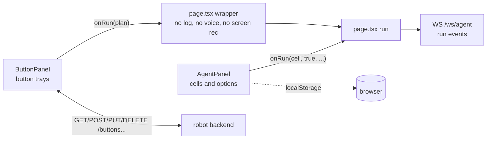

---
sources:
  - frontend/components/AgentPanel.tsx
  - frontend/components/ButtonPanel.tsx
  - frontend/components/ExpandEditor.tsx
  - frontend/components/RecordAudioToggles.tsx
  - frontend/components/PopoverButton.tsx
  - frontend/lib/buttonGroups.ts
  - frontend/lib/api.ts
  - frontend/app/page.tsx
  - scripts/test_lib.mjs
verified_at: 4a810a3717ab
---

# Structured plans and shortcut buttons

!!! abstract "In this page"
    Two ways to run a plan that you wrote yourself, without the chat. The Agent panel holds plan text in cells (one `skill::params` step per line) and runs the active cell, once, N times or forever. The shortcut buttons are plans saved on the robot's backend, grouped, and run with one click. You get the props, the browser storage keys, the endpoints, the exact difference between a cell run and a button run, and the failure modes that shaped the code.

## What the reader gets

After this page you can write a plan in a cell, save it as a preset, loop it, choose where its data log goes, and add, group and reorder shortcut buttons. If you extend the dashboard, you know which file owns which behaviour and what each one sends to `page.tsx`.

| | |
|---|---|
| **Components** | `AgentPanel` (cells, presets, log options, repeat, Run / Stop), `ButtonPanel` (button groups and trays), `ExpandEditor` (big editor for one cell), `RecordAudioToggles` (sound options of the screen recording), `PopoverButton` (small popover used by the menus) |
| **Pure logic** | `frontend/lib/buttonGroups.ts` (tabs, order, which tray is open) |
| **Input** | props from `page.tsx`; the browser storage keys below; for buttons, the backend's button list |
| **Output** | one call `onRun(...)` into `page.tsx`; for buttons, writes to the backend's `/buttons` endpoints |
| **Tests** | `scripts/test_lib.mjs` lines 576-610 for `buttonGroups.ts`. No test for the components. |

## Background

A plan step is one line of the form `skill::params`, for example `say::inputs='hello', lang='en'` or `wait::1`. A skill is a named action the robot backend can run. A "direct" run sends the plan text as it is, without asking a planner to write it. Both panels on this page start direct runs. Free text that needs a planner goes through the chat panel instead ([chat](../modules/chat.md)). The steps then appear in the plan panel ([plan view](../modules/plan-view.md)).

## Where it sits



## The Agent panel

### Props

`AgentPanel` is mounted once in `page.tsx` (line 892 to 906). Its props (`AgentPanel.tsx` lines 150-164):

| prop | type | meaning |
|---|---|---|
| `toolbarExtra` | `ReactNode`, optional | drawn before Run / Stop (the page puts its voice toggle and Guide button here) |
| `running` | `boolean` | a run is active: Run turns into Stop |
| `lang` | `Lang` | the language of the whole app, chosen in the page's control bar |
| `onRun` | function | called by Run (signature below) |
| `onStop` | function | called by Stop |
| `stopText` | `string`, optional | the Stop label: `Stop`, `Stopping…` or `Force reset` |
| `recordEnabled`, `onToggleRecord` | `boolean`, function | the "rec screen" checkbox |
| `manualRecording`, `onToggleManualRecord` | `boolean`, function | the manual record button (record and stop by hand) |
| `backendLogDir` | `string` | shown under the log options when the log goes to the backend |
| `trial` | `number` | the current run number of a repeat, shown while running |
| `onOpenGuide` | function, optional | the "? Guide" item of the presets menu |

### The cells

The panel keeps an array of four strings in state, saved as one JSON array under `robotapp_cells`. At the pin the panel draws only two of them: cell 1 (wide, with the placeholder `find::apple`, `navigate::kitchen`, `pick::cup`) and cell 2 (placeholder `skill::params`). Cells 3 and 4 exist in storage and state but have no text box. Each cell is a 40 px high box (about two lines) with a scroll, and its `⤢` button opens `ExpandEditor`, a modal with line numbers.

The cell with the blue border is the active cell. Clicking or typing in a cell makes it active. Run, and Ctrl+Enter inside a cell, always send the active cell only. Editing a cell through its `⤢` editor also makes it active; the code comment says that without this, Run would send another cell's plan.

### Presets

A preset is a named piece of plan text. The `Presets` select loads one into the active cell. The `⋯` menu has these items:

| item | what it does |
|---|---|
| Save as… | asks a name; asks again before it overwrites a preset of that name; refuses an empty cell |
| Rename | renames the selected preset, keeping its text and its place |
| Delete | deletes the selected preset and clears the cell |
| Export | downloads all presets as `presets.json` |
| Import | reads a JSON array of `{name, text}`; merges it and overwrites on a name clash |
| ? Guide | shown only when `onOpenGuide` is given |

The list is stored under `robotapp_presets_structured` and shown sorted by name with numbers in natural order. Presets live in this browser, not on the robot. `ExpandEditor` keeps your edits when the modal closes by itself (see the failure modes).

### Log and repeat options

| control | values | default | storage key |
|---|---|---|---|
| `log` checkbox | on / off | on | `robotapp_log_data` (`'0'` = off) |
| log `save in` | `frontend` (browser download folder, one folder per run) or `backend` (a folder on the backend server) | `frontend` | `robotapp_log_target` |
| log `runs` | `all` or `failed only` | `failed only` | `robotapp_log_all` (`'1'` = all) |
| repeat mode | `×1`, `×N`, `∞` | `×1` | `robotapp_repeat_mode` (`once`, `n`, `forever`) |
| repeat N | integer, at least 1 | 2 | `robotapp_repeat_n` |
| `keep on error` | on / off, shown for `×N` and `∞` | off | `robotapp_repeat_continue_on_error` |

"Failed only" keeps the runs that failed: a step that returned `isdone` false, an error, or a symbolic violation (the tooltip text in the code). The repeat count passed to `page.tsx` is `1`, `Infinity` or `max(1, N)`. While a repeat runs, a counter `trial` or `trial/N` shows next to the select. With `keep on error` off, the loop stops at the first failed run.

The `rec screen` checkbox asks `page.tsx` to record the screen while the plan runs and to download a `.webm` when it ends. `RecordAudioToggles` is the `⋯` button next to it: it sets whether the recording carries sound, from which source, and runs a 9 s self-test. A small dot on it is green when the last recording had sound and amber when it did not. The red `⏺` button starts and stops a recording by hand. Browser storage keys of the sound options are in [browser storage](../reference/browser-storage.md).

### Output

`run` in `AgentPanel.tsx` line 214:

```tsx
  const run = () => onRun(cells[activeCell], true, lang, undefined, undefined, logData, logTarget, repeatTimes, repeatCOE, logAll)
```

The parameters, in order, as `page.tsx` `run` (line 597) names them:

| position | name | value from the Agent panel |
|---|---|---|
| 1 | `finalPrompt` | the active cell's text |
| 2 | `direct` | `true` |
| 3 | `lang` | the app language |
| 4 | `planner` | `undefined`, so the default `'grace'` |
| 5 | `planOnly` | `undefined`, so `false` |
| 6 | `logData` | the `log` checkbox |
| 7 | `logTarget` | `frontend` or `backend` |
| 8 | `repeatTimes` | `1`, `N` or `Infinity` |
| 9 | `continueOnError` | the `keep on error` checkbox |
| 10 | `logAll` | `all` is `true`, `failed only` is `false` |

The 11th and 12th parameters (`voice`, `screenRec`) are left out, so they keep their default `true`. `page.tsx` ignores the call when the text is empty or a run is active.

## The shortcut buttons

### Props and storage

`ButtonPanel` props (`ButtonPanel.tsx` lines 20-24): `onRun(plan: string)` and an optional `refreshKey` that `page.tsx` raises each time the active robot connects, which makes the panel read the list again.

| key | holds |
|---|---|
| `robotapp_button_group` | the id of the group whose tray is open; `-` means no tray |
| `robotapp_buttons` | legacy: buttons used to live only in the browser (read once, then deleted) |
| `robotapp_buttons_migrated` | `'1'` once the legacy list has been sent to the backend |

### What a button is

A button is `{id, label, plan, group?}`. Its `group` is a group id; the empty string is `Other`, an implicit last group for buttons without a group. A button whose group id no longer exists also reads as `Other`. Buttons and groups are stored on the robot's backend, so each robot has its own set.

The panel shows one chip per group, a `+` chip to add a group, and under them the tray of the open group: a grid of buttons of 46 px minimum width. A second click on the open chip closes its tray. On hover, a chip shows `✎` (rename) and `×` (delete); `×` does not delete at once but opens a warning that lists the group's buttons, which move to `Other`; only the click on "Delete group" deletes. The warning is a page box and not `window.confirm`, because browsers can mute those. A button shows `⋮⋮` (drag), `✎` (edit) and `×` (delete) on hover. The add and edit form has a label, a group and a plan text box.

Drag and drop does three things: a button dropped on another button moves it before that button (the new order is sent to the backend at once, and the list is read again if that fails); a group chip dropped on another chip reorders the groups; a button dropped on a group chip moves it to that group.

### How a button runs

`page.tsx` lines 871-874:

```tsx
              {/* Button-panel shortcuts run silently — no voice announcements. */}
              <ButtonPanel
                onRun={plan => run(plan, true, 'en', 'grace', false, false, 'frontend', 1, false, true, false, false)}   // a button: no data log, no voice, no screen recording
                refreshKey={skillRefreshKey} />
```

A button run is a direct run with these fixed values: language `en`, planner `grace`, `logData` false, one repeat, `voice` false, `screenRec` false. It has no data log, no spoken announcements and no screen recording, whatever the Agent panel's checkboxes say. The language of the app does not apply to buttons.

### Endpoints

All on the active robot's backend (`api.ts` lines 641-732):

| call | method and path |
|---|---|
| list, add | `GET /buttons`, `POST /buttons` |
| edit, delete | `PUT /buttons/{id}`, `DELETE /buttons/{id}` |
| reorder buttons | `POST /buttons/reorder` with `{ids}` |
| bulk add (migration) | `POST /buttons/bulk` with `{items}` |
| groups | `GET /buttons/groups`, `POST /buttons/groups`, `PUT /buttons/groups/{id}`, `DELETE /buttons/groups/{id}`, `POST /buttons/groups/reorder` |

All paths are listed in [endpoints](../reference/endpoints.md). If the list call fails, the panel shows "Robot unreachable — connect a robot to load buttons." and disables the add form. A failed group list is treated as no groups.

### The pure part

`buttonGroups.ts` has no React and no network. A run of its functions on the data used by the tests (5 buttons, 2 groups), run offline for this page (2026-11-19, local Node, `esbuild` bundle of the repo file):

```text
groupTabs      [["head","Head",2],["arm","Arm",1],["","Other",2]]
groupTabs([],[])  [""]            (no group and no button: one Other tab, so you can still add)
openGroup('deleted', tabs) -> head   openGroup('-', tabs) -> -
reorderBefore(buttons, '3', '1') -> ["3","1","2","4","5"]
```

Button 4 has no group and button 5 names the group `gone`, which does not exist, so both count in `Other` (2 buttons).

## One-time migration of browser buttons

Older versions kept buttons only in `localStorage`. `ButtonPanel.tsx` lines 61-84:

```tsx
      let serverBtns = await api.listButtons()
      const legacy = readLegacy()
      const alreadyMigrated = localStorage.getItem(MIGRATED_LS_KEY) === '1'

      if (legacy.length > 0 && serverBtns.length === 0
          && !alreadyMigrated && !__migrationInFlight) {
        __migrationInFlight = true
        // Set the flag BEFORE the POST: if React Strict-Mode runs this effect
        // twice in quick succession, the second pass sees the flag and bails.
        localStorage.setItem(MIGRATED_LS_KEY, '1')
        try {
          const result = await api.bulkAddButtons(
            legacy.map(b => ({ label: b.label, plan: b.plan }))
          )
          if (result.count > 0) serverBtns = await api.listButtons()
          // Now drop the legacy key entirely so it can never be re-imported.
          localStorage.removeItem(LEGACY_LS_KEY)
        } catch {
          // Migration failed — unset the flag so the user can retry next load.
          localStorage.removeItem(MIGRATED_LS_KEY)
        } finally {
          __migrationInFlight = false
        }
      }
```

Permalink: [ButtonPanel.tsx lines 61-84](https://github.com/mtbui2010/robotapp/blob/4a810a3717ab/frontend/components/ButtonPanel.tsx#L61-L84). The code runs only if the browser has legacy buttons and the backend has none. It sets the flag before the request, deletes the legacy key after success, and removes the flag again if the request fails so the next load can retry. The Agent panel's `run` is at [AgentPanel.tsx line 214](https://github.com/mtbui2010/robotapp/blob/4a810a3717ab/frontend/components/AgentPanel.tsx#L214).

## Edge cases and failure modes

| symptom | cause | what the code does |
|---|---|---|
| Legacy buttons were imported twice | React Strict Mode runs an effect twice, and both passes saw an empty backend list | a module-level flag `__migrationInFlight` (`ButtonPanel.tsx` lines 13-18) plus the storage flag set before the request |
| A preset loaded into a small cell hid six steps that then ran | a cell is one or two lines high; steps below the fold still run | an amber badge `N steps` appears when the cell holds more than 3 lines with `::` (`AgentPanel.tsx` lines 231-244); hover shows the whole text |
| Edits lost in the big editor | the modal used to close by itself (outside click, Esc) and drop the text | closing keeps the edits (`ExpandEditor.tsx` lines 22-25); only the "Discard changes" button throws them away; a click that starts inside the text box and ends outside does not close it |
| Cell 3 or 4 never shows | only two cells are drawn | the state and storage hold four; use cells 1 and 2, or presets |
| Button seems to ignore your settings | a button run has fixed log and voice values | use the Agent panel when you want a data log or the screen recording |
| Presets are gone on another computer | presets are in this browser's storage | use Export and Import |
| Group deleted by mistake | `×` then "Delete group" | buttons are kept and move to `Other` |

### No "two clients" warning here

The framework's rule says an operator screen that can move the robot should warn that two clients must not drive one robot. At the pin, `AgentPanel.tsx` and `ButtonPanel.tsx` have no such note (a search of both files finds none). The note exists in the chat panel and in the teleop bar only. A cell run or a button click can move the robot and shows no warning. How to avoid it: use one dashboard on one robot at a time, and press Stop (or Cancel) in the dashboard that started the run.

## How it is verified

`scripts/test_lib.mjs` lines 576-610 test `buttonGroups.ts`: the order of tabs, `Other` last and only when it has buttons, an unknown group reading as `Other`, `buttonsOf` keeping the list order, `openGroup` rules, and `reorderBefore` and `reorderGroupIds` including the no-change case. There is no test for the components, for presets, or for the repeat logic. See [tests](../modules/tests.md). For a walk through the use of cells and buttons, see [the structured guide](../guides/structured.md).
