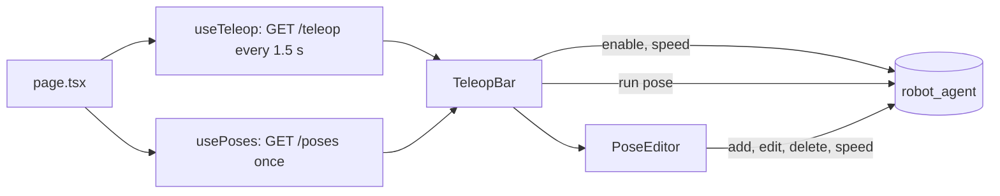

---
sources:
  - frontend/components/TeleopBar.tsx
  - frontend/components/PoseEditor.tsx
  - frontend/lib/teleop.ts
  - frontend/lib/useTeleop.ts
  - frontend/lib/poses.ts
  - frontend/lib/usePoses.ts
  - frontend/lib/api.ts
  - frontend/app/page.tsx
  - scripts/test_lib.mjs
verified_at: 4a810a3717ab
---

# Remote control strip and Go-to poses

!!! abstract "In this page"
    You get what the strip above the camera images shows, what each control sends to the robot, how the "Go to" poses work and how they are edited, and exactly where the "two clients on one robot" warning is shown (and where it is not). Checked in code at `4a810a3717ab`; nothing here was run against a robot.

## What it is

Some robots can be driven by hand with an input device that is plugged into the robot, for example a 6-axis mouse. This is called remote control or teleop. The robot's software offers one or more teleop functions (for example one per arm). The strip draws **one row per function**. Each row shows the state of the function, a few status chips, the input device battery, a speed menu and one On / Off button.

The strip also holds the **Go to** menu: a list of named poses. A pose is a label and a plan. A plan is written like the plan of a shortcut button: one step per line, `skill::argument`, and `a::x&&b::y` runs two steps together. One speed applies to every pose.

If the robot has no teleop function, `TeleopBar` returns nothing (`functions.length` is 0).

## Where it sits



The pure helpers live in `lib/teleop.ts` and `lib/poses.ts`. The components only draw and call `api`.

## When the strip is visible

The strip is not always on screen. It is drawn only when both conditions hold (`page.tsx:954`):

1. The Cameras tab is open (`mainTab === 'cameras'`).
2. `showDataTools` is true. That is the operator's "make data" toggle (the `⏺` button in the tab bar, kept in the browser under `robotapp_data_tools`), **or** a recording is running or saving, **or** a teleop function is on (`dataBusy`, `page.tsx:693-694`).

The `⏺` button itself exists only when the robot has a teleop function or a recorder (`page.tsx:922`). It is disabled while `dataBusy`, so the strip cannot be hidden while it is in use.

## Inputs

`TeleopBar` props (`TeleopBar.tsx:15`):

| prop | type | meaning |
|---|---|---|
| `functions` | `TeleopFunction[]` | the answer of `GET /teleop`, from `useTeleop` |
| `runInFlight` | `boolean` | an agent run is going on; On and Go to are blocked |
| `onChanged` | `() => void` | called after every click so the parent reads `GET /teleop` again at once |
| `poses` | `PoseList \| null` | the Go-to poses; `null` hides the Go to menu |
| `onPosesChanged` | `() => void` | called after a pose edit so the parent reads `GET /poses` again |

`PoseEditor` props (`PoseEditor.tsx:11`): `list: PoseList`, `onChanged`, `onClose`.

The data types (`teleop.ts:4-27`, `poses.ts:3-4`):

| type | fields |
|---|---|
| `TeleopFunction` | `name`, `label`, `available` (a fresh state arrived: the function runs), `state?`, `age_s?` |
| `TeleopState` | `state` (`inactive`, `hold` or `active`), `ready?`, `gripper_open?`, `speed?` (0 to 1), `input_age_s?`, `stalled?`, `frame?`, `lock?`, `line?`, `rotate?`, `rotation_on?`, `twist?`, `battery?`, `charging?`, `battery_age_s?` |
| `Pose` | `id`, `label`, `plan` |
| `PoseList` | `speed`, `poses`, `defaults_missing` |

## What a row shows

Every text below comes from a pure helper, so it can be tested without a browser.

| part | rule | helper |
|---|---|---|
| On / Off button text | `not running` (function not available), `not set up` (`ready` is false), `blocked` (stalled), `starting…` (state `hold`), `● driving` (state `active`), `▶ On` (inactive and ready) | `stateLabel`, `driveLabel` |
| Device note | shown only when something is wrong: `no input device` (never heard), `device silent` (last input more than 2 s ago). Nothing is shown when the device is fine. | `deviceText` |
| Mode chips | only what the node reports: `tool frame`, `heading frame` or `base frame`; `line <axis>` or `one axis`; `no rotation` or `twist rolls`; `rotating` | `modeChips` |
| Gripper switch | read-only; drawn only when the function has a gripper (`gripper_open` is not null) | `TeleopBar.tsx:33, 41` |
| Battery | the input device battery, for example `🔋 78%`, or `⚡` while charging. Shown only when the node reports it. "Low" is 20 % or less and not charging. | `batteryInfo` |
| Speed menu | three levels: 25 %, 50 %, 100 %. A speed set elsewhere shows as the nearest level. Disabled when the function is not available. | `SPEED_LEVELS`, `nearestLevel` |

The input device counts as connected when it sent something in the last 2 seconds. A 6-axis mouse sends about 50 times a second even when idle, so a silent device means a problem (`teleop.ts:55`).

## Output: what the controls send

| control | request | notes |
|---|---|---|
| On | `POST /teleop/{name}/enable` with `{on: true, confirm: true}` | enabled only when `canEnable`: running, set up, off, and no run in flight |
| Off (the same button while on) | `POST /teleop/{name}/enable` with `{on: false, confirm: false}` | always allowed |
| Speed menu | `POST /teleop/{name}/speed` with `{scale}` (0.25, 0.5 or 1) | |
| Go to pose | `POST /poses/{id}/run` | answers when the move is done: `{isdone, msg, plan}` |
| Pose editor | `POST /poses`, `PUT /poses/{id}`, `DELETE /poses/{id}`, `PUT /poses/speed`, `POST /poses/defaults` | `api.ts:537-567` |

The calls are at `api.ts:499-513` and `api.ts:537-573`. On failure each one throws an `Error` with the backend's `detail` text, or `HTTP <status>`, and the strip shows it in a red line under the rows.

No question is asked before On. The code comment gives the reason: a person is always next to a robot that is driven remotely. `confirm: true` is the API's own flag for this.

## Go to poses

The Go to menu is drawn on the **first** teleop row only (`f === functions[0]`), and only when `poses` is not null. It lists the poses and one last entry, `✎ Edit poses…`, which opens `PoseEditor`.

Choosing a pose runs `goTo` (`TeleopBar.tsx:20-26`):

1. Call `POST /poses/{id}/run`. The backend switches teleop off by itself before it moves (`api.ts:568`), then answers when the move is finished.
2. `poseError` reads the answer. `isdone: false` is a failure; the text is `msg`, or `the pose was not reached` when `msg` is empty.
3. On success, if the function was available, call `enableTeleop(name, true, true)` so remote control starts again by itself.
4. In every case clear the "moving…" state and call `onChanged`.

```tsx
  // Going to a pose: POST /skill switches teleop off by itself (the backend, begin_run). No question is asked: a person is always next to a robot that is driven remotely.
  const goTo = (fn: string, p: Pose, restore: boolean) => {
    setMoving(fn); setErr('')
    api.runPose(p.id)
      .then(res => { const m = poseError(res); if (m) { setErr(`${p.label}: ${m}`); return }       // a failed move leaves teleop off
        return restore ? api.enableTeleop(fn, true, true) : undefined })                           // arrived: remote control starts again by itself
      .catch(e => setErr(`${p.label}: ${e instanceof Error ? e.message : String(e)}`)).finally(() => { setMoving(null); onChanged() })
  }
```

[`frontend/components/TeleopBar.tsx` lines 19-26](https://github.com/mtbui2010/robotapp/blob/4a810a3717ab/frontend/components/TeleopBar.tsx#L19-L26)

A failed move leaves teleop **off**. The operator must press On again.

The menu is disabled while a run is in flight or while this function is moving.

### Pose editor

`PoseEditor` is a small popover under the menu. It adds no row. A click outside closes it.

| part | what it does |
|---|---|
| list of names | each pose has `✎` edit and `×` delete; delete asks `delete?` with Yes / No first |
| `＋` | new pose: a name and a plan (one step per line) |
| speed menu | one speed for every pose: 10, 15, 20, 25, 30, 40, 50, 75, 100 % (`POSE_SPEEDS`); a speed set elsewhere shows as the nearest value |
| `↺` | appears only when `defaults_missing` is more than 0; adds back the robot package's starting poses that are missing |

The plan of a pose shows only while it is being edited. Nothing is built in: the robot package only seeds the first list.

`poseFormError` blocks Save with a reason: `give the pose a name`; `write at least one step: skill::argument (for example movej::fold)`; or `a pose named "<name>" already exists` (compared without case, ignoring the pose being edited).

## The "two clients on one robot" warning

A second client (the command line, another browser tab) that drives the same robot is unsafe: the Cancel on the backend is process-wide, so it stops both. The project rule is that every screen that can move the robot says so. At the pinned commit the warning is **not** on every such screen. This is the state of the strip:

| place | warning? |
|---|---|
| Teleop row, the `🕹` icon at the left of each row | yes, as a **hover tooltip only** (`title`, `TeleopBar.tsx:37`): "... Two clients driving one robot is unsafe: Cancel stops both." Nothing is visible without hovering; a touch screen has no hover. |
| On / Off button, Go to menu, speed menu | no |
| Pose editor | no |
| Record bar (`RecorderBar`), which also starts remote control | no (see [Record raw VLA episodes](recorder.md)) |
| Data tab | no (it does not move the robot) |
| Chat panel | yes, as visible text (see [Chat](chat.md)) |

So the teleop strip carries the warning in one place, and only as a tooltip. The Go to menu moves the arm and shows no warning. How to stay safe: use one client per robot, and know that Cancel in one client also stops what the other started.

## Edge cases and failure modes

| symptom | cause | what to do |
|---|---|---|
| On is greyed | the function is not running, not set up, already on, or a run is in flight (`canEnable`) | read the button text; cancel the run first |
| Remote control is off after a Go to | the move failed (`isdone: false`) or the call threw | read the red line, then press On |
| A "driving" function suddenly shows `not running` | the state is stale: `isOn` and `stateLabel` need `available`, so an old state is never shown as on (`teleop.ts:49`) | wait for a fresh state or check the node |
| The strip disappears after one failed `GET /teleop` | `useTeleop` sets the list to empty on any read error and does not poll again until a click (`refresh`) or a robot change. The comment above the hook says a failed read keeps the last answer; the code at the pin does not (`useTeleop.ts:20`). | pick the robot again or press any control that calls `onChanged` |
| No Go to menu | `GET /poses` failed or returned an error, so `poses` is null (`usePoses.ts:13`) | check the backend |
| `no input device` / `device silent` | the device sent nothing in the last 2 s | check the cable or the dongle on the robot |

`useTeleop` polls `GET /teleop` every 1.5 s while the robot has at least one function. A robot with none is asked once, and again when another robot is picked. `usePoses` reads once, again after an edit, and when another robot is picked.

## How it is verified

`scripts/test_lib.mjs:503-574` tests `stateLabel`, `canEnable`, `isOn`, `driveLabel`, `poseError`, `modeChips`, `deviceText`, `gripperText`, `nearestLevel` and `batteryInfo`. `scripts/test_lib.mjs:704-718` tests `planSteps`, `nearestSpeed` and `poseFormError`. There is no test for `TeleopBar.tsx`, `PoseEditor.tsx` or the hooks.

Real output of the pure helpers, run offline through the repo's own `esbuild` (a probe script, the same build as the tests):

| call | result |
|---|---|
| `stateLabel` of an available, ready, inactive function | `{"text":"off","tone":"off"}` |
| `stateLabel` of state `hold` / `active` / `active` with `stalled` | `starting…` / `driving` / `blocked` |
| `stateLabel` of a function with `available: false` | `{"text":"not running","tone":"bad"}` |
| `isOn` of an active function with `available: false` | `false` |
| `driveLabel` of an inactive / active function | `▶ On` / `● driving` |
| `deviceText` with `input_age_s` 0.02 / 5 / null | `device ok` / `device silent` / `no input device` |
| `batteryInfo` with battery 0.78, 30 s old | `🔋 78%`, not low, `just now` |
| `batteryInfo` with battery 0.15, 600 s old | `🔋 15%`, low, `10 min ago` |
| `batteryInfo` with battery 0.15, charging | `⚡ 15%`, not low |
| `canEnable` of an inactive ready function, run in flight / not | `false` / `true` |
| `planSteps('movej::fold\n\n# note\nlift::0.5&&movej::give  # two')` | `["movej::fold","lift::0.5&&movej::give"]` |
| `poseFormError('Fold', 'movej::fold', [pose labelled 'fold'])` | `a pose named "Fold" already exists` |

!!! code "Where in the code"
    - [`frontend/components/TeleopBar.tsx`](https://github.com/mtbui2010/robotapp/blob/4a810a3717ab/frontend/components/TeleopBar.tsx): the rows and `goTo`.
    - [`frontend/components/PoseEditor.tsx`](https://github.com/mtbui2010/robotapp/blob/4a810a3717ab/frontend/components/PoseEditor.tsx): the editor popover.
    - [`frontend/lib/teleop.ts`](https://github.com/mtbui2010/robotapp/blob/4a810a3717ab/frontend/lib/teleop.ts) and [`frontend/lib/poses.ts`](https://github.com/mtbui2010/robotapp/blob/4a810a3717ab/frontend/lib/poses.ts): types and pure helpers.
    - [`frontend/lib/useTeleop.ts`](https://github.com/mtbui2010/robotapp/blob/4a810a3717ab/frontend/lib/useTeleop.ts), [`frontend/lib/usePoses.ts`](https://github.com/mtbui2010/robotapp/blob/4a810a3717ab/frontend/lib/usePoses.ts): the polling hooks.
    - [`frontend/app/page.tsx` lines 76-79, 693-694, 954](https://github.com/mtbui2010/robotapp/blob/4a810a3717ab/frontend/app/page.tsx#L954): when the strip is shown.
