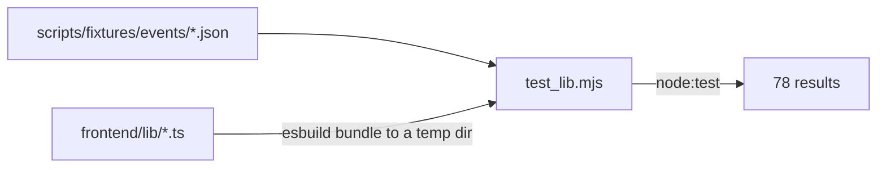

---
sources:
  - scripts/test_lib.mjs
  - scripts/fixtures/events/
  - frontend/lib/planView.ts
  - frontend/lib/chatMic.ts
  - frontend/lib/chatRun.ts
  - frontend/lib/robotLanguages.ts
  - frontend/lib/buttonGroups.ts
  - frontend/lib/targetBadge.ts
  - frontend/lib/teleop.ts
  - frontend/lib/recorder.ts
  - frontend/lib/recordings.ts
  - frontend/lib/poses.ts
  - frontend/lib/mapObjects.ts
  - frontend/lib/tabPref.ts
  - frontend/lib/api.ts
verified_at: 4a810a3717ab
---

# Unit tests on recorded runs (`scripts/test_lib.mjs`)

!!! abstract "In this page"
    How the unit tests load the pure `lib/` modules, the recorded runs they replay, the real result of a run, and what they do not cover. No backend, no browser, no install beyond `frontend/node_modules`.

## How it works

`make unit` runs `node --test-reporter=spec scripts/test_lib.mjs`. The file uses the test runner built into Node (`node:test`) and `node:assert/strict`. There is no test framework to install.

Each `lib/*.ts` module under test is bundled with `esbuild` (it ships with `next`) into a temporary folder, then imported. The ten modules loaded are `planView`, `chatMic`, `chatRun`, `robotLanguages`, `buttonGroups`, `targetBadge`, `teleop`, `recorder`, `recordings` and `poses` (`test_lib.mjs:22-31`). `mapObjects`, `tabPref` and `api` are loaded further down in the file.



Only pure modules are tested: functions that take values and return values. The tests never start a page.

## Recorded runs

Eight event files in `scripts/fixtures/events/` (39,953 bytes in all) were recorded from a simulated home robot and cut down to the planning events (`scripts/fixtures/events/README.txt`). Each is an array of agent events, replayed one by one through `reducePlan` of `lib/planView.ts`.

| File | Size (bytes) | What the run does |
|---|---|---|
| `apple_en_replan_fail` | 8,030 | English; replans, search legs; ends failed |
| `apple_ko_replan_success` | 7,734 | Korean; replans; ends success |
| `mug_en_simple_success` | 2,767 | English; 16 events, no replan; ends success |
| `mug_s2_retry_relook_fail` | 5,508 | retry, look again, asks; ends failed |
| `phone_s1_early_fail` | 2,416 | fails early; later steps skipped |
| `structured_say_wait` | 1,753 | a structured run; 18 events |
| `towel_s0_searchleg_success` | 3,613 | a search leg; ends success |
| `towel_s3_second_look_fail` | 8,132 | a second look; ends failed |

## Real result

Run on 2026-11-19 at commit `4a810a3717ab`, Node v22.23.3, Linux, with `TMPDIR` set to a scratch folder so that nothing is written in the repo. Exit code 0.

```
✔ planView apple_en_replan_fail: invariants at every prefix and at the end (3.000663ms)
✔ planView apple_ko_replan_success: invariants at every prefix and at the end (2.398644ms)
✔ planView mug_en_simple_success: invariants at every prefix and at the end (0.312338ms)
...
✔ recorder: the pose each row starts from is kept, padded to the rows, and an odd value is no pose (0.111296ms)
✔ recorder: recording before the move is off by default and kept per row (0.169978ms)
ℹ tests 78
ℹ suites 0
ℹ pass 78
ℹ fail 0
ℹ cancelled 0
ℹ skipped 0
ℹ todo 0
ℹ duration_ms 56.080768
```

| Metric | Value |
|---|---|
| Tests | 78 |
| Passed | 78 |
| Failed | 0 |
| Time | 56 ms in this run (the plan's earlier run: 53.9 ms) |

Of the 78 tests, 8 are the per-file invariant tests below. The other 70 are named by module and by what they prove, for example `chatRun: Stop twice quickly stays stopping; a late listen / answer does not leave stopping`.

## What the invariant test proves

For every fixture, at every prefix of the event list, the plan view must keep these rules. At the end of the run, more rules apply.

| When | Rule |
|---|---|
| Every prefix | Settled rows (done, failed, running, notes) come before every pending row |
| Every prefix | At most one running row |
| Every prefix | Row ids are unique |
| End | Nothing is pending or running after `done` |
| End | Done rows plus failed rows equal the number of `step_start` events |
| End | Failed rows equal the number of `step_done` events that are not ok |
| End | One note row per `replan`, `recover` and `clarify` event |
| End | `final.ok` and `final.msg` match the `done` event |

```js
// ── planView: invariants over every recorded run, at every prefix ──────────────────────────────
for (const [name, ev] of Object.entries(fixtures)) {
  test(`planView ${name}: invariants at every prefix and at the end`, () => {
    let v = PV.emptyPlanView()
    ev.forEach((e, i) => {
      v = PV.reducePlan(v, e)
      const s = v.rows
      // settled rows (done / failed / running / notes) come before every pending row
      const firstPending = s.findIndex(r => r.kind === 'step' && r.status === 'pending')
      if (firstPending >= 0) assert.ok(s.slice(firstPending).every(r => r.kind === 'step' && r.status === 'pending'), `order broken after event ${i} (${e.event})`)
      assert.ok(steps(v).filter(r => r.status === 'running').length <= 1, `two running rows after event ${i}`)
      assert.equal(new Set(s.map(r => r.id)).size, s.length, 'row ids are unique')
    })
    const st = steps(v)
    assert.equal(st.filter(r => r.status === 'pending' || r.status === 'running').length, 0, 'nothing left pending / running after done')
    // every started step is a row; every step_done decided one
    assert.equal(st.filter(r => r.status === 'done' || r.status === 'failed').length, count(ev, 'step_start'))
    assert.equal(st.filter(r => r.status === 'failed').length, ev.filter(e => e.event === 'step_done' && !okOf(e)).length)
    // notes: one per replan / recover / clarify
    assert.equal(notes(v).length, count(ev, 'replan') + count(ev, 'recover') + count(ev, 'clarify'))
    const done = ev.find(e => e.event === 'done')
    assert.equal(v.final.ok, okOf(done))
    assert.equal(v.final.msg, done.msg ?? '')
  })
}
```

Source: [`scripts/test_lib.mjs:42-66`](https://github.com/mtbui2010/robotapp/blob/4a810a3717ab/scripts/test_lib.mjs#L42-L66).

`okOf` (line 39) reads success two ways: a newer event carries `status` (`success` or `planned` is ok), an older structured one carries `success` or `result.isdone`.

## Other groups of tests

| Module | What the tests prove |
|---|---|
| `planView` | Replans keep done steps above the new plan; a client-side stop closes a run with no `done`; start and end times come from `_rx` when it exists |
| `chatMic` | The mic listens only when hands-free, idle and the robot is silent; a guard time after the robot speaks; echo of the robot's own words is dropped |
| `chatRun` | The run state machine: stop, stuck, Force reset, a socket that drops; button labels match actions |
| `mapObjects` | Parsing, the actions that exist only when the backend declares them, click-move bodies, nearest marker |
| `api` | `answerListenAudio`: 500 or unreachable is an error, 404 is "gone", 200 is the text |
| `tabPref`, language helpers | A tab keeps its own language; no storage does not throw |
| `teleop`, `buttonGroups`, `targetBadge`, `recorder`, `recordings`, `poses` | Labels, group order, badges, recording phases, edit forms, pose steps |

## Not covered

- React components and anything that needs a browser (media, speech and storage APIs).
- `lib/depthPng.ts`, `lib/captureName.ts`, `lib/datasetLog.ts`, `lib/robotPose.ts`: no test in this file.
- Any call to a real backend. The only network-shaped test, for `api.answerListenAudio`, uses a fake.
- Hooks (`useRecorder` and the others): none has a test.

## Failure modes

| You see | Cause | Fix |
|---|---|---|
| `frontend/node_modules missing: run 'make install'` | `make unit` runs `check-deps` first | `make install` |
| A temp folder `robotapp-unit-...` appears | The file writes its bundles under `os.tmpdir()` | Set `TMPDIR` to a folder you can delete |

!!! code "Where in the code"
    - `scripts/test_lib.mjs:1-31`: the loader and the list of modules.
    - `scripts/test_lib.mjs:42-66`: the invariant test over the fixtures.
    - `scripts/fixtures/events/`: the eight recorded runs and their README.
    - `Makefile:45-47`: the `unit` target.
