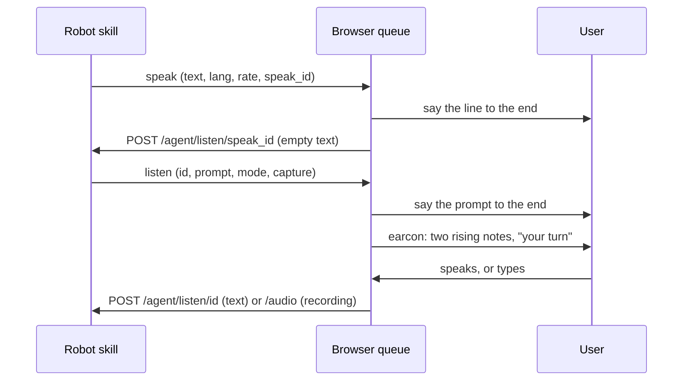

---
sources:
  - frontend/lib/hriVoice.ts
  - frontend/lib/useVoiceOutput.ts
  - frontend/lib/useHandsFree.ts
  - frontend/lib/chatMic.ts
  - frontend/lib/speechGlobals.d.ts
  - frontend/lib/recordVoice.ts
  - frontend/app/page.tsx
  - frontend/lib/api.ts
verified_at: 4a810a3717ab
---

# Voice: the browser as the robot's mouth and ears

!!! abstract "In this page"
    A robot skill can talk to the user through the dashboard. The robot sends `speak` and `listen` events over the agent WebSocket; the browser says the line aloud and captures one spoken answer. This page describes the ordered queue that keeps the two apart, the echo filter, the voice detection that decides when a phrase ended, and the hands-free microphone of the chat. The logic of `chatMic.ts` was run offline. The browser code (`hriVoice.ts`, `useVoiceOutput.ts`, `useHandsFree.ts`) was only read: it needs speech APIs and was not run.

## What the reader gets

You learn who speaks, who listens, and in which order, and why the microphone never opens while the robot talks. You also learn what the dashboard posts back and what happens when a part is missing (no microphone, plain `http`, a speech server that fails).

| | |
|---|---|
| **Speak** | the browser's speech synthesis, through `speakAndWait` (skill lines) or `useVoiceOutput` (narration of milestones) |
| **Listen** | `recognizeOnce` (the browser's recogniser) or `recordPhrase` (record audio for the backend's speech-to-text server) |
| **Order** | one queue in `page.tsx`: `enqueueHri` |
| **Echo filter** | `createEchoGuard` in `chatMic.ts` |
| **Tests** | `scripts/test_lib.mjs` lines 158-207 and 250-258 (`chatMic`). `hriVoice.ts`, `useVoiceOutput.ts` and `useHandsFree.ts` have no unit tests |

## Two voices, on purpose

| | milestone narration | skill speech |
|---|---|---|
| source | the `say` field of any event (for example "moving to the kitchen") | the `speak` event of a skill |
| code | `useVoiceOutput` | `speakAndWait` in `hriVoice.ts` |
| gated by the voice toggle | yes | the line is spoken only if voice output is on; it is always shown as a chat bubble |
| a newer line | cancels the one that is playing | never cancels; plays to the end |
| in the queue | no, it speaks outside | yes |

The reason is written in `hriVoice.ts` lines 4-11: a skill line is the skill's real output, so it must play to the end and finish before the microphone opens. A narration line may be dropped for a newer one, because queueing them would make the voice drift behind the robot with every step.

Two rules join the voices (`page.tsx` lines 343-365). A narration line is spoken at once only when no queued skill job exists (`hriBusyRef` is 0). Otherwise it is put at the end of the queue, so it never plays while the microphone is open. A "Still working" nudge (`stillWorkingPhrase`, English and Korean) repeats every 15 s while a step is quiet, and it is stopped as soon as a `speak`, `listen`, `alarm` or `quiet` event arrives.

`useVoiceOutput` picks an installed voice for the language and reports `missingVoice` when none matches. The language codes `en` and `ko` map to `en-US` and `ko-KR`; other codes are used as they are.

## The ordered queue

Skill jobs run strictly one after another (`page.tsx` lines 221-229):

```ts
  const enqueueHri = (job: () => Promise<void>) => {
    const ep = hriEpochRef.current
    hriBusyRef.current++
    hriChainRef.current = hriChainRef.current.then(() => ep === hriEpochRef.current ? job() : undefined).catch(() => {}).finally(() => {
      if (ep !== hriEpochRef.current) return          // a Reset / new run zeroed the counter
      hriBusyRef.current--
      speechUntilRef.current = Math.max(speechUntilRef.current, Date.now())   // spoken to the end just now
    })
  }
```

!!! code "Where in the code"
    [`frontend/app/page.tsx` lines 221-229](https://github.com/mtbui2010/robotapp/blob/4a810a3717ab/frontend/app/page.tsx#L221-L229).

The queue is a chain of promises. Each job waits for the one before. A new run and a Reset start a new epoch (`newHriEpoch`, line 167): jobs of an older epoch that have not started are dropped and cannot hold the queue. A failing job is swallowed, so it cannot block the next one.

The jobs that go in:

| event field | job |
|---|---|
| `speak` | say the line, then, if the event has `speak_id`, `POST /agent/listen/{speak_id}` with an empty text so that the skill knows the line was spoken |
| `alarm` | play a siren, `cycles` times a high and a low note of 0.35 s each (`playAlarm`), after the line before it |
| `listen` | the sequence below |
| a narration line when the queue is busy | say the line |



## A `listen` step by step

The `listen` event has these fields (`types.ts` lines 150-155):

| field | meaning | default in the dashboard |
|---|---|---|
| `id` | name of this question | none |
| `lang` | language of the answer | the run's language |
| `max_sec` | longest time to listen | 8 s |
| `prompt` | the question to say first | none |
| `mode` | `voice` or `text` | `voice` |
| `capture` | `whisper`: record and post audio; `browser`: the browser's recogniser | browser |
| `silence_sec` | silence that ends a phrase (whisper capture) | 1.5 s |
| `earcon` | volume of the "your turn" and "got it" tones, 0 is off | 0 |
| `rate` | how fast to say the prompt | the language's speech rate |

The job (`page.tsx` lines 409-481):

1. Show the prompt as a robot bubble, and mark the question as pending for the chat.
2. Say the prompt to the end, if voice output is on.
3. Decide who answers (`answerBy` in `chatMic.ts`). If the backend asked for text (`mode` is `text`), or the run was started from the chat with the chat's microphone off, the answer is typed. The job only waits; the chat's Send answers directly. In every other case the voice answers.
4. Play the earcon "your turn" (two rising notes of 600 and 900 Hz), then wait 100 ms. The tone is played before the microphone opens, so it is never recorded.
5. Capture one phrase, by `capture`:
    - `whisper`: `recordPhrase`, then `POST /agent/listen/{id}/audio`. The robot transcribes it.
    - otherwise: `recognizeOnce`, then `POST /agent/listen/{id}` with `{text, error, note}`.
6. A click or a typed answer that arrives meanwhile wins. The capture is ended and nothing is posted.

Real output of `answerBy` (`chatMic.ts` lines 25-26), run offline:

| situation | result |
|---|---|
| a chat run, microphone off, backend mode `voice` | `typing` |
| a chat run, microphone on, backend mode `voice` | `voice` |
| a Structured run (not from the chat), backend mode `voice` | `voice` |

## Echo filter

When the speakers are near the microphone, the microphone hears the robot. `createEchoGuard` remembers each line the robot said, with its time, for `ECHO_WINDOW_MS`. A transcript is dropped as an echo when it matches one of them.

| constant | value | meaning |
|---|---|---|
| `GUARD_MS` | 1000 ms | quiet time after the robot stops speaking before the hands-free microphone may open |
| `ECHO_WINDOW_MS` | 10000 ms | how long a spoken line is remembered |
| `ECHO_SIMILARITY` | 0.6 | similarity at which a transcript counts as an echo |

The match (`chatMic.ts` lines 79-98):

```ts
export function createEchoGuard(windowMs = ECHO_WINDOW_MS, threshold = ECHO_SIMILARITY): EchoGuard {
  let said: Array<{ text: string; at: number }> = []
  return {
    note(text, now) {
      if (!norm(text)) return
      said = said.filter(s => now - s.at <= windowMs).concat({ text, at: now })
    },
    isEcho(transcript, now) {
      const t = norm(transcript)
      if (!t) return false
      return said.some(s => {
        if (now - s.at > windowMs) return false
        const r = norm(s.text)
        // a piece of the robot's sentence ("where is", "the apple") is also an echo
        if (t.length >= 6 && (r.includes(t) || t.includes(r))) return true
        return similarity(s.text, transcript) >= threshold
      })
    },
  }
}
```

!!! code "Where in the code"
    [`frontend/lib/chatMic.ts` lines 79-98](https://github.com/mtbui2010/robotapp/blob/4a810a3717ab/frontend/lib/chatMic.ts#L79-L98).

`similarity` is the Dice coefficient on pairs of letters, after lowercasing and removing spaces and punctuation. It needs no word spaces, so it works for Korean as well as English.

Real output, run offline on 2026-11-19. The robot said "I will move to kitchen counter" at time 1000 ms; the transcripts are tested at 3000 ms unless noted:

| transcript | echo? |
|---|---|
| "i will move to kitchen counter" | `true` |
| "put the cup on the table" | `false` |
| "kitchen counter" (a piece of the sentence, 14 letters) | `true` |
| "i will move to kitchen counter" at 12000 ms (outside the window) | `false` |

`similarity('Where is the apple?', 'where is the app')` is 0.923.

The dashboard notes every robot line in the guard when it adds the bubble (`addQaLine`, `page.tsx` lines 178-182) and also assumes the line is being spoken for `400 + 90 x characters` ms, because the browser does not tell when a line ends in the robot's own speaker. A spoken answer to a `listen` that matches is cleared before it is posted (`page.tsx` lines 471-474).

## Hands-free microphone

The microphone toggle of the chat listens for a new command. `useHandsFree` runs a loop of one-shot recognitions, never a continuous recogniser. Each round asks `micVerdict` (`chatMic.ts` lines 40-48); the dashboard listens only when all of this is true:

| condition | verdict when it fails | retry after |
|---|---|---|
| hands-free is on | `off` | 500 ms |
| no `listen` is pending | `waiting` | 250 ms |
| no run is active | `running` | 250 ms |
| the robot is not speaking and has nothing queued | `speaking` | 250 ms |
| at least `GUARD_MS` since speech was last seen | `guard` | the time left |

Real output (hands-free on, speech last seen at 5000 ms):

```text
at 5400 ms               {"listen":false,"reason":"guard","retryMs":600}
at 6200 ms               {"listen":true}
at 6200 ms, a listen is pending   {"listen":false,"reason":"waiting","retryMs":250}
at 6200 ms, a run is active       {"listen":false,"reason":"running","retryMs":250}
```

While a recognition is open, a timer checks the verdict every 150 ms and aborts the recognition the moment it turns false. A transcript is accepted by `acceptTranscript` only if it is not empty, the state did not change while it was recognised, and it is not an echo. An accepted transcript goes to the chat as if it were typed. The loop stops with an error text if the recogniser reports a real error (not "no speech", not "aborted"): the toggle turns off and the card shows "mic off: ...".

One microphone owner at a time: the hands-free loop while idle, the answer capture of the run while a question is pending. This is half duplex.

## Voice detection when recording

`recordPhrase(maxSec, silenceSec)` (`hriVoice.ts` lines 307-378) decides by the microphone level, not by a model:

| step | detail |
|---|---|
| level | RMS of the signal, read every 50 ms |
| noise floor | the mean level of the first 0.3 s |
| speech threshold | `max(0.015, 3 x floor)`; a level above it is speech |
| end | `silenceSec` after the last speech, or at `maxSec` |
| file type | the first supported of `audio/webm;codecs=opus`, `audio/ogg;codecs=opus`, `audio/webm` |
| nobody spoke | the result has no blob, only a note such as "recorded 8.0 s, no speech (peak level ... < ...)" |

When nobody spoke, no audio is posted: the dashboard posts an empty body with the note. The code comment gives the reason: the speech server tends to invent words for silence. What the backend does with the empty body was not checked, because the backend is not in this repository.

Hearing nothing is not an error for the browser recogniser either: `recognizeOnce` returns empty text with a note that says whether the microphone opened, whether sound and speech were heard, and the end code. It uses interim results, because Chrome sometimes ends a long Korean phrase without a final result; the last interim text is then used.

## Failure modes met in the code

| symptom | cause | what the code does |
|---|---|---|
| the speech server invents words for silence | a recording that holds no speech | no audio is sent when the level never rose above the threshold (`hriVoice.ts` lines 297-301, 373-376) |
| the permission prompt never shows | the microphone opens seconds after the click, when Chrome no longer counts it as a user gesture | `primeMic` asks inside the click: when the chat's microphone is turned on, and at the start of a run that will listen (`page.tsx` lines 601-615 and 801-807) |
| "this page is on http" | only `https` and `localhost` may use the microphone | `primeMic` returns `insecure-context`; the chat says to open the page over `https` or `localhost` |
| a speech server error (HTTP 5xx, for example out of GPU memory) | the backend failed to transcribe | the chat shows "speech recognition failed", and the question stays open for a typed answer (`page.tsx` lines 460-466). |
| the answer arrives after the question timed out | HTTP 404 on the audio post | a note: the robot had already stopped listening, say it again when asked |
| the mic of a first run is blocked | permission denied | a robot bubble says the robot will ask for typed input instead |
| speech never ends in Chrome | Chrome sometimes does not fire the `end` event of an utterance | the wait is capped at `min(30 s, 2 s + 150 ms per character)`, longer for slow speech (`hriVoice.ts` lines 130-134) |
| the recording of the screen misses the robot's voice | the browser's own voice cannot be recorded on every machine | while a screen recording runs, the same line is also fetched from the backend as audio and played into the recording; the user still hears the browser voice (`recordVoice.ts`) |

## Endpoints

| call | when |
|---|---|
| `POST /agent/listen/{id}` with `{text, error, note}` | a typed, recognised or empty answer; also the "line spoken" signal for `speak_id` (`api.ts` lines 441-447) |
| `POST /agent/listen/{id}/audio` with the recording as the body | a `whisper` answer; the note goes in the query string (`api.ts` lines 420-439). It never throws: a network error or an HTTP error is returned as an `error` text, a 404 as `gone` |

See [endpoints](../reference/endpoints.md) and [agent events](../reference/agent-events.md).

## Tests

`scripts/test_lib.mjs` tests `chatMic` (lines 161-207: who may listen, the guard time, the chat state, the echo guard, a transcript dropped when the state changed) and `answerBy` (lines 250-258). The audio post is tested with a fake server (lines 390-413). The microphone, speech synthesis and the recogniser are browser APIs and are not tested. All of this was checked in code and in the unit tests; it was not run in a browser or against a robot.

## Related

- [Chat](../modules/chat.md): the card with the microphone toggle.
- [Recorder](../modules/recorder.md): screen recording that can include the robot's voice.
