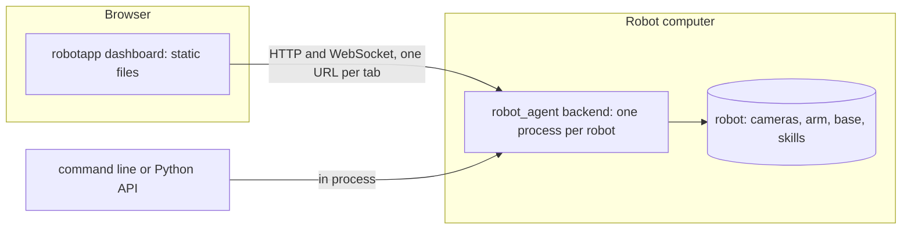

# Where robotapp sits

robotapp is the browser way to drive a robot that runs the `robot_agent` backend. This page shows where it sits in that system, what the dashboard does, and what it leaves to the backend.

!!! abstract "In this page"
    - One diagram: browser, backend, robot, and the other two ways to drive the robot.
    - A table of what the dashboard does and does not do.
    - Where to read about the rest of the stack.

## Where it sits

A robot built on the `robot_agent` framework runs one backend process. That backend holds the skills, the planners and the connections to the devices. You can drive it three ways: from this dashboard (the UI mode), from a command line, or from a Python API. The last two belong to each robot package and do not need the dashboard. See [UI mode](reference/glossary.md#ui-mode) and [robot_agent](reference/glossary.md#robot-agent).

The dashboard is plain files. It has no server of its own and talks to one backend URL per browser tab. If the page is closed, the robot and its other clients keep running. More: [1. Where robotapp sits](learn/01-ui-mode.md).

## What the dashboard does and does not do

| It does | It does not |
|---|---|
| Send a task in words (chat) or a plan written as `skill::params` lines, and show every step as the events arrive | Plan or move the robot itself: planners and skills run in the backend |
| Show camera and depth frames, and the map with the robot on it | Hold robot data: the backend serves it; only two JSON files are bundled (see [Backend coupling](reference/backend-coupling.md)) |
| Send the robot to a spot or a saved place from a map click | Work without a backend: pages that read it show errors until it answers |
| Stop a run at any time, with a button that stays live | Make the backend safe for two clients: a second client can cancel your run, and the warning is shown only in some places |
| Speak the robot's lines and record answers in the browser, when a skill asks | Check the backend's replies against generated types: the types are written by hand |
| Record teleoperation episodes, and list, clean and export them | Train a model on the episodes (see [VLA](reference/glossary.md#vla)) |
| List, edit and reload skills, configs and connections | Describe what the robot does inside: that is on the framework site |

The panels are listed on the [home page](index.md). The layers and one run, step by step: [How it works](how-it-works/index.md).

## Read about the rest of the stack

- The framework, with the backend, the planners and the robot packages: the [robot_agent site](https://mtbui2010.github.io/robot_agent/).
- The repo of this dashboard also has an older, separate site for the whole stack. It is not part of this documentation and is not linked here.
- Backend behaviour on this site is only what the dashboard's code shows: what it sends, what it reads, and what it does with an error.

## Where to go next

- Start the checks: [Getting started](getting-started.md).
- The design ideas: [Key ideas](how-it-works/key-ideas.md).
- What was checked and what was not: [Proving it works](how-it-works/correctness.md).
